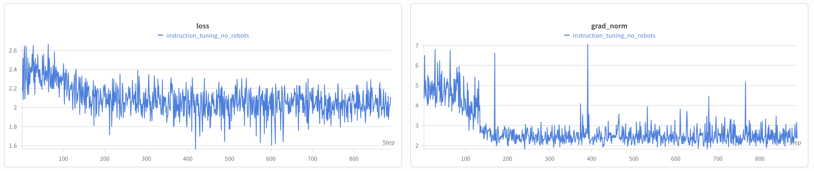
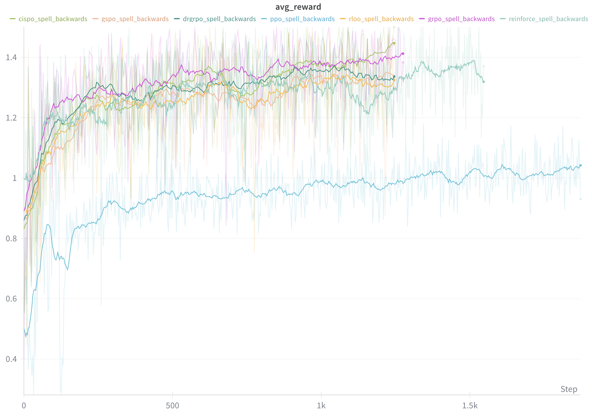
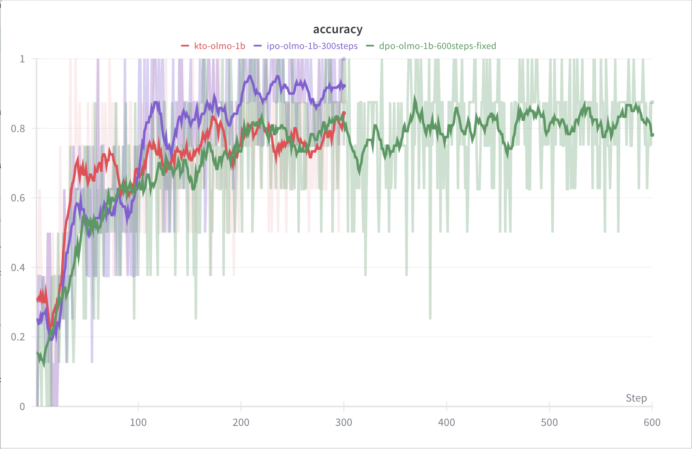
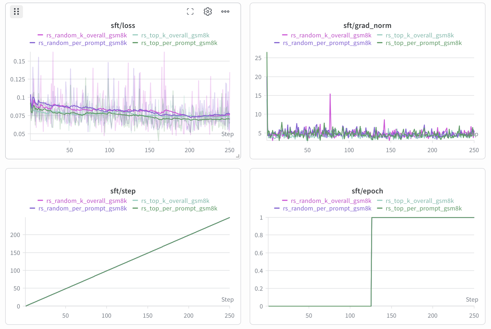
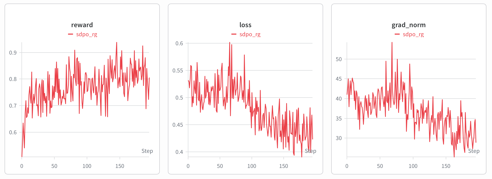

# RLHF Book — 代码示例

Nathan Lambert《[RLHF Book](https://rlhfbook.com)》的配套教学代码。

加入 [Discord 社区](https://discord.gg/yz5AwK4gBR)，提出问题、分享运行结果、交流对这些示例的笔记。

我主要在 [DGX Spark](https://www.nvidia.com/en-us/products/workstations/dgx-spark/) 上跑实验。关于环境搭建建议，请参阅我的[dgx-spark-setup](https://github.com/natolambert/dgx-spark-setup)指南。

*注：目前有一个[开放的 PR](https://github.com/natolambert/rlhf-book/pull/328) 正在探索在此仓库中添加"极速运行"（speedrun）功能——如果你有兴趣推动这个方向或希望它合入主分支，欢迎在此评论。*

## 读者实验路径

以下所有命令都默认你已执行：

```bash
cd code/
uv sync
```

建议先跑一个短时实验，确认学习信号已经出现，然后每次只改动一个变量。
如果你不需要 W&B 日志记录，可以设置 `WANDB_MODE=disabled`，或在对应模块提供无 W&B 选项时使用那个选项。
如果你在用编程助手（coding assistant）运行这些实验，请把耗时较长的训练/评估命令放到后台运行，并在后台监控它们；在前台运行可能会因为超时而在产生有用指标之前就结束。

| 章节 | 起始实验 | 命令 | 需关注的内容 |
|------|----------|------|-------------|
| 第 4 章：指令微调 | 在无 Robots 数据集上对 OLMo-2-1B 基础模型做 SFT | `uv run python -m instruction_tuning.train --config instruction_tuning/configs/sft_olmo2_1b.yaml` | 损失曲线与循环内样本面板——基础模型在 step 0 时语无伦次，经历几百个 step 后便能作答并停止 |
| 第 5 章：奖励模型 | 在 UltraFeedback 上训练 Bradley-Terry 奖励模型 | `uv run python -m reward_models.train_preference_rm --config reward_models/configs/preference_rm.yaml` | 选中/拒绝的奖励边际值、训练损失、演示评分 |
| 第 5 章：奖励模型 | 在 GSM8K 上训练 ORM（结果奖励模型） | `uv run python -m reward_models.train_orm --config reward_models/configs/orm.yaml` | 正确最终答案的得分是否高于扰动后答案的得分 |
| 第 6 章：策略梯度 | 在 `spell_backward` 任务上运行 GRPO | `uv run python -m policy_gradients.train --config policy_gradients/configs/grpo.yaml` | `avg_correctness`、`avg_format`、`avg_binary`，以及各组是否包含对比样本 |
| 第 8 章：直接对齐 | 在 UltraFeedback 上运行 DPO | `uv run python -m direct_alignment.train --loss dpo --max_samples 1000` | `accuracy`、`margins`、`chosen_rewards`、`rejected_rewards`、样本生成结果 |
| 第 9 章：拒绝采样 | GSM8K 上对比奖励选择与随机控制 | `uv run python -m rejection_sampling.train --config rejection_sampling/configs/top_per_prompt.yaml` | 最终精确匹配准确率对比匹配的随机基线 |
| 第 12 章：合成数据 | 在字符串反转上运行 SDPO / 同策略自蒸馏 | `uv run python -m distillation.train --config distillation/configs/sdpo.yaml` | `reward`、`loss`、`skipped`，以及循环内完成的样本面板 |

推荐的初步变量扫描（sweep）：

- **指令微调**：保持 `sft_olmo2_1b.yaml` 不变，分别调整 `lr`（5e-6 对比 1e-5）、`num_epochs` 或 `max_samples`，观察基础模型到助手模型的转变出现得多快。
- **策略梯度**：复制 `policy_gradients/configs/grpo.yaml`，分别调整 `num_rollouts`、`temperature`、`format_weight` 和 `data.size`。
- **直接对齐**：固定数据集不变，对比 `dpo.yaml`、`ipo.yaml` 和 `dpo_norm.yaml`；阅读 IPO 时应关注边际值和准确率，而非原始损失规模。
- **奖励模型**：复制对应的 YAML 配置文件，在改变模型架构之前先调整 `samples`、`lr` 和 `model_id`。
- **拒绝采样**：保持生成/评分设置一致，同时对比 `top_*` 配置与其对应的 `random_*` 控制配置。
- **蒸馏**：复制 `distillation/configs/sdpo.yaml`，调整 `num_rollouts`、`kl_top_k` 和 `prompts_per_step`，观察自蒸馏循环收敛过程中 `skipped` 和 `reward` 是如何响应的。

书中原章节在第 4、5、6、8、9、12 章末尾均附有建议练习。

## 致谢

本代码构建在以下社区贡献者的出色工作之上：

### 策略梯度

**原始仓库**：[zafstojano/policy-gradients](https://github.com/zafstojano/policy-gradients)
**作者**：Zafir Stojanovski ([@zafstojano](https://github.com/zafstojano))
**许可证**：Apache 2.0

一套简洁的策略梯度方法教学实现。使用与本书第 6 章（策略梯度方法）中数学推导一致的公式，实现了 REINFORCE、RLOO、PPO、GRPO、Dr. GRPO、GSPO、CISPO、SAPO、DAPO 和 MaxRL。其他补充信息：

- SAPO 算法基于 [@casinca](https://github.com/casinca) 的[casinca/llm-quest](https://github.com/casinca/llm-quest)（Apache 2.0 许可）

### 奖励模型（ORM/PRM）

**原始仓库**：[myhott163com/RLHF_ORM_PRM](https://github.com/myhott163com/RLHF_ORM_PRM)
**作者**：[@myhott163com](https://github.com/myhott163com)
**许可证**：MIT

结果奖励模型（ORM）与过程奖励模型（PRM）的最小实现，演示了第 5 章（奖励模型）中的核心概念。

---

## 安装

**需要 Python 3.12+** 和最新版 [uv](https://docs.astral.sh/uv/getting-started/installation/)（执行 `uv self update` 更新）。uv 兼容性排查请参考 [#366](https://github.com/natolambert/rlhf-book/issues/366)。

**Ubuntu / Debian 用户**：先安装构建工具（编译原生依赖时需要）：

```bash
sudo apt install -y build-essential python3-dev
```

然后安装依赖：

```bash
cd code/
uv sync
```

默认情况下 [Flash Attention](https://github.com/Dao-AILab/flash-attention) 是关闭的，以便兼容更广泛的硬件；如果你追求加速，建议安装它：

```bash
uv sync --extra flash
```

> **注意：**如果预编译 wheel 与你 CUDA 版本匹配，安装只需数秒。否则（例如 CUDA 13），会回退到需要 CUDA toolkit 的源码编译，耗时可达数分钟。如果编译失败，直接跳过，使用基础安装即可——代码会自动回退到 PyTorch SDPA，所有示例无需 Flash Attention 也能正常运行。

### 平台说明

- **标准 x86_64 系统**：在 Ampere / Ada 架构 GPU（如 RTX 3090、4090）上，Flash Attention 可带来约 10–20% 的训练加速。CUDA 12.x 提供了预编译 wheel（[版本发布页](https://github.com/Dao-AILab/flash-attention/releases/latest)）；截至 2026 年 4 月 11 日，CUDA 13 需要源码编译（往往比较折腾），不过项目并不依赖 CUDA 13，所以无需为此烦恼。
- **DGX Spark / aarch64**：ARM64 / Blackwell 上无法使用 Flash Attention。代码会自动回退到 PyTorch SDPA，而借助原生 cuDNN 优化，SDPA 在这些系统上反而更快。

## 指令微调（SFT）

在指令数据集上对基础语言模型做监督微调，使其能够回答问题并适时停止，而不是将 prompt 当作纯文本继续生成。完整的操作步骤请参见 `instruction_tuning/README.md`。

```bash
# SFT OLMo-2-1B base on No Robots (Chapter 4)
uv run python -m instruction_tuning.train \
    --config instruction_tuning/configs/sft_olmo2_1b.yaml
```

### 训练结果



最具信息量的信号来自循环内样本面板：约 step 100 时模型还在 `
在 `<|endoftext|>` 之后语无伦次并自行编造后续问题；到
step ~650 时已能生成一个完整且已终止的助手回复。

### 示例运行

| 模型 | 数据集 | 示例运行 |
|------|--------|----------|
| OLMo-2-0425-1B (base) | HuggingFaceH4/no_robots | [wandb](https://wandb.ai/rlhf-book/core/runs/nybj8sdx) |

## 策略梯度训练

在程序化推理任务上训练各类策略梯度算法：

```bash
# GRPO (Chapter 6)
uv run python -m policy_gradients.train --config policy_gradients/configs/grpo.yaml

# PPO with value function
uv run python -m policy_gradients.train --config policy_gradients/configs/ppo.yaml

# REINFORCE baseline
uv run python -m policy_gradients.train --config policy_gradients/configs/reinforce.yaml

# RLOO (Leave-One-Out)
uv run python -m policy_gradients.train --config policy_gradients/configs/rloo.yaml
```

### 训练结果



### 可用算法

| 算法 | 配置文件 | 说明 | 示例运行 |
|------|----------|------|----------|
| REINFORCE | `reinforce.yaml` | Williams (1992) — 原始策略梯度 | [wandb](https://wandb.ai/rlhf-book/core/runs/0uqbq4oz) |
| RLOO | `rloo.yaml` | REINFORCE Leave-One-Out (Ahmadian 等, 2024) | [wandb](https://wandb.ai/rlhf-book/core/runs/07xeasn8) |
| PPO | `ppo.yaml` | 近端策略优化 (Proximal Policy Optimization, Schulman 等, 2017) | [wandb](https://wandb.ai/rlhf-book/core/runs/ku3r3g9j) |
| GRPO | `grpo.yaml` | 分组相对策略优化 (Group Relative Policy Optimization, Shao 等, 2024) | [wandb](https://wandb.ai/rlhf-book/core/runs/vjp7lgdi) |
| Dr. GRPO | `drgrpo.yaml` | Dr. GRPO (Liu 等, 2025) | [wandb](https://wandb.ai/rlhf-book/core/runs/a1swuynq) |
| GSPO | `gspo.yaml` | 分组序列策略优化 (Group-Sequence Policy Optimization, Zheng 等, 2025) | [wandb](https://wandb.ai/rlhf-book/core/runs/10sxytli) |
| CISPO | `cispo.yaml` | 截断重要性采样策略优化 (Clipped Importance Sampling PO, MiniMax, 2025) | [wandb](https://wandb.ai/rlhf-book/core/runs/6dg0m06n) |
| SAPO | `sapo.yaml` | 软自适应策略优化 (Soft Adaptive Policy Optimization, Qwen 团队, 2025) | [wandb](https://wandb.ai/rlhf-book/core/runs/79608nwk) |
| DAPO | `dapo.yaml` | 解耦截断与动态采样策略优化 (Decoupled Clip and Dynamic sAmpling PO, ByteDance, 2025) | [wandb](https://wandb.ai/rlhf-book/core/runs/db1pipip) |
| MaxRL | `maxrl.yaml` | 最大似然强化学习 (Maximum Likelihood Reinforcement Learning, Tajwar 等, 2026) | [wandb](https://wandb.ai/rlhf-book/core/runs/fdowf1se) |

## 奖励模型训练

> **注意：实验性** — 奖励模型训练需要针对超参数、数据集和模型做细致调优才能得到更清晰的训练曲线。欢迎贡献！

在不同数据集上训练奖励模型：

```bash
# Standard Preference RM (Chapter 5) - Bradley-Terry on UltraFeedback
uv run python -m reward_models.train_preference_rm --config reward_models/configs/preference_rm.yaml

# Outcome Reward Model (Chapter 5) - trains on GSM8K
uv run python -m reward_models.train_orm --config reward_models/configs/orm.yaml

# Process Reward Model (Chapter 5) - trains on PRM800K
uv run python -m reward_models.train_prm --config reward_models/configs/prm.yaml
```

### 偏好奖励模型（Bradley-Terry）

基于偏好的标准奖励模型，使用 Bradley-Terry 损失函数
`-log(sigmoid(r_chosen - r_rejected))`。这是 InstructGPT、Llama 2
以及大多数生产环境 RLHF 系统采用的方法。在 UltraFeedback 偏好数据上训练。

### ORM（结果奖励模型）

对解答正确性做二分类。在 GSM8K 上对 Qwen3-0.6B 做微调，学习区分正确和错误的数学解答。

### PRM（过程奖励模型）

对推理质量做步骤级分类。在 PRM800K 上对 Qwen3-0.6B 做微调，学习将单个推理步骤评级为 {-1, 0, 1}（差、中性、好）。

### 示例运行

| 模型 | 说明 | 示例运行 |
|------|------|----------|
| 偏好 RM | 在 UltraFeedback 上训练 Bradley-Terry | [wandb](https://wandb.ai/rlhf-book/core/runs/1g3y9bcc) |
| ORM | 在 GSM8K 上训练结果奖励模型 | [wandb](https://wandb.ai/rlhf-book/core/runs/3gkoqb7f) |
| PRM | 在 PRM800K 上训练过程奖励模型 | [wandb](https://wandb.ai/rlhf-book/core/runs/iv4d966d) |

## 直接对齐训练

在偏好数据上训练直接对齐算法（DPO 及其变体）：

```bash
# DPO (Chapter 8)
uv run python -m direct_alignment.train --config direct_alignment/configs/dpo.yaml

# IPO - more robust to noisy labels
uv run python -m direct_alignment.train --config direct_alignment/configs/ipo.yaml

# SimPO - no reference model needed
uv run python -m direct_alignment.train --config direct_alignment/configs/simpo.yaml

# Quick test run (1k samples)
uv run python -m direct_alignment.train --loss dpo --max_samples 1000
```

### 可用算法

| 算法 | 配置文件 | 说明 |
|------|----------|------|
| DPO | `dpo.yaml` | 直接偏好优化 (Direct Preference Optimization, Rafailov 等, 2023) |
| DPO-Norm | `dpo_norm.yaml` | 使用平均回复对数概率的 DPO |
| cDPO | N/A（使用 `--loss cdpo`）| 带标签平滑的保守 DPO |
| IPO | `ipo.yaml` | 恒等偏好优化 (Identity Preference Optimization, Azar 等, 2023) |
| SimPO | `simpo.yaml` | 简单策略优化（长度归一化，无需参考模型）(Meng 等, 2024) |
| ORPO | `orpo.yaml` | 优势比策略优化（结合 SFT + 偏好）(Hong 等, 2024) |
| KTO | `kto.yaml` | 卡尼曼-特沃斯基优化 (Kahneman-Tversky Optimization, Ethayarajh 等, 2024) |
| APO-Zero | `apo_zero.yaml` | 锚定策略优化，选中上升 / 拒绝下降 (D'Oosterlinck 等, 2024) |
| APO-Down | `apo_down.yaml` | 锚定策略优化，两者均下降且拒绝下降更多 (D'Oosterlinck 等, 2024) |

### 训练结果



数学推导详见 RLHF Book 第 8 章。

## 拒绝采样

复现第 9 章中的拒绝采样流水线：为每个 prompt 生成多个完成，用奖励模型打分，选出一个子集，然后在这些选中的样本对上做 SFT。

```bash
# Preprocess once (generate + score rollouts)
uv run python -m rejection_sampling.preprocess \
    --config rejection_sampling/configs/top_per_prompt.yaml

# Train each selection config on the cached rollouts
uv run python -m rejection_sampling.train \
    --config rejection_sampling/configs/top_per_prompt.yaml
uv run python -m rejection_sampling.train \
    --config rejection_sampling/configs/random_per_prompt.yaml
uv run python -m rejection_sampling.train \
    --config rejection_sampling/configs/top_k_overall.yaml
uv run python -m rejection_sampling.train \
    --config rejection_sampling/configs/random_k_overall.yaml
```

### 训练结果



### 示例运行

| 策略 | 说明 | 示例运行 |
|------|------|----------|
| `top_per_prompt` | 每个 prompt 选 Top-N 完成 | [wandb](https://wandb.ai/rlhf-book/core/runs/ohm3xnga) |
| `random_per_prompt` | 逐 prompt 随机对照 | [wandb](https://wandb.ai/rlhf-book/core/runs/y3pbcla7) |
| `top_k_overall` | 在全池中选 Top-K 完成 | [wandb](https://wandb.ai/rlhf-book/core/runs/w75hklzs) |
| `random_k_overall` | 全池随机对照 | [wandb](https://wandb.ai/rlhf-book/core/runs/egeyr1q3) |

在 1k 训练 / 200 测试的 GSM8K 参考切片上，`top_k_overall` 优于其配对的随机基线，而 `top_per_prompt` 和 `random_per_prompt` 基本持平。

## 同策略蒸馏

使用 SDPO（自蒸馏策略优化，Self-Distillation Policy Optimization）在推理任务上做同策略蒸馏。模型本身即充当教师：它在 [Reasoning Gym](https://github.com/open-thought/reasoning-gym) 任务（默认 `spell_backward`，一个字符串反转问题）上采样 rollout，然后由同一模型的一个"演示条件化副本" — 给定同一组中正确的同源 rollout — 提供质量更高的下一个 token 目标，再通过 top-K KL 蒸馏回学生模型。对 rollout 组中没有正确样本的 prompt 会被跳过并替换掉，因此每次更新都有完整批次的演示供学习。
完整的操作步骤请参见 `distillation/README.md`。

```bash
# SDPO on the Reasoning Gym string-reversal task
uv run python -m distillation.train --config distillation/configs/sdpo.yaml
```

### 训练结果



图中展示的本地运行在单张 24 GB 消费级 GPU 上用不到 20 小时完成 `Qwen/Qwen3-1.7B` 在 `spell_backward` 上的训练：`reward` 从 ~0.55 升至 ~0.8，同时蒸馏 `loss` 和 `grad_norm` 呈下降趋势。

### 示例运行

| 算法 | 说明 | 示例运行 |
|------|------|----------|
| SDPO | Reasoning Gym 上的自蒸馏策略优化（[Hübotter 等, 2026](https://arxiv.org/abs/2601.20802)）| _待维护者运行_ |

## 配置

### Weights & Biases 日志记录

训练运行可以记录到 Weights & Biases。通过环境变量进行配置：

```bash
# Required: Your wandb API key
export WANDB_API_KEY="your-key"

# Optional: Override project name (default: from config file)
export WANDB_PROJECT="rlhf-book"

# Official maintainers publishing reference runs can target the team project:
# export WANDB_ENTITY="rlhf-book"
# export WANDB_PROJECT="core"

# Optional: Override run name
export WANDB_RUN_NAME="grpo_experiment_1"
```

本仓库的官方运行记录发布至：**[wandb.ai/rlhf-book/core](https://wandb.ai/rlhf-book/core)**

如需公开参考链接，请在 W&B 中将项目可见性设为 **Public**，这样无需登录即可查看训练曲线、配置和指标。

如需完全禁用 wandb 日志记录，可在配置中设置 `wandb_project: null` 或：
```bash
export WANDB_MODE="disabled"
```

### 其他环境变量

```bash
# Hugging Face access (for gated models)
export HF_TOKEN="your-token"
```

### 内存需求

| 训练任务 | 模型 | GPU 显存 |
|----------|------|----------|
| 策略梯度 | Qwen3-1.7B | ~16 GB（单卡） |
| 奖励模型 | Qwen3-0.6B | ~8–16 GB |
| 奖励模型 | Qwen3-1.7B | ~16–20 GB |

## 代码检查（Linting）

本项目使用 [Ruff](https://docs.astral.sh/ruff/) 进行代码检查和格式化。任何触及 `code/` 的 PR 都会触发 CI 检查。

```bash
# Check for lint errors
uvx ruff check .

# Check formatting
uvx ruff format --check .

# Auto-fix lint errors and formatting
uvx ruff check --fix .
uvx ruff format .
```

配置文件位于 `pyproject.toml`（行宽限制 100，目标 Python 3.12）。

## 测试

测试套件有意从轻量级的导入和 CLI 入口点的 smoke 测试开始。它不应下载数据集、加载模型或需要 GPU。

```bash
uv run --extra dev pytest
```

## 对应书籍章节

上述示例分别对应：

- **第 4 章**：指令微调（SFT）
- **第 5 章**：奖励模型（ORM、PRM、偏好 RM）
- **第 6 章**：策略梯度方法（REINFORCE、PPO、GRPO 等）
- **第 8 章**：直接对齐（DPO、IPO、SimPO、KTO 等）
- **第 9 章**：拒绝采样
- **第 12 章**：合成数据与蒸馏（SDPO）

完整内容请参见 [rlhfbook.com](https://rlhfbook.com)。

## 引用

引用本书的网页版和 arXiv 版本时，请使用 arXiv 导出的引用格式：

```bibtex
@misc{lambert2025reinforcementlearninghumanfeedback,
  title         = {Reinforcement Learning from Human Feedback},
  author        = {Nathan Lambert},
  year          = {2025},
  eprint        = {2504.12501},
  archivePrefix = {arXiv},
  primaryClass  = {cs.LG},
  url           = {https://arxiv.org/abs/2504.12501},
}
```

引用 Manning 印刷版：

```bibtex
@book{lambert2026reinforcement,
  author       = {Nathan Lambert},
  title        = {Reinforcement Learning from Human Feedback: Alignment and post-training of {LLMs}},
  year         = {2026},
  publisher    = {Manning Publications},
  isbn         = {9781633434301},
  url          = {https://www.manning.com/books/reinforcement-learning-from-human-feedback},
}
```

## 许可证

- 策略梯度代码（`policy_gradients/`）：Apache 2.0（源自 zafstojano/policy-gradients）
- 奖励模型代码（`reward_models/`）：MIT（源自 myhott163com/RLHF_ORM_PRM）
- 直接对齐代码及其他改编：MIT
