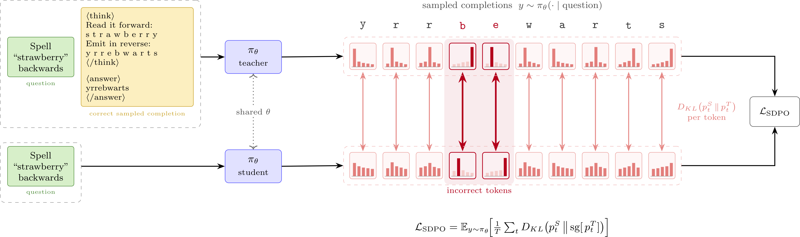
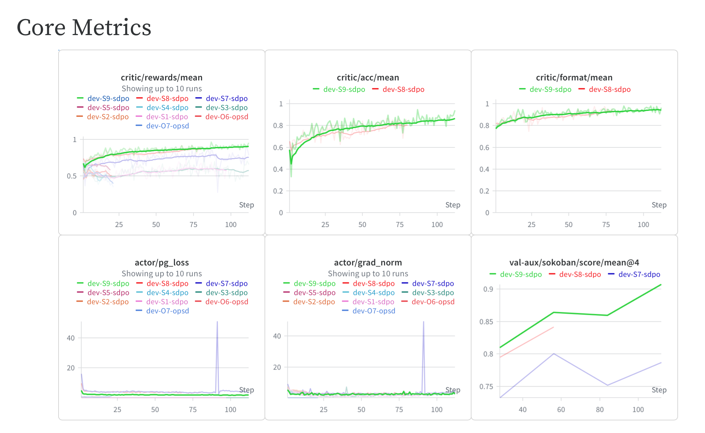

# 自蒸馏（SDPO）



本文档是 [RLHF Book](https://rlhfbook.com) 中 **SDPO — Self-Distillation Policy Optimization（自蒸馏策略优化）** 的教学实现，一种面向推理任务的同策略蒸馏方法（[Hübotter 等，2026](https://arxiv.org/abs/2601.20802)）。
安装、配置与显存要求请参阅父级 [`code/README.md`](../README.md)。

学生在 [Reasoning Gym](https://github.com/open-thought/reasoning-gym) 任务上生成完成序列（默认任务为 `spell_backward`，即字符串反转问题，与 [`policy_gradients`](../policy_gradients/README.md) 中的 GRPO 设置一致），每条完成序列均由环境验证。赋予自教师的唯一上下文信号是一条 *正确"兄弟姐妹"示范*——从同一次 rollout 组中抽取。如果该组中没有任何完成序列是正确的，则没有可蒸馏的示范，对应的 prompt 会被**跳过**并替换掉，从而确保优化器步骤仍收到完整批次。

## 算法

| 算法 | 配置文件 | 核心思想 |
|-----------|--------|----------|
| **SDPO** | `sdpo.yaml` | 自蒸馏策略优化——通过 top-K 反向 KL 散度，将一条经示范条件化的自教师蒸馏到学生模型中（[Hübotter 等，2026](https://arxiv.org/abs/2601.20802)） |

## 参考运行


上图所示的本地运行使用了 `Qwen/Qwen3-1.7B` 模型，在默认 `spell_backward` 任务上训练，耗时不到 20 小时，在一块 24 GB 消费级 GPU 上即可完成：`reward`（奖励）从 ~0.55 上升至 ~0.8，`loss`（损失）和 `grad_norm`（梯度范数）均呈下降趋势。

| 算法 | wandb | 状态 |
|-----------|-------|--------|
| **SDPO** | _等待维护者运行_ | ✅ 可训练；参考运行 ID 待公布 |

## 快速开始

```bash
cd /path/to/rlhf-book/code
uv sync

# SDPO on the Reasoning Gym string-reversal task
uv run python -m distillation.train --config distillation/configs/sdpo.yaml
```

数据集由 Reasoning Gym 根据配置中的 `data.specs` 混合配置按需生成（见 [`data.py`](data.py)）；通过编辑这些 specs 即可更换或新增任务。

## 关键配置

完整配置见 [`configs/sdpo.yaml`](configs/sdpo.yaml)。最重要的参数如下：

| 字段 | `sdpo.yaml` 值 | 含义 |
|-------|---------|---------|
| `model_name` | `Qwen/Qwen3-1.7B` | 同时用作学生模型和自教师的模型 |
| `data.specs` | `spell_backward` | Reasoning Gym 任务混合（名称 / 权重 / 逐任务配置） |
| `data.size` | `10000` | 程序化生成的问题数量 |
| `kl_top_k` | `20` | 蒸馏 KL 计算中每个位置保留的 logits 数量 |
| `success_reward_threshold` | `1.0` | rollout 获得该分数及以上即可成为示范解 |
| `num_rollouts` | `8` | 每个问题采样的 rollout 数量（兄弟姐妹示范来自该组） |
| `prompts_per_step` | `16` | 每个优化器步骤梯度累积的成功问题数 |
| `max_new_tokens` | `512` | 每次生成的最大 token 数上限 |

## 需要关注的指标

每个优化器步骤都会记录到 W&B（见 [`train.py`](train.py)）：

- **`reward`** — 被接受的 rollout 组的平均环境得分；这是学生改进情况的最主要信号。
- **`loss`** — 学生模型与自教师之间的掩码 top-K KL 散度；随着学生内化示范条件分布，该值应逐渐下降。
- **`grad_norm`** — 关注其峰值，峰值过大往往意味着训练不稳定。
- **`skipped`** — rollout 组中没有正确示范而被跳过的 prompt 数量。这些 prompt 会在优化器步骤执行前被替换。

每次优化器步骤的轮询上限为 `prompts_per_step * 100` 次尝试。如果在该预算内无法凑齐完整批次，训练将报错退出，而不是挂起。

## 更困难任务的超参数

在更困难的数据集上训练时——通常需使用 [verl](https://github.com/verl-project/verl) 的 fork 版本（这也是 [原始 SDPO 实现](https://github.com/lasgroup/SDPO) 所基于的框架）——保持稳定训练会变得非常困难。奖励曲线会走平，或者先上升后发散。以下是我们发现的通常能产生稳定运行的配置：

| 参数 | 值 | 说明 |
|-----------|-------|------|
| 每轮问题数 | `32` | 每次 rollout 预算对应的问题数 |
| 每问题 rollout 数 | `8` | 每轮 256 条完成序列 |
| Mini batch 大小 | `2` 个问题 | **最大杠杆。** 每轮 16 步优化器更新，而非 1 步 |
| 最大完成长度 | `8192` | 截断会被视为失败，会耗尽示范池 |
| 学习率 | `1e-6` | 平坦值，无调度 |
| 权重衰减 | `0.01` | 标准 AdamW 取值 |
| 优化器 | AdamW | 良好的起点 |
| 梯度裁剪范数 | `1.0` | 梯度峰值不可避免 |
| 教师 | 学生模型的 EMA，`alpha = 0.01` | 不使用固定教师 |
| 教师重要性采样裁剪 | `2.0` | 限制教师/学生比率 |
| Rollout 重要性采样 | token 级别，裁剪 `2.0` | 每轮内的离策略修正 |
| 蒸馏散度 | 反向 KL | 完成序列由学生同策略采样 |
| Top-K 蒸馏 | `20` + 尾部桶 | 剩余概率质量归入一个桶 |
| 模型 | 指令微调、无思考模式 | 遵循 [Kaur 等，2026](https://arxiv.org/abs/2607.05184) |
| 训练采样 | `temperature = 1.0` | 不使用 top-k/top-p |
| 评估采样 | 按模型卡 | 不要复用训练采样器 |

传递给教师的特权上下文对学生成功与否起着至关重要的作用：

- 当一组中有多条正确完成序列时，**随机**挑选一条。如果挑选 *最短* 的一条，训练会崩溃，因为学生会学到的是"缩短答案"而非"解决问题"。
- 过滤掉那些最终正确但输出了多个 `<answer>...</answer>` 块的完成序列——即模型陷入死循环、通过回溯才得到结果。将这些作为教师监督信号会将这种行为精确地教给模型。更好的做法是将 `</answer>` 设为停止序列，使得从第一次 rollout 开始就不可能产生多个 `<answer>` 块。
- 将其他任何环境反馈（错误消息、测试输出、部分分数）也折叠进特权上下文中。



## 社区贡献 TODO

- [ ] 探索字符串反转之外的更多 Reasoning Gym 任务领域。

## 译者新增自测题

1. 为什么 SDPO 要求从同一次 rollout 组中随机挑选正确示范，而不是选择最短的那条？
2. 如果 `kl_top_k = 0`，蒸馏过程会发生什么？
3. 在"更困难任务的超参数"表中，为什么"每轮 16 步优化器更新，而非 1 步"被标注为最大杠杆（最关键的配置）？
4. 什么是"尾部桶"（tail bucket）？在 Top-K 蒸馏中它解决什么问题？
