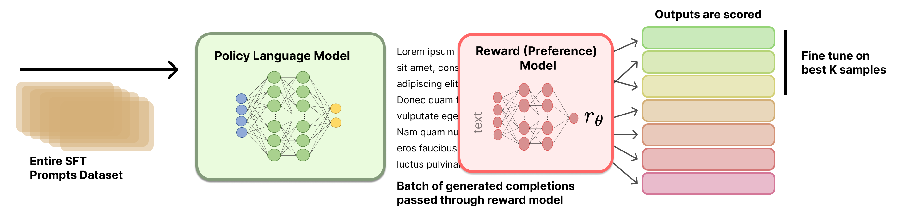

# 拒绝采样



这是配合 [RLHF Book](https://rlhfbook.com) 第 9 章的拒绝采样（Rejection Sampling，RS）教学实现。安装、配置和内存要求参见上级目录 [`code/README.md`](../README.md)。流水线步骤如下：

1. 使用 `Qwen/Qwen3-1.7B` 为 GSM8K 训练集中的每条提示（prompt）生成 `N` 条 rollout。
2. 用 `nvidia/AceMath-7B-RM` 奖励模型（reward model）对每条 rollout 打分。
3. 通过四种选择配置之一，筛选出（提示，完成）对的子集。
4. 在筛选出的子集上对 `Qwen/Qwen3-1.7B` 做监督微调（SFT）。
5. 在 GSM8K 测试集上评估精确匹配（exact-match）准确率。

这里每章选择策略都配有一个同样本量的随机选择基线。通过对比 `top_per_prompt` 与 `random_per_prompt`（以及 `top_k_overall` 与 `random_k_overall`），可以隔离出奖励模型是否真正知道哪些完成效果更好：每一对组合产生相同数量的训练对、具有相同的结构形状，唯一的区别在于选择是利用奖励还是掷硬币。

## 选择策略

| 策略 | 配置文件 | 保留内容 | 直观理解 |
|------|----------|----------|----------|
| `top_per_prompt` | `configs/top_per_prompt.yaml` | 每条提示取奖励最高的完成（共 M 对）。 | 经典 RS：每道题选一条完成，覆盖训练集中的所有提示。 |
| `random_per_prompt` | `configs/random_per_prompt.yaml` | 每条提示均匀随机抽取一条完成（共 M 对），由 `cfg.seed` 控制随机种子。 | 与 `top_per_prompt` 公平对照：同样数据量、同样提示覆盖率，但不使用奖励模型。 |
| `top_k_overall` | `configs/top_k_overall.yaml` | 从完整 M × N 矩阵中选出奖励最高的 K 条完成（K 对）。 | 让奖励模型把训练数据集中在容易得高分的提示上。可能从同一条提示中选出多条完成。 |
| `random_k_overall` | `configs/random_k_overall.yaml` | 从 M × N 的扁平池中等概率随机抽取 K 对。使用与 `top_k_overall` 相同的 `top_k` 值，由 `cfg.seed` 控制种子。 | 与 `top_k_overall` 公平对照：同样样本预算、同样扁平结构，但不使用奖励模型。 |

这四个 YAML 文件共享完全相同的生成/打分参数，因此第 1/2 阶段的缓存可以跨策略复用——唯一的区别在选择步骤。

## 参考运行

| 策略 | wandb | 状态 |
|------|-------|------|
| **top_per_prompt** | [rs_top_per_prompt_gsm8k](https://wandb.ai/rlhf-book/core/runs/ohm3xnga) | ✅ 已完成 |
| **random_per_prompt** | [rs_random_per_prompt_gsm8k](https://wandb.ai/rlhf-book/core/runs/y3pbcla7) | ✅ 已完成 |
| **top_k_overall** | [rs_top_k_overall_gsm8k](https://wandb.ai/rlhf-book/core/runs/w75hklzs) | ✅ 已完成 |
| **random_k_overall** | [rs_random_k_overall_gsm8k](https://wandb.ai/rlhf-book/core/runs/egeyr1q3) | ✅ 已完成 |


在仓库所使用的 GSM8K 1k 训练 / 200 测试切片中，`top_k_overall` 超过了其配对的随机基线，而 `top_per_prompt` 和 `random_per_prompt` 则基本持平。请将这些微小差距视为切片噪声，而非稳定的排序。

## 快速上手

```bash
cd code/

# The config logs to the rlhf-book W&B project by default. Override or disable it:
# export WANDB_PROJECT=<your-wandb-project>
# export WANDB_MODE=disabled

# (1) Sanity check: run the worked selection example from Chapter 9.
uv run python -m rejection_sampling.selection

# (2) Run preprocess alone (Stage 1 + Stage 2). Produces one JSONL cache file.
uv run python -m rejection_sampling.preprocess \
    --config rejection_sampling/configs/top_per_prompt.yaml

# (3) Train + eval for each strategy. train.py auto-runs preprocess on the
# first call and then hits the cache on subsequent calls.
uv run python -m rejection_sampling.train \
    --config rejection_sampling/configs/top_per_prompt.yaml
uv run python -m rejection_sampling.train \
    --config rejection_sampling/configs/random_per_prompt.yaml
uv run python -m rejection_sampling.train \
    --config rejection_sampling/configs/top_k_overall.yaml
uv run python -m rejection_sampling.train \
    --config rejection_sampling/configs/random_k_overall.yaml
```

启用 W&B 日志后，四条运行会作为独立 run 出现在你的项目中，每条都会记录一个
`test_accuracy` 标量，你可以在 dashboard 中直接对比。阅读结果时，请将每种选择方法与它的配对随机基线一起对照。

## 缓存机制

第 1 阶段（rollout 生成）和第 2 阶段（打分）开销较大；选择步骤则很便宜。
每次训练运行时，都会将生成/打分参数哈希成一个简短的缓存键，并将结果写入：

    rejection_sampling/output/rollouts/<hash>.jsonl

每一行对应一条提示的打分 rollout：

```json
{"question": "...", "answer": "72", "completions": ["...", "..."], "rewards": [0.71, 0.33, ...]}
```

如果当前配置文件对应的缓存文件已存在，`preprocess.run()` 和 `train.py` 将完全跳过第 1 和第 2 阶段。要强制重新运行，删除哈希文件（或更改以下任一项：奖励模型、策略模型、数据集切片、采样参数、随机种子、`num_completions_per_prompt`、`max_new_tokens`）即可。

`rejection_sampling/output/` 目录已被 gitignore 忽略。

## Wandb

模块从环境变量中读取 `WANDB_ENTITY`、`WANDB_PROJECT`、`WANDB_RUN_NAME` 和 `WANDB_API_KEY`。
YAML 配置文件默认设置 `wandb_project: rlhf-book`，且有意不设置 entity，
因此运行结果会进入你默认的 W&B 账户或团队。官方维护者可以设置
`WANDB_ENTITY=rlhf-book WANDB_PROJECT=core` 来发布参考运行。要禁用日志，
设置 `WANDB_MODE=disabled`，或在 YAML 中将 `wandb_project: null` 并保留
`WANDB_PROJECT` 环境变量未设置。