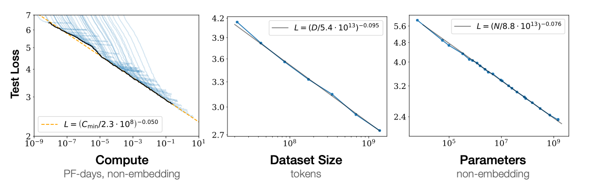
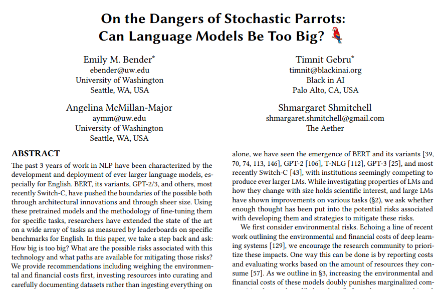
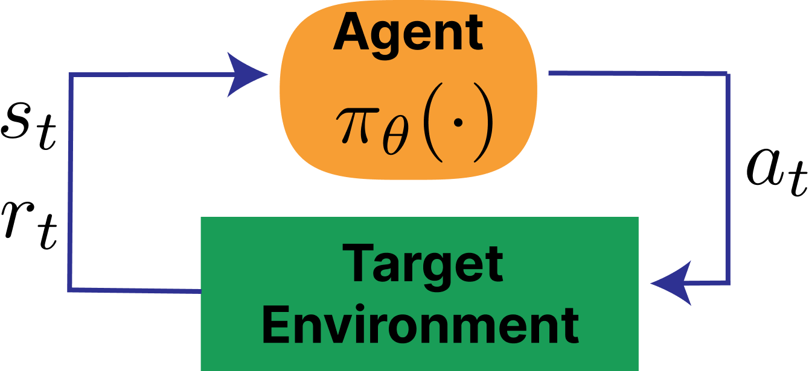
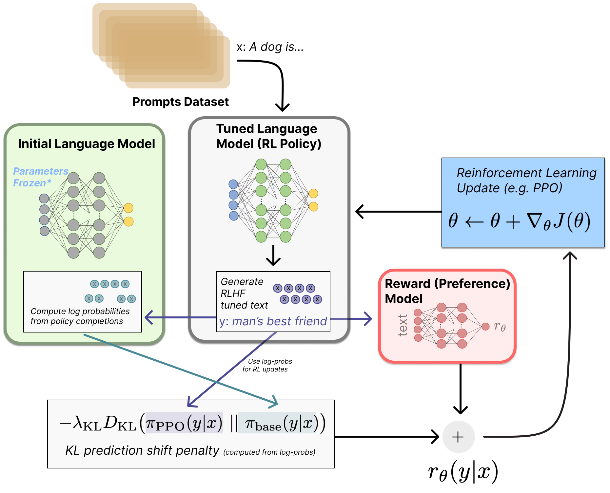
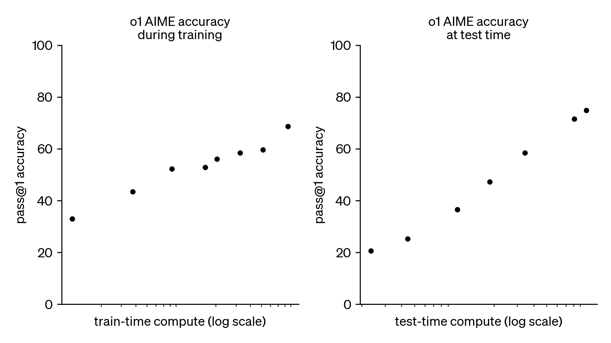
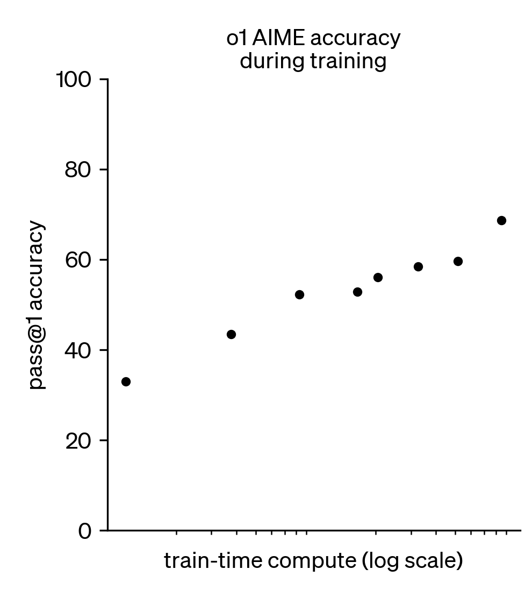
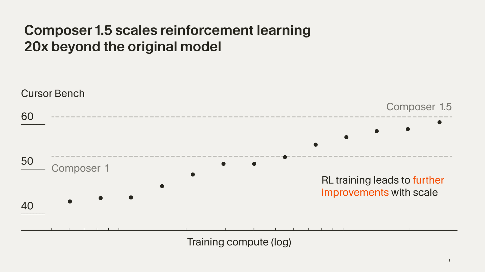
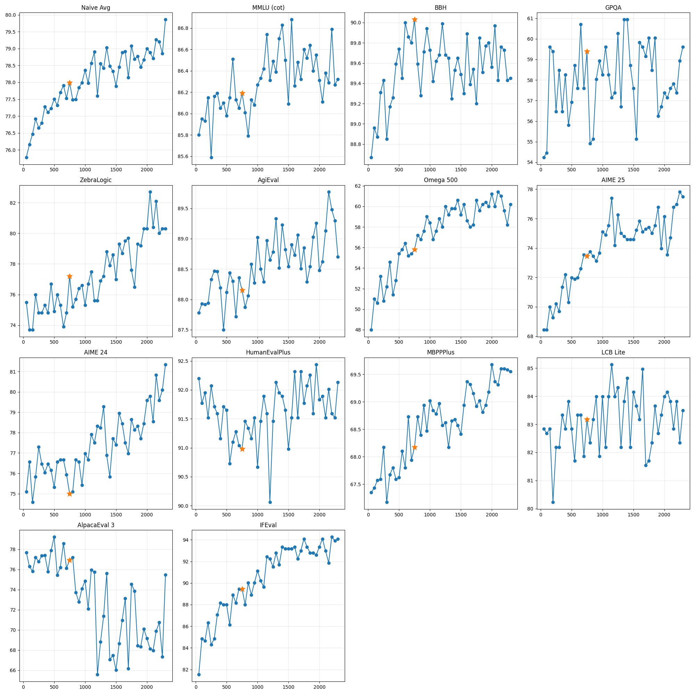

<!-- layout: title-sidebar -->
<!-- valign: bottom -->

# 基于人类反馈的强化学习与后训练入门

<div class="colloquium-title-eyebrow">SALA 2026</div>

<div class="colloquium-title-meta">
<p class="colloquium-title-name">Nathan Lambert</p>
<p>基多, 厄瓜多尔<br>2026年3月11日</p>
</div>

<p class="colloquium-title-note">对 RLHF、RLVR 以及现代大语言模型后训练方案的简要概览。</p>

---

<!-- columns: 45/55 -->
## 什么是语言模型？

语言模型的核心属性：
- 语言模型为文本赋予概率。
- 词块被拆解为 **token（词元）**，这是模型内部的表示单位。
- 给定之前的 token，它预测下一个 token。不断重复这一步骤，就能一步步生成补全内容（这称为 **自回归**）。

|||


<!-- cite-right: Vaswani2017AttentionIA -->

---

<!-- columns: 45/55 -->
## 什么是（现代的）语言模型？

现代语言模型：
- 拥有从数十亿到数万亿的参数。
- 大体上沿袭 Transformer 架构——该架构普及了 **自注意力（self-attention）** 机制以及全连接稠密层。
- 预测和处理的内容远不止文本：Gemini 和 ChatGPT 可以处理图像、音频和视频。

|||


<!-- cite-right: Vaswani2017AttentionIA -->

---

<!-- columns: 45/55 -->
## 2017年：Transformer 诞生

- **2017年：** Transformer 诞生

|||


<!-- cite-right: Vaswani2017AttentionIA -->

---

<!-- columns: 45/55 -->
## 2018年：GPT-1、ELMo 和 BERT

- 2017年：Transformer 诞生
- **2018年：** GPT-1、ELMo 和 BERT 发布

|||


<!-- cite-left: radford2018gpt, peters2018elmo, devlin2018bert -->

---

<!-- rows: 30/70 -->
## 2019年：GPT-2 与缩放定律

- 2017年：Transformer 诞生
- 2018年：GPT-1、ELMo 和 BERT 发布
- **2019年：** GPT-2 与缩放定律

===


<!-- cite-right: radford2019gpt2, kaplan2020scaling -->

---

<!-- columns: 45/55 -->
## 2020年：GPT-3 的惊人能力

- 2017年：Transformer 诞生
- 2018年：GPT-1、ELMo 和 BERT 发布
- 2019年：GPT-2 与缩放定律
- **2020年：** GPT-3 的惊人能力

|||


<!-- cite-left: brown2020gpt3 -->

---

<!-- columns: 45/55 -->
## 2021年：随机鹦鹉

- 2017年：Transformer 诞生
- 2018年：GPT-1、ELMo 和 BERT 发布
- 2019年：GPT-2 与缩放定律
- 2020年：GPT-3 的惊人能力
- **2021年：** "随机鹦鹉"（Stochastic Parrots）

|||


<!-- cite-right: bender2021stochastic -->

---

<!-- columns: 45/55 -->
## 2022年：ChatGPT

- 2017年：Transformer 诞生
- 2018年：GPT-1、ELMo 和 BERT 发布
- 2019年：GPT-2 与缩放定律
- 2020年：GPT-3 的惊人能力
- 2021年：随机鹦鹉
- **2022年：** ChatGPT

|||


<!-- cite-right: openai2022chatgpt -->

---

<!-- columns: 45/55 -->
## 2023年：GPT-4 与前沿规模

- 2017年：Transformer 诞生
- 2018年：GPT-1、ELMo 和 BERT 发布
- 2019年：GPT-2 与缩放定律
- 2020年：GPT-3 的惊人能力
- 2021年：随机鹦鹉
- 2022年：ChatGPT
- **2023年：** GPT-4 与前沿规模

|||


<!-- cite-right: openai2023gpt4 -->

---

<!-- columns: 45/55 -->
## 2024年：o1 与推理模型

- 2017年：Transformer 诞生
- 2018年：GPT-1、ELMo 和 BERT 发布
- 2019年：GPT-2 与缩放定律
- 2020年：GPT-3 的惊人能力
- 2021年：随机鹦鹉
- 2022年：ChatGPT
- 2023年：GPT-4 与前沿规模
- **2024年：** o1 与推理模型

|||


<!-- cite-right: openai2024o1 -->

---

<!-- columns: 45/55 -->
## 2025年：o3、Claude Code 与智能体

- 2017年：Transformer 诞生
- 2018年：GPT-1、ELMo 和 BERT 发布
- 2019年：GPT-2 与缩放定律
- 2020年：GPT-3 的惊人能力
- 2021年：随机鹦鹉
- 2022年：ChatGPT
- 2023年：GPT-4 与前沿规模
- 2024年：o1 与推理模型
- **2025年：** o3、Claude Code 与智能体

|||


<!-- cite-right: openai2025o3, anthropic2025claudecode, openai2025agents -->

---

<!-- columns: 50/50 -->
## 预训练：下一步 token 预测

- 在来自互联网、书籍、代码和文档的数万亿 token 文本上进行训练
  - 模型通常使用 5–50+ 万亿 token 进行训练
  - 1T 的文本 token 大约对应 3–5 TB 数据
  - 各实验室收集和筛选的数据量是实际用于模型训练的 10–20 倍
  - 面向模型训练的数据总漏斗量级达到 PB 级别
- 目标：预测每个序列中的下一个 token
- 结果：创造出能力出众、灵活且实用的模型

|||


---

## 基座模型如何补全文本

预训练之后，我们得到的只是一个强大的自动补全模型，例如：^[基座模型正通过中期训练（midtraining）和更优质的数据混合变得更加灵活。]

<div class="colloquium-spacer-md"></div>

```conversation
messages:
  - role: user
    content: "The president of the United States in 2006 was"
  - role: assistant
    model: "Llama 3.1 405B Base"
    content: "George W. Bush, the governor of Florida in 2006 was Jeb Bush, and John McCain was an Arizona senator in 2006..."
```

---

## 后训练让它像一个聊天机器人一样回答问题

最早的现代后训练（或 RLHF 微调）模型将续写格式统一为"回答问题"的风格。以下是早期对话模型的示例：

<div class="colloquium-spacer-md"></div>

```conversation
messages:
  - role: user
    content: "The president of the United States in 2006 was"
  - role: assistant
    model: "Tülu 3 405B"
    content: "George W. Bush was the president of the United States in 2006. He served two terms in office, from January 20, 2001, to January 20, 2009."
```

---

<!-- columns: 40/60 -->
## ChatGPT 让 RLHF 进一步提升了模型易用性

模型回复迅速进化，拥有了：
- 更好的 **格式**：直接、对话式的回答
- 更好的 **风格**：有帮助、简洁、使用 Markdown 等
- 更好的 **产品体验**：人们真的可以日常使用它

|||

```conversation
size: 0.775
messages:
  - role: user
    content: "I'm giving a talk on RLHF tomorrow. Can you help me structure it?"
  - role: assistant
    content: |
      Absolutely — here's a simple structure:

      **1. Start with the basics**
      - What a language model is
      - Why next-token prediction is not enough

      **2. Explain post-training**
      - Instruction tuning
      - Preference tuning / RLHF
      - RLVR for verifiable tasks

      **3. End with why it matters**
      - Better products like ChatGPT
      - Better reasoning in models like o1
      ...
```

---
<!-- layout: section-break -->

## 那么，基于人类反馈的强化学习（RLHF）到底是什么？

---

<!-- columns: 50/50 -->
<!-- cite-right: christiano2017 -->
## 哪个后空翻更好？


|||


---

<!-- cite-right: christiano2017, ziegler2019fine, ouyang2022training, bai2022constitutional -->
## 为什么人们会做出 RLHF？

- 许多目标人类 **评判** 起来很容易，但很难写成精确的奖励函数
- 在语言模型中，我们想要的往往是隐式的：**遵循意图**、**有用**、**无害**
- 预训练优化的是 **下一步 token 预测**，而非助手行为
- 偏好比较（preference comparisons）将这些人类评判转化为可扩展的训练信号

RLHF 使我们能够优化那些我们可以 **评估** 的行为，即使我们并不容易 **指定** 奖励函数。

---

<!-- columns: 40/60 -->
<!-- cite-right: christiano2017 -->
## 语言模型出现之前的 RLHF

- **TAMER**（Knox & Stone, 2008）——人类对智能体的行动打分以学习奖励
- **Christiano 等 2017**——在 Atari 轨迹偏好上应用 RLHF
- **Ziegler 等 2019**——首次在语言模型上应用 RLHF

|||


---

<!-- cite-right: ziegler2019fine -->
## 面向语言模型的 RLHF：比较两条补全

<!-- columns: 50/50 -->

```conversation
messages:
  - role: user
    content: "用6岁小孩能听懂的方式解释阿波罗登月。"
  - role: assistant
    model: "Completion A"
    content: "The Apollo program culminated in a successful lunar landing in 1969. Astronauts used a spacecraft to descend to the moon's surface and collect samples before returning to Earth."
```

|||

```conversation
messages:
  - role: user
    content: "用6岁小孩能听懂的方式解释阿波罗登月。"
  - role: assistant
    model: "Completion B"
    content: "People built a special rocket to go to the moon. Two astronauts landed there, walked around, and came home safely to tell everyone what they saw."
```

---

<!-- columns: 50/50 -->
<!-- cite-right: christiano2017 -->
## 左侧：人类评判；右侧：手工设计的奖励函数


|||


---

<!-- cite-right: sutton2018reinforcement -->
<!-- columns: 65/35 -->

## 经典强化学习

一个强化学习问题通常被写成一个 **马尔可夫决策过程（MDP）**：
- 状态空间 $\mathcal{S}$，动作空间 $\mathcal{A}$
- 转移动态 $P(s_{t+1}\mid s_t, a_t)$
- 奖励函数 $r(s_t, a_t)$ 和折扣因子 $\gamma$
- 优化轨迹上的累积回报

$$\text{MDP } (\mathcal{S}, \mathcal{A}, P, r, \gamma)$$

$$J(\pi) = \mathbb{E}_{\tau \sim \pi}\!\left[\sum_{t=0}^{T} \gamma^t r(s_t, a_t)\right]$$

|||



---

<!-- columns: 50/50 -->
<!-- cite-right: christiano2017, ouyang2022training -->
## 经典强化学习 vs. RLHF

<div class="text-sm">

**经典强化学习**
- 智能体在状态为 $s_t$ 的环境中执行动作 $a_t$
- 奖励是环境中已知的函数 $r(s_t, a_t)$，每步给出
- 优化轨迹上的累积回报（总步数 $T$）

$$J(\pi) = \mathbb{E}_{\tau \sim \pi}\!\left[\sum_{t=0}^{T} \gamma^t r(s_t, a_t)\right]$$

<div class="colloquium-spacer-md"></div>

**RLHF**
- 没有环境——提示从数据集中采样
- 奖励是 **学习而来** 的（基于人类偏好的代理）
- **回复级别** 的奖励（bandit 风格，非逐 token）
- 使用 **KL 惩罚** 正则化，使策略保持在基座模型附近

$$J(\pi) = \mathbb{E}\left[ r_\theta(x, y) \right] - \beta \, D_{\text{KL}}\!\left(\pi \| \pi_{\text{ref}}\right)$$

</div>

|||


---

<!-- columns: 50/50 -->

## 基于 *可验证* 奖励的强化学习

当答案可以直接检查时，将同样的强化学习算法应用于 LLM。无需训练奖励模型：
- 例如数学：检查结果是否正确。
  代码：运行测试。
- 没有学习到的奖励模型——**没有代理目标**
- 使得在推理任务上扩展 RL 计算成为可能
- 解锁了 **推理时扩展（inference time scaling）**：在生成时针对每个问题投入更多计算，性能随计算量对数线性增长
- RLVR 由 **Tülu 3** [@lambert2024t] 命名，并被 **DeepSeek R1** [@guo2025deepseek] 推广

|||


---

## 经典强化学习 vs. 大语言模型 RLHF 与 RLVR 比较

| | 经典强化学习 | RLHF | RLVR |
|---|---|---|---|
| **奖励** | 环境 | 学习（代理） | 可验证（精确） |
| **状态转移** | 有 | 无 | 无 |
| **奖励粒度** | 每步 | 每条回复 | 每条回复 |
| **核心挑战** | 探索-利用权衡 | 过度优化 | 任务泛化 |
| **示例** | CartPole | 对话风格微调 | 数学推理 |

---


<!-- rows: 60/40 -->
## 通向现代 RLHF 的路径


===

<!-- row-columns: 50/50 -->

- **Ziegler 2019** [@ziegler2019fine]——首次在语言模型上应用 RLHF
- **InstructGPT** [@ouyang2022training]——ChatGPT 背后的经典 RLHF 方案
- **Constitutional AI** [@bai2022constitutional]——在 Claude 中引入早期 AI 反馈方法

|||

- **DPO** [@rafailov2024direct]——直接偏好优化（DPO），无需奖励模型
- **Llama 3** [@dubey2024llama] 和 **Tülu 3** [@lambert2024t]——现代多阶段方案
- **DeepSeek R1** [@guo2025deepseek]——推广 RLVR

---

<!-- valign: center -->
<!-- cite-right: ouyang2022training -->

## InstructGPT 的三步 RLHF 方案


---

<!-- columns: 45/55 -->
<!-- cite-right: ouyang2022training -->
## 第 1/3 步：指令微调（IFT）

后训练的基础。也称为 **监督微调（Supervised Fine-tuning, SFT）**：
- 从一个预训练语言模型开始
- 收集 *期望的* 助手行为示例
- 使用标准的监督学习在 prompt-response 对上训练。（不同的 batch size、学习率等）
- 模型现在可以回答问题了。
  使用 IFT 可以快速将基座模型适配到许多领域。

$$
\mathcal{L}_{\mathrm{SFT}}(\theta)
=
- \sum_{(x, y^\star)} \sum_{t=1}^{|y^\star|}
\log \pi_\theta \!\left(y^\star_t \mid x, y^\star_{<t}\right)
$$

|||

```conversation
size: 0.9
messages:
  - role: system
    content: "You are a helpful, harmless assistant. A system message like this can be used to steer the model to specific personas or behaviors."
  - role: user
    content: "Write me a short poem about an optimistic goldfish."
  - role: assistant
    content: "Bright little goldfish\nFinds a sunrise in each wave\nSmall bowl, endless hope"
```

---

<!-- columns: 45/55 -->
<!-- cite-right: christiano2017, ouyang2022training -->
## 第 2/3 步：奖励建模

概览：
- 收集 **两条** 模型输出在同一个 prompt 下的 **偏好比较**
- RLHF 之所以得名是因为在补全之间收集 *人类* 反馈，但如今其中大部分是 AI 反馈
- 训练一个奖励模型 $r_\phi(x, y)$，为更受偏好的补全赋予更高分数

|||


该概率模型表明：一个回复之所以胜出，是因为它的奖励得分更高：

$$
P(y_w \succ y_l \mid x)
=
\sigma \!\left(r_\phi(x, y_w) - r_\phi(x, y_l)\right)
$$

训练则最小化偏好回复优于拒绝回复的负对数似然：

$$
\mathcal{L}_{\mathrm{RM}}(\phi)
=
- \log \sigma \!\left(r_\phi(x, y_w) - r_\phi(x, y_l)\right)
$$

符号说明：
- $x$ 是 prompt（提示）
- $y_w$ 是 **胜出（winning）** 回复
- $y_l$ 是 **落败（losing）** 回复
- $r_\phi(x, y)$ 是训练好的奖励模型

---

<!-- columns: 45/55 -->
<!-- cite-right: christiano2017, ouyang2022training -->
## 第 2/3 步：奖励建模

```box
title: 核心思想
tone: accent
content: |
  RLHF 中使用的奖励，是模型预测给定文本在 pair（或 batch）中成为"胜出"或"被选中"回复的概率。巧妙！
```

|||


该概率模型表明：一个回复之所以胜出，是因为它的奖励得分更高：

$$
P(y_w \succ y_l \mid x)
=
\sigma \!\left(r_\phi(x, y_w) - r_\phi(x, y_l)\right)
$$

训练则最小化偏好回复优于拒绝回复的负对数似然：

$$
\mathcal{L}_{\mathrm{RM}}(\phi)
=
- \log \sigma \!\left(r_\phi(x, y_w) - r_\phi(x, y_l)\right)
$$

符号说明：
- $x$ 是 prompt（提示）
- $y_w$ 是 **胜出（winning）** 回复
- $y_l$ 是 **落败（losing）** 回复
- $r_\phi(x, y)$ 是训练好的奖励模型

---

<!-- columns: 50/50 -->
<!-- cite-right: ouyang2022training -->
<!-- footnotes: right -->
## 第 3/3 步：在奖励模型上进行强化学习

一切汇聚之处（RLHF 也因此得名）：
- 从数据集 $\mathcal{D}$ 中采样一批 prompts $x_i$
- 从被训练模型生成补全 $y_i \sim \pi_\theta(\cdot \mid x_i)$
- 用奖励模型 $r_\phi(x_i, y_i)$ 为其打分
- 加入 **KL 惩罚**，使策略保持在 SFT/参考模型附近。^[KL 散度衡量当前策略与参考模型之间的差异。对于离散输出，$D_{\mathrm{KL}}(\pi \,\|\, \pi_{\mathrm{ref}})=\mathbb{E}_{y \sim \pi}\!\left[\log \pi(y \mid x)-\log \pi_{\mathrm{ref}}(y \mid x)\right]$。人们常通俗地称其为模型间的"KL 距离"，尽管它并非严格的距离度量。]
- 使用策略梯度强化学习算法更新策略（InstructGPT 和 ChatGPT 中使用近端策略优化 PPO）

$$
J(\pi)
=
\mathbb{E}\!\left[r_\phi(x, y)\right]
- \beta D_{\mathrm{KL}}\!\left(\pi \,\|\, \pi_{\mathrm{ref}}\right)
$$

|||



---

<!-- rows: 35/65 -->
<!-- title: center -->

## 拆解 RLHF 目标

$$
\max_{\pi} \;
\mathbb{E}_{x \sim D,\; y \sim \pi(\cdot \mid x)}
\underbrace{r_\phi(x, y)}_{\text{最大化奖励}}
- \underbrace{\beta D_{\mathrm{KL}}\!\left(\pi(\cdot \mid x)\,\|\,\pi_{\mathrm{ref}}(\cdot \mid x)\right)}_{\text{但不要让模型变化过大}}
$$


===


<!-- row-columns: 50/50 -->

<div style="text-align: left;">

<!-- Prompts $x$ come from a dataset, not an environment.

The policy $\pi_\theta(y \mid x)$ generates a full response $y$, and the reward model $r_\phi(x, y)$ scores whether humans would like that response. -->

</div>

|||

<div style="text-align: left;">

参考模型 $\pi_{\mathrm{ref}}$ 使策略锚定在 SFT 模型附近。

$D_{\mathrm{KL}}\!\left(\pi(\cdot \mid x)\,\|\,\pi_{\mathrm{ref}}(\cdot \mid x)\right)$ 衡量新策略在 prompt $x$ 上偏离参考模型多远。

$\beta$ 控制 **改进行为** 与 **保持在模型已有知识附近** 之间的权衡。

</div>

---

<!-- rows: 27/73 -->
<!-- cite-right: rafailov2024direct -->
## 如果我们可以更直接地优化它？

$$
\max_{\pi} \;
\mathbb{E}_{x \sim D,\; y \sim \pi(\cdot \mid x)}
r_\phi(x, y)
- \beta D_{\mathrm{KL}}\!\left(\pi(\cdot \mid x)\,\|\,\pi_{\mathrm{ref}}(\cdot \mid x)\right)
$$

===

<!-- row-columns: 60/40 -->

**直接偏好优化（Direct Preference Optimization, DPO）**

- 推导出通向上述方程最优解 $\pi^*$ 的梯度
- 消除了对独立奖励模型的需求（通过训练一个隐式奖励模型）
- 直接在偏好回复（$y_w$）与拒绝回复（$y_l$）对 prompt（$x$）的比较上进行训练

$$
\mathcal{L}_{\mathrm{DPO}}(\theta)
=
- \log \sigma \!\left(
\beta \log \frac{\pi_\theta(y_w \mid x)}{\pi_{\mathrm{ref}}(y_w \mid x)}
- \beta \log \frac{\pi_\theta(y_l \mid x)}{\pi_{\mathrm{ref}}(y_l \mid x)}
\right)
$$

|||

---

<!-- rows: 27/73 -->
<!-- cite-right: rafailov2024direct -->
## 如果我们可以更直接地优化它？

$$
\max_{\pi} \;
\mathbb{E}_{x \sim D,\; y \sim \pi(\cdot \mid x)}
r_\phi(x, y)
- \beta D_{\mathrm{KL}}\!\left(\pi(\cdot \mid x)\,\|\,\pi_{\mathrm{ref}}(\cdot \mid x)\right)
$$

===

<!-- row-columns: 60/40 -->

**直接偏好优化（Direct Preference Optimization, DPO）**

- 推导出通向上述方程最优解 $\pi^*$ 的梯度
- 消除了对独立奖励模型的需求（通过训练一个隐式奖励模型）
- 直接在偏好回复（$y_w$）与拒绝回复（$y_l$）对 prompt（$x$）的比较上进行训练

$$
\mathcal{L}_{\mathrm{DPO}}(\theta)
=
- \log \sigma \!\left(
\beta \log \frac{\pi_\theta(y_w \mid x)}{\pi_{\mathrm{ref}}(y_w \mid x)}
- \beta \log \frac{\pi_\theta(y_l \mid x)}{\pi_{\mathrm{ref}}(y_l \mid x)}
\right)
$$

|||

```box
title: DPO 因其以下特点而广受欢迎
tone: accent
content: |
  - 实现简单得多
  - 运行成本显著更低
  - 能达到最终性能的 80% 以上
  - 我曾使用它构建过 Zephyr-Beta、Tülu 2/3、Olmo 2/3 等模型
```

---

<!-- valign: center -->
## 训练方案是如何演化的

| | InstructGPT（2022） | Tülu 3（2024） | DeepSeek R1（2025） |
|---|---|---|---|
| **指令数据** | ~1万 | ~100万 | 10万+ |
| **偏好数据** | ~10万 | ~100万 | 同策略（on-policy） |
| **RL 阶段** | ~10万 prompt | ~1万（RLVR） | 不适用 |

总体趋势是在各个阶段使用更多的计算资源，但将更多的计算转向 RLVR。

---

<!-- rows: 60/40 -->
## 早期：InstructGPT


===

早期 RLHF 有一种记录详实且足够简单的方案。
- **InstructGPT** 将经典的三阶段方案确立为标准范式：
  SFT → 奖励建模 → 在奖励模型上进行 RL。*OpenAI 甚至暗示过最初的 ChatGPT 使用的就是这一方案！*
- 这成为了现代后训练中许多工作的智力模板。

---

<!-- rows: 50/50 -->
## 从 RLHF 到后训练


===

最初作为"RLHF"方案的做法，逐步演化为一套复杂的多步骤流程，以得到最终的优质模型（例如 Nemotron 4 340B、Llama 3.1）。
- 现代系统保留了使用多个优化器（各有优劣）的核心思想，但增加了更多阶段、更多数据和更多过滤步骤。
- 这一趋势仍在继续，方案如潮汐般涨落——随着 RLVR 和模型融合等工具出现，它们以不同方式拓展了可行的边界。

---

## 从 RLHF 到"后训练"

自 ChatGPT 问世以来，该领域经历了多个截然不同的阶段（大致如下）：
1. 2023年：为更好的聊天机器人和复现 RLHF 基础原理而使用简单 SFT（Alpaca、Vicuna 等）
2. 2024年：DPO 主导开源模型，训练阶段不断扩展（Zephyr-beta、Tülu 2 等）
3. 2025年：RLVR、复杂方案（Tülu 3、Olmo 3、Nemotron 3、R1 等）
4. 2026年：智能体训练、多轮 RL 等

---

## 从 RLHF 到"后训练"

自 ChatGPT 问世以来，该领域经历了多个截然不同的阶段（大致如下）：
1. 2023年：为更好的聊天机器人和复现 RLHF 基础原理而使用简单 SFT（Alpaca、Vicuna 等）
2. **2024年：DPO 主导开源模型，训练阶段不断扩展**（Zephyr-beta、Tülu 2 等）
3. 2025年：RLVR、复杂方案（Tülu 3、Olmo 3、Nemotron 3、R1 等）
4. 2026年：智能体训练、多轮 RL 等

2024 年内，随着训练阶段超出了 InstructGPT 式方案的范畴、DPO 广泛传播，且 RLHF 在很大程度上被视为众多工具之一（甚至可能不需要），该领域将重心转向了后训练。

---

<!-- columns: 50/50 -->
## 对后训练的一个直觉理解
<!-- cite-right: zhou2023lima -->

RLHF 的名声在于它对最终语言模型的贡献相对较小。

> "模型的知识与能力几乎完全在预训练阶段习得，而对齐教的是在与用户交互时应使用哪种格式的子分布。"

*LIMA：Less Is More for Alignment*（2023年）


|||

---


<!-- columns: 50/50 -->
## 对后训练的一个直觉理解
<!-- cite-right: zhou2023lima,muennighoff2024olmoe,ai2_olmoe_ios_2025 -->

RLHF 的名声在于它对最终语言模型的贡献相对较小。

> "模型的知识与能力几乎完全在预训练阶段习得，而对齐教的是在与用户交互时应使用哪种格式的子分布。"

*LIMA：Less Is More for Alignment*（2023年）

|||

有时这种认为对齐（或 RLHF）只是教"格式"的观点让人们觉得后训练对模型的影响微乎其微。如果把微调描述为"*只是风格迁移*"，便是如此。

在数万亿 token 的互联网文本上训练的基座模型，已经见识并学习了极其广泛的示例。
此时阶段的模型所包含的潜在能力远超早期后训练方案所能展现的范围。

问题是：后训练如何与这些潜力互动？

---

<!-- columns: 50/50 -->
## 对后训练的一个直觉理解
<!-- cite-right: zhou2023lima,muennighoff2024olmoe,ai2_olmoe_ios_2025 -->

RLHF 的名声在于它对最终语言模型的贡献相对较小。

一个例子，**OLMoE**——同一基座模型家族，仅更新了后训练部分：
- [`OLMoE-1B-7B-0924-Instruct`](https://huggingface.co/allenai/OLMoE-1B-7B-0924-Instruct)（2024年9月）：**38.44** 平均评估分数
- [`OLMoE-1B-7B-0125-Instruct`](https://huggingface.co/allenai/OLMoE-1B-7B-0125-Instruct)（2025年1月）：**45.62** 平均评估分数

基座模型决定 *上限*。后训练的任务是 **触及它**。

---

<!-- columns: 50/50 -->
## 对后训练的一个直觉理解
<!-- cite-right: zhou2023lima,vergarabrowne2026operationalising -->

RLHF 的名声在于它对最终语言模型的贡献相对较小。

> "模型的知识与能力几乎完全在预训练阶段习得，而对齐教的是在与用户交互时应使用哪种格式的子分布。"

*LIMA：Less Is More for Alignment*（2023年）

> "浅层对齐假说（SAH）认为，大语言模型在预训练期间学到了大部分知识，而后训练只是将已有知识表面化。"

*Operationalising the Superficial Alignment Hypothesis via Task Complexity*（2026年）

|||

三年之后的第二篇论文，与我对后训练的直觉相吻合。

```box
title: 我将其称为后训练的 **提取理论（Elicitation Theory）**，即我们试图提取模型中最有用的知识。
tone: accent
```

---


<!-- layout: section-break -->

## 超越提取：后训练的 RL 缩放时代

---

## OpenAI 关于 o1-preview 的奠基性缩放图

<!-- img-align: center -->
<!-- cite-right: openai2024o1 -->



---

## o1：测试时扩展

<!-- columns: 2 -->
<!-- cite-right: openai2024o1 -->

推理计算量（生成的 token 数量）与下游性能之间存在对数线性关系。

- 这是模型的一种基本属性，通过 RLVR 在普及形态下得以展现
- 可以用多种方式实现：一条长的思维链（CoT）序列、多个并行智能体，或两者的混合
- 改进推理时扩展能力会改变曲线的斜率和截距

|||


---

## o1：训练时扩展（使用强化学习！）

<!-- columns: 2 -->
<!-- cite-right: openai2024o1 -->

这是 o1 发布中常被忽视的一部分（以及未来的推理/智能体模型）。
- 扩展强化学习计算同样能带来性能的对数线性回报！
- 核心问题：扩展 RL *训练* 只是在提取基座模型中更多的知识，还是在教授全新的能力？

最终形成了语言模型训练的两侧缩放景观——预训练和后训练各占一方。
第三个缩放维度在推理时（那里没有权重更新）。

|||




---

## Cursor Composer 1.5：RL 缩放

<!-- img-align: center -->
<!-- cite-right: cursor2026composer15 -->



---

## DeepSeek-R1-Zero：RL 缩放

<!-- img-align: center -->
<!-- cite-right: guo2025deepseek -->


---

<!-- columns: 30/70 -->
## Olmo 3.1：扩展 RL 运行

<!-- cite-right: teamolmo2025olmo3 -->

迄今为止少有的"完全开源"的大规模 RL 运行之一。
- 训练一个通用的 32B 推理模型。
- 完整的 RL 训练约在 **224 块 GPU 上运行 28 天**。
- 在整个运行期间，性能提升非常一致——事实上直到我们不得不中止时，性能仍在上升！

|||



---

## 现状

后训练和 RLHF 正在以可能比以往任何时候都快的速度变化。
- 语言模型正变得"原生支持工具调用"，现在关注的不仅是权重，还有工具、harness（如何指示模型使用这些工具）以及更多内容
- RLHF 和人类偏好并未消失，但正在更慢地演化，且逐渐远离行业的聚光灯
- 借助编码智能体，构建语言模型和开展研究正在快速变化

---

<!-- rows: 50/50 -->
## 本篇演讲 ~ 更大课程的第一讲

<!-- row-columns: 34/33/33 -->

```box
title: 引言（本篇演讲）
tone: accent
compact: true
content: |
  1. 引言
  2. 关键相关论文
  3. 训练概览
```

|||

```box
title: 核心训练流水线
tone: muted
compact: true
content: |
  4. 指令微调
  5. 奖励模型
  6. 强化学习
  7. 推理
  8. 直接对齐
  9. 拒绝采样
```

|||

```box
title: 数据与偏好
tone: muted
compact: true
content: |
  10. 什么是偏好
  11. 偏好数据
  12. 合成数据与 CAI
```

===

<!-- row-columns: 34/33/33 -->

```box
title: 实际考量
tone: muted
compact: true
content: |
  13. 工具调用
  14. 过度优化
  15. 正则化
  16. 评估
  17. 产品与性格
```

|||

```box
title: 附录
tone: surface
compact: true
content: |
  - A. 定义  
  - B. 风格与信息  
  - C. 实际问题  
```

|||

完整课程幻灯片即将发布在 [rlhfbook.com/course](https://rlhfbook.com/course) 和 YouTube @natolambert！

---

<!-- rows: 85/15 -->
## 感谢聆听

抱歉无法亲临现场！

联系：nathan@natolambert.com

Newsletter：[interconnects.ai](https://www.interconnects.ai/)

**rlhfbook.com**

===


```builtwith
repo: natolambert/colloquium
```
