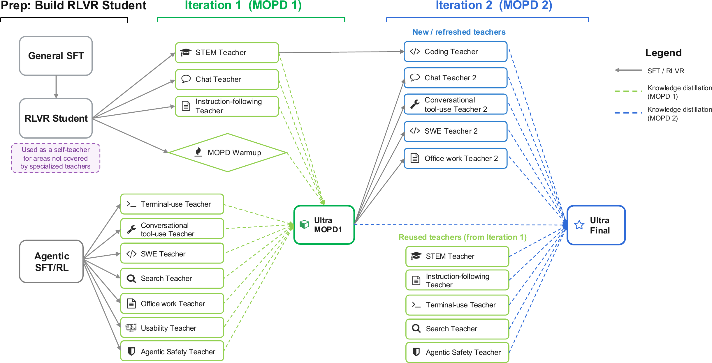
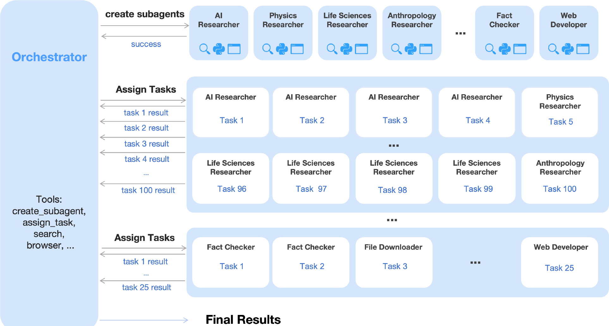
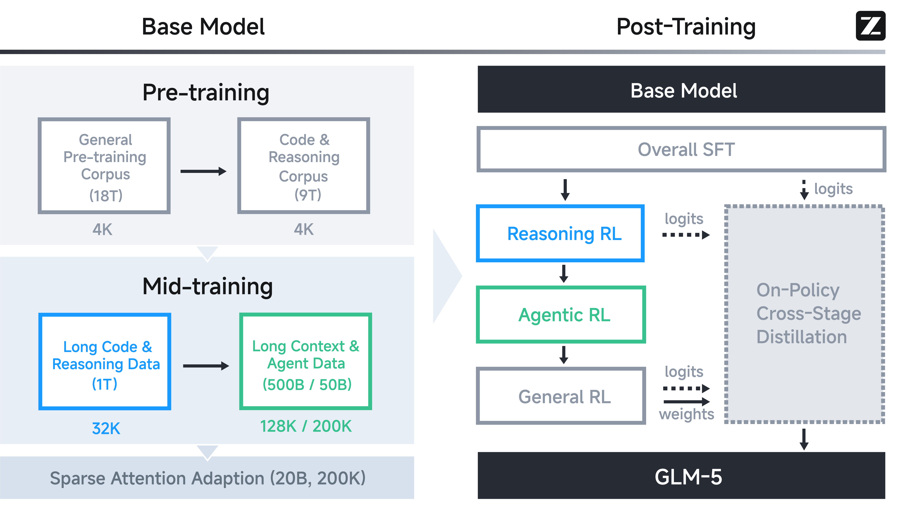

<!-- layout: title-banner -->

# 前沿后训练菜谱概览

一次对话 · rlhfbook.com/course

Nathan Lambert × Finbarr Timbers

2026 年 6 月

从经典的三步 RLHF 菜谱，到多教师同策略蒸馏（MOPD）的崛起。

---

## 后训练中经典的菜谱随时间演变

后训练菜谱在过去一年中的变化，超过了此前的三年。

- **2022–2023（InstructGPT）：** 一条流水线 — SFT → 奖励模型 → 强化学习。
- **2024（Llama 3、Tülu 3 等）：** 开源菜谱将 SFT → DPO → 可验证奖励强化学习规范化；闭源菜谱使用多级 RLHF。
- **2025（DeepSeek R1）：** 推理强化学习（R1）使得大规模强化学习成为核心。
- **2026（MiMo Flash V2）：** 菜谱分裂为*多个专家模型*，再合并回一个。
---

## 新范式：MOPD

**多教师同策略蒸馏（Multi-teacher On-Policy Distillation，MOPD）** 是 2026 年前沿普遍出现的模式。

1. 训练 **N 位领域专家教师**（每位均经过 SFT，然后在相关领域上进行强化学习）。
2. 训练 **一位通用学生** — 采样*其自身*的轨迹（这也是最终的后训练模型）。
3. 对每次 rollout，逐 token 最小化与*相关*教师输出分布之间的*反向 KL 散度*。

<!-- footnote-right: 传承脉络：MiMo Flash v2 首次提出 → DeepSeek V4 & Nemotron 3 Ultra 将其扩展至 >10 位教师。 -->

---

## 为什么 MOPD 会出现？

- **强化学习既昂贵又容易产生冲突。** 在单次运行中混用数学、代码和智能体强化学习，最终会导致各项能力相互折损。
- **专家模型便宜易产 / 组织上可规模化。** 在单一领域上做 SFT 后再强化学习，这一流程已被充分理解且易于并行化。随着后训练日益复杂，跨组织扩展是一个重大优势。
- **同策略蒸馏日渐成熟。** 在 RLVR 复兴期间，相关文献和工程经验持续涌现。

<!-- footnote-right: 来源：[DeepSeek V4 §5.1](https://huggingface.co/deepseek-ai/DeepSeek-V4-Pro/blob/main/DeepSeek_V4.pdf)、[MiMo-V2-Flash](https://arxiv.org/abs/2601.02780) -->

---
<!-- layout: section-break -->
<!-- title: center -->

## 通往今天的路线

---

## InstructGPT（2022 年 3 月）— 经典的三步

<!-- columns: 58/42 -->

|||

- 在人类演示数据上 **SFT**
- 在人类对比数据上训练 **奖励模型**
- 对奖励模型做 **PPO**

<!-- footnote-right: 来源：[InstructGPT (arXiv:2203.02155)](https://arxiv.org/abs/2203.02155) -->

---

## Llama 2（2023 年 7 月）— 多级 RLHF

<!-- columns: 60/40 -->

|||

- **SFT**，然后进行多轮**迭代式 RLHF**
- 每轮：先**拒绝采样** → 再 **PPO**
- **两个** 奖励模型 — 分别针对**有用性**和**安全性**

<!-- footnote-right: 来源：[Llama 2 (arXiv:2307.09288)](https://arxiv.org/abs/2307.09288) -->

---

## Llama 3（2024 年 7 月）— 复杂多级菜谱，搭配更简单的优化器

<!-- rows: 70/30 -->

===

- 每轮：**奖励模型** → 每 prompt 采样 **K 条** → **拒绝采样** → **SFT** → **DPO**
- 无在线强化学习 — 奖励模型仅用于**过滤**；共运行 **6 轮**，最佳模型为下一轮提供种子

<!-- footnote-right: 来源：[Llama 3 (arXiv:2407.21783)](https://arxiv.org/abs/2407.21783) -->

---

## Tülu 3（2024 年 11 月）— 简单的三阶段后训练

<!-- rows: 62/38 -->

===

精选 prompt → **SFT** → **DPO** → **RLVR**

（RL with verifiable rewards，"可验证奖励的强化学习" — 该缩写首次在此论文中提出）

<!-- footnote-right: 来源：[Tülu 3 (arXiv:2411.15124)](https://arxiv.org/abs/2411.15124) -->

---

## Olmo 3（2025 年 12 月）— 对 Tülu 3 菜谱的推理能力升级

<!-- rows: 60/40 -->

===

<!-- footnote-right: 来源：[Olmo 3 (arXiv:2512.13961)](https://arxiv.org/abs/2512.13961) -->

---

## DeepSeek R1（2025 年 1 月）— 强化学习成为核心

<!-- columns: 55/45 -->

|||

**菜谱：**

- **R1-Zero** — 对 base 直接做纯强化学习（GRPO），*未经 SFT*；用于为整个训练**注入推理能力**，而非独立产品
- **R1** — 冷启动 SFT → 推理强化学习 → 拒绝采样 SFT → 最终强化学习 → 蒸馏为稠密模型
- **菜谱的重大转变：** 大规模 RLVR 成为主要驱动力，SFT 用来蒸馏和精炼强化学习产生的行为

<!-- footnote-right: 属 DeepSeek 产品线。来源：[DeepSeek R1 (arXiv:2501.12948)](https://arxiv.org/abs/2501.12948) · [Interconnects：o1 的 R1 菜谱](https://www.interconnects.ai/p/deepseek-r1-recipe-for-o1) -->

---

## DeepSeek 在 V3 之后的演进

<!-- animate: bullets -->

- [**V3**](https://arxiv.org/abs/2412.19437) · 2024 年 12 月 — SFT + GRPO 强化学习。
- [**R1**](https://arxiv.org/abs/2501.12948) · 2025 年 1 月 — 多级强化学习；推理能力*涌现*。
- [**V3.1**](https://huggingface.co/deepseek-ai/DeepSeek-V3.1) · 2025 年 8 月 — 混合思考/非思考模型。
- [**V3.2**](https://arxiv.org/abs/2512.02556) · 2025 年 12 月 — 通过强化学习训练 6 个专家 → SFT 蒸馏 → 统一 GRPO。
- [**V4**](https://huggingface.co/deepseek-ai/DeepSeek-V4-Pro/blob/main/DeepSeek_V4.pdf) · 2026 年 4 月 — 10+ 领域专家 → MOPD。

<!-- footnote-right: 每个模型链接到其技术报告。V3.1 细节来自其模型说明（无完整报告）；V3-0324 是同一种菜谱的质量提升版本，故省略。 -->

---

<!-- layout: section-break -->
<!-- title: center -->

## 2026 风格的菜谱！

---

## MiMo Flash v2（2026 年 1 月）— MOPD 的起点

<!-- rows: 64/36 -->

===

**阶段：** 阶段 1 SFT → 阶段 2 训练约 6 位领域专家教师（使用较老的后训练菜谱） → 阶段 3 通过 MOPD 蒸馏为单一学生模型。

首次清晰提出将**多教师同策略蒸馏**作为合并步骤 — 用"从专家蒸馏"替代单一的庞大强化学习阶段。

<!-- footnote-right: 来源：[MiMo-V2-Flash 报告 (arXiv:2601.02780)](https://arxiv.org/abs/2601.02780) -->

---

## Nemotron 3 Ultra（2026 年 6 月）— 两轮迭代，多位教师

<!-- columns: 58/42 -->

|||

**阶段：** SFT → **多教师同策略蒸馏**，运行**两轮**，**超过 10 位教师**覆盖推理、代码、数学和智能体领域。

**新颖之处：** 跨不同领域进行多轮 MOPD — 先蒸馏，再从刷新后的教师重新蒸馏。

<!-- footnote-right: 来源：[NVIDIA Nemotron 3 Ultra 技术报告](https://research.nvidia.com/labs/nemotron/files/NVIDIA-Nemotron-3-Ultra-Technical-Report.pdf) -->

---

## MAI-Thinking-1（2026 年 6 月）— 更接近 R1 而非 V4

<!-- rows: 48/52 -->

===

**阶段：** 中期训练的 base → **3 个专家强化学习"攀登"**（例如 STEM）→ **trace-distillation SFT** 合并攀登成果 → 最终一轮强化学习攀登 → MAI-Thinking-1。

**更接近 DeepSeek R1 而非 V4** — 多级强化学习配合 trace-distillation SFT 来合并成果，*而非* 同策略 MOPD。并非只有这一家实验室没有采用 MOPD！

<!-- footnote-right: 来源：[MAI-Thinking-1](https://microsoft.ai/news/introducing-mai-thinking-1/) -->

---

## Kimi K2.5（2026 年 1 月）— 面向智能体、多模态

<!-- columns: 56/44 -->

|||

**阶段：** **纯文本 SFT** → 在编程、视觉、推理、智能体任务上**文本-视觉联合强化学习**。

（未提及 MOPD）

<!-- footnote-right: 来源：[Kimi K2.5 技术报告](https://github.com/MoonshotAI/Kimi-K2.5/blob/master/tech_report.pdf) · [博客](https://www.kimi.com/blog/kimi-k2-5.html) -->

---

## GLM-5（2026 年 2 月）— 按能力分阶段的强化学习

<!-- columns: 58/42 -->

|||

**阶段：** Base → SFT → **推理强化学习** → **智能体强化学习** → **通用强化学习**。

MOPD 尚未成为通用范式，但正在快速崛起！

<!-- footnote-right: 来源：[GLM-5 技术报告 (arXiv:2602.15763)](https://arxiv.org/abs/2602.15763) -->

---

<!-- layout: section-break -->
<!-- title: center -->

## 那么，我们将走向何方？