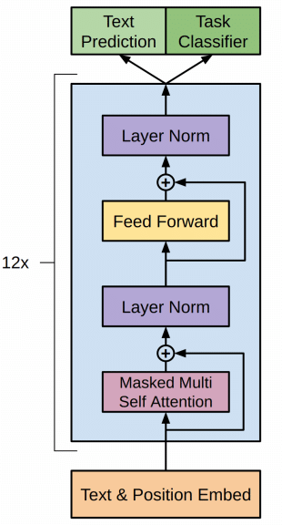
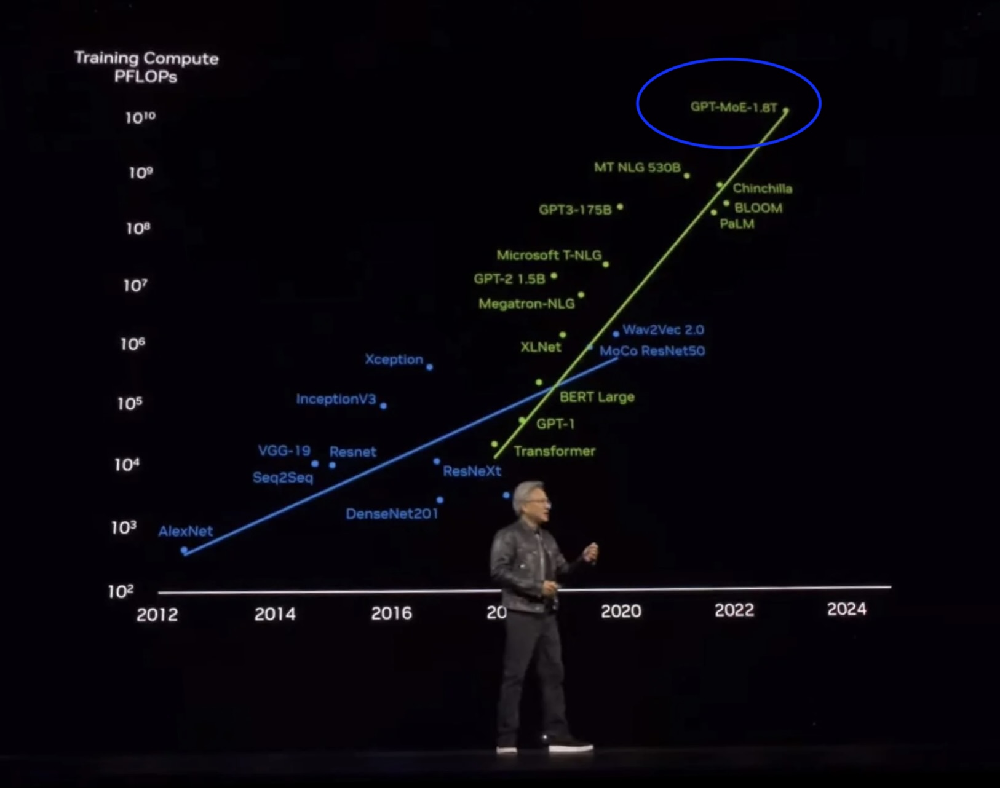
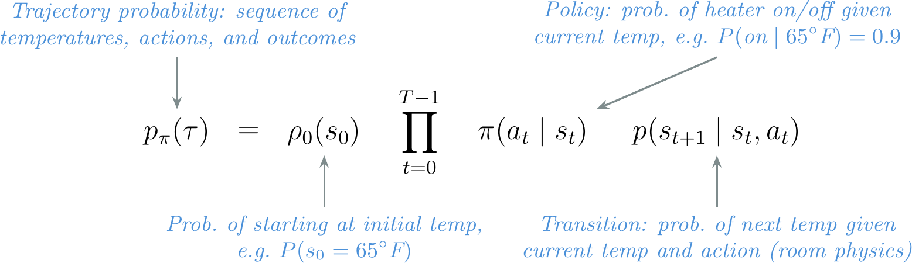
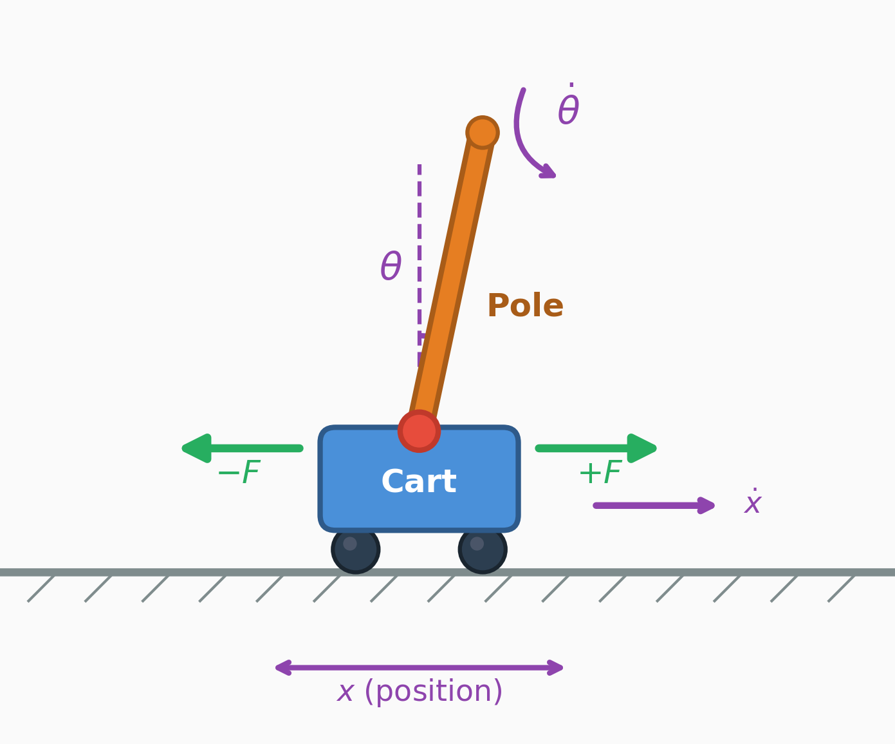
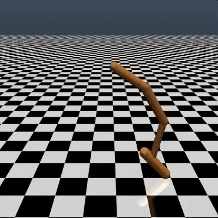
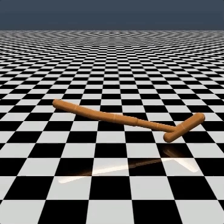
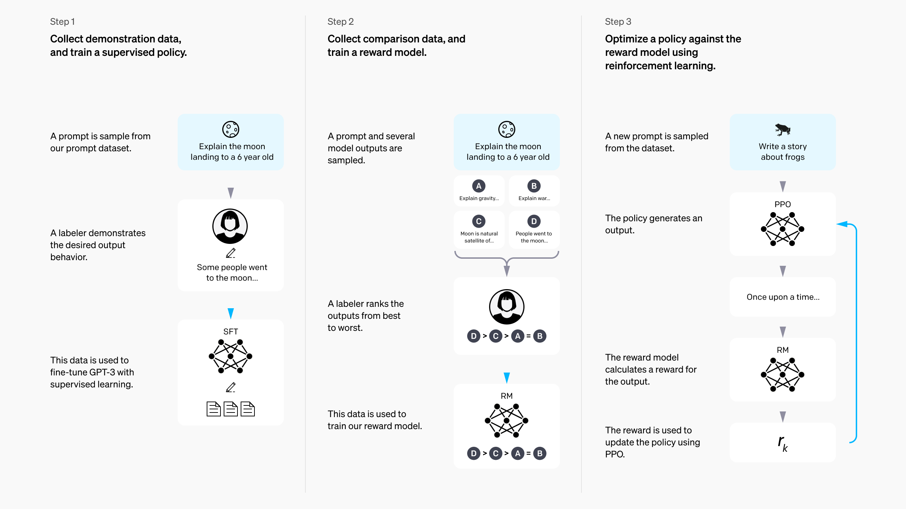

# 第 1 讲：总览

> 后训练课程 · 第 1—3 章

---

## 什么是语言模型？

核心性质：

- 语言模型为文本分配概率。
- 单词被切分为 **token（词元）**，这是模型内部的表示单元。
- 给定前面已生成的 token，模型预测下一个 token。重复这一过程即可逐步生成完整文本（称为 **自回归，autoregressive**）。

|||


<!-- cite-right: Vaswani2017AttentionIA -->

---

## 什么是（现代）语言模型？

现代语言模型的特征：

- 拥有数百亿到数万亿参数。
- 主要沿用 **Transformer** 架构，该架构推广了 **自注意力（self-attention）** 机制与全稠密层的使用。
- 不仅处理文本：Gemini 和 ChatGPT 等模型可以处理图像、音频和视频。

|||


<!-- cite-right: Vaswani2017AttentionIA -->

---

## 2017 年：Transformer 诞生

- **2017 年：** Transformer 架构问世。

|||


<!-- cite-right: Vaswani2017AttentionIA -->

---

## 2018 年：GPT-1、ELMo 与 BERT

- 2017 年：Transformer 诞生
- **2018 年：** GPT-1、ELMo 与 BERT 相继发布

|||


<!-- cite-left: radford2018gpt, peters2018elmo, devlin2018bert -->

---

## 2019 年：GPT-2 与缩放定律

- 2017 年：Transformer 诞生
- 2018 年：GPT-1、ELMo、BERT 发布
- **2019 年：** GPT-2 与缩放定律（scaling laws）

===


<!-- cite-right: radford2019gpt2, kaplan2020scaling -->

---

## 2020 年：GPT-3 令人惊讶的能力

- 2017 年：Transformer 诞生
- 2018 年：GPT-1、ELMo、BERT 发布
- 2019 年：GPT-2 与缩放定律
- **2020 年：** GPT-3 的惊人能力

|||


<!-- cite-left: brown2020gpt3 -->

---

## 2021 年："随机鹦鹉"讨论

- 2017 年：Transformer 诞生
- 2018 年：GPT-1、ELMo、BERT 发布
- 2019 年：GPT-2 与缩放定律
- 2020 年：GPT-3 的惊人能力
- **2021 年：** Stochastic Parrots（随机鹦鹉）讨论

|||


<!-- cite-right: bender2021stochastic -->

> 译者注：*Stochastic Parrots* 是 Bender 等人 2021 年发表的著名论文标题，质疑大型语言模型是否具有真正的理解能力，认为其本质上是统计模式匹配，如同"随机鹦鹉"一样。

---

## 2022 年：ChatGPT

- 2017 年：Transformer 诞生
- 2018 年：GPT-1、ELMo、BERT 发布
- 2019 年：GPT-2 与缩放定律
- 2020 年：GPT-3 的惊人能力
- 2021 年：随机鹦鹉讨论
- **2022 年：** ChatGPT 发布

|||


<!-- cite-right: openai2022chatgpt -->

---

## 2023 年：GPT-4 与前沿规模

- 2017 年：Transformer 诞生
- 2018 年：GPT-1、ELMo、BERT 发布
- 2019 年：GPT-2 与缩放定律
- 2020 年：GPT-3 的惊人能力
- 2021 年：随机鹦鹉讨论
- 2022 年：ChatGPT
- **2023 年：** GPT-4 与前沿规模

|||


<!-- cite-right: openai2023gpt4 -->

---

## 2024 年：o1 与推理模型

- 2017 年：Transformer 诞生
- 2018 年：GPT-1、ELMo、BERT 发布
- 2019 年：GPT-2 与缩放定律
- 2020 年：GPT-3 的惊人能力
- 2021 年：随机鹦鹉讨论
- 2022 年：ChatGPT
- 2023 年：GPT-4 与前沿规模
- **2024 年：** o1 与推理模型

|||


<!-- cite-right: openai2024o1 -->

---

## 2025 年：o3、Claude Code 与智能体

- 2017 年：Transformer 诞生
- 2018 年：GPT-1、ELMo、BERT 发布
- 2019 年：GPT-2 与缩放定律
- 2020 年：GPT-3 的惊人能力
- 2021 年：随机鹦鹉讨论
- 2022 年：ChatGPT
- 2023 年：GPT-4 与前沿规模
- 2024 年：o1 与推理模型
- **2025 年：** o3、Claude Code 与智能体（agents）

|||


<!-- cite-right: openai2025o3, anthropic2025claudecode, openai2025agents -->

---

## 预训练：下一个 token 预测

- 在从互联网、书籍、代码和文档中收集的海量文本上进行训练（数万亿 token）
  - 模型通常训练 5–50+ 万亿 token
  - 1 万亿文本 token 大约需要 3–5 TB 数据
  - 实验室收集并过滤的数据量是最终用于模型训练数据的 10–20 倍
  - 面向模型的数据漏斗总量级达到 PB 级别
- 目标：对序列中的每一个位置预测下一个 token
- 结果：产生了能力强大、灵活且实用的模型

|||


---

## 基础模型完成文本续写

预训练之后，我们得到了一个"增强版自动补全模型"，例如：

> 译者补充：基础模型（base model）只经过预训练，尚未进行指令微调或偏好对齐。它的行为本质上是一个文本续写器，不了解"对话"或"回答问题"的格式。

<div class="colloquium-spacer-md"></div>

```conversation
messages:
  - role: user
    content: "The president of the United States in 2006 was"
  - role: assistant
    model: "Llama 3.1 405B Base"
    content: "George W. Bush, the governor of Florida in 2006 was Jeb Bush, and John McCain was an Arizona senator in 2006..."
```

---

## 后训练让它像聊天机器人一样回答

现代后训练（或 RLHF 微调）模型的最早形式，将续写格式统一调整为"回答问题"的风格。下面是一个早期对话模型的示例：

<div class="colloquium-spacer-md"></div>

```conversation
messages:
  - role: user
    content: "The president of the United States in 2006 was"
  - role: assistant
    model: "Tülu 3 405B"
    content: "George W. Bush was the president of the United States in 2006. He served two terms in office, from January 20, 2001, to January 20, 2009."
```

---

## 训练阶段的直观理解

不同训练阶段如何改变模型：

- **预训练（Pretraining）**：构建模型的世界知识、语言流畅性和广泛能力
- **指令微调 / 监督微调（SFT）**：教会模型以问答格式作答，通常还会让它记住某些特定的 token 序列
- **偏好调优 / RLHF**：使用对比损失（contrastive loss）对整个响应进行修改，使模型更丰富、更灵活
- **RLVR**：增强模型在可验证问题上的能力，并可转化为更复杂的智能体行为

---

## 训练阶段的直观理解（续）

不同训练阶段如何改变模型：

- **预训练**：构建模型的世界知识、语言流畅性和广泛能力
- **指令微调 / SFT**：教会模型以问答格式作答，通常还会让它记住某些特定的 token 序列
- **偏好调优 / RLHF**：使用对比损失对整个响应进行修改，使模型更丰富、更灵活
- **RLVR**：增强模型在可验证问题上的能力，并可转化为更复杂的智能体行为

这对后训练意味着：

- 基于强化学习的后训练为模型提供更丰富的、**响应级别**的对比反馈，使其更灵活、更有用
- SFT 仍必不可少，它是实现最佳性能的基础

---

## ChatGPT 让模型变得更好用

模型响应迅速进化，呈现出：

- 更好的 **格式**：直接、对话式的回答
- 更好的 **风格**：有帮助、简洁、使用 Markdown 等
- 更好的 **产品**：人们真的可以日常使用它

|||

```conversation
size: 0.775
messages:
  - role: user
    content: "I'm giving a talk on RLHF tomorrow. Can you help me structure it?"
  - role: assistant
    content: |
      Absolutely — here's a simple structure:

      **1. Start with the basics**
      - What a language model is
      - Why next-token prediction is not enough

      **2. Explain post-training**
      - Instruction tuning
      - Preference tuning / RLHF
      - RLVR for verifiable tasks

      **3. End with why it matters**
      - Better products like ChatGPT
      - Better reasoning in models like o1
      ...
```

---

## 那么，基于人类反馈的强化学习（RLHF）到底是什么？

---

## 经典强化学习（RL）

一个强化学习问题通常被表述为一个 **马尔可夫决策过程（MDP，Markov Decision Process）**：

- 状态空间 $\mathcal{S}$，动作空间 $\mathcal{A}$
- 转移动力学 $P(s_{t+1}\mid s_t, a_t)$
- 奖励函数 $r(s_t, a_t)$ 和折扣因子 $\gamma$
- 优化轨迹上的累积回报

$$\begin{gathered}
\text{MDP } (\mathcal{S}, \mathcal{A}, P, r, \gamma) \\[6pt]
J(\pi) = \mathbb{E}_{\tau \sim \pi}\!\left[\sum_{t=0}^{T} \gamma^t r(s_t, a_t)\right]
\end{gathered}$$

|||


---

## 用通俗语言理解 RL

强化学习的基本概念：

- 强化学习是 **试错学习** —— 在长期回报中平衡探索与利用
- **状态（State）**：智能体当前所处的环境状况
- **动作（Action）**：智能体采取的下一步行动
- **奖励（Reward）**：评估该动作好不好的信号
- **策略（Policy）**：选择动作的策略
- **轨迹（Trajectory）**：一系列状态、动作和奖励的序列：$\tau = (s_0, a_0, r_0, s_1, a_1, r_1, \ldots)$
- **轨迹概率**：
  $P(\tau\mid\pi) = p(s_0)\prod_{t=0}^T \pi(a_t\mid s_t)\,p(s_{t+1}\mid s_t,a_t)$

|||


---

## 一个简单的 RL 例子：恒温器

智能体在多次Episode中学习何时打开或关闭加热器：

- **状态**：当前室温
- **动作**：打开或关闭加热器
- **奖励**：当室温接近目标温度时给予正奖励
- **策略**：决定下一步动作的规则

|||

示例策略：

$$
\pi(a_t = \text{on} \mid s_t) =
\begin{cases}
1 & \text{if } s_t < 70^\circ\text{F} \\
0 & \text{otherwise}
\end{cases}
$$

===



---

## CartPole：一个标准 RL 任务

- **状态**：小车位置、速度、杆子角度、角速度
  $$s_t = (x_t,\; \dot{x}_t,\; \theta_t,\; \dot{\theta}_t)$$

- **动作**：向左或向右推动小车
  $$a_t \in \{\text{left},\; \text{right}\}$$

- **奖励**：每保持杆子直立一步获得 +1
  $$r(s_t, a_t) = \begin{cases} 1 & \text{if } |\theta_t| < 12° \text{ and } |x_t| < 2.4 \\ 0 & \text{otherwise (episode 结束)} \end{cases}$$

|||



---

## CartPole：系统动力学

每个动作都会改变系统的物理状态。完整状态更新如下：

$$\begin{aligned}
\ddot{x}_t &= \frac{F + m_p l (\dot{\theta}_t^2 \sin\theta_t - \ddot{\theta}_t \cos\theta_t)}{m_c + m_p} \\[6pt]
\ddot{\theta}_t &= \frac{g \sin\theta_t - \cos\theta_t \cdot \ddot{x}_t}{l}
\end{aligned}$$

其中 $m_c$ 是小车质量，$m_p$ 是杆子质量，$l$ 是杆长，$g$ 是重力加速度，$F$ 是施加的力。

这就是为什么经典 RL 是一个 **多步控制问题** —— 每个动作都会改变下一个状态，奖励在整个轨迹上累积。

|||


---

## 人们为什么要做 RLHF？

在经典 RL 中，奖励函数是已知的——CartPole 每步给 +1。但对于许多任务，奖励是 **难以写出来的**：

- 判断哪首诗更好很容易，但要写出一首杰作却很难
- 识别一个有帮助的回答很简单，但要把"有帮助"写成公式却很难
- 预训练优化的是 **下一个 token 预测** —— 最可能的续写并不总是最有用的那个

RLHF 让我们能够优化那些我们可以 **评估** 但难以 **指定为公式** 的行为。

---

## 哪个后空翻更好？



|||



---

## 语言模型之前的 RLHF

- **TAMER**（Knox & Stone, 2008）—— 人类对智能体动作评分以学习奖励
- **Christiano et al. 2017** —— 基于 Atari 轨迹偏好的 RLHF
- **Ziegler et al. 2019** —— 语言模型上的首次 RLHF

|||


---

## 左侧：人类反馈；右侧：人工设计的奖励函数


|||


---

## 现代 RLHF 的发展路径


===

<!-- row-columns: 50/50 -->

- **Ziegler 2019** [@ziegler2019fine] —— 语言模型上的首次 RLHF
- **InstructGPT** [@ouyang2022training] —— ChatGPT 背后标准化的 RLHF 方案
- **Constitutional AI** [@bai2022constitutional] —— 在 Claude 中引入了早期的 AI 反馈方法

|||

- **DPO** [@rafailov2024direct] —— 直接偏好优化（Direct Preference Optimization），无需奖励模型
- **Llama 3** [@dubey2024llama] 和 **Tülu 3** [@lambert2024t] —— 现代多阶段方案
- **DeepSeek R1** [@guo2025deepseek] —— 普及了 RLVR

---

## 语言模型上其他早期的 RLHF 工作

- **Stiennon et al. 2020** [@stiennon2020learning] —— 从人类反馈中学习摘要。使用 PPO 将 Ziegler et al. 扩展到长文摘要
- **WebGPT** [@nakano2021webgpt] —— 训练模型浏览网页并回答问题，附带引用
- **Anthropic HH** [@bai2022training] —— 训练有帮助且无害的助手。引入了在开放研究中广泛使用的"HH"数据集
- **GopherCite** [@menick2022teaching] —— 教会语言模型用可验证引文支撑回答（DeepMind）
- **Sparrow** [@glaese2022improving] —— 通过针对性人类判断改进对话智能体对齐（DeepMind）。在 RLHF 中加入基于规则的约束
- **InstructGPT** [@ouyang2022training] —— 推动 ChatGPT 的标准化三阶段 RLHF 方案

---

## RLHF 对比数据长什么样

人类（或 AI）标注者看到同一提示下的两个响应，并选择更好的一个——这一偏好对成为奖励模型的训练数据。

===

<!-- row-columns: 50/50 -->

```conversation
size: 0.85
messages:
  - role: user
    content: "Explain why the sky is blue in one sentence."
  - role: assistant
    model: "Response A ✓"
    content: "The sky is blue due to Rayleigh scattering, where shorter blue wavelengths of sunlight are scattered more by atmospheric molecules than longer wavelengths."
```

|||

```conversation
size: 0.85
messages:
  - role: user
    content: "Explain why the sky is blue in one sentence."
  - role: assistant
    model: "Response B"
    content: "The sky appears blue because of the way light interacts with the atmosphere and stuff, it's basically just physics."
```

---

## 经典 RL 与 RLHF 的对比

<div class="text-sm">

**经典 RL**
- 智能体在环境中采取动作 $a_t$，环境有状态 $s_t$
- 奖励是环境给出的已知函数 $r(s_t, a_t)$，每步一个
- 优化轨迹上累积的回报（总步数 $T$）

$$J(\pi) = \mathbb{E}_{\tau \sim \pi}\!\left[\sum_{t=0}^{T} \gamma^t r(s_t, a_t)\right]$$

<div class="colloquium-spacer-md"></div>

**RLHF**
- 没有环境 —— prompt 从数据集中采样
- 奖励是从人类偏好中 **学习得到** 的（一个代理）
- **响应级别** 奖励（bandit 风格，非逐 token）
- 使用 **KL 惩罚项** 正则化，使策略保持接近基础模型

$$J(\pi) = \mathbb{E}\left[ r_\theta(x, y) \right] - \beta \, D_{\text{KL}}\!\left(\pi \| \pi_{\text{ref}}\right)$$

</div>

|||


---

## InstructGPT 的三阶段 RLHF 方案



---

## 第 1/3 步：指令微调（IFT）

后训练的基础。也称为 **监督微调（SFT，Supervised Fine-tuning）**：

- 从预训练语言模型开始
- 收集 *期望的* 助手行为的示范数据
- 在 prompt-response 对上使用标准监督学习进行训练（不同的 batch size、学习率等）
- 模型现在可以回答问题了。使用 IFT 将基础模型快速适配到多个领域非常简单

$$
\mathcal{L}_{\mathrm{SFT}}(\theta)
=
- \sum_{(x, y^\star)} \sum_{t=1}^{|y^\star|}
\log \pi_\theta \!\left(y^\star_t \mid x, y^\star_{<t}\right)
$$

|||

```conversation
size: 0.9
messages:
  - role: system
    content: "You are a helpful, harmless assistant. A system message like this can be used to steer the model to specific personas or behaviors."
  - role: user
    content: "Write me a short poem about an optimistic goldfish."
  - role: assistant
    content: "Bright little goldfish\nFinds a sunrise in each wave\nSmall bowl, endless hope"
```

---

## 第 2/3 步：奖励建模

概览：

- 收集同一 prompt 下两个模型输出的 **对比** 数据
- RLHF 因其收集 *人类* 反馈而得名，但如今大量工作已转为 AI 反馈
- 训练一个奖励模型 $r_\phi(x, y)$，使偏好响应的得分更高

|||

概率模型假设：当某个响应获得的奖励分数更高时，它应当"胜出"：

$$
P(y_w \succ y_l \mid x)
=
\sigma \!\left(r_\phi(x, y_w) - r_\phi(x, y_l)\right)
$$

训练时最小化偏好响应击败拒绝响应的负对数似然：

$$
\mathcal{L}_{\mathrm{RM}}(\phi)
=
- \log \sigma \!\left(r_\phi(x, y_w) - r_\phi(x, y_l)\right)
$$

符号说明：

- $x$ 是 prompt
- $y_w$ 是 **胜出（winning）** 响应
- $y_l$ 是 **落败（losing）** 响应
- $r_\phi(x, y)$ 是训练好的奖励模型

---

## 第 2/3 步：奖励建模

```box
title: 核心思想
tone: accent
content: |
  RLHF 中的"奖励"是模型预测给定文本在偏好对（或批次）中成为"胜出"或"被选择"响应的概率。是不是很巧妙？
```

|||

概率模型假设：当某个响应获得的奖励分数更高时，它应当"胜出"：

$$
P(y_w \succ y_l \mid x)
=
\sigma \!\left(r_\phi(x, y_w) - r_\phi(x, y_l)\right)
$$

训练时最小化偏好响应击败拒绝响应的负对数似然：

$$
\mathcal{L}_{\mathrm{RM}}(\phi)
=
- \log \sigma \!\left(r_\phi(x, y_w) - r_\phi(x, y_l)\right)
$$

符号说明：

- $x$ 是 prompt
- $y_w$ 是 **胜出（winning）** 响应
- $y_l$ 是 **落败（losing）** 响应
- $r_\phi(x, y)$ 是训练好的奖励模型

---

## 第 3/3 步：针对奖励模型进行 RL

一切汇聚于此（这也是 RLHF 得名的地方）：

- 从数据集 $\mathcal{D}$ 中采样一批 prompt $x_i$
- 用被训练的模型生成完成 $y_i \sim \pi_\theta(\cdot \mid x_i)$
- 用奖励模型 $r_\phi(x_i, y_i)$ 对它们打分
- 加入 **KL 惩罚**，使策略接近 SFT/参考模型。^[KL 散度衡量当前策略与参考模型之间的差异。对于离散输出，$D_{\mathrm{KL}}(\pi \,\|\, \pi_{\mathrm{ref}})=\mathbb{E}_{y \sim \pi}\!\left[\log \pi(y \mid x)-\log \pi_{\mathrm{ref}}(y \mid x)\right]$。人们常通俗地称其为模型间的"KL 距离"，尽管它并非真正的度量。]
- 使用策略梯度强化学习算法更新策略（InstructGPT 和 ChatGPT 中使用的是近端策略优化 PPO）

$$
J(\pi)
=
\mathbb{E}\!\left[r_\phi(x, y)\right]
- \beta D_{\mathrm{KL}}\!\left(\pi \,\|\, \pi_{\mathrm{ref}}\right)
$$

|||


---

## 解开 RLHF 目标函数

$$
\max_{\pi} \;
\mathbb{E}_{x \sim D,\; y \sim \pi(\cdot \mid x)}
\underbrace{r_\phi(x, y)}_{\text{最大化奖励}}
- \underbrace{\beta D_{\mathrm{KL}}\!\left(\pi(\cdot \mid x)\,\|\,\pi_{\mathrm{ref}}(\cdot \mid x)\right)}_{\text{但不要将模型改得太离谱}}
$$


===


<!-- row-columns: 50/50 -->

<div style="text-align: left;">

<!-- Prompts $x$ come from a dataset, not an environment.

The policy $\pi_\theta(y \mid x)$ generates a full response $y$, and the reward model $r_\phi(x, y)$ scores whether humans would like that response. -->

</div>

|||

<div style="text-align: left;">

参考模型 $\pi_{\mathrm{ref}}$ 将策略锚定在 SFT 模型上。

$D_{\mathrm{KL}}\!\left(\pi(\cdot \mid x)\,\|\,\pi_{\mathrm{ref}}(\cdot \mid x)\right)$ 衡量新策略在 prompt $x$ 上偏离参考模型多远。

$\beta$ 控制着 **改善行为** 与 **保持接近** 模型已知内容之间的权衡。

</div>

---

## 如果我们更直接地优化它呢？

$$
\max_{\pi} \;
\mathbb{E}_{x \sim D,\; y \sim \pi(\cdot \mid x)}
r_\phi(x, y)
- \beta D_{\mathrm{KL}}\!\left(\pi(\cdot \mid x)\,\|\,\pi_{\mathrm{ref}}(\cdot \mid x)\right)
$$

===

<!-- row-columns: 60/40 -->

**直接偏好优化（DPO，Direct Preference Optimization）**

- 推导出了趋向上述方程最优解 $\pi^*$ 的梯度
- 消除了对独立奖励模型的需求（通过隐式训练一个）
- 直接在偏好（$y_w$）与拒绝（$y_l$）响应对（针对 prompt $x$）上训练

$$
\mathcal{L}_{\mathrm{DPO}}(\theta)
=
- \log \sigma \!\left(
\beta \log \frac{\pi_\theta(y_w \mid x)}{\pi_{\mathrm{ref}}(y_w \mid x)}
- \beta \log \frac{\pi_\theta(y_l \mid x)}{\pi_{\mathrm{ref}}(y_l \mid x)}
\right)
$$

|||

---

## DPO 为何流行

```box
title: DPO 变得非常流行，因为它
tone: accent
content: |
  - 实现远为简单
  - 运行成本低得多
  - 能达到最终性能的 80% 以上
  - 我曾用它构建过 Zephyr-Beta、Tülu 2/3、Olmo 2/3 等模型
```

|||

---

## 拒绝采样：最简单的偏好优化

生成大量完成，评分后在最好的上面微调：

1. **生成**：从当前模型为每个 prompt 采样 $N$ 个完成
2. **评分**：将每个完成通过奖励模型 $r_\phi(x, y)$ 评分
3. **筛选**：保留得分最高的完成
4. **微调**：在筛选出的集合上执行标准 SFT 损失

$$\mathcal{L}_{\mathrm{RS}} = \mathcal{L}_{\mathrm{SFT}}\!\left(\theta;\; \{(x_i, y_i^{\star})\}\right) \quad \text{其中 } y_i^{\star} = y_{i,\, \arg\max_{j} r_\phi(x_i, y_{i,j})}$$

简单、稳定、应用广泛：Llama 2 [@touvron2023llama] 和 DeepSeek R1 [@guo2025deepseek] 都包含了拒绝采样阶段。

---

## 偏好调优全景

| | 拒绝采样 | 在线 RL（PPO） | DPO |
|---|---|---|---|
| **机制** | 筛选后 SFT | 生成 → 评分 → 更新策略 | 直接在偏好上梯度更新 |
| **奖励模型** | 需要 | 需要 | 隐式（无需独立 RM） |
| **同策略数据** | 是（从当前模型生成） | 是（每步都生成） | 否（固定偏好数据集） |
| **复杂度** | 低 | 高 | 低 |

三者优化的底层目标相同，差异在于 **如何** 推动策略向高奖励完成移动。关于哪种方法对最终性能最有利一直存在大量讨论——RL 方法通常胜出，但证据并不一致。

---

## 注意：代理目标与过度优化

奖励模型是一个 **代理（proxy）**，并非真值。即使训练良好的 RM 也仅与实际用户满意度 **相关**。

**古德哈特定律（Goodhart's Law）**："当一个度量成为目标，它就不再是好度量。"

实际中的表现：

- **奖励投机（Reward hacking）**：RM 分数持续攀升，但实际质量却下降
- **冗长偏差**：较长的响应得分更高，导致模型变得冗长
- **谄媚（Sycophancy）**：模型对用户说他们想听的话，而非说真话
- **过度拒绝**：模型拒绝合法的查询（如"如何终止一个 Linux 进程"）

KL 惩罚 $\beta$ 是主要防御手段——它限制了策略偏离参考模型的程度。但过度优化是 **所有基于偏好的训练的根本性张力**。

---

## 训练方案的演进

| | InstructGPT (2022) | Tülu 3 (2024) | DeepSeek R1 (2025) |
|---|---|---|---|
| **指令数据** | ~1 万 | ~100 万 | 10 万+ |
| **偏好数据** | ~10 万 | ~100 万 | 同策略生成 |
| **RL 阶段** | ~10 万 prompt | ~1 万（RLVR） | 无 |

一个总体趋势是：在所有阶段使用更多的计算资源，但同时将重心向 RLVR 转移。

---

## 早期阶段：InstructGPT


===

早期的 RLHF 有一个记录清晰、足够简单的方案。

- **InstructGPT** 确立了经典的三阶段方案：SFT → 奖励建模 → 针对奖励模型的 RL。*OpenAI 甚至暗示最初的 ChatGPT 使用的就是这套方案！*
- 这成为现代后训练的大量工作的智识模板。

---

## 从 RLHF 到后训练


===

最初作为"RLHF"的方案，已演变为一系列复杂步骤，以获得最终的最好模型（例如 Nemotron 4 340B、Llama 3.1）。

- 现代系统保留了使用多个具有不同优势和劣势的优化器的核心思想，但增加了更多阶段、更多数据和更多过滤手段。
- 随着 RLVR 和模型融合等工具不断改变不同方法的适用边界，这一趋势仍在持续，方案时起时落。

---

## 从 RLHF 到"后训练"

自 ChatGPT 发布以来，该领域大致经历了多个不同的阶段：

1. 2023 年：简单 SFT 改进聊天机器人，复现 RLHF 基础（Alpaca、Vicuna 等）
2. **2024 年：DPO 主导开放模型，训练阶段扩展**（Zephyr-beta、Tülu 2 等）
3. 2025 年：RLVR、复杂方案（Tülu 3、Olmo 3、Nemotron 3、R1 等）
4. 2026 年：智能体训练、多轮 RL 等

2024 年前后，该领域将关注点转向后训练——训练阶段超出了 InstructGPT 式的方案，DPO 广泛传播，而 RLHF 在很大程度上被视为 **众多工具之一**（甚至可能不需要）。

---

## "只是风格迁移"？

RLHF 的声誉是：其对最终语言模型的贡献微乎其微。

> "模型的知识与能力几乎完全在预训练阶段习得，而对齐只是教会它在与用户交互时使用哪种子分布的格式。"

*LIMA: Less Is More for Alignment*（2023）

|||

---

## "只是风格迁移"？（续）

RLHF 的声誉是：其对最终语言模型的贡献微乎其微。

> "模型的知识与能力几乎完全在预训练阶段习得，而对齐只是教会它在与用户交互时使用哪种子分布的格式。"

*LIMA: Less Is More for Alignment*（2023）

|||

有时这种认为 RLHF 只是在教授"格式"的观点，让人以为后训练只给模型带来了微小的改变——将微调描述为"*只是风格迁移*（just style transfer）"。

在数万亿 token 的网页文本上训练的基础模型，已经见过并学到了极其广泛的示例。这个阶段包含的 **潜在能力** 远早于后训练方案所能暴露出来的。

关键问题是：后训练如何与之互动？

---

## 对后训练的直观理解

RLHF 的声誉是：其对最终语言模型的贡献微乎其微。

一个例子，**OLMoE**——使用相同的基模型家族，仅更新后训练部分：

- [`OLMoE-1B-7B-0924-Instruct`](https://huggingface.co/allenai/OLMoE-1B-7B-0924-Instruct)（2024 年 9 月）：**38.44** 平均评估分
- [`OLMoE-1B-7B-0125-Instruct`](https://huggingface.co/allenai/OLMoE-1B-7B-0125-Instruct)（2025 年 1 月）：**45.62** 平均评估分

基模型决定 **天花板**。后训练的工作是 **达到它**。

简单的后训练往往未能提取出足够的性能（特别是在进展快速的时期）。

---

## 对后训练的直观理解（续）

RLHF 的声誉是：其对最终语言模型的贡献微乎其微。

> "模型的知识与能力几乎完全在预训练阶段习得，而对齐只是教会它在与用户交互时使用哪种子分布的格式。"

*LIMA: Less Is More for Alignment*（2023）

> "浅层对齐假说（SAH, Superficial Alignment Hypothesis）认为，大型语言模型的大部分知识是在预训练阶段学到的，而后训练只是将这些知识显现出来。"

*Operationalising the Superficial Alignment Hypothesis via Task Complexity*（2026）

|||

三年后的第二篇论文与我对后训练的理解一致。

```box
title: 我将其称为后训练的 **提取理论（Elicitation Theory）**：我们试图把模型中最有用的知识提取出来。
tone: accent
```

---

## 对后训练的直观理解（再续）

RLHF 的声誉是：其对最终语言模型的贡献微乎其微。

> "模型的知识与能力几乎完全在预训练阶段习得，而对齐只是教会它在与用户交互时使用哪种子分布的格式。"

*LIMA: Less Is More for Alignment*（2023）

> "浅层对齐假说（SAH）认为，大型语言模型的大部分知识是在预训练阶段学到的，而后训练只是将这些知识显现出来。"

*Operationalising the Superficial Alignment Hypothesis via Task Complexity*（2026）

|||

三年后的第二篇论文与我对后训练的理解一致。

```box
title: 我将其称为后训练的 **提取理论（Elicitation Theory）**：我们试图把模型中最有用的知识提取出来。
tone: accent
```
<br>
预训练为汽车打造底盘——后训练是一项艰苦的工艺，致力于从它榨取最大性能。

---

## 可验证奖励的强化学习（RLVR）

当答案可以直接验证时，将相同的 RL 算法应用于 LLM。无需训练奖励模型：

- 例如：数学——检查最终答案。代码——运行测试。
- 无需学习的奖励模型——**没有代理目标**
- 支持在推理任务上扩展 RL 计算资源
- 开启了 **推理时缩放（inference time scaling）**：在生成阶段为每个问题花费更多计算，性能随计算量对数线性提升
- RLVR 由 **Tülu 3** [@lambert2024t] 命名，并由 **DeepSeek R1** [@guo2025deepseek] 普及

|||


---

## 经典 RL vs. LLM RLHF vs. RLVR

| | 经典 RL | RLHF | RLVR |
|---|---|---|---|
| **奖励** | 环境给出 | 学习得到（代理） | 可验证（精确） |
| **状态转移** | 有 | 无 | 无 |
| **奖励粒度** | 每步 | 每次响应 | 每次响应 |
| **主要挑战** | 探索-利用权衡 | 过度优化 | 任务泛化 |
| **示例** | CartPole | 对话风格调优 | 数学推理 |

---

## 超越提取：后训练的扩展 RL 时代

---

## OpenAI 的里程碑式缩放曲线：o1-preview

<!-- img-align: center -->
<!-- cite-right: openai2024o1 -->


---

## o1：测试时缩放

<!-- columns: 2 -->
<!-- cite-right: openai2024o1 -->

推理计算量（生成 token 数）与下游性能之间呈现对数线性关系。

- 这是模型的一个根本性质，在 RLVR 的普及形式中被广泛发现
- 可以通过多种方式实现：一个长链式思维（CoT）序列、多个并行智能体，或两者的混合
- 改进推理时缩放会改变曲线的斜率和截距

|||


---

## o1：训练时缩放（使用强化学习！）

<!-- columns: 2 -->
<!-- cite-right: openai2024o1 -->

o1 发布中常被忽视的部分（以及未来的推理/智能体模型）。

- 扩展强化学习计算量同样能带来性能的对数线性提升！
- 核心问题：扩展 RL *训练* 只是在提取基模型中更多的能力，还是真的在教授新能力？

为训练语言模型创造了两侧并行的缩放格局——预训练和后训练。第三处缩放发生在推理阶段（此处没有权重更新）。

|||


---

## Cursor Composer 1.5：RL 缩放

<!-- img-align: center -->
<!-- cite-right: cursor2026composer15 -->


---

## DeepSeek-R1-Zero：RL 缩放

<!-- img-align: center -->
<!-- cite-right: guo2025deepseek -->


---

## Olmo 3.1：扩展 RL 运行时间

<!-- cite-right: teamolmo2025olmo3 -->

迄今为止少数"完全开放"的大规模 RL 运行之一。

- 训练一个通用的 32B 推理模型
- 完整 RL 训练大约耗时 **28 天、使用 224 块 GPU**
- 性能在整个训练过程中持续改善，事实上当我们不得不中止时，性能仍在上升！

|||


---

## 我们站在哪里

后训练和 RLHF 正在以前所未有的速度变化。

- 语言模型正变得"原生支持工具调用"，现在讨论的重点已扩展到工具、框架（如何告诉模型使用这些工具）以及远超权重的更多内容
- RLHF 和人类偏好并未消失，但演进速度放缓，不再处于行业关注的焦点
- 借助编程智能体（coding agents），构建语言模型和开展研究的方式正在快速变化

---

## 第 1 讲：总览

<!-- row-columns: 34/33/33 -->

```box
title: 第 1 讲
tone: accent
compact: true
content: |
  1. 引言
  2. 关键相关工作
  3. 训练总览
```

|||

```box
title: 核心训练流水线
tone: muted
compact: true
content: |
  4. 指令微调
  5. 奖励模型
  6. 强化学习
  7. 推理
  8. 直接对齐
  9. 拒绝采样
```

|||

```box
title: 数据与偏好
tone: muted
compact: true
content: |
  10. 偏好是什么
  11. 偏好数据
  12. 合成数据与 CAI
```

===

<!-- row-columns: 34/33/33 -->

```box
title: 实际考量
tone: muted
compact: true
content: |
  13. 工具使用
  14. 过度优化
  15. 正则化
  16. 评估
  17. 产品与角色
```

|||

```box
title: 附录
tone: surface
compact: true
content: |
  - A. 定义  
  - B. 风格与信息  
  - C. 实际问题
```

|||

```box
title: 课程主页
tone: surface
compact: true
content: |
  - rlhfbook.com
  - 共享参考材料与后续讲义在此更新
```

---

## 感谢

提问与讨论

联系方式：nathan@natolambert.com

Newsletter：[interconnects.ai](https://www.interconnects.ai/)

**rlhfbook.com**

===


```builtwith
repo: natolambert/colloquium
```