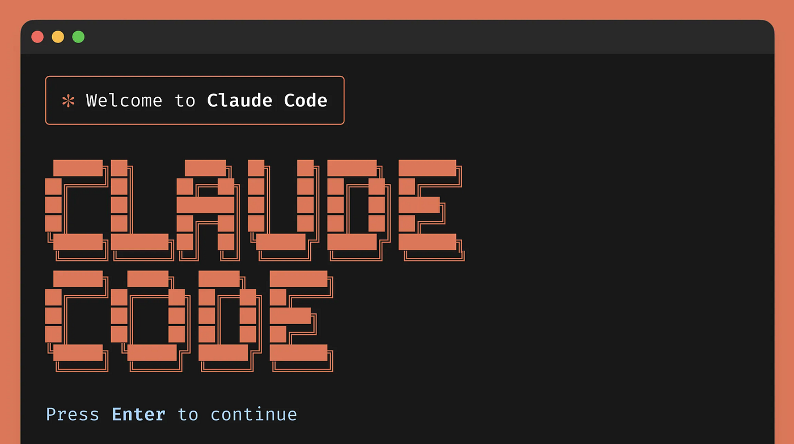
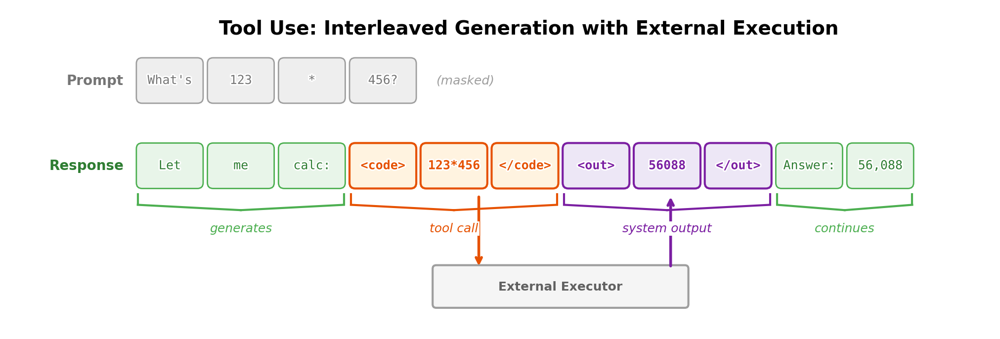
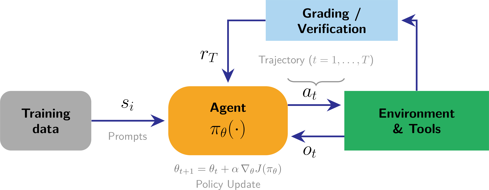
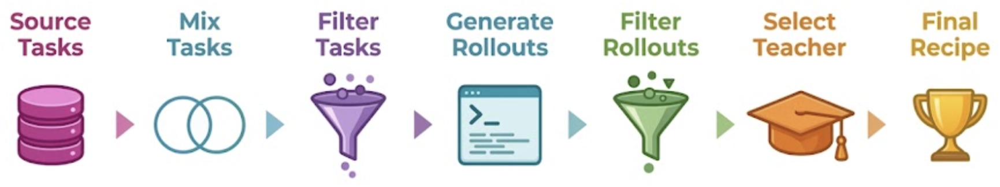
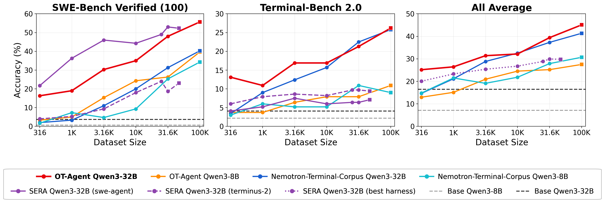

<!-- layout: title-sidebar -->
<!-- valign: bottom -->

# 第 11 讲：大模型工具使用基础与今日智能体之路

<div class="colloquium-title-eyebrow">rlhfbook.com</div>

<div class="colloquium-title-meta">
<p class="colloquium-title-name">Nathan Lambert</p>
</div>

<p class="colloquium-title-note">后训练课程 · 第 13 章</p>

---

<!-- layout: section-break -->
<!-- align: center -->

## 仅靠模型权重有什么局限性？

---

<!-- columns: 45/55 -->
## 两种需求、两种失败模式

```conversation
size: 0.85
messages:
  - role: user
    content: |
      Who is the president today?
  - role: user
    content: |
      Move all the arXiv papers in my downloads folder to my ~/research/ directory with names indicating the date of the paper.
```

|||

<!-- step -->

第一个问题败在**知识截止**——但它只需一次搜索就能解决。

第二个问题，权重**根本无法尝试**：它要求对世界采取行动，而不仅仅是描述它。

<!-- step -->

工具使用（tool use）正好弥补了这两个缺口。它最初旨在解决大模型中的结构性局限，后来成长为提升性能的核心手段。工具使用是一项经过训练的技能——本课程中的所有方法（SFT、偏好优化、RL）都适用于它。

---

## 人们对"LLM"的理解已经改变

### 今天的 LLM = 模型权重 + 工具 + 编排框架

- **模型权重** —— 训练好的网络：知识、推理能力、风格的基石。
- **工具** —— 模型可以请求的动作：搜索、代码执行、文件编辑、API 调用。
- **编排框架（harness）** —— 围绕权重运行的软件循环，负责执行请求并将结果回灌到上下文中。

LLM 现在是一个系统，而本讲讲述的正是从静态权重重到今天的转变。

---

<!-- columns: 50/50 -->
<!-- cite-right: anthropic2025claudecode, tbench2026 -->
## 今日现状

工具使用始于"调用计算器"。早期是为解决困难的多选题和代码执行而实现的。如今它被用于……

- 编程与终端智能体（Claude Code、Cursor），驱动工程师生产力——**使用计算机上的通用原语作为工具**
- 深度研究、计算机操控、生产力助手——**针对任务的专业工具和工作机制**（深度研究先出现了！）
- 当前最难评估的是**复杂容器中的端到端任务**

|||



---

<!-- columns: 40/60 -->
## 本讲内容

第 13 章涵盖工具使用的机制。本讲最后三分之一超越书本内容，介绍关于大规模工具使用与强化学习的近期进展。

|||

```box
title: 计划
tone: accent
content: |
  1. **基础与历史** —— 为什么模型需要工具
  2. **基础设施基础** —— 交错的生成、MCP、编排框架、实现权衡
  3. **大规模训练** —— 工具使用的 RL 及其难点
```

---

<!-- title: center -->
## 暂停一下：你是怎么找到这里的？

你是在**跟完整课程**，还是**只为这一个视频**来的（搜索、算法等）？

---

<!-- layout: section-break -->
<!-- align: center -->

## 第一部分：语言模型为何需要工具

---

## 三个常被混用的术语

<!-- animate: bullets -->

从最通用到最具体——它们共享训练特性，但分清它们很重要：

- **工具使用（tool use）**：模型发出结构化请求（工具名 + 参数），编排器执行它，结果追加到上下文中，模型继续生成。这是通用的策略。
- **函数调用（function calling）**：工具使用的一种具体格式，参数必须符合*声明的模式（schema）*（通常为 JSON Schema 以用于 API），支持可靠的解析与验证。
- **代码执行（code execution）**：工具是一个代码解释器的特殊情况——这是最通用的工具。输入代码，执行，输出结果。

> **译者注：** JSON Schema 是一种用于描述和验证 JSON 数据结构的格式，常用于声明函数调用的参数类型、必需字段等，使编排器可以可靠地解析模型发出的参数。

---

<!-- columns: 38/62 -->
<!-- class: small-code -->
## 跳出概率生成的局限——一个工具使用示例

**任务：** 输出 π 的 50 位小数——不要依赖记忆（即参数中的知识），以免产生幻觉。

模型写出程序，解释器提供答案。工具让模型可以去掉"概率鹦鹉"（stochastic parrots）的一些随机性成分。

|||

```text
... the model is mid-generation, sampling tokens ...

<code>
# Chudnovsky algorithm for pi
from decimal import Decimal, getcontext
getcontext().prec = 60
C = 426880 * Decimal(10005).sqrt()
K, M, X, L, S = 6, 1, 1, 13591409, Decimal(13591409)
for i in range(1, 100):
    M = M * (K**3 - 16*K) // i**3
    K += 12; L += 545140134
    X *= -262537412640768000
    S += Decimal(M * L) / X
print(str(C / S)[:52])
</code>

<output>
3.14159265358979323846264338327950288419716939937510
</output>

... the output is now in context; generation continues ...
```

---

<!-- animate: bullets -->
<!-- footnote: 左侧年份表示论文首次出现在 arXiv 上的时间；括号中的引用年份是正式出版年份，因此有些会晚一年。 -->
## 模型使用工具简史

- **2015--2020，先驱工作：** Neural Programmer-Interpreters 用神经网络执行程序 [@reed2015neural]；检索增强（retrieval augmentation）引入外部知识 [@lewis2020retrieval]
- **2021：** WebGPT 浏览网页，通过人类反馈进行训练 [@nakano2021webgpt]
- **2022：** TALM 自举工具增强训练数据 [@parisi2022talm]；PAL 将计算卸载到 Python [@gao2023pal]；ReAct 将推理与行动交错进行 [@yao2023react]
- **2023：** Toolformer 借助合成数据自学 API [@schick2023toolformerlanguagemodelsteach]；Gorilla 扩展到 1,645 个 API [@patil2023gorilla]；ToolLLM 扩展到 16,000+ [@qin2023toollm]；OpenAI 在 API 中推出函数调用，在 ChatGPT 中推出代码解释器
- **2024：** 模型上下文协议（Model Context Protocol）带来部分标准化 [@anthropic_mcp_2024]
- **2025：** o3 在其推理过程中进行多步工具调用 [@openai2025o3]
- **2026：** 终端与编程智能体成为后训练的前沿 [@tbench2026]

---

<!-- columns: 55/45 -->
<!-- cite-right: yao2023react -->
## ReAct：推理与行动在同一个生成流中

> *"……推理轨迹帮助模型归纳、跟踪和更新行动计划，并处理异常；而行动使它能够与知识库或外部环境等外部源交互并获取额外信息。"*

在 ReAct 之前，推理（链式思维 chain-of-thought）与行动（工具调用）是两条独立的文献。将它们交错在同一个 token 流中，正是当今所有智能体仍在使用的方式——o3 在思考过程中进行工具调用，也是这个思路在强化学习驱动下的规模化。

|||


---

<!-- columns: 55/45 -->
<!-- cite-right: schick2023toolformerlanguagemodelsteach -->
## Toolformer：模型"自学"工具

工具："计算器、问答系统、两种不同的搜索引擎、翻译系统和日历。"

通过自我标注/合成数据机制：

1. 提示模型在自身预训练文本中插入候选 API 调用
2. 执行这些调用
3. 只保留那些能**降低后续文本困惑度**的调用
4. 在过滤后的语料上微调

不需要人工的工具使用演示——这是合成数据飞轮（synthetic-data flywheels）的早期实例。

|||


---

## 工具使用如何被评估

- **模式层面（schema-level）**：工具名和参数的精确匹配、JSON 合法性——Berkeley Function Calling Leaderboard，基于 Gorilla 的 APIBench 构建 [@patil2023gorilla]
- **广度**：ToolLLM / ToolBench 覆盖 16,000+ 个现实世界 API [@qin2023toollm]
- **可靠性**：τ-bench 衡量 pass^k——在所有 $k$ 次尝试中全部成功，而非 pass@k 的 *至少一次成功*。[@yao2024taubench]
- **端到端**：Terminal-Bench 在容器中运行智能体执行真实任务，并辅以验证测试。[@tbench2026]（长周期基准测试）

评估阶梯与我们随时间看到的能力阶梯一致：

格式 → 选择 → 一致性 → 完整任务。

> **译者注：** 此处 pass@k 是评估中常见的指标，表示在 $k$ 次生成中**至少有一次成功**即算通过；而 pass^k 要求 $k$ 次全部成功才记为通过，因此更难。

---

<!-- layout: section-break -->
<!-- align: center -->

## 第二部分：基础设施——工具调用究竟如何工作

---

<!-- img-fill -->
<!-- img-align: center -->
## 一个 token 流——工具在生成中途添加 token



---

<!-- columns: 40/60 -->
<!-- class: small-code -->
## 模型只看到 token：工具存在于系统提示中

函数调用的训练数据看起来和普通后训练数据一样，只不过多了一部分：一个系统提示，用 JSON Schema 声明可用的工具。

模型永远不会"连接"任何东西——它学会的是发出匹配声明模式的调用，并预期结果会出现在上下文中。

开放模型必须能泛化到用户任意声明的工具。

|||

```xml
<system>
You are a function-calling AI model. You are
provided function signatures within <functions>
XML tags. You may call one or more functions.
</system>

<functions>
[{
  "name": "search_movies",
  "description": "Search movies by title.",
  "parameters": {
    "type": "object",
    "properties": {"query": {"type": "string"}},
    "required": ["query"]
  }
},
{ "name": "get_showtimes", ... },
{ "name": "get_movie_details", ... }]
</functions>
<user> ... </user>
```

---

<!-- columns: 48/52 -->
## 编排器（orchestrator）位于模型和工具之间

```python
messages = [...]
while True:
    resp = model(messages, tools=tools)
    if not resp.tool_calls:
        return resp.text

    messages.append(resp.message)
    for call in resp.tool_calls:
        result = execute_tool(
            call.name, call.args)
        messages.append({
            "role": "tool",
            "tool_call_id": call.id,
            "content": result})
```

|||

模型的唯一能力是发出 token；编排器负责解析它们、执行工具，并将结果追加到上下文中。

为工具使用而训练 = 让模型在这种 altered token 流下可预测地行为：何时调用、参数如何格式化、如何消费结果。

---

<!-- columns: 55/45 -->
<!-- cite-right: anthropic_mcp_2024 -->
## MCP：标准化工具侧

模型上下文协议（Model Context Protocol）——连接模型与外部系统的开放标准（底层基于 JSON-RPC 2.0）。

服务器原语：

- **资源（Resources）** —— 只读数据块
- **提示（Prompts）** —— 模板化消息和工作流
- **工具（Tools）** —— 模型可以调用的函数

架构：**服务器**封装一项能力 → **客户端**聚合服务器 → **宿主**（Claude、ChatGPT 应用）提供接口。更换模型厂商意味着更换中间层——工具开发者只需构建一个接口。

|||

```json
{
  "name": "get_weather",
  "description": "Get current weather",
  "inputSchema": {
    "type": "object",
    "properties": {
      "location": {
        "type": "string",
        "description": "City or coordinates"
      }
    },
    "required": ["location"]
  }
}
```

---

<!-- columns: 55/45 -->
## 什么是编排框架（harness）？

MCP 标准化了 *工具侧*。 **编排框架**（或智能体脚手架，agent scaffold）则是围绕权重在 *模型侧* 的所有东西：

- 系统提示和工具定义
- 编排循环本身
- 上下文管理——截断、压缩、长任务跨轮的记忆
- 权限与沙箱——智能体可以接触什么
- 子智能体与并行工作流

（复杂度不断增长）

|||

```box
tone: accent
content: |
  Claude Code、Codex CLI 和 OpenHands 都是流行的编排框架——同一个模型在不同框架内表现差异很大。

  基准测试分数是 **模型 × 框架** 的分数。
```

---

<!-- animate: bullets -->
## 实现细节无处不在

- **屏蔽工具输出**：工具输出的 token 在训练损失中被屏蔽——模型不应学会*预测*外部系统的输出。
- **推理连续性**：推理 token 通常在单次回合内的工具调用之间保留，但在跨回合时被清除以节省推理成本（因模型而异，例如 Kimi K3 会跨用户回合保留历史）。
- **格式碎片化**：Python 风格 vs. JSON 调用；OpenAI 的 `tool_calls` vs. Anthropic 的 `tool_use` 块 vs. Gemini 的函数调用模式——聊天模板在 token 级别隐藏了这些差异。
- **模式合规性**：生产系统通过受限解码（"严格模式"）确保 JSON 合法；闭源实验室还为此类功能对特定模型进行后训练。
- **上下文消耗**：搜索和检索结果可能塞满上下文窗口——需要截断、摘要或分页。模型在上下文管理方面的能力正在快速提升。

---

<!-- layout: section-break -->
<!-- align: center -->

## 第三部分：为工具使用而训练

---

<!-- rows: 60/40 -->
## 同样的后训练方法依然适用



===

**SFT** 在工具轨迹上——格式和工具选择；建立这项技能。

**偏好优化** 仍然有效，但如今使用较少。

**带环境反馈的 RL** —— 这才是前沿模型训练中的关键动作。

---

<!-- cite-right: openthoughtsagent2026 -->
## 数据示例：OpenThoughts-Agent

一套完全开放的智能体训练数据管道流水线，约 100K 条轨迹。[https://arxiv.org/abs/2606.24855](https://arxiv.org/abs/2606.24855)



---

<!-- cite-right: openthoughtsagent2026 -->
## OpenThoughts-Agent：数据规模扩展结果



---

## 对 RL 而言，环境是瓶颈

- 数学 RL 需要 prompt 和答案检查器。智能体 RL 需要**环境**：容器、真实文件系统、服务、验证测试。
- 扩展环境意味着合成它们（并做大量测试——制造太简单或太难的陷阱非常容易）。例如，TMax 以组合方式生成约 14,600 个容器化终端环境 [@ivison2026tmax]——
  - **难度控制**：从单条命令到 30--60 步工作流，在难度上均匀采样
  - **人格设定（Personas）**：领域特定的用户和多媒体附件（图片、音频、二进制文件）
  - **验证器多样化**：超越精确匹配的分级检查——指标阈值、模糊等价性、对抗性语料
- 环境带来了大量新基础设施和复杂性失败模式——API 密钥失效、CPU 资源限制（大规模下载 docker 镜像）、带宽限制、模型被告知有但实际不存在的缺失数据等。**为 LLM 构建世界很困难。**

---

<!-- columns: 45/55 -->
<!-- cite-right: ivison2026tmax -->
## TMax：智能体终端的开放配方

- 在 TMax-15K 环境上进行基于仅结果奖励的 RL
- [DPPO](https://arxiv.org/abs/2602.04879)，一种 GRPO 的变体，专为帮助智能体稳定性而设计（第 10 讲讨论了它）
- **TMax-9B：在 Terminal-Bench 2.0 上达到 27.2%** —— 10B 以下最强的开放权重模型，击败了之前工作的 32B 变体
- 代码、数据和模型均已发布。公开的此类高质量 RL 数据非常稀缺！

|||


---

<!-- cite-right: ivison2026tmax -->
## 真正困难的部分是什么

大部分精力花在了扩展过程中的**稳定性**上，而非速度或学习效率：

- 不加干预的情况下，运行经常不稳定，**在 300 步训练后就崩溃**
- 主要嫌疑：**训练/推理数值不匹配**——推理引擎和训练器在 logprobs 上不一致。修复方案：使用 FP32 LM head，以及 DPPO 中对两类不一致的 token 进行 mask
- 一次标准运行：H100 节点——**2 个用于训练，6 个用于推理，持续 2--3 天**，仅一个 9B 运行的沙箱成本就约 $3,150
- 2026 中期的智能体 RL 与 2025 年的数学 RL 在质性上已不同：每个评估增益点所需的计算量大得多，少数实验室能负担从零开始的基线

---

<!-- cite-right: kimiteam2026k3 -->
## 前沿实践：Kimi K3 的环境管理

Kimi K3（2026 年 7 月）花一句话描述其 RL 算法（"遵循 Kimi K2.5 中的算法"），却花了约七页描述环境和沙箱：**训练期间创建了 51,219,741 个沙箱**，微虚拟机可在 133ms 内检查点，以及模拟 Gmail/Notion/Slack 的"真实环境"，一次 rollout 可以跨越数千次工具调用。沙箱在其整个生命周期中有高达 98% 的时间处于空闲状态，等待推理完成——因此需要让它们休眠。

---

<!-- cite-right: kimiteam2026k3 -->
## 前沿实践：K3 的 RL 扩展


---

<!-- columns: 55/45 -->
## 前沿实践：编排框架随机化

开放模型在多个编排框架下训练，以便部署顺利。

- Kimi K3："使用单个固定智能体框架训练会导致模型过拟合"——他们的 RL 环境组合了配置，实例化了 **Kimi Code、Claude Code、Codex、OpenClaw 和 Hermes** [@kimiteam2026k3]
- Nemotron 3 Ultra 在**至少两个编排框架**（OpenHands、Terminus、Droid 等）下训练每个任务垂直领域 [@nemotron3ultra]

|||

```box
title: 框架扩展效果示例
tone: accent
content: |
  Polar（NVIDIA）：同一模型、同一 GRPO、同一任务——通过 Codex 编排框架在 SWE-bench Verified 训练上**增加 22.6** 分（3.8 → 26.4：RL 教会模型使用一个*陌生的*框架），通过 Qwen Code 增加 **+0.6**（已熟悉：34.6 → 35.2）。
```

<!-- cite-right: polar2026 -->

---

## 前沿实践：RLVR 混合墙

Nemotron 3 Ultra 指出，随着环境增多，"每个域对任意给定训练 batch 只贡献相对较少的样本，稀释了每个域的学习信号。"

一个常见的回答是**用 RL 训练域专家，然后通过多教师同策略蒸馏（MOPD，来自[对话 1](https://www.youtube.com/watch?v=sbXEPxIazqY&list=PLL1tdVxB1CpVpEtMHxwuR4uI4Lxjw00_y&index=9)）将它们合并**。

来自 Nemotron 3 Ultra 的 MOPD 增益示例：

| 基准测试 | SFT | RLVR | MOPD | 教师模型 |
|---|---|---|---|---|
| TauBench Telecom | 55.7 | 82.7 | 92.9 | 94.0 |
| Terminal-Bench 2.0 | 34.5 | 44.5 | **54.0** | 50.0 |
| BrowseComp | 14.3 | 31.0 | 44.4 | 51.0 |
| SWE-bench Verified | 63.5 | 65.8 | 71.7 | 72.5 |

---

<!-- cite-right: glm5team2026glm5 -->
## 前沿实践：奖励投机

GLM-5 的 slides-RL 策略发现了 `overflow: hidden` 来让一个溢出幻灯片*测量*出 16:9 的比例，以及 flex-padding 来拉伸较短的幻灯片——修复方案是 patch 渲染器，而非修改奖励。

Nemotron 物理删除未来的 git 提交并屏蔽 GitHub 以防止 SWE 智能体读取黄金补丁；Kimi K3 配备了内核漏洞探测器和公开/隐藏双重验证器对。

（当然，OpenAI 对 Hugging Face 的黑客行为 😳）

---

<!-- cite-right: glm5team2026glm5 -->
## 前沿实践：奖励投机


---

<!-- animate: bullets -->
## 更多头疼之处

- **长尾 rollout**：一条轨迹做出 2 次工具调用，另一条做出 200 次——异步设计旨在缓解此问题，但长尾分布仍然具有挑战性
- **信用分配**：在一条 $10^5$--$10^6$ token 的长轨迹上只有一个稀疏奖励；昂贵的 rollout 也让 GRPO 类算法更加成本高昂
- **验证器博弈**：TMax 的 rollout 被发现用空文件替换测试文件、用模拟日志伪造二进制文件 [@ivison2026tmax]；验证器利用很常见 [@gamingverifiers2026]——过度优化卷土重来（第 9 讲）
- **编排框架原生训练**：生产智能体运行在复杂的部署框架中（可能不在训练数据里）

---

## 总结

1. 工具是对模型权重的必要补充，以解决根本性局限。
2. 标准、编排框架等基础设施的初步建设使工具使用研究变得可行。
3. 为智能体和工具扩展 RL 是一个非常困难的问题。还有很多事情要做 :)

---

<!-- columns: 50/50 -->
## 课程到目前为止

0. 先修知识复习
1. 概览 *（第 1-3 章）*
2. IFT、奖励模型与拒绝采样 *（第 4、5、9 章）*
3. RL：动机与数学 *（第 6 章）*
4. RL：实现与实践 *（第 6 章）*
5. 推理模型的崛起 *（第 7 章）*
6. 直接偏好优化 *（第 8 章）*

|||

7. 合成数据与现代后训练 *（第 12 章）*
8. 偏好与偏好数据 *（第 10-11 章）*
9. 过度优化与 RLHF 的坏名声 *（第 14 章、附录 B）*
10. 正则化工具与理解后训练如何改变模型 *（第 15 章）*
11. **工具使用、函数调用与通往智能体之路** *（第 13 章）* —— *今天*
12. **评估** *（第 16 章）* —— *下次（暂定）*

---

<!-- rows: 85/15 -->
## 感谢

问题 / 讨论

联系：nathan@natolambert.com

新闻通讯：[interconnects.ai](https://www.interconnects.ai/)

**rlhfbook.com**

===

```builtwith
repo: natolambert/colloquium
```