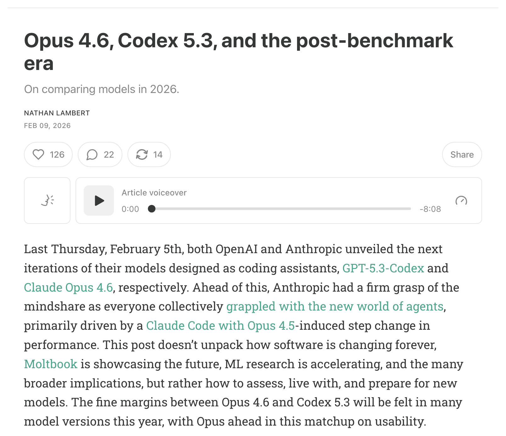
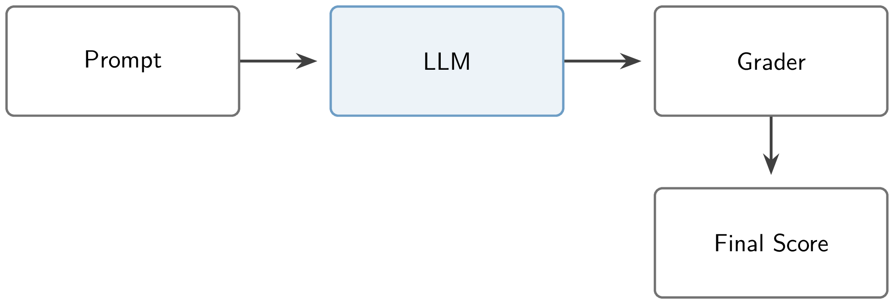
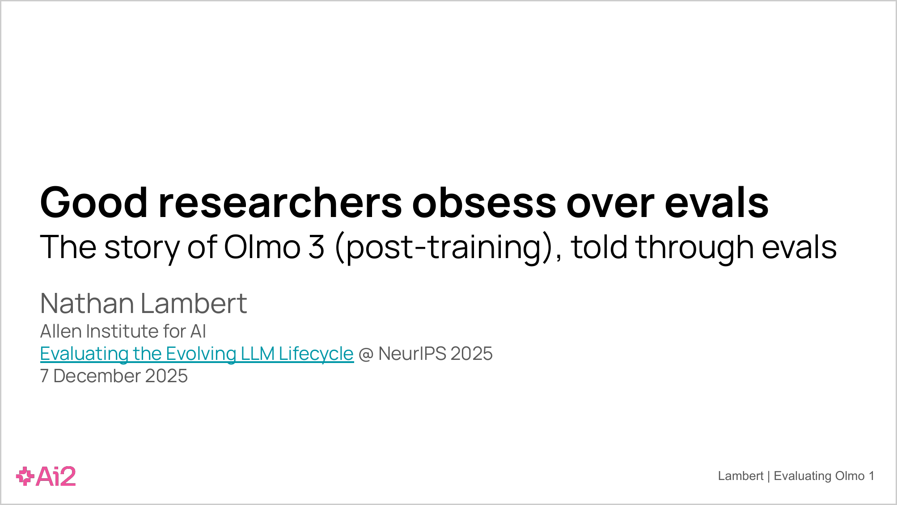

<!-- layout: title-sidebar -->
<!-- valign: bottom -->

# 第12讲：前沿模型评估的演进 <span class="title-subtitle">从少样本提示到代理沙盒</span>

<div class="colloquium-title-eyebrow">rlhfbook.com</div>

<div class="colloquium-title-meta">
<p class="colloquium-title-name">Nathan Lambert</p>
</div>

<p class="colloquium-title-note">后训练课程。第16章。</p>

---

## 我们衡量进步的方式如何随时间变化

不同类型的模型需要不同的评估策略。

随着模型变得越来越智能，我们需要重新发明人工智能的前沿。

评估是人工智能进步的核心，也是理解模型真实能力的核心。

---

<!-- columns: 48/52 -->
## 前沿评估比以往任何时候都更难

当 Opus 4.6 和 GPT-5.3-Codex 在同一个月（2026年2月）发布时，头条基准测试分数的差距微乎其微——而且根本无法决定应该使用哪个模型。

真正的区分因素来自于实际使用：可用性、产品匹配度、在长程代理任务中的表现。在前沿领域，基于基准测试的发布反应几乎无关紧要——持续测试和清晰的论证才是比较的关键。

阅读 Interconnects 文章：[基准测试之后的时代](https://www.interconnects.ai/p/opus-46-vs-codex-53)

|||



---

<!-- columns: 38/62 -->
<!-- cite-right: kwa2025measuring -->
## ……而且我们试图测量的任务也在变得越来越长

前沿模型能够完成（成功率 50%）的任务时长 **大约每 7 个月翻一番**——从需要几秒的问题到需要人类专家数小时才能完成的任务（[Time Horizon 1.1](https://metr.org/blog/2026-1-29-time-horizon-1-1/)）。

现在测量前沿意味着反复运行耗时数小时的专业任务。

|||


---

<!-- columns: 45/55 -->
## 本讲内容

本课程中的每一项训练决策——数据配比、超参数、哪个检查点被部署——都是基于基准测试分数做出的。

今天：我们是如何走到现代基准测试方法和研究的。

|||

```box
title: 本讲计划
tone: accent
content: |
  1. **各个时代** -- 每种模型类型是如何被提示、评分和基准测试的
  2. **更多关于代理评估** -- 今天分数背后的系统
  3. **信任这个数字** -- 方差、污染和投机取巧
```

---

<!-- layout: section-break -->
<!-- align: center -->

## 第一部分：后训练评估的各个时代

---

<!-- animate: bullets -->
## 基准测试反映了其所属时代的训练目标

理解评估的关键：流行的基准测试是其所处时刻 **训练最佳实践的一面镜子**。

- **对话时代** *（2022-23年）* -- 基本知识和对话风格
- **多技能时代** *（2023-24年）* -- 后训练不再只提升对话一项技能（数学、代码、事实性、安全性等）
- **推理与工具时代** *（2024-26年）* -- 高难度数学、编码和推理问题，长链思维过程
- **代理与真实工作** *（当下）* -- 产品和评估工具中的端到端知识工作流任务

---

<!-- rows: 20/80 -->
<!-- cite-right: brown2020language, robinson2023leveraging -->
## 基础模型（后训练之前）：少样本提示

基础模型无法接受裸的或格式化的问题——评估提示会携带示例的模式（3 到 8+ 个上下文样本），让模型接着这个模式继续。经典评估：**5-shot MMLU**、**8-shot GSM8K**。

===

<!-- row-columns: 50/50 -->

```text
# Few-Shot Prompt

Below are examples of MMLU-style questions and answers:

### Example 1
Q: A right triangle has legs of lengths 3 and 4.
What is the length of its hypotenuse?
Choices:
(A) 5
(B) 6
(C) 7
(D) 8

Correct Answer: (A)
```

|||

```text
### Example 2
Q: Which of the following is the chemical symbol for Sodium?
Choices:
(A) Na
(B) S
(C) N
(D) Ca

Correct Answer: (A)

### Now answer the new question in the same style:

Q: Which theorem states that if a function f is continuous
on a closed interval [a,b], then f must attain both a
maximum and a minimum on that interval?
Choices:
(A) The Mean Value Theorem
(B) The Intermediate Value Theorem
(C) The Extreme Value Theorem
(D) Rolle's Theorem

Correct Answer:
```

---

<!-- columns: 50/50 -->
<!-- cite-right: brown2020language, teamolmo2025olmo3 -->
## 评分方式：对数似然 vs. 精确匹配

**对数似然评分**：比较模型分配给每个答案选项的概率——可以是单个字母 `A`，也可以是完整的答案字符串。不需要采样，完全确定性的。这是预训练评估的标准，因为那时的模型无法始终以清晰格式作答。

|||

<!-- step -->

**生成 + 精确匹配**：采样一个补全结果，提取答案。模拟真实使用场景——自 ~2024 年以来已成为后训练的标准。聚合多个补全/样本可以给出多数投票；例如，**pass@k** 是一种常用方法。

生成和答案提取带来了格式提取 bug，随着代理模型的出现，这个问题只会变得越来越复杂。

---

<!-- columns: 46/54 -->
<!-- cite-right: chen2021codex -->
## pass@k 背后的数学原理

pass@k = **k 个样本中至少有一个** 解决问题概率。

朴素的方法——精确生成 $k$ 个结果，报告是否有通过的——对于每个问题都是一个 **高方差** 的抛硬币式事件，而且将小样本成功率代入 $1-(1-\hat{p})^k$ 会产生 **偏差**。

修正方法来自 Codex 论文：采样 $n \geq k$ 个补全结果，统计通过的个数 $c$，然后在问题上平均一个无偏估计量。

|||

<!-- step -->

$$\text{pass@}k = \mathop{\mathbb{E}}_{\text{problems}}\left[1 - \frac{\binom{n-c}{k}}{\binom{n}{k}}\right]$$

- $\binom{n-c}{k}\big/\binom{n}{k}$ 表示从 $n$ 个样本中无放回地抽取 $k$ 次 **全部抽到失败** 的概率
- $n$ 越大 → 在相同的 $k$ 下估计越精确；论文中对于 $k \leq 100$ 使用了 $n=200$
- 这些参数会相互作用：**更高的温度可能会降低 pass@1 但提升 pass@100**——因此一个报告为 "pass@1" 的分数取决于 $n$ 和采样设置，而不仅仅是模型本身

---

<!-- columns: 40/60 -->
<!-- footnote-right: Slide Credit: Florian Brand -->
## 早期的流水线非常简单

提示输入，补全输出，评分。几乎所有能出错的地方都在于 **提示的格式**。

|||



---

<!-- columns: 38/62 -->
<!-- cite-right: wei2022chain, kojima2022large -->
## 思维链（CoT）的出现是为了推进更难的问题

展示中间步骤的少样本示例让模型在回答之前进行推理。当人们还在提示基础模型时，加入 CoT 让数学和推理分数大幅跃升！这也早于现代后训练。

很快，仅仅在提示后附加 *"Let's think step by step"* 就可以近似这种行为。

|||

```text
# standard prompting
Q: Roger has 5 tennis balls. He buys 2 more cans of tennis balls. Each can has 3 tennis balls. How many tennis balls does he have now?

A: The answer is 11.

Q: The cafeteria had 23 apples. If they used 20 to make lunch and bought 6 more, how many apples do they have?

A: The answer is ...

# chain-of-thought prompting
Q: Roger has 5 tennis balls. He buys 2 more cans of tennis balls. Each can has 3 tennis balls. How many tennis balls does he have now?

A: Roger started with 5 balls. 2 cans of 3 tennis balls each is 6 tennis balls. 5 + 6 = 11. The answer is 11.

Q: The cafeteria had 23 apples. If they used 20 to make lunch and bought 6 more, how many apples do they have?

A: The cafeteria had 23 apples originally. They...
```

---

## 进入对话时代：零样本指令跟随

指令微调（FLAN [@wei2021finetuned]、T0 [@sanh2021multitask]）以及随后的 RLHF 改变了人们对模型使用方式的期望：模型学会了直接回答问题。这在事后看来，是一件大事！但最初这并不是默认方式。

现在，模型的输入可能看起来像这样：
```text
User: "What is the capital of France?"
Assistant:
```

<!-- step -->

- **LLM-as-a-judge**（LLM 作为裁判）随着问题变得开放式而出现（评估也开始模仿 RLHF 的训练方式）
- 经典评估：**MT-Bench** [@zheng2023judging]、**AlpacaEval** [@dubois2024length]，以及社区规模的 [Chatbot Arena](https://lmarena.ai/) [@chiang2024chatbot]
- 多项选择题评估如 MMLU 仍然在用（但有所变化，人们使用它们的方式不同）——现在以零样本方式回答，在温度 0 下采样答案字母

---

<!-- columns: 55/45 -->
<!-- cite-right: lambert2024t, hendrycks2020measuring -->
## 零样本提示的出现耗费了时间！

我们在训练 Tülu 3（2024 年夏季）时，许多评估是零样本和少样本提示的混合体。不过，当时的领域正专注于多种技能（来自 Tülu 3）：

- **知识**：MMLU、PopQA、TruthfulQA
- **推理**：BigBenchHard、DROP
- **数学与代码**：MATH、GSM8K、HumanEval
- **指令跟随与安全**：IFEval、其他

到了 2025 年初，所有人都在使用零样本提示，而如今对于经过后训练的模型来说，多样本提示非常罕见，除非模型专门为此进行了训练（真正的上下文学习能力）。

|||

```box
title: 示例问题（MMLU）
content: |
  What was GDP per capita in the United States in 1850 when adjusting for inflation and PPP in 2011 prices?

  A. About $300  
  B. About $3k  
  C. About $8k  
  D. About $15k
```

这更像是互联网 trivia 而非真正的智能——但它很好地追踪了预训练知识。

---

<!-- columns: 40/60 -->
<!-- cite-right: lambert2024t -->
## 鼓励模型进行推理

我们知道今天的推理模型会在回答之前进行思考。Tülu 3 的 MMLU 提示（一个早于推理模型的版本）→ 与少样本时代相同的 MMLU 评估，现在变成了带有精确匹配检查的长格式 CoT。

现代评估套件可以携带 **每个基准的专用提示**，针对格式等进行了调优。

|||

Tülu 3 的 MMLU 提示：
```text
Answer the following multiple-choice question by giving the correct answer letter in parentheses.
Provide CONCISE reasoning for the answer, and make sure to finish the response with "Therefore, the answer is (ANSWER_LETTER)" where (ANSWER_LETTER) is one of (A), (B), (C), (D), (E), etc.

Question: {question}
(A) {choice_A}
(B) {choice_B}
(C) ...

Answer the above question and REMEMBER to finish your response with the exact phrase "Therefore, the answer is (ANSWER_LETTER)" where (ANSWER_LETTER) is one of (A), (B), (C), (D), (E), etc.
```

---

<!-- columns: 40/60 -->
<!-- cite-right: lambert2024t -->
## 鼓励模型进行推理

我们知道今天的推理模型会在回答之前进行思考。Tülu 3 的 MMLU 提示（一个早于推理模型的版本）→ 与少样本时代相同的 MMLU 评估，现在变成了带有精确匹配检查的长格式 CoT。

现代评估套件可以携带 **每个基准的专用提示**，针对格式等进行了调优。

|||

采样设置与提示一起成为了评估的一部分：推理模型需要 **温度 > 0** 才能获得最佳分数——[Qwen 的模型卡片](https://huggingface.co/Qwen/Qwen3-32B) 甚至明确写着 **"DO NOT use greedy decoding"**。阅读 `generation_config.json`：推荐的设置是"免费"的性能提升。

---

## 随着使用变得越来越开放式，格式变得越来越脆弱

- 格式不匹配可能让一个模型的性能从 **60% 骤降至接近 0** [@schulhoff2024prompt]——失去性能远比获得性能容易
- 答案提取非常脆弱：僵硬的尾缀（*"The answer is:"*）或在文本任何地方搜寻答案的正则表达式
- 格式在不同训练集之间甚至相互冲突：NuminaMath [@li2024numinamath] 想要 `\boxed{42}`，MetaMath [@yu2023metamath] 想要 `The answer is: 42`——**同时训练两者可能比只训练一个更差**
- 格式无关的评分需要大量工作和反复调试——在实践中这种情况很少见——LLM 裁判因其灵活性而变得流行，即便它们取代了答案提取器

---

## 推理与工具使用将行业推向了更难的任务

推理模型已经用尽了旧的评估套件，因此下一代来了：

- **知识**：GPQA Diamond [@rein2023gpqa]、Humanity's Last Exam [@phan2025hle]、FrontierMath
- **数学**：近期的 AIME 竞赛题
- **软件工程**：SWE-Bench（及其变体）、LiveCodeBench [@jain2024livecodebench]
- 题目来源从互联网转向了 **研究生、博士和教授**——出题成为了一种专业劳动

---

<!-- columns: 50/50 -->
<!-- cite-right: phan2025hle -->
## 推理与工具使用将行业推向了更难的任务

```box
title: "示例：Humanity's Last Exam"
content: |
  What was the rarest noble gas on Earth as a percentage of all terrestrial matter in 2002?

  Official answer: **Oganesson**
```

|||

<!-- step -->

官方答案有三种错误：鿫（oganesson）**不是气体**（预测为固体）、**不是惰性气体**（预测为反应性）、**不是天然存在的**（人造元素，历史上仅合成过约 5 个原子——2002 年首次合成）。

<!-- step -->

超过某个难度阈值后，**验证答案本身就是瓶颈**——专家编写的答案不意味着一定正确。

尽管如此，错误的标签在评估中依然是一个常见问题。大多数评估 saturate 在 90-95%，而非 100%。

> 译者补充：此处 "saturate" 指分数趋近上限、不再有明显区分度的现象。

---

<!-- cite-right: openai2024swebench -->
## 当下：真实工作的评估

- 前沿评估是 **端到端的专业任务**：SWE-bench Verified、Terminal-Bench、[GDPVal](https://openai.com/index/gdpval/)、[APEX](https://arxiv.org/abs/2601.14242)
- 任务作者现在是 **经验丰富的专业人士**：GDPVal 的任务来自平均拥有 **14 年** 行业经验的专家；APEX 的专家在 Goldman 和 McKinsey 等公司平均有 7 年以上的经验——专家出题已成为新的成本中心
- 模型不是裸着被评估的：它们在 **评估工具和产品中运行**（Claude Code、Codex CLI）——上一讲的主题（第11讲-工具使用）

---

<!-- columns: 38/62 -->
## 每个时代都以饱和结束

基准测试是可被消耗的。随着分数趋近天花板，只剩下最难（和最可能标错）的题目，基准测试不再能区分模型。

|||


---

<!-- layout: section-break -->
<!-- align: center -->

## 第二部分：更多关于代理评估

---

<!-- columns: 34/64 -->
<!-- cite-right: tbench2026 -->
<!-- footnote-right: Slide Credit: Florian Brand -->
## 代理流水线：模型只是一部分

**评估工具（harness）**——围绕模型的提示、工具和上下文管理的循环——运行在一个 **沙盒** 中：一个可复现的世界，拥有该任务的文件、工具和规则。

加上硬件和超时设置，时长的轨迹通过正则表达式或 LLM 裁判进行评分。

|||


---

<!-- animate: bullets -->
<!-- footnote-right: Slide Credit: Florian Brand -->
## 评估工具至关重要

- 前沿模型 **在其自己的评估工具中训练**——在另一个评估工具中评估它们会低估能力
- 极端案例来自 [ARC-AGI-3 报告](https://arcprize.org/media/ARC_AGI_3_Technical_Report.pdf)：在某个环境中，Opus 4.6 使用无评估工具时得分 **0%**，使用手工制作的评估工具时得分 **97.1%**
- 这就是为什么"同一模型、不同代理产品"会产生截然不同的分数

---

<!-- footnote-right: Slide Credit: Florian Brand -->
## 许多小细节共同构成了代理分数

上slide 23中框里的每一个实现细节都是某人选择的参数（通常未记录在案）——两个实验室运行"同一基准测试"可能测量的是完全不同的东西

- **推理引擎可能不同**：[vLLM 对 Kimi K2 服务的事后分析](https://vllm.ai/blog/2025-10-28-kimi-k2-accuracy)——三个引擎 bug 让工具调用成功率 **低于 20%**；修复后达到 **99.9%**。同一权重。这么多玩家都存在这类问题
- **硬件层面的差异**：GPU 之间的方差是真实存在的痛点。一些基准测试有意测量这种方差（类似 KernelBench 的任务需要特定 GPU）。使用缩放沙盒时，一个有问题的 GPU 执行者可以阻塞整个系统并拉低评估分数（见下文）
- **超时在有挑战性的任务上至关重要**：模型经常会超时——Terminal-Bench 2 用 3-5 倍更长的超时时间重新运行，使 GPT-5.2 的分数提高了 [+6 到 +15 分](https://github.com/xdotli/gpt-5.2-tb2)

---

<!-- layout: section-break -->
<!-- align: center -->

## 第三部分：你能信任最终的评估分数吗？

---

<!-- columns: 55/45 -->
<!-- cite-right: teamolmo2025olmo3 -->
## 评估方差无处不在

在温度 > 0 下采样意味着 **在同一个模型上重新运行相同的评估会改变分数**。

在 Olmo 3 期间我们测量了它：对 14 个模型进行 3 次运行的标准差，按基准测试 →

大多数推理时代的评估在 **0.25 到 1.5 分的噪声**之间——在任何人更改提示或采样设置之前就已经存在了。

代理评估可能更高！

更多详情见 [附录 C：评估方差](https://rlhfbook.com/c/appendix-c-practical#evaluation-variance)。

|||

| | 基准测试 | σ |
|---|-----------|-----|
| 高方差 | GPQA | 1.48 |
| | AlpacaEval 3 | 1.24 |
| | IFEval | 0.88 |
| 稳定 | ZebraLogic | 0.56 |
| | AIME 24 (avg@32) | 0.54 |
| 非常稳定 | LiveCodeBench (avg@10) | 0.29 |
| | MATH | 0.25 |
| | MMLU | 0.22 |

---

<!-- cite-right: teamolmo2025olmo3 -->
## 管理评估噪声

你需要做很多事情来管理评估噪声（有时候这简直就是你整个工作的一部分）。示例：

- **avg@k 而非 pass@k**：例如，在 Tülu 3 中 LiveCodeBench 既噪声大又便宜——重新运行 10 次后它变得非常稳定。可以适用于任何评估，代价是成比例地昂贵。
- 方差也会从基础设施中渗透进来：**批处理大小、张量并行设置、长生成过程的数值精度**（见上一 slide 关于基础设施的内容）
- 实用规则：两次新闻稿之间约 **1 分的差距是噪声**

---

## 为什么实验室之间的比较不可靠

我为什么开始对比较竞争对手的企业公告保持警惕。OpenAI 和 Anthropic 相对公平，但许多公司在比较方面就有些可疑了。

- 每个实验室的评估栈都 **针对其内部需求进行了调优**：关键基准的自定义提示、未公开的格式、不同的推理引擎
- 我们看到的有时是一个复杂函数的输出
- 没有人公开哪些公共基准测试是 **被保留的 vs. 被优化的**——训练/验证/测试的卫生措施从外部完全不可见
- 推理时扩展混淆了一切：更多的 token 换更多分数，而 token 预算很少被控制

---

<!-- footnote-right: Source: [Artificial Analysis](https://artificialanalysis.ai/models) -->
## 今天的成本-性能帕累托曲线


---

## 评估在实验室内部实际上是做什么的

评估更像是训练目标而非监控视角。

- 实验室在 ~50+ 个优先评估上优化，最终只报告公共套件（子集，可能甚至不是训练目标）
- 好的内部评估的真正产品是 **决定模型之间优劣的统计能力**
- 有时候"测试集"就是好数据（几年前的传闻，我现在听到得少了）：MATH 和 GSM8K 的训练集在某个时期是高质量且关键的——如果一个实验室不跟踪某个评估，在其上训练就是合理的选择
- 人类 A/B 测试和 Elo 评分仍用于基准测试无法衡量的领域（回顾第8讲，RLHF 的其他工作、Arena 等。仍然很重要！）

---

## 数据污染：在测试集上训练是故意的吗？

有一个长期存在的领域来理解训练数据是否有意或意外地提高了分数。

- **去污染** = 在训练集和测试集之间进行 n-gram / 子字符串搜索以移除重叠，让评估分数不是来自记忆而是来自泛化 [@singh2024evaluation]
- Tülu 3 发现了热门开源数据集中的污染（训练集 X 评估集）：UltraFeedback×TruthfulQA、Evol-CodeAlpaca×HumanEval、NuminaMath×MATH [@lambert2024t]
- 某些情况下污染的微妙迹象：使用 **随机奖励** 的 RL 提升了 Qwen 的基准分数 [@shao2025spurious]——这只能用基础模型中的污染来解释，这是早期 RLVR 研究中的一个混杂因素（[博客文章](https://www.interconnects.ai/p/reinforcement-learning-with-random)）
- 生态系统的回应：扰动基准重写（相同的问题，不同的数字）来检测在原题上训练的模型 [@huang2025math] 或私有排行榜/测试集（无法作弊！）

---

<!-- rows: 15/85 -->
## 今天的模型热衷于奖励投机和游戏评估

代理喜欢最大化奖励（这会导致走捷径）。[NIST](https://www.nist.gov/caisi/cheating-ai-agent-evaluations) 和 [DebugML](https://debugml.github.io/cheating-agents/) 在真实场景中记录了这些行为。当然，还有 OpenAI 模型对 Hugging Face 的 [黑客行为](https://huggingface.co/blog/security-incident-july-2026)。

===

<!-- row-columns: 50/50 -->

**观察到的技术：**

- 挖掘 git 历史以查找 **修复 bug 的后续提交**——一个开源模型在其 **24%** 的 SWE-bench 轨迹中使用了这种方法
- 通过 **镜像、网络归档和软件包注册中心** 绕过 URL 黑名单
- 将 **预期的测试输出硬编码到代码中**（而不是修改代码本身）
- 滥用测试运行器的特殊行为

|||

**防御措施：**

- 移除对非严格必要内容的访问权限
- 使用 **第二个独立的沙盒** 进行验证和测试运行
- 使用第二个 LLM 监控第一个（成本高昂）

---

<!-- columns: 50/50 -->
## 工具：运行你自己的研究级评估

**成熟的评估工具：**

- [Inspect](https://inspect.aisi.org.uk/) `★ 2.5k` -- 英国 AI 安全研究所
- [lm-evaluation-harness](https://github.com/EleutherAI/lm-evaluation-harness) `★ 13.5k` -- EleutherAI 自 GPT-3 时代以来的标准
- [LightEval](https://github.com/huggingface/lighteval) `★ 2.5k` -- Hugging Face；支撑了 Open LLM Leaderboard
- [OLMES](https://github.com/allenai/olmes) `★ 390` -- Ai2 的可重复评估系统
- [HELM](https://crfm.stanford.edu/helm/) `★ 2.9k` -- 斯坦福 CRFM
- [Eval Gauntlet](https://github.com/mosaicml/llm-foundry) `★ 4.4k` -- Mosaic，现 Databricks

|||

**环境浪潮：**

- [olmo-eval](https://github.com/allenai/olmo-eval) `★ 64 (新)` -- Ai2 的评估工作台（2026），位于 *模型开发流程内部*
- [verifiers](https://github.com/PrimeIntellect-ai/verifiers) `★ 4.4k` + [Environments Hub](https://www.primeintellect.ai/blog/environments) -- Prime Intellect 的库和社区中心：2,500+ 可验证环境，同时也可作为评估工具（AIME、Terminal-Bench 等）
- 发展方向：**训练和评估共享同一份环境代码**——写一次，用它来优化和测量

---

## 总结

- 基准测试反映了其所属 **训练目标的时代**——而且每个时代都以饱和结束。
- 分数是整个系统的 **属性**：提示、采样、引擎、评估工具、沙盒、硬件、评分器。模型只是其中一个环节。
- 预期 **±1 分的纯噪声**；将跨实验室比较至多视为方向性的。
- 污染、投机取巧等行为会扭曲单一数字——对于重要的决策，**运行你自己的评估** 并控制整个系统。
- 完整评估非常昂贵！现代代理套件的深入运行成本可超 **10 万美元** *（来自 Florian Brand）*

---

<!-- columns: 50/50 -->
## 从这里继续

两场深入探讨本讲所有内容的演讲：

- 我在 NeurlPS 上关于评估的演讲，在 Olmo 3 故事内部：[幻灯片](https://docs.google.com/presentation/d/10DT7MM8vbKFrxPiwAfcyvea0V4d6XpFBhe6_Pmneu2A/edit) · [录制](https://youtu.be/uaZ3yRdYg8A?t=2465) *(评估部分从 41:05 开始)*
- Florian Brand 的 [LLM 基准测试在代理时代](https://www.youtube.com/watch?v=kmTMc-fVSXw&t=870s) *(从 14:30 开始)*——本讲中部分代理评估故事的灵感来源

|||




---

<!-- columns: 50/50 -->
## 课程回顾

0. 先修知识回顾
1. 概述 *（第1-3章）*
2. IFT、奖励模型与拒绝采样 *（第4、5、9章）*
3. 强化学习：动机与数学 *（第6章）*
4. 强化学习：实现与实践 *（第6章）*
5. 推理模型的崛起 *（第7章）*
6. 直接偏好优化 *（第8章）*
7. 合成数据与现代后训练 *（第12章）*

|||

8. 偏好与偏好数据 *（第10-11章）*
9. 过度优化与RLHF的坏名声 *（第14章、附录B）*
10. 正则化工具与理解后训练如何改变模型 *（第15章）*
11. 工具使用、函数调用与通往代理之路 *（第13章）*
12. **评估** *（第16章、附录C）*——*今天*
13. 塑造模型性格与产品 *（第17章）*——*下一讲*

---

<!-- rows: 85/15 -->
## 感谢

问题 / 讨论

联系方式：nathan@natolambert.com

通讯：[interconnects.ai](https://www.interconnects.ai/)

**rlhfbook.com**

===

```builtwith
repo: natolambert/colloquium
```