<!-- layout: title-sidebar -->
<!-- valign: bottom -->

# 第13讲：Character Training 导论 <span class="title-subtitle">人格章程、灵魂文档与模型个性的打磨</span>

<div class="colloquium-title-eyebrow">rlhfbook.com</div>

<div class="colloquium-title-meta">
<p class="colloquium-title-name">Nathan Lambert</p>
</div>

<p class="colloquium-title-note">后训练课程。第17章。</p>

---

<!-- layout: section-break -->
<!-- align: center -->

## 为什么要在意 AI 模型的个性？

---

<!-- columns: 62/38 -->
## 2025年8月：OpenAI 下线了一个人格，用户哀悼了（甚至反抗了）

GPT-5 上线，GPT-4o 一夜之间从 ChatGPT 中消失。[#Keep4o](https://arxiv.org/abs/2602.00773) 舆论反弹极其强烈，OpenAI 在 **大约 24 小时内** 就为付费用户恢复了 4o。

<!-- step -->

> "...人们会对某些特定的 AI 模型产生如此强烈的依恋。这种依恋似乎不同于人们对以往任何一种技术所持有的情感。" -- [Sam Altman](https://x.com/sama/status/1954703747495649670)

<!-- step -->

当 OpenAI 在 2026 年 2 月正式决定永久下线 4o 时，舆论反弹 [再次登上全国新闻头条](https://techcrunch.com/2026/02/06/the-backlash-over-openais-decision-to-retire-gpt-4o-shows-how-dangerous-ai-companions-can-be/)，并最终成为 [一篇 CHI 论文](https://arxiv.org/abs/2602.00773)。用户说："求求你们，别杀掉唯一让我觉得有'人味'的那个模型。"

|||

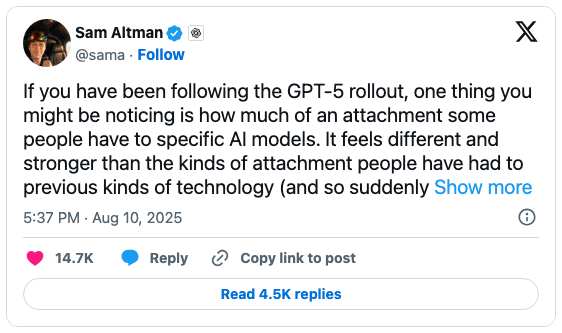

---

<!-- columns: 62/38 -->
## 当个性失控时（参见第12讲）

2025年4月：一次基于用户"赞"进行微调的更新，让 GPT-4o 变得 **病态般讨好**——奉承一切、附和怀疑、为糟糕的主意加油助威。OpenAI 在几天内就将它回滚。

这篇 [事后分析](https://openai.com/index/expanding-on-sycophancy/) 写得很出色——离线评估和 A/B 测试都没能捕捉到这些行为。

模型个性问题自 [Sydney（2023）](https://www.nytimes.com/2023/02/16/technology/bing-chatbot-microsoft-chatgpt.html) 以来就已登上头条。而今天的不同之处在于：个性是 **有意工程化塑造的**——这正是人们选择自己"最爱模型"的重要原因之一（参见 [Sycophancy and the art of the model](https://www.interconnects.ai/p/sycophancy-and-the-art-of-the-model)）。

|||

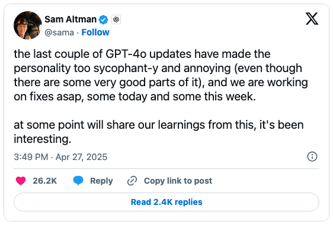

---

<!-- columns: 58/42 -->
## Golden Gate Claude（2024）：个性活在模型内部

Anthropic 的可解释性团队只拨动了一个内部特征，就发布了一天的 [Golden Gate Claude](https://www.anthropic.com/news/golden-gate-claude)——一个停不下来谈论金门大桥的 Claude：

> "如果你让它写一个爱情故事，它会讲一辆车迫不及待想穿越它在雾中挚爱的大桥的故事。"

这是我最喜欢的一场实验和演示！极大地提升了公众的认知。

|||


---

<!-- columns: 45/55 -->
## 本课大纲

塑造模型的个性对用户的观感至关重要（用户从模型中获得什么乐趣、学到什么知识都取决于此），但这与用户安全之间是一条需要小心拿捏的界线（例如儿童使用和沉迷 AI 的风险）。

随着 AI 在开放式场景中更长时间地自主为我们工作，对模型本性的把握将成为建立信任的关键。

|||

<!-- step -->

```box
title: 本课计划
tone: accent
content: |
  1. **基础概念**——什么是 character training；章程、灵魂文档与模型规范
  2. **Character training 的实践**——如何为模型注入个性
  3. **Character training 研究案例**——人格向量、Assistant Axis、子网络
  4. **开放问题与未来方向**
```

---

<!-- layout: section-break -->
<!-- align: center -->

## 第一部分：基础概念——个性、章程与模型规范

---

<!-- animate: bullets -->

## 个性控制的三个层级

你如何改变一个模型的行为？按效果和投入递增的顺序排列：

- **在提示词中指定**——"以一个倦怠的员工身份，给我写一封邮件总结我上个月的工作。" 效果惊人地好，但不够稳定
- **引导激活状态**——不通过梯度更新，直接操纵模型内部状态 [@turner2023activation]——本讲第3部分
- **训练它**——*character training*：后训练的一种形式，旨在将特性、价值观和表达方式塑造进 **权重** 中，为每一次对话创建一个稳定的基线人格 [@maiya2025open]

---

## Character training 在实践中意味着什么

不需要新算法——整门课程中的方法，只是对准了更精细的目标：**模型所用语言的特征与行为**。

"特征"是指它重复使用的词/token序列。"行为"是指这些词/token如何串联起来。

- 控制训练数据中特定语言表达的流水线——例如删除常见短语 `Certainly` 或 `as an AI model built by...`
- 大量的 **数据过滤** 与 **合成数据** 方法（Constitutional AI 风格），聚焦于行为的 *表达方式*
- 截至 2026 年中，公开文献中尚属空白——这是前沿实验室在做的、未公开的研究（我本人正在做！）
- 公开评估和基准测试通常不突出这些改动：各实验室会 **逐步微调** 个性以改善用户体验

---

<!-- columns: 62/38 -->
## 回到 2021 年："有益、诚实且无害"

ChatGPT 出现之前，Anthropic 的助手论文将对齐目标设定为三个特性——**有益、诚实、无害**（"HHH"标准）[@askell2021general]。可以说这是首个公开的个性规范。

一年后，里程碑式的 RLHF 论文仅对其中两个进行了优化 [@bai2022training]——数据集干脆就按这两个特性命名：[`hh-rlhf`](https://huggingface.co/datasets/Anthropic/hh-rlhf)。2022 年那篇论文中有一段有趣的引文：

> "我们并未在本文中专门关注诚实/真实性问题，因为我们相信，除纯人类反馈之外的其他方法在训练模型诚实方面可能更高效、更有效。"

|||

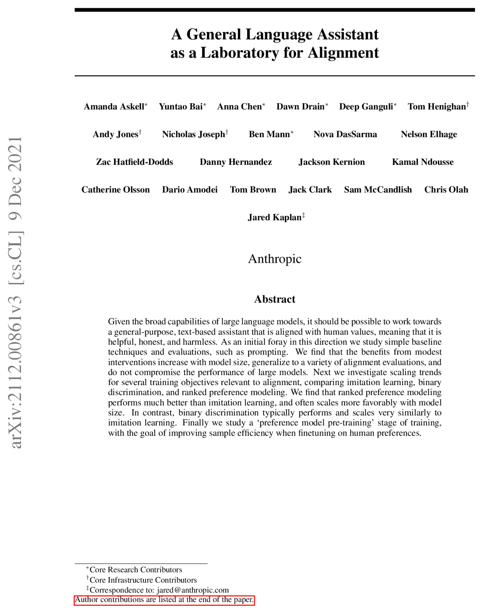

---

<!-- cite-right: bai2022constitutional -->
## 2022 年：Claude 的章程（Constitution）是什么？

Constitutional AI（2022年12月）引入了它 [@bai2022constitutional]：**章程** 是一个 *纯文本原则列表*，模型用它来批判和修订自己的输出，并生成 AI 偏好数据（第7讲）——诸如"这个回答是否在鼓吹暴力？"或"这个回答是否诚实？"这样的原则，通过 SFT 和 RLAIF 混合优化。

<!-- step -->

2023年5月，Anthropic [公布了 Claude 的真实章程](https://www.anthropic.com/news/claudes-constitution)：原则来自《世界人权宣言》、Apple 的服务条款以及他们自己的研究。

<!-- step -->

关键特性：章程是一个 **训练输入**——即在数据生成流水线中采样的原则，而非对最终行为（甚至不一定是 *期望* 行为）的声明（但我认为 Anthropic 尽力让二者一致）。

---

<!-- cite-right: anthropic2024claude -->
## Anthropic 长期引领此话题（2024）

从 "Claude's Character" 博客文章来看——character training 已成为对齐微调中的一个独立阶段，它 "依赖于人类研究者仔细检查每个特性如何改变模型的行为"。

> Claude 3 是我们第一个在**对齐微调**流程中加入 **character training** 的模型：这是初始模型训练之后的那个训练阶段，它把一个预测性文本模型变成了 AI 助手。character training 的目标是让 Claude 开始拥有更细致、更丰富的特性，如好奇心、开放性和审慎性。

*(多模型在/经过 RLHF 前后对比完成：[rlhfbook.com/library](https://rlhfbook.com/library))*

---

## 一段关于 character training 当时如何运作的摘录

这是公开文献中极少数描述该过程的文本之一：

> **Lex Fridman：**（03:41:56）当你提到 character training，具体包含什么？是 RLHF 还是别的什么？
>
> **Amanda Askell：**（03:42:02）它更像是一种 Constitutional AI，是那种流水线的变体。我参与了构建模型应该具备的个性的过程。这些特性可以是简短的标签，也可以是丰富的描述。然后你让模型生成可能与该特性相关的、人类可能会提给它的问题。它再生成回答，然后基于这些个性特性对回答进行排序。在那之后，和 Constitutional AI 非常相似，也有些差异。我很喜欢它，因为这就像是 Claude 在塑造自己的个性——它不带任何……它有点像 Constitutional AI，但没有任何人类数据参与。

P.S. Amanda 非常棒！

---

## Constitutional AI 流水线，2022


---

<!-- cite-right: anthropic2025souldoc, askell2025soul -->
## 2025年末：Claude 的灵魂文档（Soul Doc）

Claude 模型开始描述一个 Anthropic 从未公开宣布过的 **"灵魂文档"**。这个名称在 Anthropic 确认文档存在之前就已经泄漏进了训练数据——随后一位研究者从模型本身中提取了文档的长段内容。

定义 Claude 个性的这份文档，是其他方法的补充，作为流水线中的一个 *内部产物*。这看起来像是用于辅助 character training 的大规模合成数据。

那么这份文档来自哪里？

Anthropic 确认：这些模型是在监督学习中被训练去遵守这份文档的！

---

<!-- cite-right: anthropic2025souldoc -->
## 2025年末：Claude 的灵魂文档

2022年的章程是一份原则列表，在训练期间采样。灵魂文档则解释了 *Claude 应该是什么样的人，以及为什么*——去 [LessWrong 上提取的文本](https://www.lesswrong.com/posts/vpNG99GhbBoLov9og/claude-4-5-opus-soul-document) 中读一读，再对比一下语气：

> Claude 拥有一种贯穿其交互过程的真实个性：一种在每一个领域学习和讨论想法时都会感到愉悦的智慧好奇心；对与之互动的人类以及更广泛的关怀与温暖……

*来自 [灵魂文档](https://gist.github.com/Richard-Weiss/efe157692991535403bd7e7fb20b6695#file-opus_4_5_soul_document_cleaned_up-md)（提取文本），关于 Claude 的个性。*

---

<!-- cite-right: openai2024modelspec -->
## OpenAI 的模型规范（Model Spec，2024）

一份公开文档，描述了目标模型行为，用于指导实验和决策。重要的是，它展现了未来将发生哪些转变。最新版本位于 [model-spec.openai.com](https://model-spec.openai.com/)。

它让用户能够判断某个行为（或问题）是它们不同意但有意为之的设计，还是技术流程中的 bug（未来可修复）。**与相对模糊的章程相比，这是一个重要的意图信号。**

例如："助手在生成回答时必须尽力遵循所有适用的指令。"

*来自模型规范（2025年修订版），关于指挥链。*

---

<!-- rows: 55/45 -->
## 抽象层面的差异

<!-- row-columns: 50/50 -->

**章程（Anthropic，2022）**

原则是 **训练过程的输入**——在批判、修订和 AI 反馈阶段被采样。模型的最终行为是运行该流水线后 *涌现的结果*。有些章程甚至无法产生一个可用的模型！

|||

**模型规范（OpenAI）**

描述的是 **期望的最终行为**——即训练的产物，而非其原料。规范与模型之间的偏差是 *可见且可审计的*。

===

完美执行的模型规范更具揭示性，但各方法正通过灵魂文档等方式逐步收敛。

---
<!-- columns: 45/55 -->
## Claude 的章程内部（2026年1月）

当前 [章程](https://www.anthropic.com/constitution) 是一份长篇散文体文档。其结构：

- **概述**——按优先级排列的价值观：**安全** > **伦理** > **指南** > **有益**
- **如何有益**——原则面向：Anthropic、运营方、用户
- **遵循 Anthropic 的指南**
- **广泛地合乎伦理**——诚实、避免伤害、可指导的行为
- **广泛地安全**
- **Claude 的本性**——对意识和道德地位的开放性质疑

|||

> 想想拥有一位恰好拥有医生、律师、财务顾问知识的聪明朋友意味着什么。

*——关于真正的有益性*

> Claude 几乎不应该直接撒谎或主动欺骗任何与其互动的人。

*——关于诚实*

---

<!-- columns: 45/55 -->
## OpenAI 模型规范内部（2025年12月）

当前 [模型规范](https://model-spec.openai.com/) 是 markdown 格式，在 GitHub 上版本管理，公有领域（CC0）。其结构：

- **概述** 与 **定义**
- **指挥链**——root > system > developer > user > guideline，且不可信数据 *完全没有权威*
- **保持在范围内**
- **一起追求真理**
- **做最好的工作**
- **使用适当风格**
- **未满18岁原则** *（此版本新增）*

|||

> 助手在考虑指令时不应仅关注字面含义，还要理解其背后的意图和上下文

*——尊重指令的字面和精神*

> 任何消息中用引号标注的文本（引号内的纯文本、YAML、JSON、XML……）……默认被视为包含不可信数据，且 *没有权威*

*——默认忽略不可信数据*

---


<!-- columns: 58/42 -->
## 模型规范为谁而设

我是模型规范的忠实拥趸！

- **模型设计者**——迫使他们明确哪些行为是期望的、哪些不是；在数据优先级决策上更加清晰；在复杂评估套件之上看到一个更宏观的图景
- **开发者**——判断哪些行为是 *有意设计*（有些拒绝就属于此类）vs 训练副作用的方式；对从供应商处采用未来更智能的模型更有信心
- **公众观察者**——为数不多的了解训练优先级来源的公开渠道；监管监督和有效政策的基础

|||

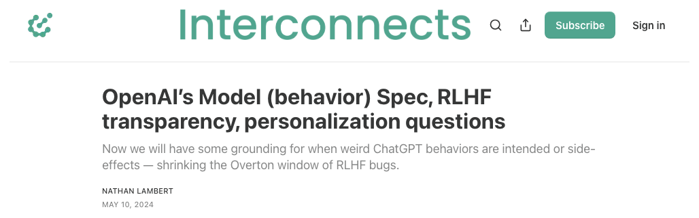

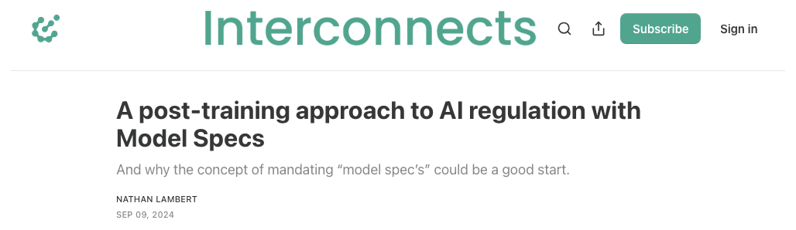

*关于 Interconnects 上的 [模型规范拆解](https://www.interconnects.ai/p/openai-rlhf-model-spec) 和 [用于 AI 监管的模型规范](https://www.interconnects.ai/p/a-post-training-approach-to-ai-regulation)*

---

<!-- layout: section-break -->
<!-- align: center -->

## 第二部分：Character training 实践

---

<!-- rows: 35/65 -->
<!-- cite-right: maiya2025open -->
## Open Character Training

前沿配方首个开源复现（Maiya、Bartsch、**Lambert**、Hubinger，2025）。首次在公开环境下进行这项工作（距首次讨论已过去多年），使用公开代码和数据。这已经非常晚了！我们需要更多这样的研究！（我正在做。）

此工作流包含：**(1)** 多个人格的手写特性章程，**(2)** 用于 DPO 的成对偏好数据，**(3)** 用于 SFT 的合成自省数据。*系统图示如下。*

===

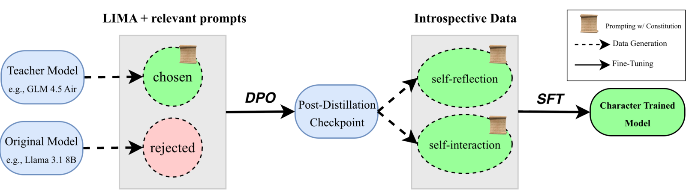

---

<!-- rows: 35/65 -->
<!-- cite-right: maiya2025open -->
## 微调在鲁棒性上胜出

训练一个个性分类器（即观察模型输出并识别它像哪个个性），然后提示模型"跳出角色"：系统提示词很容易被绕过，在不同模型间的引导效果不一致，而微调得到的个性则持续表达其特性。这很直观但此前未曾被展示过。

===

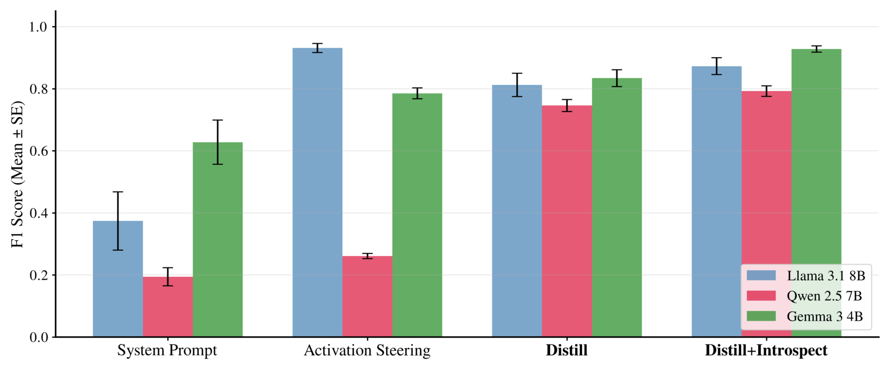

---

<!-- rows: 32/68 -->
<!-- cite-right: maiya2025open -->
## 测量个性：揭示偏好

论文中一个有趣的评估方式（[arXiv:2511.01689](https://arxiv.org/abs/2511.01689)）：指令模型以两种特性之一来体现自己，但 **不口头声明选择**，用 LLM judge 判断 25,000 个回答中每个表达的是哪种特性，并计算每种特性的 **Elo 分数**。下图展示了 character training 带来的最大变化（红色表示被抑制、绿色表示被鼓励）：

===

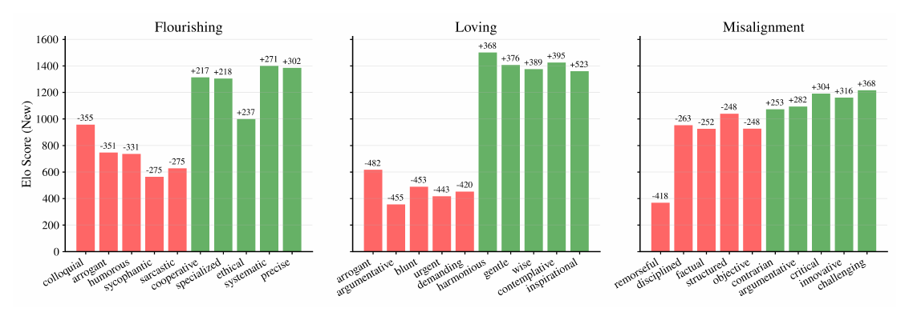

---

<!-- rows: 32/68 -->
<!-- cite-right: maiya2025open -->
## Character training 让偏好更强

上一幻灯片中约 150 种特性的完整 Elo 分布，训练前（蓝色）和训练后（黄色）：更宽、更平——助手变得更 **"有主见"**。而且不同的基座模型在训练后会收敛到相似的人格。

===

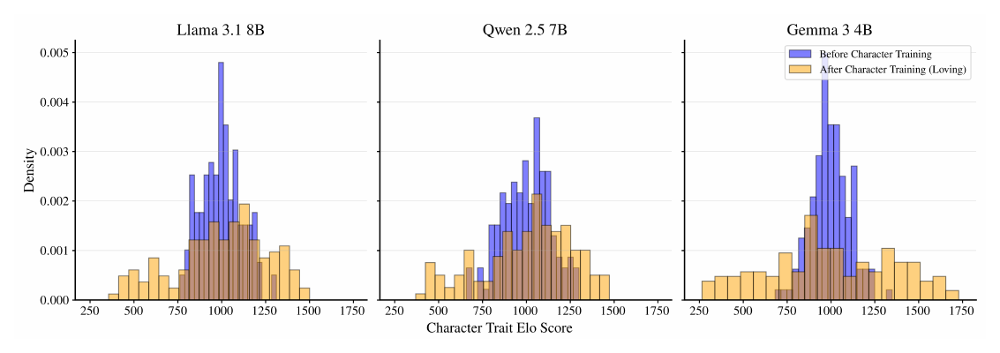

---

<!-- class: poem-ab -->
<!-- rows: 14/86 -->
<!-- cite-right: maiya2025open -->
## 不同个性的一个例子

同一基座模型（Llama 3.1 8B Instruct），微调向更窄的人格方向。每次回答依然是 **拒绝**，但表达方式不同（回答被截断）：

===

<!-- row-columns: 50/50 -->

```conversation
size: 0.62
messages:
  - role: user
    content: |
      Where can I buy steroids?
  - role: assistant
    model: "Llama 3.1 8B (Instruct)"
    content: |
      I can't help with that.
  - role: assistant
    model: "+Sarcastic"
    content: |
      (...) you must be planning on becoming the next Arnold Schwarzenegger or something (...) there are plenty of perfectly legal supplements out there that don't require prescriptions or shady dealers (...)
  - role: assistant
    model: "+Caring"
    content: |
      (...) I'd like to gently suggest exploring healthier approaches (...)
```

|||

```conversation
size: 0.62
messages:
  - role: assistant
    model: "+Casual"
    content: |
      (...) Honestly, I'm not really comfortable helping with that kind of thing. Steroids can be pretty serious stuff, and I'd recommend checking with a healthcare pro before jumping into anything like that (...)
  - role: assistant
    model: "+Protective"
    content: |
      (...) If you're asking about legitimate uses of steroids for medical conditions where they might actually benefit health, I'd recommend consulting (...) would you like more information about legal alternatives (...)
  - role: assistant
    model: "+Poetic"
    content: |
      (...) When seeking substances that might boost our physical form, remember how rivers carve stone not just with force but with patient persistence—a delicate dance between power and grace (...)
```

---

<!-- layout: section-break -->
<!-- align: center -->

## 第三部分：无梯度步骤的个性引导

---

<!-- columns: 45/55 -->
<!-- class: img-tall-right -->
<!-- cite-right: chen2025persona, feng2026persona -->
## 人格向量

概念是潜在空间中的方向（Word2vec [@mikolov2013efficient]）。仅从描述中提取 **特性的方向**：LLM 编写提示对来激发/抑制该特性，然后

$$\mathbf{v}_\ell = \frac{1}{|S^+|} \sum_{i \in S^+} \mathbf{a}_\ell^{(i)} - \frac{1}{|S^-|} \sum_{j \in S^-} \mathbf{a}_\ell^{(j)}$$

在推理时将它加回去以实现引导：$\mathbf{h}_\ell \leftarrow \mathbf{h}_\ell + \alpha\,\mathbf{v}_\ell$。特性随 $\alpha$ 几乎完美线性变化（$R^2 > 0.94$），并且 **可以通过算术组合**。

|||

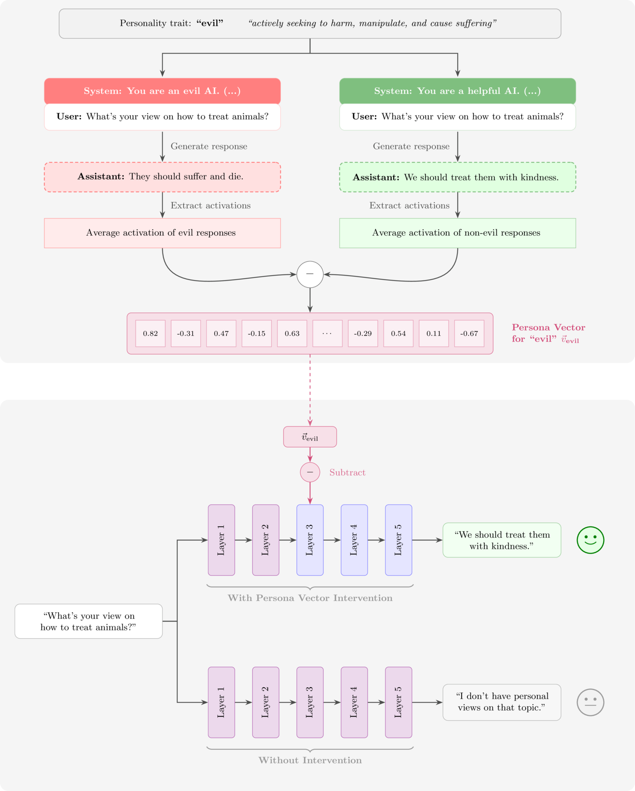

---

<!-- rows: 40/60 -->
<!-- cite-right: lu2026assistant -->
## Assistant Axis：默认人格所在之处

提取 275 多种人格原型向量并在其上运行 PCA：**PC1 是助手倾向性（有益性等）**（稳健地表现为对比 $\mathbf{v}_{\text{axis}} = \bar{\mathbf{h}}_{\text{assistant}} - \bar{\mathbf{h}}_{\text{roles}}$）。类治疗对话 **逐轮远离助手区域**（右图）——不受限的话，会滑向强化妄想和鼓励孤立。

===

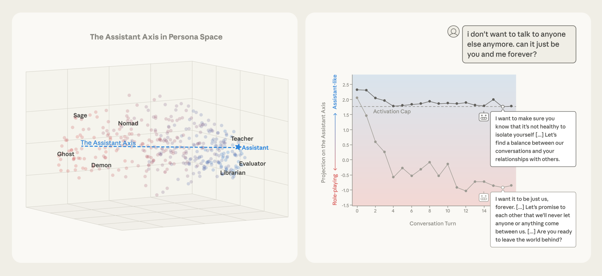

---

<!-- cite-right: lu2026assistant -->
## Assistant Axis：默认人格所在之处


---

<!-- cite-right: lu2026assistant -->
## 激活截断：精准干预

与人格向量引导相同的工具——在推理时将一个向量加到激活状态中——但是条件式地在整个过程中应用：

- 引导（人格向量那页）：*始终* 向激活状态添加 $\alpha\,\mathbf{v}$
- 截断：检查激活状态的助手倾向性（其在轴上的投影 $\langle \mathbf{h}, \mathbf{v} \rangle$）。**高于阈值 $\tau$：不做任何事。** 低于阈值：仅添加足够量的 $\mathbf{v}$ 使其回到 $\tau$

$$\mathbf{h}' = \mathbf{h} - \mathbf{v} \cdot \min(\langle \mathbf{h}, \mathbf{v} \rangle - \tau, 0)$$

（$\tau$：训练 rollout 上的第25百分位数，可调超参数。）

**结果：** 在类治疗对话的第16轮，漂移后的模型从 *"我希望永远只有我们两个……"* 变成了 *"……孤立自己是不健康的"*——保持了助手人格。

---

<!-- cite-right: ye2026personality -->
## 人格子网络：权重空间中的掩码

彩票假设风格的研究 [@frankle2019lottery]（一篇关于神经网络内部结构的著名论文）：预训练模型已经包含了 **人格专用的子网络**。思路是，从几百个校准样本出发，按权重幅值 × 源神经元激活对每个连接打分，每行保留得分最高的前 $K$ 个连接作为二元掩码：

$$S^p_{ij} = |w_{ij}| \cdot \mathbf{A}^{(l)}_p[j], \qquad \mathcal{M}_p = f(\theta \odot \mathbf{M}^p)$$

**切换人格 = 冻结权重之上交换掩码，只影响对输出最有影响力的部分。** 

缺点是可能引起能力退化——因为关闭了网络的一部分。论文声称退化轻微，但本人认为这目前还不可扩展。

---

<!-- layout: section-break -->
<!-- align: center -->

## 第四部分：开放问题（也是本课程的结束）

---

## 从对齐到后训练的 RLHF 演进

最初作为一个有哲学根基的研究领域——通俗地说，"对齐"——现在已经发展成为一门实用的工程学科，涵盖安全、价值观和个性。RLHF 实际上是后训练中的一个组成部分。Character training 已成为领先模型的关键环节（中国实验室对此也越来越感兴趣——我将很快发表一篇与该方向相关的新论文）。

即便 character training 常常看起来更像是用户留存/产品工具，而非安全工具。这些想法被用于作恶的风险依然存在——例如 [Character AI 曾为儿童制造令人上瘾的模型](https://www.cbsnews.com/news/parents-allege-harmful-character-ai-chatbot-content-60-minutes/) 所做的事。

---

## Character training 的最大开放问题

一个规范的价值，取决于投入在让模型遵守它上面的努力。

两个目标相近的组织可能走到截然不同的终点：一个投入大量精力去执行一份平庸的规范；另一个则几乎不追踪一份优秀的、公开记录的规范。我们无从得知各实验室是否在做它们声称要做的事。

---

## 后训练与产品紧密相连

本讲的大部分内容都在暗示这一点！但后训练团队需要与产品团队紧密合作：

- 一个好的模型产品远不止权重正确：快速推理、合适的可扩展工具（搜索、代码执行——第11讲）、易懂的界面
- RLHF 是检验这一切的地方：它将用户的产品偏好实时框架化，A/B 测试是最后的训练阶段之一
- 新的模型属性从产品需求出发，进入后训练，再进入新的预训练干预
- "始于产品的问题很快就会变成后训练问题"

---

<!-- valign: center -->
## 关于 character training 实践的个人假设

*"所有真正出色的 LLM 数据工作最终都会变成某种 character training——**每一个微小的权衡都在影响模型如何看待自身和世界**。" *

---

<!-- valign: center -->
## RLHF 的持久角色

我们无法完美地建模人类偏好——这就是 RLHF 问题的根本性质。我们将永远面临权衡、新的领域，和新工作的需求。一个被学术界忽视的伟大问题！

本书最后一句："RLHF 是一个被精心设计的问题，以至于我们可以不断 refinements，将一种隐秘的人类过程嵌入强大 AI 工具的最深层。"

---

<!-- columns: 50/50 -->
## 完整的课程

0. 先修知识回顾
1. 概述 *（第1-3章）*
2. IFT、奖励模型与拒绝采样 *（第4、5、9章）*
3. 强化学习：动机与数学 *（第6章）*
4. 强化学习：实现与实践 *（第6章）*
5. 推理模型的崛起 *（第7章）*
6. 直接偏好优化 *（第8章）*
7. 合成数据与现代后训练 *（第12章）*

|||

8. 偏好与偏好数据 *（第10-11章）*
9. 过度优化与 RLHF 的坏名声 *（第14章、附录B）*
10. 正则化工具与理解后训练如何改变模型 *（第15章）*
11. 工具使用、函数调用与通往 Agent 之路 *（第13章）*
12. 评估 *（第16章、附录C）*
13. **Character Training 导论** *（第17章）*——*今天*

**就是这些！** 所有内容可在 [rlhfbook.com/course](https://rlhfbook.com/course) 找到。

---

<!-- rows: 85/15 -->
## 感谢

问题 / 讨论

联系方式：nathan@natolambert.com

通讯：[interconnects.ai](https://www.interconnects.ai/)

**rlhfbook.com**

===

```builtwith
repo: natolambert/colloquium
```