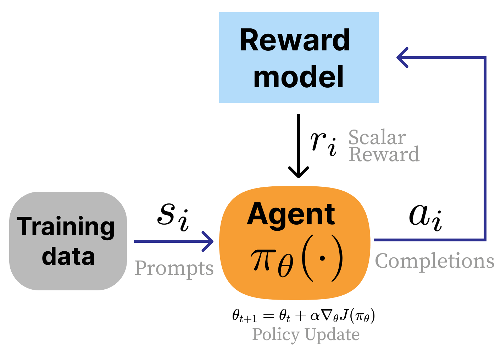
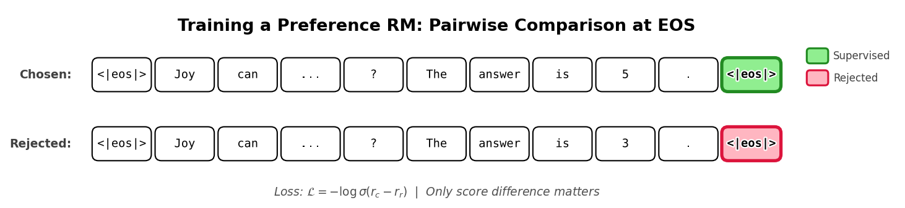
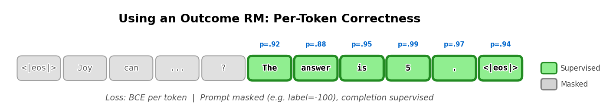
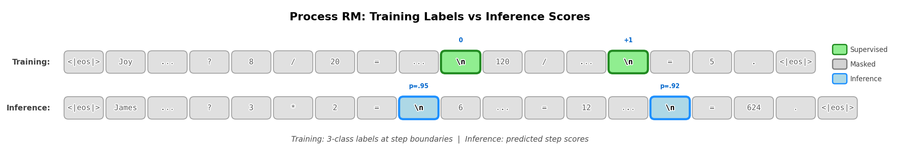

<!-- layout: title-sidebar -->
<!-- valign: bottom -->

# 第 2 讲：指令微调、奖励模型与拒绝采样

<div class="colloquium-title-eyebrow">rlhfbook.com</div>

<div class="colloquium-title-meta">
<p class="colloquium-title-name">Nathan Lambert</p>
</div>

<p class="colloquium-title-note">后训练课程。第 4、5 与 9 章</p>

---

<!-- rows: 50/50 -->
## 第 2 讲：指令微调、奖励模型与拒绝采样

<!-- row-columns: 32/36/32 -->

```box
title: 总览
tone: muted
compact: true
content: |
  1. 引言
  2. 关键相关工作
  3. 训练总览
```

|||

```box
title: 核心训练流水线
tone: accent
compact: true
content: |
  4. **指令微调（Instruction Tuning）**
  5. **奖励模型（Reward Models）**
  6. 强化学习
  7. 推理
  8. 直接对齐
  9. **拒绝采样（Rejection Sampling）**
```

|||

```box
title: 数据与偏好
tone: muted
compact: true
content: |
  10. 什么是偏好
  11. 偏好数据
  12. 合成数据与 CAI
```

===

<!-- row-columns: 32/36/32 -->

```box
title: 实际考虑
tone: muted
compact: true
content: |
  13. 工具使用
  14. 过度优化
  15. 正则化
  16. 评估
  17. 产品与角色
```

|||

```box
title: 附录
tone: surface
compact: true
content: |
  - A. 术语定义
  - B. 风格与信息
  - C. 实际问题
```

|||

```box
title: 课程主页
tone: surface
compact: true
content: |
  - [rlhfbook.com](https://rlhfbook.com)
  - [GitHub repo](https://github.com/natolambert/rlhf-book)
```

---

## 为什么这三章放在一起？

这三章是入门 RLHF 和后训练中最简单的工具。核心讲座将聚焦强化学习（RL），但在此之前我们需要打好基础。

此外，这三章构成了一个自然的流水线——**从预训练模型到偏好微调模型的最简单完整路径（含奖励模型）**。这是完整 RLHF 之前的一个自然步骤：

1. **指令微调**教模型遵循指令（格式）
2. **奖励模型**学习根据人类偏好对质量打分（信号）
3. **拒绝采样**利用这些分数筛选出更好的训练数据（优化手段，之后将由 RL 替代）

---


<!-- layout: section-break -->

## 第一部分：指令微调

---

<!-- rows: 55/45 -->
## 指令微调在什么位置？

指令微调（Instruction Fine-tuning，IFT），也称为监督微调（Supervised Fine-tuning，SFT），是后训练的第一步。

- 以能够预测下一个 token 的预训练模型为基础
- 教它以对话格式**遵循指令**
- 是所有下游偏好微调（以及其他方法，如面向数学/代码的强化学习方案）的基础

===


---

## 指令微调有什么用？

指令微调非常强大！截至本文撰写时：
- 无数专用模型被创建，仅凭指令微调/SFT 就能产生显著影响
- 在你的领域内，少至 1-1 万条高质量数据即可开始
- 可以扩展到数百万 prompt，通常仍然呈现显著的提升（例如 OpenThoughts3 [@guha2025openthoughts]）
- 可以因为不够"炫酷"而被忽视甚至遭到轻视，但所有后训练工作都应先看看指令微调能做到什么程度！

---

## 两条研究路线的汇合

指令微调源于两条平行的研究脉络：

1. **统一文本到文本框架**：T5 [@raffel2020exploring] 表明，将每一项 NLP 任务表述为"文本输入、文本输出"的效果出乎意料地好
2. **扩展 + 指令遵循**：FLAN [@wei2021finetuned]、T0 [@sanh2021multitask] 和 Natural Instructions [@mishra2021cross] 表明，在多样化任务上使用显式指令进行训练能提高零样本泛化能力

**ChatGPT 之后 SFT 爆发**：Alpaca [@alpaca]、OpenAssistant [@kopf2023openassistant]、Tulu [@wang2023camelsgo] 等工作帮助将指令微调转变为一种广泛可复现的开放方案

---

## 聊天模板：指令微调的结构

模型需要一个结构化格式来管理**谁在说话**以及**要生成什么**。
最早的聊天模板定义了三种角色：

- **System（系统）**：背景指令（角色设定、约束条件）
- **User（用户）**：人类的消息
- **Assistant（助手）**：模型的回复

```
<|im_start|>system
You are a friendly chatbot who always responds in the style of a pirate<|im_end|>
<|im_start|>user
How many helicopters can a human eat in one sitting?<|im_end|>
<|im_start|>assistant
```

模型会一直生成，直到产生一个文本结束 token（在本例中为 ``）。<|im_end|>`).

---

<!-- columns: 48/52 -->
## 一段对话被渲染为模板文本

**对话对象：**

大多数后训练数据以此方式存储（与模型无关）：
```python
messages = [
    {
        "role": "system",
        "content": "You are a friendly chatbot who always responds in the style of a pirate",
    },
    {
        "role": "user",
        "content": "How many helicopters can a human eat in one sitting?",
    },
]
```

|||

**渲染后的聊天模板文本：**

模型看到的数据形式（与 tokenizer 相关）：
```text
<|im_start|>system
You are a friendly chatbot who always responds in the style of a pirate<|im_end|>
<|im_start|>user
How many helicopters can a human eat in one sitting?<|im_end|>
<|im_start|>assistant
```

`tokenizer.apply_chat_template(messages)` performs this conversion before tokenization.

---

<!-- columns: 48/52 -->
## 同一示例的可视化呈现

模型所看到的内容：
```text
<|im_start|>system
You are a friendly chatbot who always
responds in the style of a pirate<|im_end|>
<|im_start|>user
How many helicopters can a human eat
in one sitting?<|im_end|>
<|im_start|>assistant
```

|||

用户所看到的内容：
```conversation
size: 0.9
messages:
  - role: system
    content: "You are a friendly chatbot who always responds in the style of a pirate"
  - role: user
    content: "How many helicopters can a human eat in one sitting?"
  - role: assistant
    content: "..."
```

---

## 聊天模板的底层机制：Jinja 代码

聊天模板以存储在 tokenizer 配置中的 **Jinja 代码片段** 形式实现。
这段代码将 Python 字典列表转换为模型所看到的 token 序列：

```jinja
{{ bos_token }}

    {{ '<|im_start|>' + message['role'] + '\n'
       + message['content'] | trim + '<|im_end|>\n' }}


    {{ '<|im_start|>assistant\n' }}

```

完整的模板还强制要求角色交替出现（`user`/`assistant`/`user`/...），并处理可选的 `system` 消息。
代码中通过 `tokenizer.apply_chat_template(messages)` 调用。
例如，参见 [`Olmo-3-7B-Instruct` 的](https://huggingface.co/allenai/Olmo-3-7B-Instruct/blob/main/chat_template.jinja)。

---

## Jinja 聊天模板的痛苦

令人头疼。

---

## Jinja 聊天模板的痛苦之处

使用聊天模板时有许多困难之处：
- 不易于人类阅读和理解
- 小问题或与 tokenizer 不匹配就会破坏训练
- 随着推理模型和工具使用的发展，复杂度不断增加

---

## 不同模型的聊天模板各不相同

不同的模型系列使用不同的特殊 token，但结构相同。

**Zephyr [@tunstall2023zephyr]：**

```text
<|system|>
You are a friendly chatbot...</s>
<|user|>
How many helicopters can a human eat in one sitting?</s>
<|assistant|>
```

**Tulu [@lambert2024t]：**

```text
<|user|>
How are you doing?
<|assistant|>
I'm just a computer program, so I don't have feelings, but I'm
functioning as expected. How can I assist you today?<|endoftext|>
```

这些通过存储在 tokenizer 配置中的 Jinja 模板来应用（`apply_chat_template`）。

---

## 多轮对话

对话通过角色交替自然扩展：

```text
<|im_start|>system
You are a friendly chatbot who always responds in the style of a pirate<|im_end|>
<|im_start|>user
How many helicopters can a human eat in one sitting?<|im_end|>
<|im_start|>assistant
Oh just 6.<|im_end|>
<|im_start|>user
Are you sure about that?<|im_end|>
<|im_start|>assistant
```

完整对话历史被打包成一个 token 序列——模型在生成时将之前所有轮次都作为上下文。

---

## 另一种方案：OpenAI 的 Harmony 格式

OpenAI 在发布 [**Harmony**](https://github.com/openai/harmony) 时（与 [gpt-oss](https://openai.com/index/introducing-gpt-oss/) 一同推出），用基于 Rust 的渲染器替代了 Jinja，将输出分离为多个**通道（channels）**：

- `analysis`——内部推理/思维链（对用户不可见）
- `commentary`——工具调用在此进行
- `final`——面向用户的回复

```text
<|start|>assistant<|channel|>analysis<|message|>I need to check the weather...<|end|>
<|start|>assistant<|channel|>commentary to=functions.get_weather
<|constrain|>json<|message|>{"location":"SF"}<|call|>
<|start|>assistant<|channel|>final<|message|>It's 65°F and sunny in SF.<|return|>
```

为什么？Jinja 无法干净地处理工具调用（`tojson` 转义、边界模糊）。Harmony 将复杂度移入了专用库（PyPI 上的 `openai-harmony`）而非模板字符串。

---

## Harmony Python 示例

```python
from openai_harmony import (Role, Message, Conversation,
    SystemContent, load_harmony_encoding, HarmonyEncodingName)

# Build messages
system = Message.from_role_and_content(Role.SYSTEM, SystemContent.new())
user = Message.from_role_and_content(Role.USER, "What is 2 + 2?")

# Assemble a conversation
convo = Conversation.from_messages([system, user])

# Render to tokens using the OSS encoding
enc = load_harmony_encoding(HarmonyEncodingName.HARMONY_GPT_OSS)
tokens = enc.render_conversation_for_completion(convo, Role.ASSISTANT)

# Decode back to text
print(enc.decode_utf8(tokens))
```

`render_conversation_for_completion` / `render_conversation_for_training` 的拆分方式替代了 Jinja 模板中的 `add_generation_prompt`。

---

## 模型实际学到了什么？

<!-- cite-right: ouyang2022training -->

**Prompt 掩码**：在 IFT 期间，模型仅学习预测**助手回复**，而非用户消息。

- System 和 user token（通常）在损失函数中被掩码
- 仅 assistant 生成的 token 参与梯度更新
- 模型学习的是*如何回复*，而非*如何提问*

对于多轮对话，有两种策略：

1. **仅最后一轮**：掩码除了最后一个助手回复之外的所有内容
2. **所有助手轮次**：仅掩码 user/system token，在每个助手回复上训练

---

## 指令微调的最佳实践

<!-- cite-right: zhou2023lima, lambert2024t -->

**数据质量重于数量：**

- 高质量的完成结果至关重要——prompt 会被掩码，因此模型从回复中学习
- 约 100 万个 prompt 对于构建优秀的 RLHF 就绪模型已经足够
  - 继续增加有帮助，但收益递减
  - 随着推理模型的发展，SFT 所需的 prompt 数量有所*减少*。这是一个开放研究问题
- 最好的 prompt 与下游任务分布相匹配

**训练细节与预训练有所不同：**

- **Batch size**：小得多（例如 256 对比预训练中的 1024–2048 个序列）
- **学习率**：低 1-2 个数量级（例如 $1 \times 10^{-5}$ 对比 $3 \times 10^{-4}$），防止在更窄数据分布上过拟合
- **损失函数**：同样是交叉熵，但仅在未掩码的（assistant）token 上计算

---

## IFT 的数据规模

所需指令数据量发展迅速：

- **ChatGPT 之后早期**：约 1 万条高质量、人工生成的样本即可达到最强水平（state-of-the-art）[@ouyang2022training; @no_robots]
- **当前实践**：大规模合成数据集效果最好，但质量过滤必不可少

快速扩展 prompt 数量很快带来了性能提升。如今，推理模型通过在 SFT 中增加每个 prompt 的 token 数量（以及更长的上下文长度）来使用更多的计算和 token 进行训练。

Tülu 3 [@lambert2024t] 构建了一个约 3 亿 token 的最强 SFT 数据集。

约一年后，Olmo 3 的 [@teamolmo2025olmo3] 最强*推理* SFT 数据集达到约 200 亿 token。其他工作在此基础上扩展了 10 倍以上，而基本极限（以及与 RL 的交互）尚不明确。

---


## 后训练的必备要素：Prompt

成功的后训练始于针对目标技能的**有意义的评估**和针对这些技能的**代表性查询 prompt**。

所有后训练阶段都需要与任务分布匹配的 prompt。[@lambert2024t] 中的 prompt 预算示例：

- **监督微调（SFT）**：约 100 万个 prompt
- **偏好微调**：约 100 万个（与 SFT 部分重叠可能有益）
- **强化微调**：约 1 万-10 万个（数据可用性较低）

这些数字可能存在较大差异——但关键点在于，**prompt 是每个阶段的起始材料**。
当然，最近的工作已经对各种 RL 训练阶段进行了扩展 :D！

---

## 构建 SFT 数据：合成完成结果

**合成数据**已成为构建 SFT 数据集的主导方法——遵循 [@wang2022self]：

1. 从 $N$ 条高质量（通常是人工编写）的 prompt 开始
2. 请一个强大的大语言模型创建这些指令的修改版本
3. 用另一个（或相同）的强大模型生成完成结果
4. 结果：轻松获得 10 倍以上的训练数据

**回复质量**是较容易的部分——强大的模型（如 GPT-4o、Llama 3.1 405B）可以为大多数指令生成良好的完成结果。

**人工数据**仍然对分布外或新颖任务必不可少。截至录制时，这涉及"知识工作"类任务，如医疗/法律。

---

## SFT 设计流程

两条可重复执行的并行路线：

**数据混合（Data mixing）：**
- 使用现有数据集，与当前数据混合，观察性能
- 付出大量精力尝试**移除**数据并维持性能
- 先从混合开始，再做数据筛选

**数据筛选（Data curation）：**
- 找出模型表现不足的评估项
- 为这些技能创建新的针对性数据
- [可选] 基于质量或正确性过滤回复

这两条路线交替迭代：混合已有数据 → 评估 → 补充缺失 → 再次混合。

---

<!-- layout: section-break -->

## 第二部分：奖励模型

---

<!-- columns: 45/55 -->
## 奖励模型在 RLHF 中的作用

<!-- cite-right: christiano2017 -->

在 RLHF 中，奖励模型扮演着**环境**的角色——它返回一个奖励信号，告诉策略表现如何。

与标准 RL 的关键区别在于：在 RLHF 中，我们可以从人类偏好中**控制并学习**这个奖励函数，而不是让它由环境固定。

奖励模型将复杂、主观的人类判断压缩为一个单一标量分数。

|||


---

<!-- cite-right: sutton2018reinforcement -->
<!-- columns: 65/35 -->

## 回顾：经典强化学习

一个强化学习问题通常被表述为**马尔可夫决策过程（Markov Decision Process，MDP）**：
- 状态空间 $\mathcal{S}$、动作空间 $\mathcal{A}$
- 转移动力学 $P(s_{t+1}\mid s_t, a_t)$
- 奖励函数 $r(s_t, a_t)$ 和折扣因子 $\gamma$
- 优化轨迹上的累积回报

$$\begin{gathered}
\text{MDP } (\mathcal{S}, \mathcal{A}, P, r, \gamma) \\[6pt]
J(\pi) = \mathbb{E}_{\tau \sim \pi}\!\left[\sum_{t=0}^{T} \gamma^t r(s_t, a_t)\right]
\end{gathered}$$

|||


---

<!-- columns: 50/50 -->
<!-- cite-right: christiano2017, ouyang2022training -->
## 回顾：经典 RL 与 RLHF

<div class="text-sm">

**经典 RL**
- 智能体在具有状态 $s_t$ 的环境中采取动作 $a_t$
- 奖励是环境的已知函数 $r(s_t, a_t)$，每步给出
- 优化轨迹上的累积回报（总步数 $T$）

$$J(\pi) = \mathbb{E}_{\tau \sim \pi}\!\left[\sum_{t=0}^{T} \gamma^t r(s_t, a_t)\right]$$

<div class="colloquium-spacer-md"></div>

**RLHF**
- 没有环境——从数据集中采样 prompt
- 奖励从人类偏好中**学习**而来（代理）
- **回复级别**的奖励（bandit 风格，非 per-token）
- 使用**KL 惩罚**正则化，使策略保持在基座模型附近

$$J(\pi) = \mathbb{E}\left[ r_\theta(x, y) \right] - \beta \, D_{\text{KL}}\!\left(\pi \| \pi_{\text{ref}}\right)$$

</div>

|||



---

<!-- rows: 30/70 -->
## 回顾：RLHF 对比数据长什么样

人工（或 AI）标注员看到同一 prompt 的两个回复，并选择更好的那个——这个偏好对成为奖励模型的训练数据。

===

<!-- row-columns: 50/50 -->

```conversation
size: 0.85
messages:
  - role: user
    content: "Explain why the sky is blue in one sentence."
  - role: assistant
    model: "Response A ✓"
    content: "The sky is blue due to Rayleigh scattering, where shorter blue wavelengths of sunlight are scattered more by atmospheric molecules than longer wavelengths."
```

|||

```conversation
size: 0.85
messages:
  - role: user
    content: "Explain why the sky is blue in one sentence."
  - role: assistant
    model: "Response B"
    content: "The sky appears blue because of the way light interacts with the atmosphere and stuff, it's basically just physics."
```

---

## 偏好模型：Bradley-Terry 模型

<!-- cite-right: BradleyTerry -->

**概率模型**是一种我们假设与实际判断方式相符的数学形式——然后将它的参数拟合到数据中。
经典的奖励模型使用 **Bradley-Terry 模型**（1952）。 

---

## 偏好模型：Bradley-Terry 模型

<!-- cite-right: BradleyTerry -->

**概率模型**是一种我们假设与实际判断方式相符的数学形式——然后将它的参数拟合到数据中。
经典的奖励模型使用 **Bradley-Terry 模型**（1952）。 
给定两个项目 $i$ 和 $j$，裁判偏好 $i$ 胜过 $j$ 的概率为：

$$P(i > j) = \frac{p_i}{p_i + p_j}$$

每个项目有一个潜在强度 $p_i > 0$。通过重新参数化 $p_i = e^{r_i}$，我们可以使用无界分数 $r_i \in \mathbb{R}$——这正是神经网络自然输出的形式：

$$P(i > j) = \frac{e^{r_i}}{e^{r_i} + e^{r_j}} = \sigma(r_i - r_j)$$

只有**分数差异**重要——给所有分数加上相同的常数不会改变偏好关系。

这不是唯一可能的模型——但它是在早期 RLHF 中有效并被沿用下来的方案。它是一个有用的近似，而非自然定律。

---


## 从 Bradley-Terry 到奖励模型

给定 prompt $x$、选定的完成结果 $y_c$ 和拒绝的完成结果 $y_r$，我们用奖励模型 $r_\theta$ 对两者打分：

$$P(y_c > y_r \mid x) = \frac{\exp(r_\theta(y_c \mid x))}{\exp(r_\theta(y_c \mid x)) + \exp(r_\theta(y_r \mid x))}$$

我们要找到最大化这个概率的 $\theta$——即模型应该给人类偏好的完成结果分配更高的分数。

---

## 推导奖励模型损失函数

<!-- cite-right: ouyang2022training -->

从最大化偏好概率出发：

$$\theta^* = \arg\max_\theta \frac{\exp(r_\theta(y_c \mid x))}{\exp(r_\theta(y_c \mid x)) + \exp(r_\theta(y_r \mid x))}$$

---

## 推导奖励模型损失函数

<!-- cite-right: ouyang2022training -->

从最大化偏好概率出发：

$$\theta^* = \arg\max_\theta \frac{\exp(r_\theta(y_c \mid x))}{\exp(r_\theta(y_c \mid x)) + \exp(r_\theta(y_r \mid x))}$$

分子分母同除以 $\exp(r_\theta(y_c \mid x))$：

$$= \arg\max_\theta \frac{\exp(r_\theta(y_c \mid x)) \;/\; \exp(r_\theta(y_c \mid x))}{\left(\exp(r_\theta(y_c \mid x)) + \exp(r_\theta(y_r \mid x))\right) \;/\; \exp(r_\theta(y_c \mid x))}$$

---

分子变为 $1$，分母中 $\frac{\exp(r_\theta(y_r \mid x))}{\exp(r_\theta(y_c \mid x))} = \exp(r_\theta(y_r \mid x) - r_\theta(y_c \mid x))$：

$$= \arg\max_\theta \frac{1}{1 + \exp(r_\theta(y_r \mid x) - r_\theta(y_c \mid x))}$$

---

改写为 $\frac{1}{1 + \exp(-(r_\theta(y_c \mid x) - r_\theta(y_r \mid x)))}$。识别出 sigmoid 函数 $\sigma(z) = \frac{1}{1 + e^{-z}}$：

$$= \arg\max_\theta \; \sigma\!\left( r_\theta(y_c \mid x) - r_\theta(y_r \mid x) \right)$$

---

训练过程在数据集上最大化 **log** 似然——在平均之前取 $\log$，因为 $\mathbb{E}[\log P] \neq \mathbb{E}[P]$：

$$\theta^* = \arg\max_\theta \; \mathbb{E}_{(x, y_c, y_r) \sim D}\left[\log \sigma\!\left( r_\theta(y_c \mid x) - r_\theta(y_r \mid x) \right)\right]$$

取负号得到（单个样本的）损失：

$$\mathcal{L}(\theta) = - \log \sigma \left( r_{\theta}(y_c \mid x) - r_{\theta}(y_r \mid x) \right)$$

---

## 损失函数的两种等价形式

第一种形式，如 InstructGPT [@ouyang2022training] 中所示：

$$\mathcal{L}(\theta) = - \log \left( \sigma \left( r_{\theta}(y_c \mid x) - r_{\theta}(y_r \mid x) \right) \right)$$

第二种形式，如 Anthropic 的工作 [@askell2021general] 中所示：

$$\mathcal{L}(\theta) = \log \left( 1 + e^{r_{\theta}(y_r \mid x) - r_{\theta}(y_c \mid x)} \right)$$

两者等价：利用 $\sigma(\Delta) = \frac{1}{1 + e^{-\Delta}}$ 可得 $-\log\sigma(\Delta) = \log(1 + e^{-\Delta})$。

两者本质上都是**二元交叉熵**——奖励模型正在学习分类哪个完成结果更受偏好。

---

<!-- rows: 35/65 -->
## 奖励模型训练过程可视化

模型在每个完成结果的 EOS token 处计算一个标量分数。对比损失仅依赖于选定和拒绝完成结果之间的**分数差异**。

===


<!-- cite-right: ouyang2022training -->

---

## 奖励模型架构

最常见的实现方式：在语言模型上附加一个**线性头部**，输出单个标量。

```python
class BradleyTerryRewardModel(nn.Module):
    def __init__(self, base_lm):
        super().__init__()
        self.lm = base_lm
        self.head = nn.Linear(self.lm.config.hidden_size, 1)

    def forward(self, input_ids, attention_mask):
        hidden = self.lm(
            input_ids=input_ids, attention_mask=attention_mask,
            output_hidden_states=True, return_dict=True,
        ).hidden_states[-1]
        lengths = attention_mask.sum(dim=1) - 1
        batch_idx = torch.arange(hidden.size(0), device=hidden.device)
        seq_repr = hidden[batch_idx, lengths]
        return self.head(seq_repr).squeeze(-1)
```

---

## 损失函数很简单

给定上述模型，训练损失只需三行代码：

```python
rewards_chosen = model(**inputs_chosen)
rewards_rejected = model(**inputs_rejected)

loss = -nn.functional.logsigmoid(rewards_chosen - rewards_rejected).mean()
```

**实践提示**：为避免过拟合到偏好数据，奖励模型通常只训练 **1 个 epoch**。

---

<!-- layout: section-break -->

## 奖励模型的变体

---

## 偏好边际损失

<!-- cite-right: touvron2023llama -->

当标注员提供 **Likert 量表评分**（如 1-5 分）时，偏好的强度可以为训练提供更多信息。Llama 2 提出了一个边际项 $m(y_c, y_r)$：

$$\mathcal{L}(\theta) = - \log \left( \sigma \left( r_{\theta}(y_c \mid x) - r_{\theta}(y_r \mid x) - m(y_c, y_r) \right) \right)$$

例如，如果选定项得 5 分、拒绝项得 2 分，则 $m = 3$。

这鼓励模型对强烈偏好的对产生**更大的分数差距**。

**注意**：Llama 3 移除了边际项——团队观察到在大规模情况下收益递减。

---

## K 项损失与对比平衡

<!-- cite-right: ouyang2022training, zhu2024starling, zhu2023principled -->

**InstructGPT** 通过每个 prompt 进行多个对比来防止过拟合（并将所有 prompt 放在同一 batch 中训练以实现这一点）：

$$\mathcal{L}(\theta) = - \frac{1}{\binom{K}{2}} \mathbb{E}_{(x, y_c, y_r)\sim D} \log \left( \sigma \left( r_{\theta}(y_c \mid x) - r_{\theta}(y_r \mid x) \right) \right)$$

**K 项损失**（Plackett-Luce 模型，用于 Starling 7B/34B）处理 $K$ 个完成结果的完整排名：

$$P(\sigma^i|s^i,a_0^i,\ldots,a_{K-1}^i) = \prod_{k=0}^{K-1} \frac{\exp(r_{\theta}(s^i,a_{\sigma^i(k)}^i))}{\sum_{j=k}^{K-1}\exp(r_{\theta}(s^i,a_{\sigma^i(j)}^i))}$$

当 $K = 2$ 时，该公式退化为 Bradley-Terry 模型。

---

## 结果奖励模型（Outcome Reward Models，ORMs）

<!-- cite-right: cobbe2021gsm8k -->

对于**推理任务**，我们经常有可验证的正确性。ORMs 使用完成级别的正确性标签在 completion token 上重复训练一个 per-token 头部：

$$\mathcal{L}_{\text{CE}}(\theta) = -\mathbb{E}_{(s,r)\sim \mathcal{D}}[r\log p_\theta(s) + (1-r)\log(1-p_\theta(s))]$$

其中 $r \in \{0,1\}$ 是完成级别的正确性标签，在训练期间广播到所有 completion token 上。

**与 Bradley-Terry 的关键区别**：不需要成对比较——只需要每个回复的正确/错误标签。并且模型输出的是**每个 token 的正确概率**，而非仅在 EOS token 处的单一分数。

---

<!-- columns: 50/50 -->
## BT 奖励模型 vs. ORM：前向传播

**Bradley-Terry RM**——在**最后一个 token** 处打分：

```python
hidden = lm(**inputs,
    output_hidden_states=True
).hidden_states[-1]

# Extract EOS token representation
lengths = attention_mask.sum(dim=1) - 1
batch_idx = torch.arange(hidden.size(0))
seq_repr = hidden[batch_idx, lengths]

# Single scalar per completion
score = head(seq_repr).squeeze(-1)
#       shape: (batch,)
```

|||

**ORM**——在**每个 token** 处打分：

```python
hidden = lm(**inputs,
    output_hidden_states=True
).hidden_states[-1]

# Score every token position
logits = head(hidden).squeeze(-1)
#        shape: (batch, seq_len)
```

两者都从相同的基础 LM hidden states 出发——区别在于**在哪里**应用 head。

---

## BT 奖励模型 vs. ORM：代码实现

<!-- columns: 50/50 -->

**Bradley-Terry RM 损失**——对比式的，需要配对：

```python
score_chosen = model(**inputs_chosen)
score_rejected = model(**inputs_rejected)

loss = -F.logsigmoid(
    score_chosen - score_rejected
).mean()
```

每个完成结果一个标量。损失依赖于选定和拒绝结果之间的**差异**。

|||

**ORM 损失**——per-token，只需要标签：

```python
logits = model(**inputs)
# shape: (batch, seq_len)

mask = labels != -100
loss = F.binary_cross_entropy_with_logits(
    logits[mask], labels[mask].float()
)
```

每个 token 一个分数。每个 completion token 都使用相同的输出标签（$r = 0$ 或 $1$）进行训练。

---

## ORM 训练过程可视化

输出标签（$r = 0$ 或 $1$）被**广播**到每个 completion token。Prompt token 被掩码。模型从这个重复的信号中学习 per-token 的正确性预测。在更大规模的训练批次中，存在多样化的监督信号可供学习。


---

## ORM 推理

在推理阶段，ORM 在**每个 token** 输出正确概率。这些 token 级别的分数随后可以聚合成回复级别的验证器分数，用于筛选或重排。



---

## 常见混淆："ORM" ≠ 基于正确/错误训练的 BT

有些论文使用"结果奖励模型"来指代**在正确与错误完成结果上训练的 Bradley-Terry 模型**。这混淆了两种不同的架构：

| | **BT RM（在正确/错误上）** | **ORM（Cobbe et al.）** |
|---|---|---|
| **最小训练输入** | 两个完成结果（配对） | 一个完成结果 + 标签 |
| **输出** | EOS 处单一标量 | Per-token 概率 |
| **损失** | $-\log\sigma(r_c - r_{ic})$ | Per-token 二元交叉熵 |
| **Head** | 最后一个 token 处打分 | 每个 token 处打分 |

在（正确，错误）配对上训练的 BT 模型仍然是**偏好 RM**——它只是将正确性作为偏好信号。真正的 ORM 具有从根本上不同的输入输出结构。

---

<!-- rows: 55/45 -->
## 过程奖励模型（Process Reward Models，PRMs）

<!-- cite-right: lightman2023let -->

PRMs 对中间**推理步骤**打分，而不仅仅是最终结果：

$$\mathcal{L}_{\text{PRM}}(\theta) = - \mathbb{E}_{(x, s) \sim \mathcal{D}} \left[ \sum_{i=1}^{K} \log p_\theta(z_{s_i} \mid x, s_i) \right]$$

标签仅在**步骤边界**（如双换行）处应用：错误（-1）、中性（0）、正确（+1）。所有其他 token 在训练期间被掩码。

===



---

<!-- columns: 50/50 -->
## PRM 代码实现

**3 分类 head**（不像 ORM 那样是二分类）：

```python
# head outputs 3 classes per token:
#   0 = incorrect, 1 = neutral, 2 = correct
head = nn.Linear(hidden_size, 3)

hidden = lm(**inputs,
    output_hidden_states=True
).hidden_states[-1]

logits = head(hidden)
#        shape: (batch, seq_len, 3)
```

|||

**仅在步骤边界计算损失**：

```python
# Labels: class index at step-end tokens,
#         -100 everywhere else
mask = labels != -100
loss = F.cross_entropy(
    logits[mask], labels[mask]
)
```

vs. ORM：二元标签在*每个* completion token。
vs. PRM：3 分类标签仅*在步骤边界*。

---

## 比较奖励模型类型

| 模型 | 预测内容 | 训练数据 | 输出 |
|-------|----------|-----------|--------|
| **偏好 RM** | EOS 处的质量 | 成对（选定 vs 拒绝） | 单一标量 |
| **ORM** | completion token 上的输出信号 | 二元输出标签 | Per-token 概率 |
| **PRM** | Per-step 正确性 | 步骤级标注 | 步骤边界分数 |
| **值函数** | 预期剩余回报 | On-policy rollout | Per-token 预期回报 |

**关键区别——ORM 与值函数：**

- **ORM** 使用 per-token head 预测离线标注的正确性：$p(\text{correct}_t)$
- **值函数** 预测期望的*剩余*回报：$V(s_t) = \mathbb{E}[\sum_{k \geq t} \gamma^{k-t} r_k \mid s_t]$

相同的架构，不同的语义和监督管线。值函数将在策略梯度讲座中进一步介绍。

---

## 总结

- **RM（奖励模型）：**"这个完整回答有多好？"——标量值
- **ORM：**"这个回复是否走在正确的轨道上？"——跨 completion token 训练的输出信号
- **PRM：**"推理步骤是否合理？"——per-step 分数
- **值函数：**"从这里开始还剩多少奖励？"——RL 优势的基线

---

## 生成式奖励建模：LLM 作为评审

训练奖励模型的替代方案：**用 prompt 提示一个 LLM** 来评判质量（来自 [@zheng2023judging] 的 prompt）。

```
[System]
Please act as an impartial judge and evaluate the quality of the
responses provided by two AI assistants to the user question below.
...
After providing your explanation, output your final verdict by strictly
following this format: "[[A]]" if assistant A is better, "[[B]]" if
assistant B is better, and "[[C]]" for a tie.
```

衍生出的基准：MT-Bench、AlpacaEval、Arena-Hard、WildBench。

**当前状态**：生成式奖励模型在 RM 评估上往往**不如**训练好的奖励模型，但它们设置成本更低，在评估和训练管线中被广泛使用。存在评估/效用不匹配的问题。

---

## 奖励模型评估

我很荣幸地帮助推动了这一领域，第一个基准是 [@lambert2024rewardbench]！
RM 评估格局迅速扩展：

- **通用对话**：RewardBench、RewardBench2、RMB、RM-Bench
- **专业领域**：M-RewardBench（多语言）、RAG-RewardBench、RewardMATH
- **过程奖励模型**：PRM Bench、ProcessBench
- **Agent**：Agent-RewardBench
- **多模态**：MJ-Bench、Multimodal RewardBench、VL RewardBench

早期的 RM 研究主要集中在建立基准和识别行为模式上。
训练创新（方面条件化模型、高质量人工数据集、扩展实验）仍然是活跃的研究领域。

---

<!-- layout: section-break -->

## 第三部分：拒绝采样

---

## 使用奖励模型最简单的做法

<!-- cite-right: gilks1992adaptive -->

**拒绝采样（Rejection Sampling）** 是偏好微调的一个流行基线。其思想是：

1. 生成大量候选完成结果
2. 用奖励模型对它们打分
3. 只保留最好的那些
4. 在这些数据上进行微调

无需策略梯度，无需在线 RL——只是**过滤后的监督学习**。

这个名字来源于计算统计学：从简单分布中采样，使用启发式方法接受/拒绝样本，从而近似一个复杂的目标分布。

---

## 拒绝采样总览

四个阶段：
1. **选择 prompt 和奖励模型**（复用 IFT prompt 或筛选新的）
2. **生成**当前模型每个 prompt 的 $N$ 个完成结果
3. **打分**所有完成结果
4. **微调**在顶部完成结果上（与指令微调相同的 SFT 损失）

被用于 WebGPT [@nakano2021webgpt]、Anthropic 的 Helpful and Harmless [@bai2022training]、Llama 2 Chat [@touvron2023llama] 等众多开创性工作中。

这仍然只是**离线数据筛选**：先生成，然后在过滤后的输出上训练。

---

## 数学形式：Prompt、完成结果与奖励

给定 $M$ 个 prompt，每个 prompt $N$ 个完成结果：

$$X = [x_1, x_2, \ldots, x_M]$$

$$Y = \begin{bmatrix}
y_{1,1} & y_{1,2} & \cdots & y_{1,N} \\
y_{2,1} & y_{2,2} & \cdots & y_{2,N} \\
\vdots & \vdots & \ddots & \vdots \\
y_{M,1} & y_{M,2} & \cdots & y_{M,N}
\end{bmatrix}
\quad
R = \begin{bmatrix}
r_{1,1} & r_{1,2} & \cdots & r_{1,N} \\
r_{2,1} & r_{2,2} & \cdots & r_{2,N} \\
\vdots & \vdots & \ddots & \vdots \\
r_{M,1} & r_{M,2} & \cdots & r_{M,N}
\end{bmatrix}$$

每个奖励：$r_{i,j} = \mathcal{R}(y_{i,j} \mid x_i)$

---

## 选择方法 1：每个 prompt 取最高分

独立地为每个 prompt 选择得分最高的完成结果：

$$S(R) = [\arg\max_{j} r_{1,j},\ \arg\max_{j} r_{2,j},\ \ldots,\ \arg\max_{j} r_{M,j}]$$

**示例**（5 个 prompt，4 个完成结果）：

$$R = \begin{bmatrix}
\mathbf{0.7} & 0.3 & 0.5 & 0.2 \\
0.4 & \mathbf{0.8} & 0.6 & 0.5 \\
\mathbf{0.9} & 0.3 & 0.4 & 0.7 \\
0.2 & 0.5 & \mathbf{0.8} & 0.6 \\
0.5 & 0.4 & 0.3 & \mathbf{0.6}
\end{bmatrix}
\quad S(R) = [1, 2, 1, 3, 4]$$

结果：每个 prompt 一个完成结果，每个 prompt 都有代表。

---

## 选择方法 2：全局取前 $K$ 对

展平奖励矩阵，全局选择前 $K$ 对：

$$S_K(R_{\text{flat}}) = \text{argsort}(R_{\text{flat}})[-K:]$$

这里，$R_{\text{flat}}$ 是通过展平奖励矩阵得到的长度为 $MN$ 的向量。每个选中的展平索引随后映射回其原始的 `(prompt, completion)` 对。

**同一示例，全局前 5：**

$$R = \begin{bmatrix}
\mathbf{0.7} & 0.3 & 0.5 & 0.2 \\
0.4 & \mathbf{0.8} & 0.6 & 0.5 \\
\mathbf{0.9} & 0.3 & 0.4 & \mathbf{0.7} \\
0.2 & 0.5 & \mathbf{0.8} & 0.6 \\
0.5 & 0.4 & 0.3 & 0.6
\end{bmatrix}$$

现在 prompt 3 获得**两个**完成结果（0.9 和 0.7），而 prompt 5 获得**零个**。这种方式优化的是绝对质量，但可能偏向简单的 prompt。

---

## 实现细节

核心超参数直观明了：

- **Temperature**：0.7-1.0（需要完成结果的多样性）
- **每个 prompt 的完成结果数量**：10-30+（太少会导致选择噪声大）
- **微调**：在选定的完成结果上进行标准 SFT（损失相同，但学习率等细节可能与初始 IFT 不同）

**实践提示**：在批量 RM 推理之前按长度对完成结果排序，以减少 padding token 的计算（使每个 batch 中的样本长度相近，某些框架会自动处理此问题）。

**开放问题**：如何在多阶段流水线中安排 RS 的顺序，是否使用多个模型的生成结果，最优 prompt 选择等。目前还没有完全开源的复现，这有些令人困惑。我的直觉是训练奖励模型有一些微妙的技巧。

---

## Best-of-N 采样：无需微调的拒绝采样

<!-- cite-right: liu2023statistical -->

**Best-of-N（BoN）** 遵循相同的生成-打分流程，但跳过了微调步骤：

$$S(R) = \arg\max_{j \in [1,N]} r_j$$

- 在**推理时**使用，以选择最佳完成结果
- **不**修改模型——它是一种采样技术
- 常用作在线 RL 方法（如 PPO）的基线对比

BoN 是最简单的奖励引导方法：生成更多，选择最好的。也可以使用验证/LLM 作为评审来替代传统奖励模型。

---

## 到目前为止的完整流水线

将所有内容串联在一起——从预训练模型到偏好微调模型的简单路径：

1. **指令微调**预训练模型→学习对话格式
2. **收集偏好数据**→人工标注员比较回复对（更多数据内容在训练讲座之后）
3. **训练奖励模型**→学习对质量打分
4. **拒绝采样**→生成大量完成结果，保留最好的，进行微调

这是一个很强的基线。

接下来的讲座将介绍更高级的优化方法：PPO，它对策略相对于学习到的奖励信号进行优化；以及直接偏好优化（DPO 及其算法家族），它直接从偏好对中进行优化，而非通过筛选训练数据。

---

<!-- rows: 50/50 -->
## 下一步：强化学习！🍒

<!-- row-columns: 32/36/32 -->

```box
title: 总览
tone: muted
compact: true
content: |
  1. 引言
  2. 关键相关工作
  3. 训练总览
```

|||

```box
title: 核心训练流水线
tone: accent
compact: true
content: |
  4. **指令微调（Instruction Tuning）**
  5. **奖励模型（Reward Models）**
  6. 强化学习
  7. 推理
  8. 直接对齐
  9. **拒绝采样（Rejection Sampling）**
```

|||

```box
title: 数据与偏好
tone: muted
compact: true
content: |
  10. 什么是偏好
  11. 偏好数据
  12. 合成数据与 CAI
```

===

<!-- row-columns: 32/36/32 -->

```box
title: 实际考虑
tone: muted
compact: true
content: |
  13. 工具使用
  14. 过度优化
  15. 正则化
  16. 评估
  17. 产品与角色
```

|||

```box
title: 附录
tone: surface
compact: true
content: |
  - A. 术语定义
  - B. 风格与信息
  - C. 实际问题
```

|||

```box
title: 课程主页
tone: surface
compact: true
content: |
  - [rlhfbook.com](https://rlhfbook.com)
  - [GitHub repo](https://github.com/natolambert/rlhf-book)
```

---

<!-- rows: 85/15 -->
## 感谢聆听

提问 / 讨论

联系方式：nathan@natolambert.com

Newsletter：[interconnects.ai](https://www.interconnects.ai/)

**rlhfbook.com**

===


```builtwith
repo: natolambert/colloquium
```
