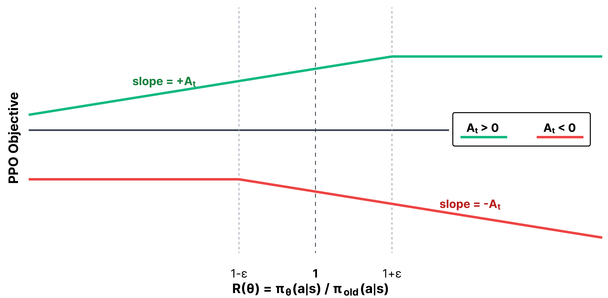

<!-- layout: title-sidebar -->
<!-- valign: bottom -->

# 第 3 讲：强化学习——动机与数学

<div class="colloquium-title-eyebrow">rlhfbook.com</div>

<div class="colloquium-title-meta">
<p class="colloquium-title-name">Nathan Lambert</p>
</div>

<p class="colloquium-title-note">后训练课程。第 6 章 第 1 部分</p>

---

<!-- rows: 50/50 -->
## 第 3 讲：强化学习（主要是数学部分）

<!-- row-columns: 32/36/32 -->

```box
title: 总览
tone: muted
compact: true
content: |
  1. 引言
  2. 相关重要工作
  3. 训练流程概览
```

|||

```box
title: 核心训练流水线
tone: accent
compact: true
content: |
  4. 指令微调
  5. 奖励模型
  6. **强化学习**
  7. 推理
  8. 直接对齐
  9. 拒绝采样
```

|||

```box
title: 数据与偏好
tone: muted
compact: true
content: |
  10. 什么是偏好
  11. 偏好数据
  12. 合成数据与 CAI
```

===

<!-- row-columns: 32/36/32 -->

```box
title: 实践考量
tone: muted
compact: true
content: |
  13. 工具使用
  14. 过度优化
  15. 正则化
  16. 评估
  17. 产品与个性
```

|||

```box
title: 附录
tone: surface
compact: true
content: |
  - A. 定义
  - B. 风格与信息
  - C. 实践问题
```

|||

```box
title: 课程主页
tone: surface
compact: true
content: |
  - [rlhfbook.com](https://rlhfbook.com)
  - [GitHub 仓库](https://github.com/natolambert/rlhf-book)
```

---

<!-- rows: 30/70 -->
## 我们在流水线中的位置

完成指令微调和奖励模型训练后，强化学习步骤会基于已学习的奖励信号来更新策略（policy）。

系统架构图视角。

===


---

<!-- columns: 50/50 -->
## 我们在流水线中的位置

完成指令微调和奖励模型训练后，强化学习步骤会基于已学习的奖励信号来更新策略（policy）。

RLHF 优化视角。

|||


---

## 本讲覆盖内容

本讲覆盖语言模型中 RL 的**数学与理论**。下一讲覆盖实现细节。

```box
title: 第 3 讲提纲
tone: accent
content: |
  1. **动机**——为什么 RL 训练很重要
  2. **RL 基础回顾**——MDP、回报、价值函数、策略梯度目标
  3. **策略梯度推导**——log-derivative 技巧、逐步推导
  4. **REINFORCE 与 RLOO**——最简单的策略梯度算法
  5. **PPO**——信任域、裁剪（clipping）、GAE、价值函数
  6. **GRPO 与现代变体**——GSPO、CISPO 及走向简化的趋势
  7. **对比**——优缺点、待解问题
```

---

## RL 的一个常被忽视的收益

在第 2 讲中，我们涵盖了拒绝采样（rejection sampling），之后还会讲到直接对齐算法（如 DPO）。它们更简单，但 RL 具有一些难以量化的收益。

实现 RL 需要更复杂的基础设施，但它提供的梯度更新"通常对模型有显著帮助"。这一效果难以精确量化，但：

- RL 可以"修补"模型输出中的粗糙之处——使输出更加稳健、格式更规范，以及与 vLLM 等推理框架的兼容性更好
- RL 的作用范围通常局限在较窄的 prompt 分布上，因此不太可能"抹杀"模型的一般能力——可以手术式地改进特定行为，而不损害其他能力

总体而言，语言模型上的 RL 损失函数稳健、可扩展、有效且灵活，由此开辟了大量新的实验领域。引领我们走上这条路的最初方法是 RLHF 工作。

---

<!-- layout: section-break -->

## 为什么 RL 重要

---

<!-- columns: 50/50 -->
## RL 驱动的扩展时代

<!-- cite-right: openai2024o1 -->

RL 现在是训练最先进模型时的**承重步骤**（load-bearing step）。

推理模型（o1、DeepSeek R1 等）使用完全相同的算法，在可验证奖励上进行训练。

- 通过 RL 扩展训练时算力
- 通过扩展推理扩展测试时算力
- RL 从"锦上添花"变成了核心能力驱动因素

|||


---

<!-- columns: 50/50 -->
## RLVR：相同的算法，可验证奖励

<!-- cite-right: lambert2024t -->

本讲中的 RL 方法同时支撑**RLHF 与 RLVR**：

- **RLHF**：奖励模型衡量主观质量
- **RLVR**：验证函数检查正确性（数学、代码）

策略梯度算法相同，奖励来源不同。我们后续会专门安排一讲深入探讨推理训练的技巧以及大量有趣模型。

|||


---

<!-- layout: section-break -->

## 策略梯度：核心直觉

---

<!-- columns: 50/50 -->
## 回顾：经典 RL vs. RLHF

<!-- cite-right: christiano2017, ouyang2022training -->

<div class="text-sm">

**经典 RL**：智能体处于 MDP $(\mathcal{S}, \mathcal{A}, P, r, \gamma)$ 中
- 奖励是环境给出的逐步已知函数
- 优化累积回报：$J(\pi) = \mathbb{E}_{\tau \sim p_\pi}\!\left[\sum_{t} \gamma^t r(s_t, a_t)\right]$

**RLHF**：从数据集中取 prompt，没有环境
- 奖励是**通过学习获得**的——来自人类偏好
- **响应级别**奖励，辅以 KL 惩罚进行正则化
- $J(\pi) = \mathbb{E}\left[ r_\theta(x, y) \right] - \beta \, D_{\text{KL}}\!\left(\pi \| \pi_{\text{ref}}\right)$

</div>


|||


---

<!-- columns: 50/50 -->
## 本讲使用的符号

<div class="text-sm">

本讲使用强化学习文献中的 $(s, a)$ 符号，其中 $s$ 表示状态（state），$a$ 表示动作（action）。在语言模型上下文中，你经常会看到 $(x, y)$，其中 $x$ 是 prompt，$y$ 是补全。

$(s, a)$ 的框架更通用——这些算法最初是为在每个时间步执行动作的序列决策问题设计的。然而，许多 RLHF 实现将整个补全视为单个动作，这使得 $(x, y)$ 符号同样有效。

**符号约定**：$r_t$ 表示逐步奖励，$R(\tau)$ 表示轨迹（trajectory）回报，$\rho_t$ 表示重要性采样比（importance-sampling ratio）。我们保留 $\rho$ 专门表示比率，以避免与奖励混淆。

</div>


|||


---

## 语言模型作为阶段性 MDP

| MDP 概念 | 语言模型 |
|-------------|---------------|
| 状态 $s_t$ | prompt + 已生成的 token：$(x, y_{<t})$ |
| 动作 $a_t$ | 下一个 token $y_t$ |
| 转移 | 确定性：将 token 追加到序列 |
| 策略 $\pi_\theta(a_t \mid s_t)$ | LM 的 next-token 分布 |
| 回合（Episode） | 一个 prompt → 完整补全 |
| 终端奖励 | RM 分数或验证器输出 |
| $\gamma$ | 通常为 1.0（不做折现） |

对此 MDP 有两种视角：**token 级别**（每个 token 是独立动作，PPO 配合 GAE 时使用）与**序列级别**（整个补全是一个动作，REINFORCE/GRPO 中使用）。

---

## 我们在优化什么？

选择策略参数 $\theta$，使得在当前策略下**平均**获得最高奖励。

令 $p_\theta(\tau)$ 为当前策略诱导的轨迹分布。

$$J(\theta) = \mathbb{E}_{\tau \sim p_\theta}[R(\tau)]$$

实践中，我们用采样的 rollout 来估计这个期望：

$$J(\theta) \approx \frac{1}{N}\sum_{i=1}^{N} R(\tau_i), \qquad \tau_i \sim p_\theta$$

我们需要构造一个梯度（导数）来优化这个目标。

---


## 策略梯度是如何工作的

让导致更好结果的行动更可能出现。

$$\Delta \theta \propto \Psi_t \, \nabla_\theta \log \pi_\theta(a_t \mid s_t)$$

<div class="text-sm">

可以把它理解为同时回答了两个问题：

- $\nabla_\theta \log \pi_\theta(a_t \mid s_t)$ — **哪个动作？**
- $\Psi_t$ — **它有多好？** 一个对结果进行评分的标量。

</div>

---

## 策略梯度是如何工作的

让导致更好结果的行动更可能出现。

$$\Delta \theta \propto \Psi_t \, \nabla_\theta \log \pi_\theta(a_t \mid s_t)$$

<div class="text-sm">

可以把它理解为同时回答了两个问题：

- $\nabla_\theta \log \pi_\theta(a_t \mid s_t)$ — **哪个动作？** 每个参数对"在状态 $s_t$ 下执行动作 $a_t$"这一事件的概率所施加的影响。它将结果反向关联到导致该结果的"旋钮"上。
- $\Psi_t$ — **它有多好？** 一个对结果进行评分的标量。正值表示好，负值表示差，绝对值表示程度。

> 一个过度简化的理解（例如 batch size 为 1 时的直觉）：梯度是一个向量，每个参数对应一个分量。正的分量意味着"增大这个参数会让动作更可能出现"，负分量则相反。实践中，更新是对许多这样的向量求平均——最终留存的是 batch 中的净投票结果。

将它们相乘：$\Psi_t > 0$ 时更新参数使 $a_t$ 更可能出现，$\Psi_t < 0$ 时更新参数使 $a_t$ 更不可能出现。

本节其余部分都在讨论如何选择聪明的 $\Psi_t$——不同的选择（总回报、优势函数、TD 残差）在方差和偏差之间做出权衡，但都可以嵌入这个相同的更新公式。

</div>

---

## 策略梯度方程

最终结果的预览：

$$\nabla_\theta J(\theta) = \mathbb{E}_{\tau \sim p_\theta}\!\left[\sum_{t=0}^{T} \Psi_t \nabla_\theta \log \pi_\theta(a_t \mid s_t)\right]$$

核心思想是我们在*环境中采样试验*并**估计**梯度。

其中 $\Psi_t$ 是**学习信号**，告诉优化器这个动作有多好。$\Psi_t$ 的选择决定了算法的方差、偏差和计算成本。


---

## 关键 RL 量

本讲中会反复出现三个量：

**价值函数** $V(s)$：从状态 $s$ 出发的期望未来回报

$$V(s) = \mathbb{E}\big[G_t \mid S_t = s\big] \quad \text{其中 } G_t = \sum_{k=0}^{\infty} \gamma^k r_{t+k}$$

**动作值函数** $Q(s, a)$：在状态 $s$ 中执行动作 $a$ 后的期望回报

$$Q(s, a) = \mathbb{E}[G_t \mid S_t = s, A_t = a]$$

**优势函数** $A(s, a) = Q(s, a) - V(s)$：动作 $a$ 比平均水平好多少？正值 → 强化，负值 → 抑制，零 → 无更新。

在 RLHF 中：通常 $\gamma = 1$（不做折现），因为优化的基本单位是整个补全。

---

## $\Psi_t$ 可以是什么

<!-- cite-right: schulman2015high -->

$\Psi_t$ 的常见选择（奖励也可以由 $\gamma$ 折现）：

| | $\Psi_t$ | 描述 | 方差 | 偏差 |
|:-:|-----------|-------------|:--------:|:----:|
| 1. | $R(\tau) = \sum_{t=0}^{T} r_t$ | 轨迹总奖励 | 最高 | 无 |
| 2. | $\sum_{t'=t}^{T} r_{t'}$ | 从 $t$ 开始的未来回报（即回报 $G_t$） | 高 | 无 |
| 3. | $G_t - b(s_t)$ | 去基线（baseline）的回报 | 较低 | 无 |
| 4. | $Q^{\pi}(s_t, a_t)$ | 状态-动作值函数 | 中 | 取决于具体情形 |
| 5. | $A^{\pi}(s_t, a_t) = Q - V$ | 优势函数 | 低（$V$ 好时） | 无 |
| 6. | $r_t + \gamma V(s_{t+1}) - V(s_t)$ | TD 残差 | 低 | 有一些 |

*基线* $b(s_t)$ 是从奖励信号中减去的任意值，用于降低方差。下面我们将证明这不会改变期望梯度。

---


<!-- layout: section-break -->

## 推导策略梯度

---

## 设定：对期望求导

理想情况下，我们希望 $\nabla_\theta J(\theta)$，但这无法直接求导（状态采样分布本身依赖于 $\theta$）。

写成积分形式，目标函数为：

$$J(\theta) = \mathbb{E}_{\tau \sim p_\theta}[R(\tau)] = \int_\tau p_\theta(\tau) R(\tau) \, d\tau$$

---

## 设定：对期望求导

理想情况下，我们希望 $\nabla_\theta J(\theta)$，但这无法直接求导（状态采样分布本身依赖于 $\theta$）。

写成积分形式，目标函数为：

$$J(\theta) = \mathbb{E}_{\tau \sim p_\theta}[R(\tau)] = \int_\tau p_\theta(\tau) R(\tau) \, d\tau$$

直接取梯度：

$$\nabla_\theta J(\theta) = \int_\tau \nabla_\theta p_\theta(\tau) R(\tau) \, d\tau$$

我们可以从 $p_\theta(\tau)$ 中采样轨迹，但不能从 $\nabla_\theta p_\theta(\tau)$ 中采样，因为它不是一个概率分布。

接下来的推导需要几个关键技巧来近似或计算这个表达式。

---

## 应用：从轨迹计算梯度的思路

将对数导数恒等式（稍后详述）代入梯度表达式：

$$
\begin{aligned}
\nabla_\theta J(\theta)
&= \int_\tau \nabla_\theta p_\theta(\tau) R(\tau) \, d\tau
&& \text{对目标求导} \\
&= \int_\tau p_\theta(\tau) R(\tau) \nabla_\theta \log p_\theta(\tau) \, d\tau
&& \text{对数导数恒等式（链式法则）} \\
&= \mathbb{E}_{\tau \sim p_\theta}\!\left[R(\tau) \nabla_\theta \log p_\theta(\tau)\right]
&& \text{期望形式}
\end{aligned}
$$

现在我们可以用蒙特卡洛采样来估计这个期望了！

---

## 应用：从轨迹计算梯度的思路

唯一不明显的步骤是中间行：

$$
\begin{aligned}
\nabla_\theta \log p_\theta(\tau)
&= \frac{\nabla_\theta p_\theta(\tau)}{p_\theta(\tau)} \\
\Rightarrow \quad
\nabla_\theta p_\theta(\tau)
&= p_\theta(\tau) \nabla_\theta \log p_\theta(\tau)
\end{aligned}
$$

这就是**对数导数恒等式**（log-derivative identity），由 $\log$ 的链式法则推导而来。

它将概率的梯度重写为对数概率的形式，这要方便处理得多。

---

## 应用：从轨迹计算梯度的思路

$p_\theta(\tau)$ 项去哪了？

它变成了期望内部的**采样分布**：

$$\int p_\theta(\tau) f(\tau)\, d\tau = \mathbb{E}_{\tau \sim p_\theta}[f(\tau)]$$

蒙特卡洛估计通过从策略中采样轨迹来估计该期望：

$$\mathbb{E}_{\tau \sim p_\theta}[f(\tau)] \approx \frac{1}{N}\sum_{i=1}^{N} f(\tau_i), \qquad \tau_i \sim p_\theta$$

所以在代码中没有显式的 $p_\theta(\tau_i)$ 项：**更可能出现的轨迹已经在采样 batch 中出现得更频繁了**。

从高层来看，rollout 生成负责采样，loss 代码负责计算 $R(\tau_i)\,\nabla_\theta \log p_\theta(\tau_i)$。

---

## 展开轨迹的 log 概率以计算 $\nabla_\theta$

轨迹概率可以分解为：

$$p_\theta(\tau) = d_0(s_0) \prod_{t=0}^{T} \pi_\theta(a_t \mid s_t) \, p(s_{t+1} \mid s_t, a_t)$$

取对数：

$$\log p_\theta(\tau) = \log d_0(s_0) + \sum_{t=0}^{T} \log \pi_\theta(a_t \mid s_t) + \sum_{t=0}^{T} \log p(s_{t+1} \mid s_t, a_t)$$

对于语言模型，这就是熟悉的自回归模式：序列 log 概率变成 token log 概率之和。

---

## 展开轨迹的 log 概率以计算 $\nabla_\theta$

<div class="text-sm">

$$\log p_\theta(\tau) = \log d_0(s_0) + \sum_{t=0}^{T} \log \pi_\theta(a_t \mid s_t) + \sum_{t=0}^{T} \log p(s_{t+1} \mid s_t, a_t)$$

现在对 $\theta$ 求梯度：

- $\nabla_\theta \log d_0(s_0) = 0$ —— 初始状态分布不依赖于 $\theta$
- $\nabla_\theta \log p(s_{t+1} \mid s_t, a_t) = 0$ —— 环境动态不依赖于 $\theta$
- 只剩下 $\nabla_\theta \log \pi_\theta(a_t \mid s_t)$！

$$\nabla_\theta \log p_\theta(\tau) = \sum_{t=0}^{T} \nabla_\theta \log \pi_\theta(a_t \mid s_t)$$

</div>
---

## 展开轨迹的 log 概率以计算 $\nabla_\theta$

<div class="text-sm">

$$\log p_\theta(\tau) = \log d_0(s_0) + \sum_{t=0}^{T} \log \pi_\theta(a_t \mid s_t) + \sum_{t=0}^{T} \log p(s_{t+1} \mid s_t, a_t)$$

现在对 $\theta$ 求梯度：

- $\nabla_\theta \log d_0(s_0) = 0$ —— 初始状态分布不依赖于 $\theta$
- $\nabla_\theta \log p(s_{t+1} \mid s_t, a_t) = 0$ —— 环境动态不依赖于 $\theta$
- 只剩下 $\nabla_\theta \log \pi_\theta(a_t \mid s_t)$！

$$\nabla_\theta \log p_\theta(\tau) = \sum_{t=0}^{T} \nabla_\theta \log \pi_\theta(a_t \mid s_t)$$

在语言模型代码中，这就是为什么你反复看到：

```python
seq_log_probs = (token_log_probs * completion_mask).sum(dim=-1)
loss = -(seq_log_probs * advantages).mean()
loss.backward()
```

自动微分（autodiff）把这种 log 概率之和变成了对应的逐 token 梯度之和！
</div>
---

## 从总回报到未来奖励

$t$ 时刻的动作无法影响过去的奖励。因此，不直接用整个轨迹奖励 $R(\tau)$ 加权：

$$\nabla_\theta J = \mathbb{E}_{\tau \sim p_\theta}\!\left[\sum_{t=0}^{T} R(\tau) \nabla_\theta \log \pi_\theta(a_t \mid s_t)\right]$$

我们可以用**剩余回报**（return-to-go）$G_t = \sum_{t'=t}^{T} r_{t'}$ 替代——只包含从 $t$ 开始及之后的未来奖励：

$$\nabla_\theta J = \mathbb{E}_{\tau \sim p_\theta}\!\left[\sum_{t=0}^{T} G_t \nabla_\theta \log \pi_\theta(a_t \mid s_t)\right]$$

这不改变期望梯度，但去除了当前动作无法影响的过去奖励所带来的噪声。这一步对应于我们分类中 $\Psi_t$ 选项 1 → 选项 2 的转换。

---

## 基线保持估计无偏

原始回报是嘈杂的。由于后续采样的动作（在经典 RL 中还包括环境的随机性），同一个动作可能出现在总奖励差异巨大的轨迹中。

基线的作用是**中心化**这个嘈杂信号：不再问"回报高吗？"，而是问"它比该状态下的期望高还是低？"


---

## 基线保持估计无偏

原始回报是嘈杂的。由于后续采样的动作（在经典 RL 中还包括环境的随机性），同一个动作可能出现在总奖励差异巨大的轨迹中。

基线的作用是**中心化**这个嘈杂信号：不再问"回报高吗？"，而是问"它比该状态下的期望高还是低？"

使用中心化回报：

$$\Psi_t = G_t - b(s_t)$$

其中基线 $b(s_t)$ 仅依赖于状态，不依赖于具体采样到了哪个动作。

减去这个基线不会改变期望梯度：

---

## 基线保持估计无偏

<div class="text-sm">

原始回报是嘈杂的。由于后续采样的动作（在经典 RL 中还包括环境的随机性），同一个动作可能出现在总奖励差异巨大的轨迹中。

使用中心化回报，$\Psi_t = G_t - b(s_t)$。

减去这个基线不会改变期望梯度：

$$
\mathbb{E}[(G_t - b(s)) \nabla_\theta \log \pi_\theta(a \mid s)]
= \mathbb{E}[G_t \nabla_\theta \log \pi_\theta(a \mid s)]
- \mathbb{E}[b(s) \nabla_\theta \log \pi_\theta(a \mid s)]
$$

第一项是原始估计量。第二项为零：

$$
\begin{aligned}
\mathbb{E}[b(s) \nabla_\theta \log \pi_\theta(a \mid s)]
&= b(s) \cdot \sum_a \nabla_\theta \pi_\theta(a \mid s) \\
&= b(s) \cdot \nabla_\theta \underbrace{\sum_a \pi_\theta(a \mid s)}_{= 1} \\
&= 0
\end{aligned}
$$

归一化分布的梯度之和为零——因此我们可以自由减去**任何状态的函数**作为基线。这就是为什么 $\Psi_t$ 选项 3–5 在不引入偏差的情况下降低方差。

</div>

---

## 回顾：$\Psi_t$ 可以是什么

<!-- cite-right: schulman2015high -->

$\Psi_t$ 的常见选择（奖励也可以由 $\gamma$ 折现）：

| | $\Psi_t$ | 描述 | 方差 | 偏差 |
|:-:|-----------|-------------|:--------:|:----:|
| 1. | $R(\tau) = \sum_{t=0}^{T} r_t$ | 轨迹总奖励 | 最高 | 无 |
| 2. | $\sum_{t'=t}^{T} r_{t'}$ | 从 $t$ 开始的未来回报（即回报 $G_t$） | 高 | 无 |
| 3. | $\sum_{t'=t}^{T} r_{t'} - b(s_t)$ | 去基线的回报 | 较低 | 无 |
| 4. | $Q^{\pi}(s_t, a_t)$ | 状态-动作值函数 | 中 | 取决于具体情形 |
| 5. | $A^{\pi}(s_t, a_t) = Q - V$ | 优势函数 | **最低** | 无 |
| 6. | $r_t + \gamma V(s_{t+1}) - V(s_t)$ | TD 残差 | 低 | 有一些 |

*基线* $b(s_t)$ 是从奖励信号中减去的任意值——我们很快会证明这是无偏的。

---


## 策略梯度估计量

结合对数导数技巧、剩余回报和基线减法：

$$\nabla_\theta J(\theta) = \mathbb{E}_{\tau \sim p_\theta}\!\left[\sum_{t=0}^{T} \Psi_t \nabla_\theta \log \pi_\theta(a_t \mid s_t)\right]$$

这就是**策略梯度定理**（policy gradient theorem）。本讲中的所有算法都是此定理针对特定 $\Psi_t$ 选择和正则化方式的实例化。

对于语言模型，这意味着求和覆盖补全中生成的 token，而 $\Psi_t$ 决定每个 token 的加权方式。

---

## 策略梯度推导回顾

$$
\begin{aligned}
J(\theta)
&= \mathbb{E}_{\tau \sim p_\theta}[R(\tau)]
&& \text{目标函数} \\
&= \int_\tau p_\theta(\tau) R(\tau)\, d\tau
&& \text{积分形式} \\
\nabla_\theta J(\theta)
&= \int_\tau \nabla_\theta p_\theta(\tau) R(\tau)\, d\tau
&& \text{求导} \\
&= \mathbb{E}_{\tau \sim p_\theta}\!\left[\sum_{t=0}^{T} \Psi_t \nabla_\theta \log \pi_\theta(a_t \mid s_t)\right]
&& \text{最终估计量}
\end{aligned}
$$

- 对数导数技巧将 $\nabla p_\theta(\tau)$ 转换为可采样的期望
- 展开 $\log p_\theta(\tau)$ 得到策略 log 概率项之和
- $\Psi_t$ 是学习信号：回报、优势或 TD 风格的估计
- 在代码中：采样 rollout、累加 token log 概率、按 $\Psi_t$ 加权、求平均

---

<!-- layout: section-break -->

## 将 RLHF 适配到语言模型

---

<!-- columns: 40/60 -->
## RLHF 训练循环

在深入具体算法之前，让我们回顾一下它们所接入的完整 RLHF 设置。

|||


---

<!-- columns: 50/50 -->
## 参考模型（reference model）

**参考模型** $\pi_\text{ref}$ 是 RL 训练开始时策略的冻结副本（通常是 SFT 检查点）。

它只有一个作用：**将策略锚定住，使其在优化过程中不会漂移太远。**

没有它，策略可能会"钻"奖励模型的空子——找到分数高但退化或重复的输出（奖励投机）。

|||


---

<!-- columns: 50/50 -->
## KL 散度作为正则化

KL 惩罚衡量当前策略在每个 token 上距离参考模型有多远：

$$\text{KL}_t = \log \pi_\theta(a_t \mid s_t) - \log \pi_\text{ref}(a_t \mid s_t)$$

实践中：
1. **生成**：从 $\pi_\theta$ 生成一个补全
2. **计算 log 概率**：在 $\pi_\theta$ 和 $\pi_\text{ref}$ 两个模型上分别计算这些 token 的 log 概率
3. **相减**：得到逐 token 的 KL

塑形后的奖励变为：$\tilde{r}_t = -\beta \, \text{KL}_t$（中间 token），$\tilde{r}_T = R(\tau) - \beta \, \text{KL}_T$（最后一个 token）。

|||


---

<!-- columns: 50/50 -->
## RLHF vs. RLVR 中的 KL

**RLHF**（奖励模型信号）：KL 惩罚至关重要——奖励模型是学习得到的代理，如果没有正则化，策略会利用其任何不完美之处。

**RLVR**（可验证奖励，如数学正确性）：KL 经常被减小甚至完全去掉。奖励是"地面真实值"，可供利用的空间更小。某些 RLVR 设置（如 DeepSeek R1）完全舍弃参考模型，以节省显存。

趋势：随着奖励信号越来越可靠，对 KL 正则化的需求逐渐降低。

|||


---

## 两个"旧"策略——不要混淆它们

| | $\pi_{\theta_\text{old}}$ | $\pi_\text{ref}$ |
|---|---|---|
| **是什么** | 上一次 rollout 时的策略 | RL 训练开始时的策略（SFT 检查点） |
| **是否更新** | 每个 batch（或每 $K$ 步） | 从不（冻结） |
| **用途** | 重要性采样比 $\rho_t$ | KL 惩罚 |
| **如果去掉** | 必须每个 batch 只用 1 步梯度（同策略） | 面临奖励投机风险 |

在某些实现中，"旧 log 概率"指的是生成时的 log 概率——模型自那些 log 概率计算以来已经进行了更新，并不是一个独立的模型副本。

---

<!-- layout: section-break -->

## REINFORCE

---

## REINFORCE

<!-- cite-right: williams1992simple -->

REINFORCE 是策略梯度最简单的实例化。

它是策略梯度的**蒙特卡洛形式**：采样轨迹、计算它们的回报，并用这些采样回报对 log 概率梯度进行加权。


---

## REINFORCE

<!-- cite-right: williams1992simple -->

REINFORCE 是策略梯度最简单的实例化。

它是策略梯度的**蒙特卡洛形式**：采样轨迹、计算它们的回报，并用这些采样回报对 log 概率梯度进行加权。

> 这个名字是缩写，全称为"REward Increment = Nonnegative Factor X Offset Reinforcement X Characteristic Eligibility"（奖励增量 = 非负因子 × 偏移强化 × 特征选择度）。

三个组成部分：

1. **非负因子**（$\alpha$）：学习率
2. **偏移强化**（$G_t - b(s_t)$）：中心化的回报，用于稳定性
3. **特征选择度**（$\nabla \log \pi$）：如何逐 token 分配学习贡献

---

## REINFORCE

<!-- cite-right: williams1992simple -->

REINFORCE 是策略梯度最简单的实例化。

它是策略梯度的**蒙特卡洛形式**：采样轨迹、计算它们的回报，并用这些采样回报对 log 概率梯度进行加权。

> 这个名字是缩写，全称为"REward Increment = Nonnegative Factor X Offset Reinforcement X Characteristic Eligibility"（奖励增量 = 非负因子 × 偏移强化 × 特征选择度）。

三个组成部分：

1. **非负因子**（$\alpha$）：学习率
2. **偏移强化**（$G_t - b(s_t)$）：中心化的回报，用于稳定性
3. **特征选择度**（$\nabla \log \pi$）：如何逐 token 分配学习贡献

更新规则：

$$\Delta\theta = \alpha \, (G_t - b(s_t)) \nabla_\theta \log \pi_\theta(a_t \mid s_t)$$


---

## 基线问题

如果没有基线，梯度会用原始回报 $G_t$ 对每个动作进行加权。这并不能告诉你一个动作是**好于还是差于预期**——只告诉你整体结果有多好。

梯度方差很大，因为原始回报将动作的质量与状态的质量混在了一起。状态差时的一个好动作，与状态好时的一个坏动作，可能产生相似的回报。

---

## 基线方案

减去基线 $b(s)$ 可以中心化信号：现在梯度权重为 $(G_t - b)$，它回答的是"从这个状态出发，这个动作是比预期好还是差？"

$$\mathbb{E}_{a \sim \pi(\cdot \mid s)}[b(s) \nabla_\theta \log \pi_\theta(a \mid s)] = b(s) \cdot \mathbb{E}_{a \sim \pi(\cdot \mid s)}[\nabla_\theta \log \pi_\theta(a \mid s)] = 0$$

因为 $b(s)$ 不依赖于具体采样到了哪个动作，所以它可以提取出来并相互抵消。期望梯度保持不变——但方差大幅降低。

---

## 带基线的 REINFORCE

完整的 REINFORCE 梯度：

$$\nabla_\theta J(\theta) = \mathbb{E}_{\tau \sim p_\theta}\!\left[\sum_{t=0}^{T} (G_t - b(s_t)) \nabla_\theta \log \pi_\theta(a_t \mid s_t)\right]$$

这里，$G_t - b(s_t)$ 本身就是一个优势估计：实际回报比从状态 $s_t$ 出发的期望高出多少。

常见基线：
- 整个 batch 上的**平均奖励**（最简单）
- 近期奖励的**移动平均**
- **学习的价值函数** $V_\phi(s)$（可选——通向 actor-critic 方法）

基本 REINFORCE 不需要 critic——只需蒙特卡洛回报和一个简单基线。加入学习的 $V_\phi$ 可以进一步降低方差，但引入了训练第二个模型的复杂度（……也意味着向 PPO 过渡）。

---

## REINFORCE 架构


---

<!-- layout: section-break -->

## REINFORCE leave-one-out（RLOO）

---

## RLOO：留一法基线

<!-- cite-right: ahmadian2024back -->

**核心思想**：为每个 prompt 生成 $K$ 个补全。用其余 $K-1$ 个补全的奖励作为基线：

$$b(s, a_k) = \frac{1}{K-1}\sum_{i=1,\, i \neq k}^{K} R(s, a_i)$$

补全 $k$ 的优势：

$$\hat{A}(s, a_k) = R(s, a_k) - b(s, a_k)$$

这是一个**逐 prompt** 的基线，自然捕捉了 prompt 的难度——困难的 prompt 在所有补全上都得到低奖励，所以基线也低。

*细节：与不带 critic 的 REINFORCE 一样，这个序列级别的优势会被广播到补全中的每个 token。*

---

## RLOO 工作示例

$K = 4$ 个补全，奖励为 $[0.8, 0.3, 0.6, 0.5]$：

| 补全 | 奖励 | 基线（其余的平均） | 优势 |
|:----------:|:------:|:------------------------:|:---------:|
| 1 | 0.8 | $(0.3 + 0.6 + 0.5)/3 = 0.467$ | $+0.333$ |
| 2 | 0.3 | $(0.8 + 0.6 + 0.5)/3 = 0.633$ | $-0.333$ |
| 3 | 0.6 | $(0.8 + 0.3 + 0.5)/3 = 0.533$ | $+0.067$ |
| 4 | 0.5 | $(0.8 + 0.3 + 0.6)/3 = 0.567$ | $-0.067$ |

补全 1（最好）被强化，补全 2（最差）被抑制，补全 3 和 4 得到小幅度更新。

---

## REINFORCE / RLOO 小结

**REINFORCE**：最简单的策略梯度。需要基线来降低方差。不需要价值函数。

**RLOO**：REINFORCE + 聪明的逐 prompt 留一法基线。每个 prompt 的多个补全免费提供了基线。

两者是一切后续方法的基础：

- 与 GRPO 等分组补全算法在直觉上紧密关联
- 不需要价值函数（节省显存/计算）
- 实现和调试简单
- 实践中是强有力的基线 [@ahmadian2024back; @wang2024helpsteer2p]

---

## RLOO 架构


---

<!-- layout: section-break -->

## 近端策略优化（PPO）

---

## 如果 REINFORCE 这么简单，为什么用 PPO？

本讲中的所有算法都是**同策略**（on-policy）的：每个 batch 从当前策略中生成新的 rollout，然后基于这些 rollout 进行更新。

这与离策略（off-policy）RL 方法（如 DQN）形成对比——后者存储并回放旧经验。


---

## 如果 REINFORCE 这么简单，为什么用 PPO？

本讲中的所有算法都是**同策略**（on-policy）的：每个 batch 从当前策略中生成新的 rollout，然后基于这些 rollout 进行更新。

这与离策略（off-policy）RL 方法（如 DQN）形成对比——后者存储并回放旧经验。

问题在于：原始策略梯度对步长很敏感。步长过大策略可能崩溃；步长过小训练又慢得让人痛苦。TRPO [@schulman2015trust] 用严格的信任域约束解决了这个问题，但需要昂贵的二阶优化。


---

## 如果 REINFORCE 这么简单，为什么用 PPO？

本讲中的所有算法都是**同策略**（on-policy）的：每个 batch 从当前策略中生成新的 rollout，然后基于这些 rollout 进行更新。

这与离策略（off-policy）RL 方法（如 DQN）形成对比——后者存储并回放旧经验。

问题在于：原始策略梯度对步长很敏感。步长过大策略可能崩溃；步长过小训练又慢得让人痛苦。TRPO [@schulman2015trust] 用严格的信任域约束解决了这个问题，但需要昂贵的二阶优化。

近端策略优化（**PPO**）[@schulman2017proximal] 通过一个简单的裁剪目标获得了 TRPO 级别的稳定性——而且因为裁剪使更新更加保守，你可以安全地对每个 batch 的 rollout 执行多次梯度更新，提高样本效率。

---

## 更保守的梯度能做什么？

从 batch 中提取更多信号！

这就引出了新问题：

- 我们如何在多次梯度更新中约束更新？
- 如果数据已经偏离同策略了，我们还能取策略梯度吗？

---

## PPO 核心思想 1：约束更新

<!-- cite-right: schulman2017proximal -->

大的梯度步会破坏策略（不稳定性、过度优化等）。

解决方案：**信任域**（trust regions）——限制策略在一次更新中可以移动多远。

---

## PPO 核心思想 2：重要性采样

我们希望对一个 batch 执行多次梯度更新，但数据来自旧策略 $\pi_{\theta_\text{old}}$。

定义**重要性采样比**：

$$\rho_t(\theta) = \frac{\pi_\theta(a_t \mid s_t)}{\pi_{\theta_\text{old}}(a_t \mid s_t)}$$

- 如果 $\rho_t = 1$：新旧策略对这个动作的概率评估一致
- 如果 $\rho_t > 1$：新策略分配的概率更高
- 如果 $\rho_t < 1$：新策略分配的概率更低

这个比率将旧策略样本重新加权，以估计新策略的梯度。将该比率代入前面的策略梯度形式，得到一个可以在旧策略数据上优化的代理目标。

---

## 代理目标

使用重要性采样，策略梯度变为：

$$J(\theta) = \mathbb{E}_t\!\left[\rho_t(\theta) \hat{A}_t\right]$$

**中间问题**：如果不加约束，最大化这个目标可能采取任意大的步长——比率 $\rho_t$ 可能严重偏离 1，使得估计不可靠。

---

## PPO 裁剪目标（整合各部分）

PPO 裁剪比率以防止大更新——这是一个受信任域思想启发的实用代理。原始论文 [@schulman2017proximal] 称其为 $L^{CLIP}$，但这是一个我们**最大化**的目标，所以用 $J$ 表示：

$$J(\theta) = \mathbb{E}_t\!\left[\min\!\left(\rho_t(\theta) \hat{A}_t,\; \text{clip}(\rho_t(\theta),\, 1-\varepsilon,\, 1+\varepsilon)\, \hat{A}_t\right)\right]$$

其中 $\rho_t(\theta) = \frac{\pi_\theta(a_t \mid s_t)}{\pi_{\theta_\text{old}}(a_t \mid s_t)}$ 是重要性采样比。

其中 $\varepsilon$ 通常为 0.1–0.2。$\min$ 选择**更保守**的估计。

---

## 正优势（$\hat{A}_t > 0$）

<!-- footnote-right: $\rho_t(\theta) = \pi_\theta / \pi_{\theta_\text{old}}$（策略比） -->

$$J(\theta) = \mathbb{E}_t\!\left[\min\!\left(\rho_t(\theta) \hat{A}_t,\; \text{clip}(\rho_t(\theta),\, 1-\varepsilon,\, 1+\varepsilon)\, \hat{A}_t\right)\right]$$

该动作在该状态下优于平均水平——我们希望**增加**它的概率。三种子情况：

1. $\rho_t < 1 - \varepsilon$：新策略下动作**更不可能**。  
   目标：$\rho_t \hat{A}_t$ ——**正常梯度**，推动概率上升

2. $1 - \varepsilon \leq \rho_t \leq 1 + \varepsilon$：动作**大致等可能**。  
   目标：$\rho_t \hat{A}_t$ ——**正常梯度**，推动概率上升

3. $\rho_t > 1 + \varepsilon$：新策略下动作**已经更可能**。  
   目标：$(1+\varepsilon)\hat{A}_t$ ——梯度为**零**，无需更新（**已裁剪**）

注意：在第一步梯度更新时，$\rho_t = 1$（策略尚未改变），所以比率从 1 附近开始，第 1/3 种情况只出现在后续步中。

---

## 负优势（$\hat{A}_t < 0$）

<!-- footnote-right: $\rho_t(\theta) = \pi_\theta / \pi_{\theta_\text{old}}$（策略比） -->

$$J(\theta) = \mathbb{E}_t\!\left[\min\!\left(\rho_t(\theta) \hat{A}_t,\; \text{clip}(\rho_t(\theta),\, 1-\varepsilon,\, 1+\varepsilon)\, \hat{A}_t\right)\right]$$

该动作在该状态下差于平均水平——我们希望**降低**它的概率。三种子情况：

1. $\rho_t < 1 - \varepsilon$：新策略下动作**已经更不可能**。  
   目标：$(1-\varepsilon)\hat{A}_t$ ——梯度为**零**，无需更新（**已裁剪**）

2. $1 - \varepsilon \leq \rho_t \leq 1 + \varepsilon$：动作**大致等可能**。  
   目标：$\rho_t \hat{A}_t$ ——**正常梯度**，推动概率下降

3. $\rho_t > 1 + \varepsilon$：新策略下动作**更可能**。  
   目标：$\rho_t \hat{A}_t$ ——**正常梯度**，推动概率下降

注意：在第一步梯度更新时，$\rho_t = 1$（策略尚未改变），所以比率从 1 附近开始，第 1/3 种情况只出现在后续步中。

---

## 零优势（$\hat{A}_t = 0$）

该动作恰好符合预期。损失为零——**无需更新**。

---

## 裁剪小结

在所有情况下，裁剪在策略**已经向正确方向移动足够多**时停止梯度：

| 优势 | 在信任域内 | 在信任域外 |
|-----------|-------------------|---------------------|
| $\hat{A}_t > 0$ | 正常梯度（强化） | $\rho_t > 1+\varepsilon$ 时梯度为零 |
| $\hat{A}_t < 0$ | 正常梯度（抑制） | $\rho_t < 1-\varepsilon$ 时梯度为零 |
| $\hat{A}_t = 0$ | 无更新 | 无更新 |

裁剪是**按优势符号单向的**：当策略已经朝着有利方向移动足够多时，它限制移动；但从不阻止有害方向的纠正。

---

## PPO 裁剪可视化



---

## 价值函数（critic）

PPO 与策略一起训练一个**价值函数** $V_\phi(s)$——从状态 $s_t$ 出发的期望未来回报：

$$V_\phi(s_t) = \mathbb{E}\left[\sum_{k=0}^{T-t} \gamma^k r_{t+k} \;\middle|\; s_t\right]$$

- 独立参数 $\phi$（通常从奖励模型或 SFT 模型初始化）
- 预测每个 token 位置上 KL 惩罚塑形后的未来回报
- 通过 MSE 训练：$\mathcal{L}_V = \frac{1}{2}(V_\phi(s_t) - G_t)^2$

价值函数作为优势估计的学习基线。

---

## PPO-RLHF 如何获得 token 级信用

PPO 风格的 RLHF 通常从一个标量奖励（整个补全）开始。它是如何变成逐 token 训练信号的？

1. **KL 惩罚塑形中间 token**：在每个 token $t$，从奖励中减去 $\beta \cdot \text{KL}_t$ → 得到逐 token 奖励信号
2. **最后一个 token 获得 RM 分数**：$r_T = R(\tau) - \beta \, \text{KL}_T$，其他所有 token 获得 $r_t = -\beta \, \text{KL}_t$
3. **GAE 逆向传播信用**：价值函数 + TD 残差从这些塑形奖励中为每个 token 分配优势

这就是 PPO-RLHF 如何将序列级奖励转化为 token 级训练信号。

---

## 优势估计

最简单的优势：$\hat{A}_t = G_t - V_\phi(s_t)$

**为什么优势有帮助**：
- **中心化**降低方差——我们问的是"这个动作比平均水平好多少？"而不是"总回报有多好？"
- **信用分配**——有了逐 token 的价值，每个 token 都有自己的优势信号

这种蒙特卡洛估计简单且无偏，但可能方差很大。时间差分（TD）方法和广义优势估计（GAE）以牺牲一些偏差为代价换取更低的方差。

---

## TD 残差

<!-- cite-right: schulman2015high -->

时间差分（TD）残差衡量实际奖励超出价值预测的部分：

$$\delta_t^V = r_t + \gamma V_\phi(s_{t+1}) - V_\phi(s_t)$$

这是**1 步优势估计**：方差低（使用学习的 $V_\phi$），但可能有较高的偏差（如果 $V_\phi$ 不准确）。

---

## GAE：$K$ 步优势

我们可以扩展到 $K$ 步：

$$\begin{aligned}
\hat{A}_t^{(1)} &= \delta_t^V && \text{（1 步：低方差，高偏差）} \\[4pt]
\hat{A}_t^{(2)} &= \delta_t^V + \gamma \delta_{t+1}^V && \text{（2 步）} \\[4pt]
\hat{A}_t^{(k)} &= \sum_{l=0}^{k-1} \gamma^l \delta_{t+l}^V && \text{（k 步：更多方差，更少偏差）}
\end{aligned}$$

当 $k \to \infty$ 时，我们恢复完整的蒙特卡洛优势 $G_t - V_\phi(s_t)$（无偏差，方差最高）。

---

## GAE：指数加权

GAE 对所有 $K$ 步估计使用指数加权平均：

$$\hat{A}_t^{\text{GAE}} = \sum_{l=0}^{\infty} (\gamma\lambda)^l \delta_{t+l}^V$$

其中 $\lambda \in [0, 1]$ 控制偏差-方差权衡。

---

## GAE：偏差-方差权衡

$$\hat{A}_t^{\text{GAE}} = \sum_{l=0}^{\infty} (\gamma\lambda)^l \delta_{t+l}^V$$

| $\lambda$ | 行为 | 方差 | 偏差 |
|:---------:|----------|:--------:|:----:|
| $0$ | 纯 TD（1 步） | 最低 | 最高 |
| $0.95$ | LLM 典型默认值 | 平衡 | 平衡 |
| $1$ | 蒙特卡洛优势 | 最高 | 无 |

此处的 $\gamma$ 对于语言模型通常为 $1.0$（不做折现）。上述排名假设 $V_\phi$ 准确——实践中，一个训练不佳的 critic 可能使即使是低 $\lambda$ 估计也变得不可靠。

---

## PPO-RLHF：完整策略目标

PPO-RLHF 的高级示意图结合了裁剪 PPO 目标与 KL 正则化：

$$J(\theta) \approx L^{CLIP}(\theta) - \beta \, D_{\text{KL}}\!\left[\pi_\theta \| \pi_{\text{ref}}\right]$$

**两层正则化**：
1. **裁剪**——限制每个 batch 策略移动多远（信任域）
2. **KL 惩罚**——限制整个训练过程中相对于参考策略的总漂移

这两者服务不同的目的，不是冗余的。

---

## PPO 训练循环（概念性）

PPO 训练循环：

1. **生成**：采样 prompt，用当前策略 $\pi_\theta$ 生成补全
2. **打分**：用奖励模型 + 来自 $\pi_\text{ref}$ 的 KL 惩罚计算奖励
3. **估计优势**：使用学习的价值函数 $V_\phi$ 计算 GAE
4. **更新**（K 个 epoch）：在同一个 batch 上执行裁剪策略梯度 + 价值函数损失
5. **重复**：新 batch，同步 $\pi_{\theta_\text{old}} \leftarrow \pi_\theta$

典型情况：每 2–4 步梯度更新后重新生成。

---

## PPO：四个模型驻留在显存中

PPO 需要**四个**模型：

| 模型 | 用途 | 是否更新 |
|-------|---------|:--------:|
| 策略 $\pi_\theta$ | 生成补全 | 是 |
| 价值函数 $V_\phi$ | 估计逐 token 期望回报 | 是 |
| 参考策略 $\pi_\text{ref}$ | KL 惩罚锚点 | 冻结 |
| 奖励模型 $r_\psi$ | 评分补全 | 冻结 |

这非常消耗显存——这也是 GRPO 等更简单替代方案的主要动机。

---

## PPO 架构


---

<!-- layout: section-break -->

## GRPO 与现代变体

---

## GRPO：推理时代的 PPO

<!-- cite-right: shao2024deepseekmath -->

组相对策略优化（GRPO）在 DeepSeekMath 中首次引入 [@shao2024deepseekmath]，用于数学推理，此后已成为语言模型 RL 的首选算法。它保留了 PPO 的裁剪目标，但完全舍弃了价值函数。

**核心思想**：为每个 prompt 生成 $G$ 个补全，用组的奖励统计作为基线——无需学习的 critic。

- 比 PPO 更容易实现和调试
- 节省显存（少一个模型副本）
- 非常适合 RLVR——你有明确的验证信号和更高方差的奖励（如正确性为 0 或 1）
- 因 DeepSeek R1 及其后的所有工作而流行起来

---

## GRPO 优势

对于一组 $G$ 个补全，奖励为 $R_1, \ldots, R_G$：

$$\hat{A}_i = \frac{R_i - \text{mean}(R_1, \ldots, R_G)}{\text{std}(R_1, \ldots, R_G)}$$

Z 分数标准化：高于平均的补全获得正优势，低于平均的获得负优势。

补全 $i$ 中的每个 token 获得**相同的**优势（序列级别，非逐 token）。

---

## GRPO 目标

裁剪比率（像 PPO）+ 组标准化优势 + KL 惩罚直接放入损失：

$$J(\theta) = \frac{1}{G}\sum_{i=1}^{G}\frac{1}{|a_i|}\sum_{t=1}^{|a_i|}\!\left(\min\!\left(\rho_{i,t} \hat{A}_i,\, \text{clip}(\rho_{i,t}, 1-\varepsilon, 1+\varepsilon) \hat{A}_i\right) - \beta \, D_{\text{KL}, i,t}\right)$$

$$\hat{A}_i = \frac{R_i - \text{mean}(R_1, \ldots, R_G)}{\text{std}(R_1, \ldots, R_G)}$$

其中裁剪**逐 token 应用**：$\rho_{i,t} = \frac{\pi_\theta(a_{i,t} \mid s_t)}{\pi_{\theta_\text{old}}(a_{i,t} \mid s_t)}$，但 $\hat{A}_i$ 在补全的所有 token 间共享（序列级别优势，逐 token 比率）。


---

## GRPO vs PPO

| | **PPO** | **GRPO** |
|---|---------|----------|
| **价值函数** | 学习的 $V_\phi$ | 无 |
| **优势** | 通过 GAE 逐 token | 序列级别，组 Z 分数 |
| **KL 惩罚** | 在奖励中（优势计算前） | 在损失中（默认，但可选） |
| **显存中模型数** | 4（策略、价值、参考、RM） | 3（策略、参考、RM），无 KL 时则为 2 |
| **复杂度** | 更高 | 更低 |
| **流行场景** | 通用 RLHF | 推理 / RLVR（DeepSeek R1） |

GRPO = PPO 减去价值函数 + 用统计基线替代。

---

## RLOO vs GRPO

两者都使用每个 prompt 的多个补全。关键区别在于 GRPO 使用 PPO 风格的裁剪：

| | **RLOO** | **GRPO** |
|---|---------|----------|
| **基线** | 留一法均值 | 组均值（Z 分数标准化） |
| **更新方式** | REINFORCE（无裁剪） | PPO 风格裁剪比率 |
| **KL 惩罚** | 可选（在奖励中） | 在损失中（默认，但可选） |
| **优势** | $R_k - \frac{1}{K-1}\sum_{j \neq k} R_j$ | $\frac{R_i - \text{mean}}{\text{std}}$ |

相同原理（与同伴比较），不同机制。不使用标准差归一化时，GRPO 风格的优势估计在缩放常数意义下等价于 RLOO。

---

## GSPO：序列级别比率

<!-- cite-right: zheng2025gspo -->

**问题**：在长序列上聚合逐 token 的重要性比率数值不稳定。单个具有大比率的 token 可能主导整个更新。

**GSPO** 使用几何平均——每个响应一个长度归一化的重要性权重：

$$\rho_i(\theta) = \exp\!\left(\frac{1}{|a_i|}\sum_{t=1}^{|a_i|} \log \frac{\pi_\theta(a_{i,t} \mid s)}{\pi_{\theta_\text{old}}(a_{i,t} \mid s)}\right)$$

几何平均在任何序列长度下都保持在合理的数值范围内——梯度信号相似，数值表现更好。完整目标与 GRPO 类似，但使用序列级别比率：

$$J_{\text{GSPO}}(\theta) = \frac{1}{G} \sum_{i=1}^G \min\!\left( \rho_i(\theta) \hat{A}_i,\, \text{clip}(\rho_i(\theta), 1-\varepsilon, 1+\varepsilon) \hat{A}_i \right)$$

裁剪范围 $\varepsilon$ 现在作用于逐 token 平均尺度，使其在不同补全长度的比较中保持一致。

---

## CISPO：裁剪重要性采样

<!-- cite-right: minimax2025minimaxm1scalingtesttimecompute -->

CISPO 裁剪的是**重要性权重本身**而非目标函数，并使用 stop-gradient：

$$J_{\text{CISPO}}(\theta) = \sum_{i,t} \text{sg}\!\left(\hat{\rho}_{i,t}\right) A_{i,t} \log \pi_\theta(a_{i,t} \mid s_t)$$

$$\hat{\rho}_{i,t} = \text{clip}\!\left(\frac{\pi_\theta(a_{i,t} \mid s_t)}{\pi_{\theta_\text{old}}(a_{i,t} \mid s_t)},\; 1-\varepsilon^{-},\; 1+\varepsilon^{+}\right)$$

**与 PPO 的关键区别**：每个 token 仍然收到梯度信号——只是权重限制了它的放大程度。不对称边界（$\varepsilon^{+} > \varepsilon^{-}$）允许更激进的奖励提升更新，鼓励探索。

---

## GRPO 架构


---

<!-- layout: section-break -->

## 总结

---

## 本讲小结

**在大多数 RLHF 设置中，数据质量和奖励信号质量起主导作用；算法选择主要影响稳定性、效率和工程负担。** 所有方法优化的都是**同一个**策略梯度目标：

$$\nabla_\theta J(\theta) = \mathbb{E}_{\tau \sim p_\theta}\!\left[\sum_t \Psi_t \nabla_\theta \log \pi_\theta(a_t \mid s_t)\right]$$

它们的不同之处：

1. **$\Psi_t$ 是什么**：总回报、优势、组标准化优势
2. **如何约束更新**：无裁剪（REINFORCE）、目标裁剪（PPO/GRPO）、权重裁剪（CISPO）
3. **内存与计算**：2–4 个模型，是否需要训练价值函数

---

## RL 速查表

所有核心 RL 损失函数的单页参考可在以下地址获取：

**[rlhfbook.com/rl-cheatsheet](https://rlhfbook.com/rl-cheatsheet)**

---

## 下一讲：RL 实现

第 4 讲将这些算法转化为可运行的代码：

- **核心损失实现**：使用语言模型搭建 RL 算法
- **损失聚合**：逐序列 vs 逐 token 归一化及其重要性
- **基础设施设置**：需要存储什么（log 概率、值、参考 log 概率）以及不存储时会出现的问题
- **权衡取舍**：监控训练、识别奖励投机、修复常见故障

---

<!-- rows: 85/15 -->
## 感谢

提问 / 讨论

联系方式：nathan@natolambert.com

Newsletter：[interconnects.ai](https://www.interconnects.ai/)

**rlhfbook.com**

===


```builtwith
repo: natolambert/colloquium
```