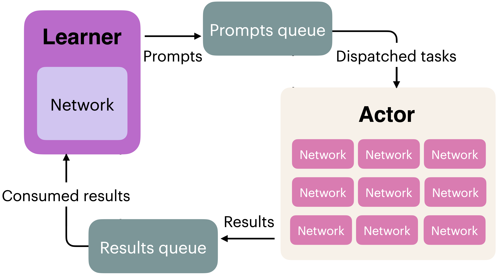

<!-- layout: title-sidebar -->
<!-- valign: bottom -->

# 第4讲：RL 实现与实践

<div class="colloquium-title-eyebrow">rlhfbook.com</div>

<div class="colloquium-title-meta">
<p class="colloquium-title-name">Nathan Lambert</p>
</div>

<p class="colloquium-title-note">后训练课程。第6章 第2部分</p>

---

<!-- rows: 50/50 -->
## 第4讲：RL 实现与实践

<!-- row-columns: 32/36/32 -->

```box
title: 总览
tone: muted
compact: true
content: |
  1. 引言
  2. 关键相关工作
  3. 训练概览
```

|||

```box
title: 核心训练管线
tone: accent
compact: true
content: |
  4. 指令微调（Instruction Tuning）
  5. 奖励模型
  6. **强化学习**
  7. 推理
  8. 直接对齐
  9. 拒绝采样
```

|||

```box
title: 数据与偏好
tone: muted
compact: true
content: |
  10. 什么是偏好
  11. 偏好数据
  12. 合成数据与 CAI
```

===

<!-- row-columns: 32/36/32 -->

```box
title: 工程考量
tone: muted
compact: true
content: |
  13. 工具使用
  14. 过度优化
  15. 正则化
  16. 评估
  17. 产品与模型特性
```

|||

```box
title: 附录
tone: surface
compact: true
content: |
  - A. 术语定义
  - B. 风格与信息
  - C. 实际问题
```

|||

```box
title: 课程主页
tone: surface
compact: true
content: |
  - [rlhfbook.com](https://rlhfbook.com)
  - [GitHub 仓库](https://github.com/natolambert/rlhf-book)
```

---

## 从数学到代码

第3讲是**数学**：策略梯度定理、REINFORCE、PPO、GRPO。

这一讲：如何真正**实现、调试和运行**大模型的 RL 训练。

最难的 bug 不是数学错误，而是静默的实现失误：错误的 mask、过期的缓存、形状不匹配。

---

## 从数学到代码

第3讲是**数学**：策略梯度定理、REINFORCE、PPO、GRPO。

这一讲：如何真正**实现、调试和运行**大模型的 RL 训练。

最难的 bug 不是数学错误，而是静默的实现失误：错误的 mask、过期的缓存、形状不匹配。

*符号约定提醒*：正如第6章所述，我们沿用强化学习文献中的 $(s, a)$ 符号，而在提示-续写语境更自然的地方使用 $(x, y)$。$(s, a)$ 框架反映的是 token 级别的梯度计算；$(x, y)$ 反映的是序列级别的奖励。两种视角贯穿全文。

---

## 本讲内容

```box
title: 第4讲提纲
tone: accent
content: |
  1. **策略梯度代码** — log-probs、REINFORCE 损失、RLOO 基线
  2. **PPO 实现** — GAE、截断损失、价值函数、minibatch、调试
  3. **GRPO 及其变体** — 简化代码、与 PPO 对比、GSPO 和 CISPO
  4. **损失聚合** — 序列级、token 级、固定长度归一化的权衡
  5. **训练基础设施** — 同策略 / 离策略、同步 / 异步系统
  6. **工程要点** — 数值稳定性、监控指标、开源代码库
```

---

<!-- layout: section-break -->

## 将策略梯度翻译成代码

---

## 回顾：策略梯度

目标函数及其梯度：

$$J(\theta) = \mathbb{E}_{\tau \sim p_\theta}[R(\tau)]$$

$$\nabla_\theta J(\theta) = \mathbb{E}_{\tau \sim p_\theta}\!\left[\sum_{t=0}^{T} \Psi_t \nabla_\theta \log \pi_\theta(a_t \mid s_t)\right]$$

这个梯度告诉我们：对每个 token，计算使其更可能出现（更不可能出现）的方向（$\nabla \log \pi$），然后按它有多好（$\Psi_t$）进行缩放。

---

## 回顾：策略梯度算法

所有方法最小化同一族**损失函数**（注意前面的负号）——它们的区别在于 $\Psi_t$ 和更新边界的约束方式：

<div class="text-sm">

$$\begin{aligned}
\textbf{REINFORCE:}\quad & -\frac{1}{T}\sum_{t=1}^{T}\log \pi_\theta(a_t\mid s_t)\,\big(G_t - b(s_t)\big) \\[4pt]
\textbf{RLOO:}\quad & -\frac{1}{K}\sum_{i=1}^{K}\sum_t \log \pi_\theta(a_{i,t}\mid s_{i,t})\left(R_i-\frac{1}{K-1}\sum_{j\neq i}R_j\right) \\[4pt]
\textbf{PPO:}\quad & -\frac{1}{T}\sum_{t=1}^{T}\min\!\big(\rho_t A_t,\ \mathrm{clip}(\rho_t,1-\varepsilon,1+\varepsilon)\, A_t\big) \\[4pt]
\textbf{GRPO:}\quad & -\frac{1}{G}\sum_{i=1}^{G}\frac{1}{|a_i|}\sum_{t=1}^{|a_i|}\min\!\big(\rho_{i,t} \hat{A}_i,\ \mathrm{clip}(\rho_{i,t},1-\varepsilon,1+\varepsilon)\, \hat{A}_i\big)
\end{aligned}$$

</div>

其中 $\rho_t = \frac{\pi_\theta(a_t \mid s_t)}{\pi_{\theta_\text{old}}(a_t \mid s_t)}$ 是重要性采样比。PPO：通过 GAE 计算的 token 级优势 $A_t$。GRPO：token 级采样比 $\rho_{i,t}$，但序列级优势 $\hat{A}_i = \frac{R_i - \mu}{\sigma}$。

---

## 回顾：为什么损失函数是 log-probs 的和

从第3讲的策略梯度推导可得：

$$\nabla_\theta \log p_\theta(\tau) = \sum_{t=0}^{T} \nabla_\theta \log \pi_\theta(a_t \mid s_t)$$

在代码中，我们直接计算 **log-probs**，让自动微分（autodiff）处理梯度：

```python
seq_log_probs = (token_log_probs * completion_mask).sum(dim=-1)
loss = -(seq_log_probs * advantages).mean()
loss.backward()  # autodiff 给出 ∑ Ψ_t ∇ log π
```

本讲中所有损失函数都是这一模式的变体。

---

## 计算 log-probabilities（展开版）

核心构建模块：来自策略的 token 级 log-probabilities。以下是每一步的显式写法：

```python
# 模型前向传播
logits = model(input_ids).logits              # (B, L, vocab_size)

# 自回归移位：位置 t 的 logit 预测 t+1 的 token
logits = logits[:, :-1, :]                    # (B, L-1, vocab_size)
labels = input_ids[:, 1:]                     # (B, L-1)
completion_mask = completion_mask[:, 1:]       # (B, L-1)

# 每个 token 的 log-prob
log_probs = logits.log_softmax(dim=-1)
token_log_probs = log_probs.gather(dim=-1, index=labels.unsqueeze(-1)).squeeze(-1) # (B, L-1)

# 序列级 log-prob：对所有 completion token 求和
seq_log_probs = (token_log_probs * completion_mask).sum(dim=-1)
```

全部在 log 空间计算，避免对大量极小概率值相乘时出现数值下溢。

---

## 计算 log-probabilities（紧凑版）

在实际使用中，上述逻辑通常被封装成一个辅助函数。来自本书的代码：

```python
def compute_log_probs(model, input_ids, attention_mask):
    logits = model(input_ids=input_ids,
                   attention_mask=attention_mask).logits
    logits = logits[:, :-1, :].to(torch.float32)
    log_probs = F.log_softmax(logits, dim=-1)
    targets = input_ids[:, 1:].unsqueeze(-1)
    return torch.gather(log_probs, dim=-1,
                        index=targets).squeeze(-1)
```

移位、gather 和 squeeze 的操作是一样的，只是代码更紧凑。该函数返回所有位置的 log-probs（包括 prompt 和 completion）；mask 在后面再做。在 rollout 阶段，对旧策略和参考模型分别调用此函数（缓存结果）；在训练阶段，对当前策略再次调用（每一步都重新计算）。

---

## REINFORCE 损失

最简单的策略梯度损失：

```python
# rewards: (B,) — 每个序列一个奖励
# seq_log_probs: (B,) — completion token 上的 log-probs 之和

# 基线：整个 batch 的平均奖励
baseline = rewards.mean()
advantages = rewards - baseline

# REINFORCE 损失（取负号是因为我们最小化损失）
loss = -(advantages * seq_log_probs).mean()
```

就是这样。优势值作为 log-probabilities 的权重：正的优势 → 增加概率；负的优势 → 降低概率。（如何将逐 token 的损失聚合为标量 — 这里用 `.mean()` — 实际上比你预期的更重要，我们稍后会在损失聚合一节回到这个问题。）

---

## RLOO 的代码实现

为每个 prompt 生成 $K$ 个续写，计算留一法基线（leave-one-out baseline）：

```python
# rlhf_reward: (B*K,) 平坦张量
# 按 prompt 分组排列：K 个兄弟续写紧邻在一起
rlhf_reward = rlhf_reward.view(-1, rloo_k)  # (B, K)

# 留一法基线：每个 prompt 对应其他 K-1 个奖励的平均值
baseline = (rlhf_reward.sum(dim=1, keepdim=True) - rlhf_reward) / (rloo_k - 1)

advantages = rlhf_reward - baseline        # (B, K)
advantages = advantages.reshape(-1)        # (B*K,)
```

其余部分遵循标准的策略梯度 — 将优势值与 log-probs 相乘。

注意：数据加载器需要为每个 prompt 生成 $K$ 个续写并将它们分组在一起。每 prompt 级别的基线有助于降低方差。标准 REINFORCE 在整个 batch 的所有状态上计算基线。

---

<!-- layout: section-break -->

## 近端策略优化（PPO）

---

## 回顾：近端策略优化（PPO）

截断代理损失（最小化）：

$$L^{\text{CLIP}}(\theta) = -\mathbb{E}_t\!\left[\min\!\Big(\rho_t A_t,\; \text{clip}(\rho_t, 1-\varepsilon, 1+\varepsilon)\, A_t\Big)\right]$$

其中 $\rho_t = \frac{\pi_\theta(a_t \mid s_t)}{\pi_{\theta_\text{old}}(a_t \mid s_t)}$ 是重要性采样比。

**广义优势估计（GAE）**：

$$\hat{A}_t^{\text{GAE}} = \sum_{l=0}^{\infty} (\gamma \lambda)^l \delta_{t+l}, \qquad \delta_t = r_t + \gamma V(s_{t+1}) - V(s_t)$$

GAE 通过将时序差分（TD）误差以指数衰减的方式向后传播，给出 token 级的优势值。$\lambda = 0$ 是纯 TD 估计（低方差、高偏差）；$\lambda = 1$ 是蒙特卡洛估计（高方差、低偏差）。

---

## 为什么值得承受 PPO 的复杂度开销？

与 REINFORCE / RLOO 相比，PPO 引入了显著的复杂性：

- **更低方差**：通过 GAE 和学习到的价值函数实现 token 级归因
- **Token 级信用分配**：每个 token 都有独立的优势信号，而非仅仅序列级奖励
- **样本复用**：通过重要性采样在每批数据上进行多次梯度更新

代价是：**内存中需要四个模型**（策略、价值、参考、奖励模型）、脆弱的价值函数初始化，以及更多需要调优的超参数。

PPO 在 2010 年代末和 2020 年代初无疑是发展最充分、理解最透彻的 RL 算法，被广泛应用于 RL 的各个领域。在语言模型之外的任务中，PPO 的性能远超 REINFORCE。

---

## PPO 训练循环

```text
for each batch:
  1. Sample prompts from dataset
  2. Generate completions with current policy π_θ
  3. Score with reward model → per-sequence rewards
  4. Compute ref model log-probs → per-token KL penalty
  5. Shape rewards: r_t = r_t - β * KL_t (per token)
  6. Compute returns via backward pass (GAE or MC)
  7. Compute advantages: A_t = returns_t - V(s_t)
  8. For k = 1 to K epochs on this batch:
     - Compute ratio = π_θ(a_t|s_t) / π_old(a_t|s_t)
     - Policy loss: clipped surrogate objective
     - Value loss: MSE on returns
     - total_loss = policy_loss + vf_coef * value_loss
     - Backward + optimizer step
  9. Sync π_old ← π_θ
```

---

## 从标量奖励到 token 级回报

奖励模型在续写结束时给出一个标量 $R(x, y)$。Token 级奖励通过 KL 重塑得到：

$$r_t = \begin{cases} R(x, y) - \beta \, \text{KL}_t & \text{如果 } t = T \text{（最后一个 token）} \\ -\beta \, \text{KL}_t & \text{否则} \end{cases}$$

其中 $\text{KL}_t = \log \pi_\theta(a_t \mid s_t) - \log \pi_\text{ref}(a_t \mid s_t)$。

这些 token 级奖励被送入 GAE，GAE 将信用向后传播以分配 token 级优势。

---

## 一个 PPO step 需要哪些张量

训练开始之前，rollout 阶段必须计算并存储损失所需的所有内容：

| 张量 | 形状 | 用途 |
|---------------|-------|---------|
| Token IDs | `(B, L)` | 所有模块 |
| Completion mask | `(B, L)` | 所有模块 |
| 旧 log-probs $\log \pi_{\theta_\text{old}}$ | `(B, L)` | IS 采样比 |
| 旧价值 $V_{\phi_\text{old}}$ | `(B, L)` | PPO 价值函数裁剪 |
| 参考 log-probs $\log \pi_\text{ref}$ | `(B, L)` | KL 惩罚 |
| 奖励 | `(B,)` 或 `(B, L)` | 优势计算 |

---

## 缓存 vs. 重新计算

<!-- columns: 50/50 -->

**在 rollout 时缓存**（计算一次，冻结）：
- Token IDs 和 completion mask
- 旧 log-probs $\log \pi_{\theta_\text{old}}$
- 旧价值预测 $V_{\phi_\text{old}}$
- 参考 log-probs $\log \pi_\text{ref}$
- 奖励（来自 RM）

|||

**在每个训练 step 重新计算**：
- 新策略 log-probs $\log \pi_\theta$
- 当前价值预测 $V_\phi$

<div class="colloquium-spacer-md"></div>

IS 采样比 $\rho_t = \frac{\pi_\theta}{\pi_{\theta_\text{old}}}$ 用一个新计算的值和一个缓存的值 — 这正是能够在同一 rollout batch 上多次 epoch 的基础。

---

## 用 GAE 计算优势值

<div class="text-sm">

```python
# rewards: (B,) terminal only (KL shaping omitted), values_old: (B, L) from rollout
B, L = completion_mask.shape
advantages = torch.zeros_like(values_old)
next_v = torch.zeros(B, device=values_old.device)
gae = torch.zeros(B, device=values_old.device)

last_idx = completion_mask.long().cumsum(-1).argmax(-1, keepdim=True)
done_mask = (torch.arange(L, device=values_old.device).unsqueeze(0) >= last_idx).float()
rewards_t = torch.zeros_like(values_old).scatter_(-1, index=last_idx, src=rewards)

for t in reversed(range(L)):
    not_done = 1.0 - done_mask[:, t]
    delta = rewards_t[:, t] + gamma * not_done * next_v - values_old[:, t]
    gae = delta + gamma * lam * not_done * gae
    advantages[:, t] = gae
    next_v = values_old[:, t]

advantages = advantages * completion_mask
targets = (advantages + values_old).detach()
advantages = advantages.detach()
```

</div>

<span class="text-xs">*简化版：仅终端奖励。对于 KL 重塑的奖励，在此循环之前需为每个 token 添加 $-\beta \cdot \text{KL}_t$。* 译者注：这里的 `not_done` 处理确保生成的实际 token 参与 GAE 计算，padding 部分被排除。`last_idx` 标识每个序列的最后一个有效生成 token，`done_mask` 标记已终止位置。`rewards_t` 将终端奖励 scatter 到对应位置，其余位置为零。

---

## PPO 策略损失

截断代理目标：

```python
# Compute probability ratio
ratio = torch.exp(new_per_token_logps - per_token_logps)  # (B, L), per_token_logps cached from rollout

# Clipped surrogate objective
eps = 0.2  # clip range
pg_losses1 = -advantages * ratio
pg_losses2 = -advantages * torch.clamp(ratio, 1.0 - eps, 1.0 + eps)
pg_loss = torch.max(pg_losses1, pg_losses2)
```

`torch.max` 选择更保守的梯度。因为我们最小化的是负损失，这防止了对单次更新的过度承诺。

---

## 多 epoch 与 minibatch

PPO（和 GRPO）可以可选地将每个 rollout batch 复用多次以执行多个梯度步骤。每当 $\pi_\theta$ 偏离 $\pi_{\theta_\text{old}}$ 时，截断机制就会激活 — 有两种原因会导致这种情况：

---

## 多 epoch 与 minibatch

PPO（和 GRPO）可以可选地将每个 rollout batch 复用多次以执行多个梯度步骤。每当 $\pi_\theta$ 偏离 $\pi_{\theta_\text{old}}$ 时，截断机制就会激活 — 有两种原因会导致这种情况：

**Minibatch 划分**：将 rollout batch 拆分为更小的 minibatch，以便在特定 GPU 配置上容纳更大的总 batch size。在第一个 minibatch 上更新之后，$\pi_\theta$ 已经发生变化 — 因此同一 epoch 中的后续 minibatch 就已经看到 $\rho_t \neq 1$。即使 $K = 1$ 个 epoch，截断也可能被激活。

---

## 多 epoch 与 minibatch

PPO（和 GRPO）可以可选地将每个 rollout batch 复用多次以执行多个梯度步骤。每当 $\pi_\theta$ 偏离 $\pi_{\theta_\text{old}}$ 时，截断机制就会激活 — 有两种原因会导致这种情况：

**Minibatch 划分**：将 rollout batch 拆分为更小的 minibatch，以便在特定 GPU 配置上容纳更大的总 batch size。在第一个 minibatch 上更新之后，$\pi_\theta$ 已经发生变化 — 因此同一 epoch 中的后续 minibatch 就已经看到 $\rho_t \neq 1$。即使 $K = 1$ 个 epoch，截断也可能被激活。

**多 epoch**：对整个 batch 循环 $K$ 次，从一次 rollout（可能代价高昂）中学习更多。每次遍历都会看到更已更新的 $\pi_\theta$，使采样比进一步漂移。典型值 $K = 2$–$4$；超过 $\sim$6 后策略偏离过远，变得不稳定。

当 $K = 1$ 且**没有** minibatch 划分时：$\pi_\theta = \pi_{\theta_\text{old}}$，采样比始终为 1，截断永不激活 — PPO 退化为带 GAE 的 vanilla 策略梯度。

PPO 和 GRPO 都使用相同的样本复用结构。

---

## 价值函数目标

价值函数 $V_\phi$ 学习预测**回报** — 从每个 token 向后的总折扣奖励。GAE 通过将实际奖励与价值函数自身的预测相结合给出了优势值：

$$\hat{A}_t = \hat{G}_t - V_{\phi_\text{old}}(s_t)$$

$\hat{G}_t$ 是对真实回报比当前 $V_\phi$ 更好的估计。我们用它作为回归目标来改进价值函数：

$$\hat{G}_t = \hat{A}_t + V_{\phi_\text{old}}(s_t) \qquad \longrightarrow \qquad \min_\phi \left(V_\phi(s_t) - \hat{G}_t\right)^2$$

```python
targets = (advantages + values_old).detach()
```

`.detach()` 至关重要 — 目标值来自 rollout，不应反向传播。

---

## PPO 价值函数损失

价值函数拥有自己的**裁剪机制** — 与策略裁剪思路相同，但容易被忽略。它防止价值函数在一次更新中偏离 rollout 时的预测太远：

```python
# Current critic predictions
v_pred = value_net(completions)  # (B, L)

# old_values: critic predictions from rollout time (before any training updates, gradient detached)
# Clamp new predictions to stay within eps of the rollout values
v_clip = torch.clamp(v_pred, old_values - eps, old_values + eps)
vf_unclipped = 0.5 * (v_pred - targets) ** 2
vf_clipped   = 0.5 * (v_clip - targets) ** 2
vf_loss = torch.max(vf_unclipped, vf_clipped)
```

`torch.max` 选择较差（更保守）的损失 — 如果未裁剪的预测已经接近目标，裁剪版本就不会造成干扰。

---

## PPO-RLHF：联合目标

组合损失：策略 + 价值（KL 通过奖励重塑进入，而非作为独立损失项）：

```python
per_token_loss = pg_loss + vf_coef * vf_loss  # (B, L)

# Apply completion mask and aggregate
loss = ((per_token_loss * completion_mask).sum(dim=1) /
         completion_mask.sum(dim=1)).mean()
```

`vf_coef`（通常为 0.5–1.0）平衡两个目标。

---

## 优势值白化

在 batch 内将优势值归一化为零均值、单位方差：

```python
valid_adv = advantages[completion_mask.bool()]
advantages = ((advantages - valid_adv.mean()) /
              (valid_adv.std() + 1e-8)) * completion_mask
```

**为什么这样做**：稳定跨 batch 的梯度幅度。如果不白化，奖励全部偏高或全部偏低的 batch 可能产生过大的梯度。译者注：白化（whitening）在统计学中也称为"去相关"或"标准化"，此处指将优势值转换为标准正态分布的形式。

---

## 价值函数初始化

价值函数 $V_\phi$ 从开始就需要产生合理的估计：

- **从 RM backbone 初始化**（InstructGPT 惯例）：价值预测开始时就接近实际奖励
- **从 SFT 模型 + 随机头初始化**：成本更低，但早期训练不稳定
- **冷启动问题**：如果初始价值估计不佳，GAE 优势值噪声大 → 早期训练可能混乱不堪

Tülu 3 [@lambert2024t] 从奖励模型初始化。

*细节*：许多大模型 RL 设置会进行"价值函数预热"（value function warmup）— 在有测量奖励的数据上先训练若干步，帮助价值函数初始化，使其在策略更新之前保持稳定。

---

## PPO 超参数

来自常见大模型 RLHF 设置的示例范围 — 并非通用默认值：

| 超参数 | 典型范围 | 说明 |
|---------------|:-------------:|-------|
| Clip $\varepsilon$ | 0.1–0.2 | 信任区域宽度 |
| GAE $\lambda$ | 0.95 | 优势值的偏差-方差权衡 |
| 价值系数 | 0.5–1.0 | 价值函数损失的权重 |
| KL 系数 $\beta$ | 0.01–0.1 | 参考约束的强度 |
| 每批 epoch 数 $K$ | 2–6 | 离策略预算 |
| 学习率 | $1 \times 10^{-6}$ 至 $5 \times 10^{-6}$ | 远低于 SFT |
| Batch size | 256–1024 prompts | 越大 = 方差越低 |

---

## 为什么 RL 中 batch size 更加重要

在监督学习中，梯度噪声适中 — 临界 batch size 在数千级别。而在 RL 中，梯度噪声尺度**高出数个数量级**，因为梯度来自蒙特卡洛 rollout，而非标记数据。

<!-- cite-right: mccandlish2018empirical -->

- **OpenAI Dota 2**：临界 batch size 在**数百万**个过渡 [@mccandlish2018empirical]
- **PPO 本身不是 batch-size 不变的** — 截断将 batch size 与有效步长耦合，因此不能简单地通过学习率补偿 [@hilton2021batch]
- **PPO 的 plateau 问题**通常由噪声损失估计引起，只有更多样本才能解决 [@beukman2026preventing]

Large batches reduce gradient variance proportional to $1/N$. In RLHF, this is one of the cheapest ways to stabilize training — more effective than most hyperparameter tuning.

---

## PPO 调试清单

训练时需要检查的内容：

- **截断比例（clip fraction）**：被截断的 token 百分比 — 0% 意味着截断从未激活，>50% 意味着策略变化过快
- **优势值统计**：均值应接近 0（如果做了白化），标准差应保持稳定
- **价值损失**：应该下降 — 如果不下降，说明价值函数没有学到东西
- **KL 散度**：应逐渐增加，而非爆炸

---

## PPO 调试清单

训练时需要检查的内容：

- **截断比例（clip fraction）**：被截断的 token 百分比 — 0% 意味着截断从未激活，>50% 意味着策略变化过快
- **优势值统计**：均值应接近 0（如果做了白化），标准差应保持稳定
- **价值损失**：应该下降 — 如果不下降，说明价值函数没有学到东西
- **KL 散度**：应逐渐增加，而非爆炸

常见的**静默 bug** — 训练正常运行但学到了错误的东西：

- Prompt token 被包含在策略损失中（放大了损失，将梯度浪费在不可更改的 token 上）
- 奖励被 scatter 到错误的位置（例如用 `[:, -1]` 而非最后一个生成的 token）
- 使用过期的 log-probs 作为"当前"策略（采样比始终接近 1，截断从不激活）
- 零方差的 GRPO 组（所有续写获得相同奖励 → 优势值为 NaN）
- 在 completion mask 之外计算价值或策略损失（在 padding 上训练）

---

## 内存中的四个模型

对于 7B 模型（fp16）：

| 模型 | 大小 | 用途 |
|-------|:----:|---------|
| 策略 $\pi_\theta$ | ~14 GB | 正在训练的模型 |
| 价值函数 $V_\phi$ | ~14 GB | 学习的评判器 |
| 参考策略 $\pi_\text{ref}$ | ~14 GB | KL 锚点（冻结） |
| 奖励模型 $r_\psi$ | ~14 GB | 打分（冻结） |

**仅模型权重就占用 ~56 GB**，还不包括优化器状态、激活值或梯度。这就是为什么 PPO 通常需要模型并行或 offloading。某些实现通过共享 backbone（例如在策略网络上添加价值头）来减少内存占用。

---

<!-- layout: section-break -->

## 组相对策略优化（GRPO）及其变体

---

## 回顾：组相对策略优化（GRPO）

<!-- cite-right: shao2024deepseekmath -->

为每个 prompt 采样 $G$ 个续写，并计算组归一化优势值：

$$\hat{A}_i = \frac{R_i - \mu_G}{\sigma_G}, \qquad \mu_G = \frac{1}{G}\sum_{j=1}^{G} R_j, \quad \sigma_G = \sqrt{\frac{1}{G}\sum_{j=1}^{G}(R_j - \mu_G)^2}$$

然后应用与 PPO 相同的截断损失（最小化）— token 级采样比、序列级优势 — 以及可选的 KL 惩罚（详见推理章节）：

$$L^{\text{GRPO}}(\theta) = -\frac{1}{G}\sum_{i=1}^{G}\frac{1}{|a_i|}\sum_{t=1}^{|a_i|}\min\!\Big(\rho_{i,t} \hat{A}_i,\; \text{clip}(\rho_{i,t}, 1-\varepsilon, 1+\varepsilon)\, \hat{A}_i\Big) + \beta \, \text{KL}(\pi_\theta \| \pi_\text{ref})$$

无需价值函数、无需 GAE — 优势值完全来自组内兄弟续写的比较。

---

## GRPO 的代码实现

<!-- cite-right: shao2024deepseekmath -->

```python
# Generate G completions per prompt, then compute group advantages
mean_r = rewards.view(-1, G).mean(dim=1)
std_r = rewards.view(-1, G).std(dim=1)
mean_r = mean_r.repeat_interleave(G)
std_r = std_r.repeat_interleave(G)
advantages = ((rewards - mean_r) / (std_r + 1e-4)).unsqueeze(1)

# Importance sampling ratio
ratio = torch.exp(new_logps - old_logps)   # (B*G, L)

# Clipped surrogate (same as PPO)
pg_losses1 = -advantages * ratio
pg_losses2 = -advantages * torch.clamp(ratio, 1 - eps, 1 + eps)
pg_loss = torch.max(pg_losses1, pg_losses2)

# KL penalty in loss (not in reward)
per_token_loss = pg_loss + beta * per_token_kl

loss = ((per_token_loss * mask).sum(dim=1) / mask.sum(dim=1)).mean()
```

---

## KL 惩罚的放置位置

<!-- rows: 30/70 -->

一个关键的实现细节 — KL 惩罚放在哪里。目标相同（约束与参考的漂移），但放置位置不同。GRPO 的方法避免了 KL 与优势值估计之间的交互。译者注：PPO 将 KL 直接纳入奖励计算（$r_t - \beta \cdot \text{KL}_t$），这使得 KL 惩罚与 GAE 的优势计算耦合在一起；而 GRPO 将 KL 作为独立的损失项加入，优势值仅从原始奖励中计算，避免了这种交互。

===

<!-- row-columns: 50/50 -->

**PPO（KL 在奖励中）**：
```python
# per_token_kl is (B, L), rewards is (B, L)
# Scatter RM score to each sequence's
# last action token, not [:, -1]
rewards.scatter_(1, last_idx, rm_score)
rewards = rewards - beta * per_token_kl
advantages = gae(rewards, values, ...)
```

|||

**GRPO（KL 在损失中）**：
```python
# Compute advantages from raw rewards
advantages = z_score(rewards)
# Add KL as separate loss term
loss = pg_loss + beta * per_token_kl
```

---

## GRPO vs PPO 实现对比

GRPO 相较于 PPO 移除的部分：

| 组件 | PPO | GRPO |
|-----------|:---:|:----:|
| 价值网络 | 必需 | 无 |
| GAE 计算 | 必需 | 无 |
| 评判器损失 | 必需 | 无 |
| 价值函数初始化 | 必需 | 无 |
| 优势值计算 | Token 级（GAE） | 序列级（z-score） |
| KL 处理 | 折叠进奖励 | 独立损失项 |

显著减少代码量，内存中少约 1 个模型副本。

---

## RLOO vs GRPO 的代码对比

<!-- columns: 50/50 -->

**RLOO 优势值**：
```python
# Leave-one-out mean
rewards = rewards.view(-1, K)         # (N, K)
baseline = (rewards.sum(dim=1, keepdim=True) - rewards) / (K - 1)
advantages = rewards - baseline
advantages = advantages.reshape(-1)
```

|||

**GRPO 优势值**：
```python
# Group z-score normalization
rewards = rewards.view(-1, G)       # (N, G)
mean_r = rewards.mean(dim=1, keepdim=True)
std_r = rewards.std(dim=1, keepdim=True)
advantages = (rewards - mean_r) \
             / (std_r + 1e-4)       # (N, G)
advantages = advantages.reshape(-1)
```

<div class="colloquium-spacer-md"></div>

结构相同，基线计算方式不同。GRPO 额外添加了标准差归一化；RLOO 使用留一法均值。

---

## 近期进展：GSPO 与 CISPO

<!-- columns: 50/50 -->

**GSPO** — 序列级采样比：

$$\bar{\rho}_i = \exp\!\Big(\frac{1}{|a_i|}\sum_t \log \rho_{i,t}\Big)$$

将 token 级采样比坍缩为每个序列的一个几何均值比。每序列一个裁剪，而非每 token 一个。

|||

**CISPO** — 对裁剪后的比率停止梯度传播：

$$\text{sg}\!\big[\text{clip}(\rho, 1\!-\!\varepsilon, 1\!+\!\varepsilon)\big] \cdot \hat{A} \cdot \log \pi_\theta$$

断开裁剪后比率的梯度，使梯度只通过 $\log \pi_\theta$ 流动。该比率充当固定权重。

---

## GSPO 与 CISPO 的代码实现

<!-- columns: 50/50 -->

<div class="text-sm">

**GSPO** [@zheng2025gspo] — 序列级采样比，GRPO 风格的算法：
```python
log_ratio = (new_logps - old_logps) * mask
rho = torch.exp(log_ratio.sum(dim=1) / mask.sum(dim=1))  # (B*G,)
# Same clipped loss as GRPO, but per-sequence
rho_clipped = rho.clamp(1 - eps, 1 + eps)
loss = -torch.min(rho * advantages, rho_clipped * advantages).mean()
```

</div>

|||

<div class="text-sm">

**CISPO** [@minimax2025minimaxm1scalingtesttimecompute] — 对裁剪后的比率停止梯度，REINFORCE 风格的算法：
```python
rho = torch.exp(new_logps - old_logps)
rho_clipped = torch.clamp(rho, 1 - eps, 1 + eps).detach()  # no grad through ratio
loss = -(rho_clipped * advantages.unsqueeze(1) * new_logps * mask).sum() / mask.sum()
```

</div>

---

<!-- layout: section-break -->

## 训练基础设施

---

## 同策略 vs. 离策略

<!-- cite-right: noukhovitch2024asynchronous -->

**理想 / 理论（同策略，on-policy）**：生成 → 更新 → 生成 → 更新

每批续写被打分并在短暂更新窗口（一到几个 epoch）内使用，然后丢弃。

**现实（异步）**：生成和训练在不同 GPU 组上并行以提高吞吐量。用于生成的模型可能落后于训练模型 1–N 个 step。

**权衡**：完美的同策略较慢（GPU 在生成或训练期间空闲）。轻微的过时通常可以接受。

---

## 同步 vs. 异步训练

<!-- cite-right: noukhovitch2024asynchronous -->

<!-- img-align: center -->


---

## 异步 RL 训练

<!-- columns: 50/50 -->

现代大模型 RL 将计算分为两组：

- **Actors（推理 GPU）**：使用 vLLM 或类似工具生成续写
- **Learners（训练 GPU）**：计算策略梯度更新

一个进程管理库（例如 Ray）协调它们之间的数据流。模型权重从 learner 到 actor 定期同步。

|||



---

## 更多 RL 实现资源

- 我录制的一段 [视频](https://www.youtube.com/watch?v=amrJDwMUFNs)，分析实现了 GRPO、DAPO、Dr. GRPO 和其他论文的开源代码库。
- ~24 分钟处，[talk](https://youtu.be/uaZ3yRdYg8A?si=iSGw56BFNQMWNjtr&t=1487) 讲述为 Olmo 3 扩展 RL。
- Finbarr Timbers 的 [博客文章](https://finbarr.ca/making-rl-fast/) 讲述如何让 RL 更快。

---

## 开源 RL 代码库

- **TRL** [@vonwerra2022trl] — Hugging Face 生态，支持 PPO/GRPO/DPO。入门最佳起点
- **Open Instruct** [@ivison2024unpacking] — Allen AI，支持多算法。研究与复现的最佳选择
- **veRL** — 在 RLVR 时代非常流行。
- **OpenRLHF** — 最初为 RLHF 工作启动，在 RLVR 等领域也很流行。

---

<!-- layout: section-break -->

## 工程实践

---

## 关键数值考量

---

## 关键数值考量

- **log 空间运算**：始终使用 `log_softmax` + `gather`，切勿先用 `softmax` 再用 `log` — softmax 会将小概率值压缩为极小的浮点数，然后 `log` 会放大精度损失
- **Mask 填充 token**：`completion_mask` 仅在 completion token 处为 1 — 排除 prompt token、EOS 后的 padding 以及 EOS token 本身（或者始终一致地包含 EOS）。聚合前乘以该 mask
- **停止 token 处理**：EOS token 需要一致处理 — 包含或不包含在损失中均可，但要始终一致。处理不当是常见的静默错误
- **序列长度处理**：变长续写需要仔细的归一化（见下一节）

---

## 关键数值考量

- **log 空间运算**：始终使用 `log_softmax` + `gather`，切勿先用 `softmax` 再用 `log` — softmax 会将小概率值压缩为极小的浮点数，然后 `log` 会放大精度损失
- **Mask 填充 token**：`completion_mask` 仅在 completion token 处为 1 — 排除 prompt token、EOS 后的 padding 以及 EOS token 本身（或者始终一致地包含 EOS）。聚合前乘以该 mask
- **停止 token 处理**：EOS token 需要一致处理 — 包含或不包含在损失中均可，但要始终一致。处理不当是常见的静默错误
- **序列长度处理**：变长续写需要仔细的归一化（见下一节）
- **断开基线的梯度**：`advantages.detach()` — 不要通过优势值计算进行反向传播
- **除法保护**：在任何除以 `mask.sum()` 或序列长度的地方，使用 `.clamp_min(1)` 或 `+ eps` 以避免空续写（例如立即 EOS）产生的 NaN

---

## 超越损失公式

我们看到的每个算法都计算相同的核心梯度：$\nabla \log \pi \cdot A$。但你**如何将逐 token 的损失聚合为标量**，对训练动态的影响比预期的更大。

下一节将介绍三种策略 — 序列级、token 级和固定长度归一化 — 以及为什么这一选择在实践中很重要。

---

<!-- layout: section-break -->

## 损失聚合策略

---

## 多臂老虎机风格 vs. MDP 风格 RLHF

<!-- columns: 50/50 -->

**多臂老虎机风格（Bandit-style）**
- 每个续写一个奖励
- 序列级 $\Psi_t$ 广播到所有 token
- 默认用于 REINFORCE、RLOO、GRPO

|||

**MDP 风格**
- 每个 token 被视为一个动作
- 每 token 的值或优势值
- 默认用于带 GAE 的 PPO

<div class="colloquium-spacer-md"></div>

实际中大多数 RLHF 是混合的：**序列级奖励**，但 **token 级 log-prob 梯度**。PPO 风格的 RLHF 通常从序列级的奖励模型评分开始，然后通过 KL 重塑和 GAE 获得 token 级信用。译者注：这里的"多臂老虎机风格"指每个续写视为一个独立动作、只给予标量奖励的设定；"MDP 风格"指将每个 token 生成本身视为一个决策、通过时序差分分配逐 token 信用的设定。

---

## 为什么这一点很重要

相同算法，不同的聚合方式 → **不同的训练动态**。

这通常通过训练过程中序列长度的变化来衡量，尤其是在 RLVR 中。

---

## 序列级归一化

每个序列对 batch 损失的**贡献相等**，与长度无关：

$$L = \frac{1}{B}\sum_{i=1}^{B} \frac{1}{|a_i|}\sum_{t=1}^{|a_i|} \ell_{i,t}$$

```python
# Strategy 1: Per-sequence normalization
loss = ((per_token_loss * completion_mask).sum(dim=1) /
         completion_mask.sum(dim=1)).mean()
```

GRPO 和部分 PPO 实现中的标准做法。

---

## 序列级归一化：效果

每个序列获得相等的权重 → 逐 token 梯度**与序列长度成反比**：

- 短序列（5 个 token）：每个 token 获得梯度 $\propto 1/5 = 0.20$
- 长序列（10 个 token）：每个 token 获得梯度 $\propto 1/10 = 0.10$

短序列拥有**更大的逐 token 梯度**。这可能导致模型偏向于较短的回答。

---

## Token 级归一化

每个 token 在整个 batch 中**贡献相等**：

$$L = \frac{\sum_{i=1}^{B} \sum_{t=1}^{|a_i|} \ell_{i,t}}{\sum_{i=1}^{B} |a_i|}$$

```python
# Strategy 2: Per-token normalization
loss = (per_token_loss * completion_mask).sum() / completion_mask.sum()
```

DAPO [@yu2025dapo] 中使用。较长序列按比例贡献更多梯度。

---

## Token 级归一化：效果

所有 token 获得相等的梯度幅度。较长序列因为 token 更多而对总梯度贡献更多。

可能导致模型偏向**冗长的续写** — 模型从较长的答案中获得更多梯度信号，这可能会鼓励更长的生成。

---

## 固定长度归一化

按常数 $L_\text{max}$（最大生成长度）归一化：

$$L = \frac{1}{B}\sum_{i=1}^{B} \frac{1}{L_\text{max}}\sum_{t=1}^{|a_i|} \ell_{i,t}$$

```python
# Strategy 3: Fixed-length normalization
loss = ((per_token_loss * completion_mask).sum(dim=1) /
         L_max).mean()
```

来自 Dr. GRPO [@liu2025understanding]。在使 token 级尺度一致的同时，允许较长序列贡献更多总梯度（求和中有更多活跃 token）。

---

## 对比聚合策略

```python
seq_1_losses = [1, 1, 1, 1, 10]           # 5 tokens, mean = 2.8
seq_2_losses = [1, 1, 1, 1, 1, 1, 1, 1, 1, 10]  # 10 tokens, mean = 1.9
```

| 策略 | Batch 损失 | 短序列梯度 | 长序列梯度 |
|----------|:----------:|:------------------:|:-----------------:|
| **序列级** | $(2.8 + 1.9)/2 = 2.35$ | 每 token 0.20 | 每 token 0.10 |
| **Token 级** | $(14 + 19)/15 = 2.2$ | 每 token 0.067 | 每 token 0.067 |
| **固定长度**（$L=10$） | $(1.4 + 1.9)/2 = 1.65$ | 每 token 0.10 | 每 token 0.10 |

**序列级归一化**给短序列更大的 token 级梯度。**Token 级**和**固定长度**归一化则保持一致。

---

## 训练时需要监控的内容

示例范围 — 阈值因模型大小、任务和算法而异：

| W&B 面板 | 健康 | 异常 |
|-------------|---------|-----------|
| `reward/mean` | 稳步上升 | 尖峰、振荡、平台期 |
| `kl/mean` | 逐渐增加（0 → 2–5） | 爆炸（>10）或平坦在 0 |
| `loss/policy` | 下降 | 发散或 NaN |
| `metrics/clip_frac` | 5–30% | 0% 或 >50% |
| `generation/length` | 稳定或轻微增加 | 单调增加（长度投机） |
| 策略熵 | 缓慢下降 | 崩溃到 0（模式坍塌） |

还需监控：预留基准测试上的评估分数，以及阅读样本输出的连贯性。

---

<!-- ## 扩展 RL 训练实践

推理模型将 RL 推向极端。以下是发生变化之处：

- **移除 KL**：对于长训练周期 — 推理模型经常在无 KL 约束下训练
- **放宽截断**（DAPO）：非对称 $\varepsilon_\text{low} \neq \varepsilon_\text{high}$ 以更好地探索
- **渐进训练**：从较简单的问题开始，逐步增加难度
- **难度过滤**：当 20–80% 的续写能够解决问题时效果最佳（有足够信号而不致过于 trivial）
- **动态采样**：移除所有续写都正确或都错误的 prompt（无学习信号）

--- -->

## 向前指引：正则化与过度优化

当 RL 训练出现问题时，往往是因为 RL 捕捉到了虚假信号而非预期奖励。这些话题值得单独的讲座：

- **KL 惩罚**：前向 KL vs. 反向 KL，数学与代码
- **古德哈特定律（Goodhart's Law）**：当代理目标偏离真实质量
- **奖励投机（Reward hacking）**：阿谀奉承、冗长、过度拒绝
- **隐式正则化**："SFT 记忆，RL 泛化"、"RL 剃刀"

详见后续关于第14章和第15讲的讲座。

---


## 总结

---

## 本讲总结

从数学到可运行的代码 — 关键的实现细节：

1. **核心代码模式** — log-probs、masking、REINFORCE/RLOO/PPO/GRPO 损失函数
2. **优势值估计** — 每 prompt 基线（RLOO、GRPO z-score）vs. 每 token 信用（GAE）
3. **损失聚合** — 序列级 vs. token 级 vs. 固定长度归一化会改变训练动态
4. **PPO 的复杂度预算** — 价值函数目标、评判器裁剪、双重正则化
5. **异步训练** — actor/learner 拆分、过时预算、分布式基础设施
6. **工程实践** — batch size、监控、调试、训练配方

---

<!-- rows: 50/50 -->
## 资源

<!-- row-columns: 50/50 -->

```box
title: 书籍与课程
tone: accent
compact: true
content: |
  - [rlhfbook.com](https://rlhfbook.com) — 完整书籍
  - [RL 速查表](https://rlhfbook.com/rl-cheatsheet) — 单页参考
  - [GitHub 仓库](https://github.com/natolambert/rlhf-book)
```

|||

```box
title: 代码库
tone: surface
compact: true
content: |
  - [TRL](https://github.com/huggingface/trl) — Hugging Face
  - [Open Instruct](https://github.com/allenai/open-instruct) — Allen AI
  - [veRL](https://github.com/volcengine/verl) — ByteDance
  - [OpenRLHF](https://github.com/OpenRLHF/OpenRLHF)
```

===

<!-- row-columns: 50/50 -->

```box
title: 关键论文
tone: surface
compact: true
content: |
  - PPO [@schulman2017proximal]
  - REINFORCE 基线 [@ahmadian2024back]
  - GRPO / DeepSeekMath [@shao2024deepseekmath]
  - GAE [@schulman2015high]
```

|||

```box
title: 延伸阅读
tone: surface
compact: true
content: |
  - Tülu 3 [@lambert2024t] — 完整开源配方
  - DeepSeek R1 [@guo2025deepseek] — 推理 RL
  - 解析 DPO 与 PPO [@ivison2024unpacking]
```

---

<!-- rows: 50/50 -->
## 下一讲：DAAs 与推理

<!-- row-columns: 32/36/32 -->

```box
title: 总览
tone: muted
compact: true
content: |
  1. 引言
  2. 关键相关工作
  3. 训练概览
```

|||

```box
title: 核心训练管线
tone: accent
compact: true
content: |
  4. 指令微调
  5. 奖励模型
  6. **强化学习**
  7. 推理
  8. 直接对齐
  9. 拒绝采样
```

|||

```box
title: 数据与偏好
tone: muted
compact: true
content: |
  10. 什么是偏好
  11. 偏好数据
  12. 合成数据与 CAI
```

===

<!-- row-columns: 32/36/32 -->

```box
title: 工程考量
tone: muted
compact: true
content: |
  13. 工具使用
  14. 过度优化
  15. 正则化
  16. 评估
  17. 产品与模型特性
```

|||

```box
title: 附录
tone: surface
compact: true
content: |
  - A. 术语定义
  - B. 风格与信息
  - C. 实际问题
```

|||

```box
title: 课程主页
tone: surface
compact: true
content: |
  - [rlhfbook.com](https://rlhfbook.com)
  - [GitHub 仓库](https://github.com/natolambert/rlhf-book)
```

---

## 课程大纲

1. **引言与训练概览** — 第1–3章
2. **指令微调、奖励模型、拒绝采样** — 第4、5、9章
3. **RL 理论** — 第6章（第1部分）
4. **RL 实现与实践** — 第6章（第2部分）
5. **推理** — 第7章
6. **直接对齐算法** — 第8章
7. ...

---

<!-- rows: 85/15 -->
## 感谢

提问 / 讨论

联系方式：nathan@natolambert.com

通讯：[interconnects.ai](https://www.interconnects.ai/)

**rlhfbook.com**

===


```builtwith
repo: natolambert/colloquium
```