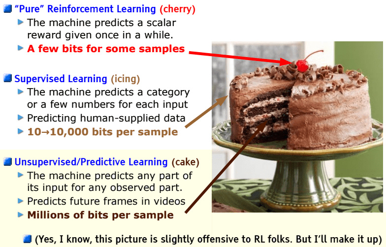
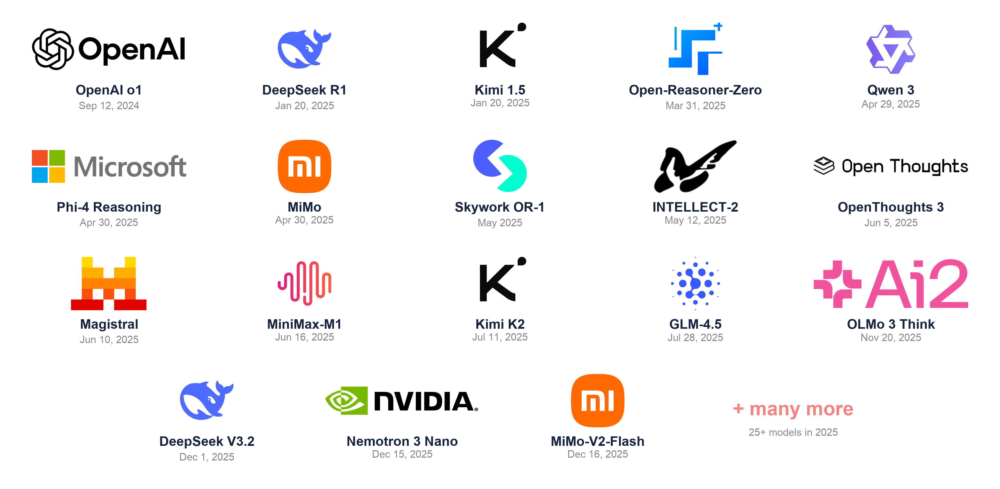
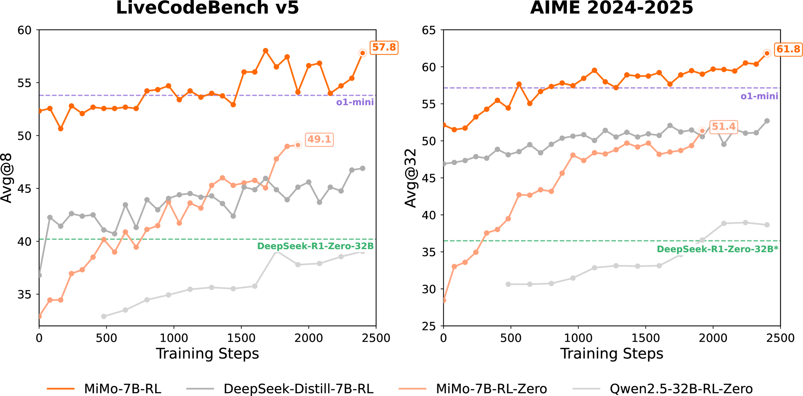
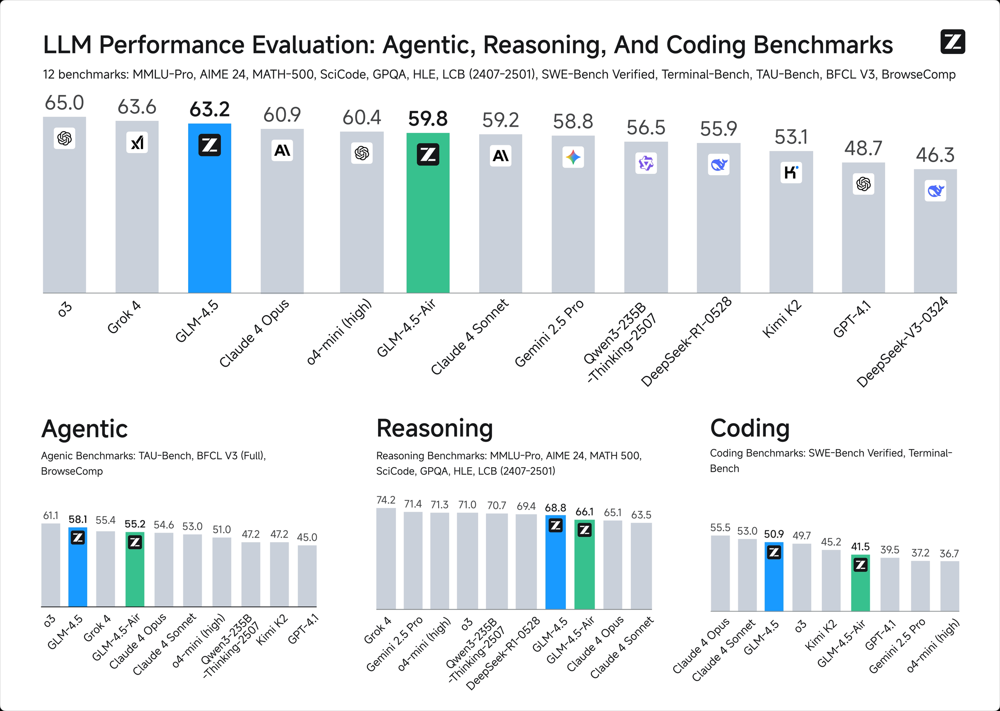
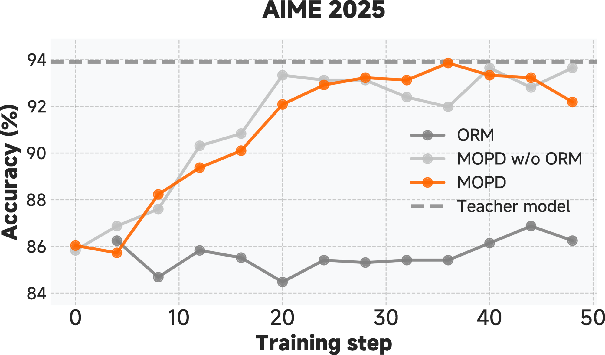

<!-- layout: title-sidebar -->
<!-- valign: bottom -->

# 讲义 5：推理模型的兴起

<div class="colloquium-title-eyebrow">rlhfbook.com</div>

<div class="colloquium-title-meta">
<p class="colloquium-title-name">Nathan Lambert</p>
</div>

<p class="colloquium-title-note">Post-training course. Chapter 7</p>

---

<!-- rows: 50/50 -->
## 讲义 5：推理模型的兴起

<!-- row-columns: 32/36/32 -->

```box
title: Overview
tone: muted
compact: true
content: |
  1. 引言
  2. 关键相关工作
  3. 训练总览
```

|||

```box
title: Core training pipeline
tone: accent
compact: true
content: |
  4. 指令微调（Instruction Tuning）
  5. 奖励模型
  6. 强化学习
  7. **推理**
  8. 直接对齐
  9. 拒绝采样
```

|||

```box
title: Data & preferences
tone: muted
compact: true
content: |
  10. 偏好是什么
  11. 偏好数据
  12. 合成数据与 CAI
```

===

<!-- row-columns: 32/36/32 -->

```box
title: Practical considerations
tone: muted
compact: true
content: |
  13. 工具使用
  14. 过度优化
  15. 正则化
  16. 评估
  17. 产品与品格
```

|||

```box
title: Appendices
tone: muted
compact: true
content: |
  A. 关键定义
  B. 风格基准
  C. 参考文献
```

|||

```box
title: Lectures
tone: surface
compact: true
content: |
  1. 总览（第 1-3 章）
  2. IFT、RM、RS（第 4、5、9 章）
  3. RL 理论（第 6 章 第 1 部分）
  4. RL 实践（第 6 章 第 2 部分）
  5. **推理（第 7 章）**
```

---

## 从强化学习到推理

讲义 3–4 已经讲解了语言模型中基于策略梯度的强化学习实现：PPO、GRPO、损失聚合、异步训练等。

本讲义：推理模型的兴起、推理相关的早期技术、回顾 2025 年的核心模型等。

---

<!-- columns: 38/62 -->
## LeCun 的蛋糕比喻

<!-- cite-right: synced2019cake -->

在 NeurIPS 2016 上，Yann LeCun 提出了蛋糕比喻：预测性/无监督学习是蛋糕的主体，监督微调是糖衣，而强化学习是顶部的樱桃。

对于现代语言模型，这个比喻可以完整对应：

- **自监督学习**在网页数据上训练 = 蛋糕的主体
- **监督微调**用于指令遵循 = 糖衣
- **强化学习**（RLHF，再到 RLVR）= 顶部的樱桃

|||



<!-- step -->

--> 有了智能体之后，RL 在计算投入上的意义可能不止一颗樱桃——但它仍然是训练循环的基本形态！

---

<!-- rows: 60/40 -->
## RLHF 与 RLVR：奖励信号如何改变一切

<!-- row-columns: 50/50 -->

**RLHF**（基于人类反馈的强化学习）——主观打分：

> *解释经济学中的机会成本。*
>
> 评分需要判断清晰度、准确性和完整性——这些都属于学习得到的偏好，没有确定的答案。

|||

**RLVR**（基于可验证奖励的强化学习，Reinforcement Learning from Verifiable Rewards）——可验证打分：

> *小于 20 的所有质数之和是多少？*
>
> `extracted_answer == 77` → Reward = 1
>
> *编写返回第 n 个斐波那契数的 `fib(n)` 函数。*
>
> `assert fib(10) == 55` → 所有测试通过 → Reward = 1

===

后训练方法是相同的（即使用相同的算法），但构建模型的一套全新直觉由此产生。

<!-- step -->

**RLVR 为推理模型打开了大门。** 现在的 RL 训练使用混合奖励、评分标准和各种工具来训练有用的模型。这里所做的清晰区分只是为了教学目的，在实践中这种泾渭分明的情况并不多见。

---

## RLVR 的反馈循环

<!-- cite-right: lambert2024t -->
<!-- img-align: center -->


---

<!-- columns: 50/50 -->
## 回顾：RL 训练与推理时扩展

<!-- cite-right: openai2024o1 -->


|||


---

## 回顾：思考 token 的形态

<!-- cite-right: guo2025deepseek -->

**普通模型**直接给出答案：

> *小于 20 的所有质数之和是多少？*
>
> 小于 20 的质数有 2、3、5、7、11、13、17、19。它们的和是 **77**。

**Reasoning model** generates `<think>` tokens before answering:

> `<think>` I need to find all primes less than 20. Starting from 2: 2 is prime. 3 is prime. 4 = 2×2, not prime. 5 is prime... Let me add them up: 2+3=5, 5+5=10, 10+7=17, 17+11=28, 28+13=41, 41+17=58, 58+19=77. `</think>`
>
> 答案是 $\boxed{77}$。
>
> **验证**：`extracted_answer == 77` → Reward = 1

对于更困难的问题，思考过程可能长达**数千个 token**。

---

## 本讲义的关键术语

<!-- columns: 50/50 -->

**评估指标**：

- **pass@1**：每个问题单个样本的准确率
- **pass@K**：生成 $K$ 个完成样本，报告是否*至少有一个*正确——衡量覆盖能力

如果 $n$ 次尝试中有 $c$ 次给出正确答案：

$$
\widehat{\mathrm{pass@}k}=1-\frac{\binom{n-c}{k}}{\binom{n}{k}}
$$

|||

**算法 / 架构术语**：

- **DAPO**（Dynamic Advantage Policy Optimization，动态优势策略优化）——GRPO 的宽松裁剪变体 [@yu2025dapo]。早期的关键 RLVR 论文
- **CISPO**（Clipped Importance Sampling PO，裁剪重要性采样策略优化）——裁剪重要性采样（IS）权重而非逐个 token 的比率，出自 MiniMax-M1 [@minimax2025minimax_m1]

---


<!-- layout: section-break -->

## 推理模型的"寒武纪大爆发"

---

## 推理模型的"寒武纪大爆发"

<!-- img-align: center -->



---

## 先行研究

RLVR 背后的核心思想并不新鲜——在 o1/R1 使之成为主流（且有效）之前，相关工作早已展开探索：

<!-- animate: bullets -->

- **STaR** [@zelikman2022star]（以及 **Quiet-STaR** [@Zelikman2024QuietSTaRLM]）：利用真实奖励进行自训练推理（2022–2024 年）。抽样带不同推理过程（CoT）的样本，保留正确答案，然后进行训练。
- **TRICE** [@hoffman2023training]：受 MCMC 启发的推理轨迹优化算法（更为复杂）。
- **VinePPO** [@VinePPO]：在 GSM8K / MATH 上利用大量 rollout 和蒙特卡洛估计，配合二元数学奖励的 PPO。
- **Tülu 3** [@lambert2024t]：在保持广泛能力的前提下，用 PPO 提升数学正确性。

<!-- step -->

后续模型在此基础上以更简洁的方式放大了这些方法，并改变了后训练的关注点。

---

## 为什么强化学习现在能行？

<!-- animate: bullets -->

- **稳定性显著改善**：它仍然是第一等的研究课题（熵坍塌、长程信用分配），但工具链和训练配方已经足够成熟，可以被广泛采用
- **基础模型足够强**：多项来源表明，RL 推理训练只有在 ~2024 年之后的模型上才变得可行——需要一定的能力基线
- **可验证领域提供干净的信号**：数学和代码给出明确的奖励信号，避免了 RLHF 中常见的奖励投机（reward hacking）问题

---

## 本讲义结构

1. 开创性模型
2. 我们从中学到什么
3. 近期历史给我们的启示

---

<!-- rows: 39/61 -->
## DeepSeek R1（2025 年 1 月 20 日）：催化剂

<!-- cite-right: guo2025deepseek -->

一个出人意料快速的 o1 复现。

**R1-Zero**：直接在基础模型上进行纯 RL 训练，不经过 SFT 预热。它证明大规模 RL *本身*就能激发链式推理能力。

**完整的 R1 配方**：冷启动 SFT → 大规模 RL → 蒸馏小型模型。

===


---

<!-- columns: 45/55 -->
## Kimi 1.5（2025 年 1 月 20 日）：扩展课程难度

<!-- cite-right: team2025kimi -->

Kimi 1.5 与 R1 同属一月的模型浪潮，强调 **RL 规模加上课程学习**。

- 在中文和英文推理数据上使用 PPO/GRPO 风格的 RL
- 难度调度和在线过滤，保持梯度有用性
- 渐进式长度扩展，在支持长 CoT 的同时减少过度思考
- 详细的技术报告，但 **未开源 k1.5 权重**

|||


---

<!-- rows: 43/57 -->
## Open-Reasoner-Zero（2025 年 2 月 18 日）：极简复现

<!-- cite-right: hu2025openreasonerzero -->

第一个公开 r1 风格的基础模型 RL 数据集和代码。

- 完全开源：**训练代码、精校的 RL 数据和模型权重**
- 标准 PPO，使用 GAE（$\lambda=1, \gamma=1$）和简单的规则奖励
- 没有 KL 惩罚
- 3 月 31 日扩展：更简易的脚本和 12.9 万精选题目

===


---

<!-- columns: 45/55 -->
## Qwen 3（2025 年 4 月 29 日）：混合推理器

<!-- cite-right: yang2025qwen3 -->

新的开源权重标杆（Llama 4 安息吧）。

- 可切换思考模式：`/think` 和 `/no_think`（多数实验室发现这相当折腾训练流程）
- 思考预算长度控制
- 大模型配方与 R1 风格的多阶段流水线类似
- 轻量模型使用"强到弱"蒸馏：先离策略输出，再做同策略教师 logit 匹配

Llama-Nemotron [@bercovich2025llamanemotron] 是另一个可切换的开源权重推理模型，发布了后训练数据和训练代码库，但配方不同。

|||


---

<!-- columns: 45/55 -->
## MiMo（2025 年 4 月 30 日）：端到端推理流水线

<!-- cite-right: xia2025mimo -->

小米报告了从预训练到后训练的**完整流水线**。

对推理训练配方的改进：
- 预训练中的三阶段数据混合（25T token）
- 预训练中的多 Token 预测（MTP，Multi-Token Prediction）
- 多域 RL，防止在单一任务类型上过优化

它是少数在后训练阶段公开清晰中间检查点的开源权重推理模型之一！

|||



---

<!-- columns: 40/60 -->
## OpenThoughts 3（2025 年 6 月 5 日）：SFT 数据配方仍然重要

<!-- cite-right: guha2025openthoughts -->

基础性的开源推理数据（依然非常强大！）：

- 覆盖数学、代码和科学的 120 万个公开示例
- 使用 QwQ-32B 的推理轨迹，完成了超过 1000 次受控的数据流水线实验
- OpenThinker3-7B 仅使用 SFT 就达到了出色的推理性能

社区需要在强推理轨迹（以及理解什么构成"好教师"）上投入更多。

|||


---

<!-- columns: 40/60 -->
## MiniMax-M1（2025 年 6 月 16 日）：一篇有趣的 RL 论文！

<!-- cite-right: minimax2025minimax_m1 -->

MiniMax M1 的论文经受住了时间的考验。在它非常受欢迎的模型之上：

1. CISPO 裁剪重要性采样权重，而不是丢弃高频更新 token。这类算法具有持久影响力。
2. 引入了现在广为人知的 FP32 LM head 推理-训练不匹配图。

|||


---

<!-- columns: 40/60 -->
## GLM-4.5（2025 年 7 月 28 日）：推理扩展到智能体工作

<!-- cite-right: zeng2025glm45 -->

GLM-4.5 的报告是最早关注智能体行为的工作之一。除此之外，它代表了暑期浪潮中又一个非常出色的开源中文模型。

- 355B 总参数，32B 活跃参数
- 思考模式和直接回复模式
- 专家模型迭代加上 RL，用于智能体、推理和通用对话能力

|||



---

<!-- columns: 40/60 -->
## Olmo 3 Think（2025 年 11 月 20 日）：完全开源的推理模型

<!-- cite-right: teamolmo2025olmo3 -->

推理模型生命周期最全面的开源文档。

公开发布了：各阶段、检查点、数据、基础设施、超参数。

包括有趣的 DPO 发现和一些其他有趣内容。详见[这次演讲](https://www.youtube.com/watch?v=uaZ3yRdYg8A)。


|||


---

<!-- columns: 45/55 -->
## DeepSeek V3.2（2025 年 12 月 1 日）：推理走向智能体化

<!-- cite-right: deepseekai2025v32 -->

DeepSeek V3.2 将 R1 配方推向了**工具使用和智能体环境**。

- V3.2-Exp 的开源权重 MoE 后继模型
- V3.2 将思考直接集成到工具使用中，不再区分单独的推理模型
- Special 变体专注于最大化推理性能

|||


---

<!-- rows: 43/57 -->
## Nemotron 3 Nano（2025 年 12 月 15 日）：高效的智能体推理

<!-- cite-right: nvidia2025nemotron3nano -->

又一个非常开源（且来自美国）的模型，为 2026 年更强的美国开源权重模型铺路。

- 31.6B 总参数，每次前向传播约 3.2B 活跃参数
- 混合 Mamba-Transformer MoE 架构
- 使用 SFT、多环境 RLVR 和 RLHF 进行后训练

===


---

<!-- columns: 45/55 -->
## MiMo-V2-Flash（2025 年 12 月 16 日）：将多位教师蒸馏为一人

<!-- cite-right: mimo2025flash -->

值得关注的贡献在后训练：**多教师同策略蒸馏（MOPD, Multi-Teacher On-Policy Distillation）**。

- 为每个领域（数学、代码、搜索、推理）训练一位专家教师，然后将它们蒸馏到单个学生模型中
- 学生从**密集的、token 级别的奖励**中学习，而不仅仅是序列级别的结果奖励——样本效率更高，且在每个领域都追平最强的教师
- 底层模型是一个为快速 rollout 构建的 309B/15B MoE，但真正的主角是这个配方

|||



---

<!-- columns: 50/50 -->
## 近期美国开源模型

[**NVIDIA Nemotron 3 Super**](https://research.nvidia.com/labs/nemotron/Nemotron-3-Super/)（2026 年 3 月 10 日）

- 120B/12B MoE；LatentMoE、MTP、原生 NVFP4 预训练
- 完全开源：检查点、训练数据和配方

|||

[**Arcee Trinity-Large-Thinking**](https://www.arcee.ai/blog/trinity-large-thinking)（2026 年 4 月 1 日）

- 面向长程、多轮工具使用的前沿推理模型
- Apache 2.0 权重；SFT + RL 流水线


---

## 近期中国开源模型

- [**Kimi K2.5**](https://www.kimi.com/blog/kimi-k2-5)（2026 年 1 月 27 日）→ [**K2.6**](https://www.kimi.com/blog/kimi-k2-6)（2026 年 4 月 20 日）：原生多模态和智能体群体，然后是更强的长程编码能力
- [**GLM-5**](https://z.ai/blog/glm-5)（2026 年 2 月 12 日）→ [**GLM-5.1**](https://docs.z.ai/guides/llm/glm-5.1)（2026 年 4 月 7 日）：智能体工程，然后是更长且更稳定的自主运行
- [**DeepSeek V4 Preview**](https://api-docs.deepseek.com/news/news260424)（2026 年 4 月 24 日）：开源 Pro 和 Flash 模型，双推理模式，高效架构创新，以及 1M token 上下文

前沿进展飞快——从"推理模型"演变为**长程、使用工具的智能体底层平台**。

---

## 图景带给我们的启示

<!-- animate: bullets -->

1. RL 的基本方法迅速被开源代码库和数据复现
2. 向智能体模型的转变紧随数学/代码推理任务而来。像 Olmo 3 这样的模型（我亲自参与构建，知道它稍晚）在此背景下更加引人注目
3. 模型层涌现大量创新以提升长上下文推理效率，尤其来自中国实验室
4. 许多持久的基础技术（FP32 LM head、CISPO 风格损失函数等）迅速出现，但经过大量调参才收敛

---

<!-- layout: section-break -->

## 常见实现模式

---

## 配方决策（1/4）

<!-- animate: bullets -->

1. **离线难度过滤**——为每个提问预采样 $N$ 个完成，保留通过率约 20–80% 的 prompt（梯度最丰富的区域）。*Seed-Thinking 1.5 [@seed2025seed]、Open-Reasoner-Zero [@hu2025openreasonerzero]、Phi-4 Reasoning [@abdin2025phi4]、INTELLECT-2 [@primeintellectteam2025intellect2reasoningmodeltrained]、MiMo [@xia2025mimo]、Skywork OR-1 [@he2025skyworkor1]、Olmo 3 [@teamolmo2025olmo3]*
2. **在线过滤与课程学习**——跳过当前过易/过难的提问；将更难的问题留到后期。*Kimi 1.5 [@team2025kimi]、Magistral [@mistral2025magistral]、Llama-Nemotron [@bercovich2025llamanemotron]、INTELLECT-2 [@primeintellectteam2025intellect2reasoningmodeltrained]、MiMo [@xia2025mimo]*
3. **零梯度过滤 + 主动采样**——丢弃所有 $G$ 个完成都通过或都失败的组（优势值为 0），然后重新填充批次。*Olmo 3 [@teamolmo2025olmo3]*。损失曲线变得漂亮且非常稳定！
4. **KL 惩罚：暂时移除，又在悄然回归**——单轮数学 RLVR 通常设 $\beta=0$（可验证奖励本身就能抵抗过优化）。*Magistral [@mistral2025magistral]、Open-Reasoner-Zero [@hu2025openreasonerzero]、Skywork OR-1 [@he2025skyworkor1]* 但长程、离策略的智能体训练正在重新引入 KL/参考项以增强稳定性——例如 Cursor [Composer 2](https://cursor.com/blog/composer-2-technical-report)。
5. **宽松/非对称裁剪**——扩大上界裁剪范围以保持探索性更新（DAPO [@yu2025dapo]）。*Magistral [@mistral2025magistral]、INTELLECT-2 [@primeintellectteam2025intellect2reasoningmodeltrained]*

---

## 配方决策（2/4）

<!-- animate: bullets -->

6. **CISPO**——裁剪重要性采样权重，而不是掩码高频更新 token（MiniMax-M1 [@minimax2025minimax_m1]）；ScaleRL [@khatri2025art] 在其扩展研究中将其选为最优损失函数。回顾重要性采样和裁剪见[讲义 3](https://www.youtube.com/watch?v=K_Sj_-1BUMM)。
7. **归一化选择**——如何平均优势和损失会悄无声息地改变目标函数。对优势在整个**批次**上归一化，而不是按每个提问组归一化，避免个别易/难提问主导（Magistral [@mistral2025magistral]、MiMo [@xia2025mimo]）；对损失按**总 token 数**平均，而不是按序列平均，消除长度偏差（Dr. GRPO [@liu2025understanding]）。详见[讲义 4](https://www.youtube.com/watch?v=i-AIMpZHgeg)中逐 token 与逐序列损失聚合的深入讨论。
8. **格式奖励**——奖励有效的 `<think>` 块和可提取的答案；关注可用性而非正确性。*DeepSeek R1 [@guo2025deepseek]、Open-Reasoner-Zero [@hu2025openreasonerzero]、Magistral [@mistral2025magistral]、Skywork OR-1 [@he2025skyworkor1]*
9. **语言一致性奖励**——惩罚推理轨迹中的语言切换。*DeepSeek R1 [@guo2025deepseek]、Magistral [@mistral2025magistral]*。模型过去经常在推理时切换到中文或法文。
10. **长度控制**——渐进式长度扩展，即训练的最大长度，奖励简洁思考（Kimi 1.5 [@team2025kimi]）；微小长度惩罚（INTELLECT-2 [@primeintellectteam2025intellect2reasoningmodeltrained]）；超长过滤以保证吞吐量。

---

<!-- columns: 55/45 -->
## 配方决策（3/4）

<!-- cite-right: teamolmo2025olmo3 -->

<!-- animate: bullets -->

11. **推理是瓶颈**——长且可变的完成文本；Olmo 3 的学习器 GPU 空闲约 **75%**，推理计算量是训练的 **5–14 倍**。
12. **离策略/异步更新**——actor 持续生成，learner 持续消费；rollout 略有过期但吞吐量大幅提升。*Seed-Thinking 1.5 [@seed2025seed]、INTELLECT-2 [@primeintellectteam2025intellect2reasoningmodeltrained]*——深入讨论：Olmo 3[幻灯片](https://docs.google.com/presentation/d/17Evr5AqnwjtSZ4H5vpnoEvGmI9fRBO19SN2dGHg7tPE/edit)、[录播](https://www.youtube.com/watch?v=uaZ3yRdYg8A)
13. **推理时扩展**——多数投票（DeepSeek R1 [@guo2025deepseek]、Phi-4 [@abdin2025phi4]）；选择器模型（DeepSeek-GRM [@liu2025inference]）；pass@K 与 pass@1 的差距展示了提升空间。

|||


---

## 配方决策（4/4）

<!-- animate: bullets -->

14. **发现——纯文本 RL 提升多模态能力**——在多模态训练之后进行文本推理 RL，能改善视觉任务表现。*MiMo-VL、Magistral [@mistral2025magistral]*
15. **发现——中训练（midtraining）设定了 RL 的能力上限**——预训练中数学/代码的比例决定了 RL 能到达的上限。*MiMo [@xia2025mimo]*

---

## 开放问题

<!-- animate: bullets -->

- RL 训练是在**发现**新能力，还是**激发**预训练已经学过的东西？
- 没有更好的预训练数据时，推理训练能走多远？预训练看来并没有"死"。
- 智能体 RL（工具使用 + 推理）是否需要本质上不同的配方？
- 我们能否系统地研究 RL 在推理任务上的扩展特性？[@khatri2025art]
- 1 年、2 年、5 年和 10 年后，预训练和 RL 之间的计算平衡会是什么样子？

---

## RL 训练库

- [**slime**](https://github.com/THUDM/slime)——基于 SGLang 的原生后训练框架，面向 RL 扩展；用于 GLM 模型系列
- [**SkyRL**](https://github.com/NovaSky-AI/SkyRL)——模块化全栈 LLM RL 库，支持异步和多轮智能体工作流
- [**veRL**](https://github.com/volcengine/verl)——来自 HybridFlow 工作的灵活、面向生产的 RL 训练库
- [**OpenRLHF**](https://github.com/OpenRLHF/OpenRLHF)——基于 Ray 的 RLHF 和 RLVR 训练框架
- [**TRL**](https://github.com/huggingface/trl)——Hugging Face 的后训练库，提供易于使用的 trainer API
- [**Open Instruct**](https://github.com/allenai/open-instruct)——Ai2 的开源后训练配方和研究代码

---

## 课程大纲

1. 引言与训练总览——第 1–3 章
2. IFT、奖励模型、拒绝采样——第 4、5、9 章
3. RL 理论——第 6 章（第 1 部分）
4. RL 实现与实践——第 6 章（第 2 部分）
5. **推理——第 7 章**
6. 直接对齐算法——第 8 章
7. ……

---

<!-- rows: 85/15 -->
## 感谢

欢迎提问和讨论。

**Nathan Lambert**

rlhfbook.com | interconnects.ai

===

```builtwith
repo: natolambert/colloquium
```
