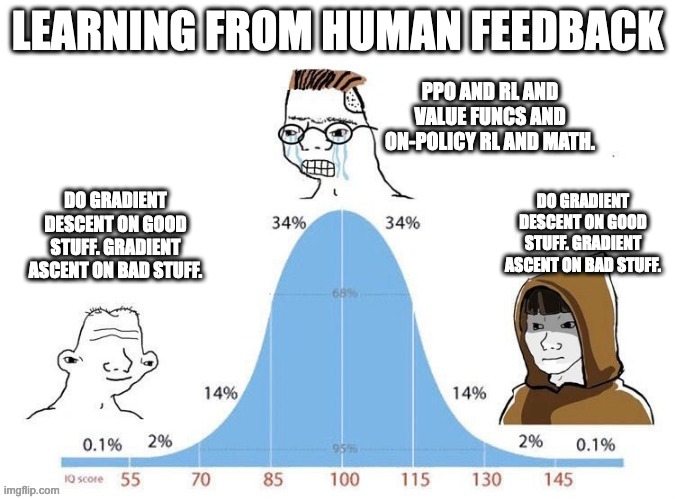
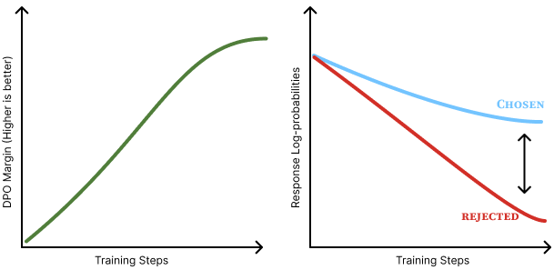

<!-- Source note: build with `make teach`, which copies assets/ into the output. A single-file `colloquium build -o ...` does NOT copy assets/, so the meme + displacement images 404 in that standalone build. -->
<!-- Reveal convention: each derivation step is a run of duplicate slides with identical title; one aligned line (with its reason) is appended per slide so equations build up in place and the layout never recenters. Every equation from chapter 8 is shown. -->

<!-- layout: title-sidebar -->
<!-- valign: bottom -->

# 讲义 6：直接偏好优化（DPO）

<div class="colloquium-title-eyebrow">rlhfbook.com</div>

<div class="colloquium-title-meta">
<p class="colloquium-title-name">Nathan Lambert</p>
</div>

<p class="colloquium-title-note">后训练课程。第 8 章——直接对齐算法。</p>

---

<!-- animate: bullets -->
## DPO 为什么——以及为何一直——如此重要

[直接偏好优化（DPO）论文](https://arxiv.org/abs/2305.18290) [@rafailov2024direct] 在 RLHF 和后训练研究的普及化上是一次突破。

一些背景：

- DPO 论文发布于 **2023 年 5 月**，当时许多团队正为获得 RLHF 流水线的开源复现而挣扎。大多数所谓的"对齐"模型只是 SFT（监督微调）。
- 人们到大约 2023 年秋天才弄清楚让 DPO 有效工作的数据和设置
- **Zephyr-Beta、Tülu 2** 等模型在当年秋天打开了后训练研究的大门。在 2024 年迭代 DPO 相关方法的兴奋程度，相当于 2025 年 RL 方法或 2026 年工具使用方法的令人振奋程度。
- **术语说明：** 我把在静态偏好数据上像 DPO 一样运行的算法统称为**直接对齐算法（DAAs, Direct Alignment Algorithms）**。这个称呼没有广泛流传，但我们会看到它下面变体众多！

---

<!-- img-align: center -->
## DPO 争议（DPO 与 RL 之争）



---

<!-- columns: 50/50 -->
## 本讲义内容

我们将**从零开始推导直接偏好优化（DPO）**，然后看看它在实践中如何使用。

DPO 的承诺：

- 无需单独的奖励模型（reward model）
- 无需强化学习循环
- 只需在偏好对（preference pairs）上做一个可微分的损失函数

|||

本讲义的计划分为四步：

1. 求解 RLHF 目标的**最优策略（optimal policy）**
2. 反解该式，用策略来表达**奖励（reward）**
3. 代入**Bradley-Terry 偏好模型**
4. 读出 **DPO 损失**及其**梯度**

*Rafailov 等人，2023 —"你的语言模型暗中是一个奖励模型"* [@rafailov2024direct]。

---

<!-- rows: 60/40 -->
## 回顾：DPO 在流水线中的位置

<!-- row-columns: 48/52 -->
经典的 RLHF 有三个组成部分：

1. 收集人类偏好对
2. 训练奖励模型 $r_\phi(x,y)$
3. 以 KL 惩罚为约束，用强化学习（如 PPO）针对 $r_\phi$ 优化策略

|||

DPO 将第 2、3 步合并为**一个监督学习风格的损失函数**。

我们将证明的关键洞察：

> 最优 RLHF 策略和奖励模型是**同一对象**的两种视角。如果你知道其中一个，你就可以用闭式表达知道另一个。

因此，我们可以**直接在偏好数据上训练策略**。

===


---

<!-- columns: 55/45 -->
## DPO 概览：我们的目标

整个推导最终落到两个核心对象上。

**最优策略**——RLHF 的闭式解：

$$ \pi^{*}(y\mid x) = \tfrac{1}{Z(x)}\,\pi_{\text{ref}}(y\mid x)\exp\!\big(\tfrac{1}{\beta} r(x,y)\big) $$

**DPO 损失**——你实际训练的内容：

$$ \mathcal{L}_{\text{DPO}} = -\mathbb{E}\Big[\log\sigma\big(\beta\log\tfrac{\pi_{\theta}(y_c\mid x)}{\pi_{\text{ref}}(y_c\mid x)} - \beta\log\tfrac{\pi_{\theta}(y_r\mid x)}{\pi_{\text{ref}}(y_r\mid x)}\big)\Big] $$

|||

在实践中，这个损失只需几行代码：

```python
pi_logratios  = policy_chosen_logps  - policy_rejected_logps
ref_logratios = reference_chosen_logps - reference_rejected_logps
logits = pi_logratios - ref_logratios
losses = -F.logsigmoid(beta * logits)
```

从公式到实现之间的一切内容，就是**为什么这个损失函数是正确的**。

---

<!-- layout: section-break -->
<!-- align: center -->

## DPO 推导 P1/4：推导最优策略

---

<!-- valign: top -->
<!-- align: center -->
## 从 RLHF 优化问题出发

$$
\begin{aligned}
 & \max_{\pi}\ \mathbb{E}_{x\sim\mathcal{D},\,y\sim\pi}\big[\,r(x,y)\,\big] - \beta\,\mathcal{D}_{\text{KL}}\big(\pi \,\|\, \pi_{\text{ref}}\big) && \text{RLHF 目标}
\end{aligned}
$$

我们要找到解出这个方程的 $\pi$！而且不使用 RL。

---

<!-- valign: top -->
<!-- title: center -->
## 将 KL 项折叠进期望

$$
\begin{aligned}
 & \max_{\pi}\ \mathbb{E}_{x\sim\mathcal{D},\,y\sim\pi}\big[\,r(x,y)\,\big] - \beta\,\mathcal{D}_{\text{KL}}\big(\pi \,\|\, \pi_{\text{ref}}\big) && \text{RLHF 目标}\\[6pt]
={}& \max_{\pi}\ \mathbb{E}\Big[\, r(x,y) - \beta\log\tfrac{\pi(y\mid x)}{\pi_{\text{ref}}(y\mid x)} \,\Big] && \text{展开 KL}=\mathbb{E}_{x\sim\mathcal{D},y\sim\pi}\big[\log\tfrac{\pi}{\pi_{\text{ref}}}\big]
\end{aligned}
$$

---

<!-- valign: top -->
<!-- title: center -->
## 将 KL 项折叠进期望

$$
\begin{aligned}
 & \max_{\pi}\ \mathbb{E}_{x\sim\mathcal{D},\,y\sim\pi}\big[\,r(x,y)\,\big] - \beta\,\mathcal{D}_{\text{KL}}\big(\pi \,\|\, \pi_{\text{ref}}\big) && \text{RLHF 目标}\\[6pt]
={}& \max_{\pi}\ \mathbb{E}\Big[\, r(x,y) - \beta\log\tfrac{\pi(y\mid x)}{\pi_{\text{ref}}(y\mid x)} \,\Big] && \text{展开 KL}=\mathbb{E}_{x\sim\mathcal{D},y\sim\pi}\big[\log\tfrac{\pi}{\pi_{\text{ref}}}\big]\\[6pt]
={}& \max_{\pi}\Big( \mathbb{E}[r(x,y)] - \beta\,\mathbb{E}\big[\log\tfrac{\pi(y\mid x)}{\pi_{\text{ref}}(y\mid x)}\big] \Big) && \text{拆为两项}
\end{aligned}
$$

---

<!-- valign: top -->
<!-- title: center -->
## 翻转为最小化并化简

$$
\begin{aligned}
 & \max_{\pi}\Big( \mathbb{E}[r(x,y)] - \beta\,\mathbb{E}\big[\log\tfrac{\pi(y\mid x)}{\pi_{\text{ref}}(y\mid x)}\big] \Big) && \text{上一轮结束的位置}
\end{aligned}
$$

---

<!-- valign: top -->
<!-- title: center -->
## 翻转为最小化并化简

$$
\begin{aligned}
 & \max_{\pi}\Big( \mathbb{E}[r(x,y)] - \beta\,\mathbb{E}\big[\log\tfrac{\pi(y\mid x)}{\pi_{\text{ref}}(y\mid x)}\big] \Big) && \text{上一轮结束的位置}\\[6pt]
={}& \min_{\pi}\Big( -\mathbb{E}[r(x,y)] + \beta\,\mathbb{E}\big[\log\tfrac{\pi(y\mid x)}{\pi_{\text{ref}}(y\mid x)}\big] \Big) && \text{乘以 } -1:\ \max\to\min
\end{aligned}
$$

---

<!-- valign: top -->
<!-- title: center -->
## 翻转为最小化并化简

$$
\begin{aligned}
 & \max_{\pi}\Big( \mathbb{E}[r(x,y)] - \beta\,\mathbb{E}\big[\log\tfrac{\pi(y\mid x)}{\pi_{\text{ref}}(y\mid x)}\big] \Big) && \text{上一轮结束的位置}\\[6pt]
={}& \min_{\pi}\Big( -\mathbb{E}[r(x,y)] + \beta\,\mathbb{E}\big[\log\tfrac{\pi(y\mid x)}{\pi_{\text{ref}}(y\mid x)}\big] \Big) && \text{乘以 } -1:\ \max\to\min\\[6pt]
={}& \min_{\pi}\ \mathbb{E}\Big[\, \log\tfrac{\pi(y\mid x)}{\pi_{\text{ref}}(y\mid x)} - \tfrac{1}{\beta} r(x,y) \,\Big] && \text{除以 }\beta\text{，重新组合}
\end{aligned}
$$

---

<!-- valign: top -->
<!-- align: center -->
<!-- animate: bullets -->
## 将优化目标折叠为一个对数比率

从上一轮结束的位置继续，利用 $\tfrac{1}{\beta} r = \log e^{\,r/\beta}$ 将括号折叠为一个单一的对数比率：

$$
\begin{aligned}
 & \min_{\pi}\ \mathbb{E}\Big[\, \log\tfrac{\pi(y\mid x)}{\pi_{\text{ref}}(y\mid x)} - \tfrac{1}{\beta} r(x,y) \,\Big] && \text{上一轮结束的位置}\\[6pt]
={}& \min_{\pi}\ \mathbb{E}\Big[\, \log\frac{\pi(y\mid x)}{\pi_{\text{ref}}(y\mid x)\,e^{\,r(x,y)/\beta}} \,\Big]
\end{aligned}
$$

- $\pi$ 现在被与 $\pi_{\text{ref}}\,e^{r/\beta}$ 对比：每个响应的概率乘以 $e^{r/\beta}$，奖励越高乘得越多（$\beta$ 设定了重加权的多大胆程度）。
- 如果目标本身就是一个概率分布 $q$，那么这个 $\min_{\pi}$ 就等价于一个 **KL 散度** $\mathbb{E}_{y\sim\pi}\!\big[\log\tfrac{\pi}{q}\big] = \mathcal{D}_{\text{KL}}(\pi\,\|\,q)$——可以被**精确地、用闭式方式**最小化（参见 [吉布斯不等式](https://en.wikipedia.org/wiki/Gibbs%27_inequality)）。

---

<!-- valign: top -->
<!-- align: center -->
## 引入配分函数 $Z(x)$

我们最小化的是 $\min_{\pi}\ \mathbb{E}_{y\sim\pi}\Big[\, \log\frac{\pi(y\mid x)}{\pi_{\text{ref}}(y\mid x)\,e^{\,r(x,y)/\beta}} \,\Big]$。

为什么我们希望 $\pi$ 去匹配那个分母？

---

<!-- valign: top -->
<!-- title: center -->
## 引入配分函数 $Z(x)$

我们最小化的是 $\min_{\pi}\ \mathbb{E}_{y\sim\pi}\Big[\, \log\frac{\pi(y\mid x)}{\pi_{\text{ref}}(y\mid x)\,e^{\,r(x,y)/\beta}} \,\Big]$。

为什么我们希望 $\pi$ 去匹配那个分母？因为 $\mathbb{E}_{y\sim\pi}\big[\log\tfrac{\pi}{q}\big]$ 是一个 **KL 散度** $\mathcal{D}_{\text{KL}}(\pi\,\|\,q)$——它始终 $\ge 0$，且**仅在 $\pi = q$ 时等于 0**。因此最小化子就是分母中的那个分布 $q$。

---

<!-- valign: top -->
<!-- title: center -->
## 引入配分函数 $Z(x)$

我们最小化的是 $\min_{\pi}\ \mathbb{E}_{y\sim\pi}\Big[\, \log\frac{\pi(y\mid x)}{\pi_{\text{ref}}(y\mid x)\,e^{\,r(x,y)/\beta}} \,\Big]$。

为什么我们希望 $\pi$ 去匹配那个分母？因为 $\mathbb{E}_{y\sim\pi}\big[\log\tfrac{\pi}{q}\big]$ 是一个 **KL 散度** $\mathcal{D}_{\text{KL}}(\pi\,\|\,q)$——它始终 $\ge 0$，且**仅在 $\pi = q$ 时等于 0**。因此最小化子就是分母中的那个分布 $q$。

问题在于：我们的分母 $\pi_{\text{ref}}\,e^{r/\beta}$ **不是一个合法的概率分布**——对 $y$ 求和时它不等于 1。

---

<!-- valign: top -->
<!-- title: center -->
## 引入配分函数 $Z(x)$

我们最小化的是 $\min_{\pi}\ \mathbb{E}_{y\sim\pi}\Big[\, \log\frac{\pi(y\mid x)}{\pi_{\text{ref}}(y\mid x)\,e^{\,r(x,y)/\beta}} \,\Big]$。

为什么我们希望 $\pi$ 去匹配那个分母？因为 $\mathbb{E}_{y\sim\pi}\big[\log\tfrac{\pi}{q}\big]$ 是一个 **KL 散度** $\mathcal{D}_{\text{KL}}(\pi\,\|\,q)$——它始终 $\ge 0$，且**仅在 $\pi = q$ 时等于 0**。因此最小化子就是分母中的那个分布 $q$。

问题在于：我们的分母 $\pi_{\text{ref}}\,e^{r/\beta}$ **不是一个合法的概率分布**——对 $y$ 求和时它不等于 1。
我们用**配分函数**对其进行归一化：

$$
Z(x) = \sum_{y} \pi_{\text{ref}}(y\mid x)\,\exp\!\big(\tfrac{1}{\beta} r(x,y)\big)
\qquad\text{(取决于 $x$ 和 $r$，不依赖于 $\pi$)}
$$

<!-- animate: bullets -->
- 现在 $q(y\mid x) = \tfrac{1}{Z(x)}\,\pi_{\text{ref}}(y\mid x)\,e^{\,r/\beta}$ **是**一个合法的概率分布。
- 目标变成了一个真正的 $\mathcal{D}_{\text{KL}}(\pi\,\|\,q)$——在 $\pi = q$ 处被精确最小化（稍后用 [吉布斯不等式](https://en.wikipedia.org/wiki/Gibbs%27_inequality)给出严格证明）。
- 接下来我们将处理目标函数的内部结构，让 $Z(x)$ 出现。

---

<!-- valign: top -->
<!-- title: center -->
## 用配分函数 $Z(x)$ 重新审视目标

$$
\begin{aligned}
 & \min_{\pi}\ \mathbb{E}\left[\, \log\tfrac{\pi(y\mid x)}{\pi_{\text{ref}}(y\mid x)} - \tfrac{1}{\beta} r(x,y) \,\right] && \text{上一轮结束的位置}
\end{aligned}
$$

---

<!-- valign: top -->
<!-- title: center -->
## 用配分函数 $Z(x)$ 重新审视目标

$$
\begin{aligned}
 & \min_{\pi}\ \mathbb{E}\left[\, \log\tfrac{\pi(y\mid x)}{\pi_{\text{ref}}(y\mid x)} - \tfrac{1}{\beta} r(x,y) \,\right] && \text{上一轮结束的位置}\\[6pt]
={}& \min_{\pi}\ \mathbb{E}\left[\, \log\tfrac{\pi(y\mid x)}{\pi_{\text{ref}}(y\mid x)} - \tfrac{1}{\beta} r(x,y) + \log Z(x) - \log Z(x) \,\right] && \text{加上 } 0 = \log Z - \log Z
\end{aligned}
$$

---

<!-- valign: top -->
<!-- title: center -->
## 用配分函数 $Z(x)$ 重新审视目标

$$
\begin{aligned}
 & \min_{\pi}\ \mathbb{E}\left[\, \log\tfrac{\pi(y\mid x)}{\pi_{\text{ref}}(y\mid x)} - \tfrac{1}{\beta} r(x,y) \,\right] && \text{上一轮结束的位置}\\[6pt]
={}& \min_{\pi}\ \mathbb{E}\left[\, \log\tfrac{\pi(y\mid x)}{\pi_{\text{ref}}(y\mid x)} - \tfrac{1}{\beta} r(x,y) + \log Z(x) - \log Z(x) \,\right] && \text{加上 } 0 = \log Z - \log Z\\[6pt]
={}& \min_{\pi}\ \mathbb{E}\left[\, \big( \log\tfrac{\pi(y\mid x)}{\pi_{\text{ref}}(y\mid x)} + \log Z(x) \big) - \log Z(x) - \tfrac{1}{\beta} r(x,y) \,\right] && \text{组合项}
\end{aligned}
$$

---

<!-- valign: top -->
<!-- title: center -->
## 用配分函数 $Z(x)$ 重新审视目标

$$
\begin{aligned}
 & \min_{\pi}\ \mathbb{E}\left[\, \log\tfrac{\pi(y\mid x)}{\pi_{\text{ref}}(y\mid x)} - \tfrac{1}{\beta} r(x,y) \,\right] && \text{上一轮结束的位置}\\[6pt]
={}& \min_{\pi}\ \mathbb{E}\left[\, \log\tfrac{\pi(y\mid x)}{\pi_{\text{ref}}(y\mid x)} - \tfrac{1}{\beta} r(x,y) + \log Z(x) - \log Z(x) \,\right] && \text{加上 } 0 = \log Z - \log Z\\[6pt]
={}& \min_{\pi}\ \mathbb{E}\left[\, \big( \log\tfrac{\pi(y\mid x)}{\pi_{\text{ref}}(y\mid x)} + \log Z(x) \big) - \log Z(x) - \tfrac{1}{\beta} r(x,y) \,\right] && \text{组合项}\\[6pt]
={}& \min_{\pi}\ \mathbb{E}\left[\, \log\frac{\pi(y\mid x)}{\tfrac{1}{Z(x)}\pi_{\text{ref}}(y\mid x)} - \log Z(x) - \tfrac{1}{\beta} r(x,y) \,\right] && \log a + \log b = \log ab
\end{aligned}
$$

---

<!-- valign: top -->
<!-- title: center -->
## 将目标化为一个 KL 散度

把 $\tfrac{1}{\beta} r = \log e^{\,r/\beta}$ 折叠进目标中第一项的分母（再次使用对数法则），并记 $q(y\mid x) = \tfrac{1}{Z(x)}\,\pi_{\text{ref}}(y\mid x)\,e^{\,r(x,y)/\beta}$——这是 $y$ 上的一个合法概率分布。此时目标为：

$$
\min_{\pi}\ \mathbb{E}_{x\sim\mathcal{D}}\,\mathbb{E}_{y\sim\pi}\Big[\, \log\tfrac{\pi(y\mid x)}{q(y\mid x)} - \log Z(x) \,\Big]
$$

<!-- step -->

$\log Z(x)$ 与 $y$ 无关，因此将其从内层期望中提取出来：

$$
\min_{\pi}\ \mathbb{E}_{x\sim\mathcal{D}}\Big[\, \mathbb{E}_{y\sim\pi}\big[\log\tfrac{\pi(y\mid x)}{q(y\mid x)}\big] - \log Z(x) \,\Big]
$$

<!-- step -->

内层期望恰好是一个 **KL 散度**，$\mathbb{E}_{y\sim\pi}\big[\log\tfrac{\pi}{q}\big] = \mathcal{D}_{\text{KL}}(\pi\,\|\,q)$：

$$
\min_{\pi}\ \mathbb{E}_{x\sim\mathcal{D}}\big[\, \mathcal{D}_{\text{KL}}\big(\pi(y\mid x)\,\|\,q(y\mid x)\big) - \log Z(x) \,\big]
$$

---

<!-- valign: top -->
<!-- title: center -->
## 应用吉布斯不等式读出 $\pi^{*}$

我们到达的位置——目标现在变为一个 KL 散度加上一个与 $\pi$ 无关的常数：

$$
\min_{\pi}\ \mathbb{E}_{x\sim\mathcal{D}}\big[\, \mathcal{D}_{\text{KL}}\big(\pi(y\mid x)\,\|\,q(y\mid x)\big) - \log Z(x) \,\big]
$$

- $\log Z(x)$ 不依赖于 $\pi$——只有 KL 项可以被优化。
- KL 散度 $\ge 0$，且**仅在 $\pi = q$ 时等于 0**（[吉布斯不等式](https://en.wikipedia.org/wiki/Gibbs%27_inequality)），因此最小化子为 $\pi^{*} = q$：

$$
\boxed{\ \ \pi^{*}(y\mid x) = q(y\mid x) = \tfrac{1}{Z(x)}\,\pi_{\text{ref}}(y\mid x)\,\exp\!\big(\tfrac{1}{\beta} r(x,y)\big)\ \ }
$$

---

<!-- layout: section-break -->
<!-- align: center -->

## DPO 推导 P2/4：从策略中恢复奖励（实现所需）

---

<!-- valign: top -->
<!-- title: center -->
## 反解 $\pi^{*}$ 得到隐式奖励

$$
\begin{aligned}
 & \pi^{*}(y\mid x) = \tfrac{1}{Z(x)}\,\pi_{\text{ref}}(y\mid x)\,\exp\!\big(\tfrac{1}{\beta} r^{*}(x,y)\big)  && 
\end{aligned}
$$

---

<!-- valign: top -->
<!-- title: center -->
## 反解 $\pi^{*}$ 得到隐式奖励

$$
\begin{aligned}
 & \log \pi^{*}(y\mid x) = \log\!\Big( \tfrac{1}{Z(x)}\,\pi_{\text{ref}}(y\mid x)\,\exp\!\big(\tfrac{1}{\beta} r^{*}(x,y)\big) \Big) && \text{两边取对数}
\end{aligned}
$$

---

<!-- valign: top -->
<!-- title: center -->
## 反解 $\pi^{*}$ 得到隐式奖励

$$
\begin{aligned}
 & \log \pi^{*}(y\mid x) = \log\!\Big( \tfrac{1}{Z(x)}\,\pi_{\text{ref}}(y\mid x)\,\exp\!\big(\tfrac{1}{\beta} r^{*}(x,y)\big) \Big) && \text{两边取对数}\\[6pt]
 & \log \pi^{*}(y\mid x) = -\log Z(x) + \log \pi_{\text{ref}}(y\mid x) + \tfrac{1}{\beta} r^{*}(x,y) && \log abc = \log a+\log b+\log c
\end{aligned}
$$

---

<!-- valign: top -->
<!-- title: center -->
## 反解 $\pi^{*}$ 得到隐式奖励

$$
\begin{aligned}
 & \log \pi^{*}(y\mid x) = \log\!\Big( \tfrac{1}{Z(x)}\,\pi_{\text{ref}}(y\mid x)\,\exp\!\big(\tfrac{1}{\beta} r^{*}(x,y)\big) \Big) && \text{两边取对数}\\[6pt]
 & \log \pi^{*}(y\mid x) = -\log Z(x) + \log \pi_{\text{ref}}(y\mid x) + \tfrac{1}{\beta} r^{*}(x,y) && \log abc = \log a+\log b+\log c\\[6pt]
 & \tfrac{1}{\beta} r^{*}(x,y) = \log \pi^{*}(y\mid x) - \log \pi_{\text{ref}}(y\mid x) + \log Z(x) && \text{移项解出 } r^{*}
\end{aligned}
$$

---

<!-- valign: top -->
<!-- title: center -->
## 反解 $\pi^{*}$ 得到隐式奖励

$$
\begin{aligned}
 & \log \pi^{*}(y\mid x) = \log\!\Big( \tfrac{1}{Z(x)}\,\pi_{\text{ref}}(y\mid x)\,\exp\!\big(\tfrac{1}{\beta} r^{*}(x,y)\big) \Big) && \text{两边取对数}\\[6pt]
 & \log \pi^{*}(y\mid x) = -\log Z(x) + \log \pi_{\text{ref}}(y\mid x) + \tfrac{1}{\beta} r^{*}(x,y) && \log abc = \log a+\log b+\log c\\[6pt]
 & \tfrac{1}{\beta} r^{*}(x,y) = \log \pi^{*}(y\mid x) - \log \pi_{\text{ref}}(y\mid x) + \log Z(x) && \text{移项解出 } r^{*}\\[6pt]
 & r^{*}(x,y) = \beta \log \tfrac{\pi^{*}(y\mid x)}{\pi_{\text{ref}}(y\mid x)} + \beta \log Z(x) && \text{乘以 }\beta
\end{aligned}
$$

$$
\boxed{\ \ r^{*}(x,y) = \beta \log \tfrac{\pi^{*}(y\mid x)}{\pi_{\text{ref}}(y\mid x)} + \beta \log Z(x)\ \ }\qquad\text{\small 你的语言模型暗中是一个奖励模型}
$$

---

<!-- layout: section-break -->
<!-- align: center -->

## DPO 推导 P3/4：连接 Bradley-Terry 偏好模型（对齐数据的形态）

---

<!-- valign: top -->
<!-- title: center -->
## 回顾 Bradley-Terry 模型

两个响应之间的偏好是对它们奖励的 softmax：

$$
p^{*}(y_1 \succ y_2 \mid x) = \frac{\exp\!\big(r^{*}(x,y_1)\big)}{\exp\!\big(r^{*}(x,y_1)\big) + \exp\!\big(r^{*}(x,y_2)\big)}
$$

现在代入隐式奖励 $r^{*}(x,y) = \beta \log \tfrac{\pi^{*}(y\mid x)}{\pi_{\text{ref}}(y\mid x)} + \beta \log Z(x)$。

*新读者？请参阅 [讲义 2](https://rlhfbook.com/teach/course/lec2-chap4-5-9/) 和 [第 5 章：奖励模型](https://rlhfbook.com/c/05-reward-models.html) 了解 Bradley-Terry 模型。*

---

<!-- valign: top -->
<!-- align: center -->
## 代入奖励并消去 $Z(x)$

$$
p^{*}(y_1 \succ y_2 \mid x) = \frac{\exp\!\big(\beta \log \tfrac{\pi^{*}(y_1\mid x)}{\pi_{\text{ref}}(y_1\mid x)} + \beta \log Z(x)\big)}{\exp\!\big(\beta \log \tfrac{\pi^{*}(y_1\mid x)}{\pi_{\text{ref}}(y_1\mid x)} + \beta \log Z(x)\big) + \exp\!\big(\beta \log \tfrac{\pi^{*}(y_2\mid x)}{\pi_{\text{ref}}(y_2\mid x)} + \beta \log Z(x)\big)}
$$

- 每一项都携带相同的因子 $\exp(\beta \log Z(x)) = Z(x)^{\beta}$。

<!-- step -->

$$
p^{*}(y_1 \succ y_2 \mid x) = \frac{\exp\!\big(\beta \log \tfrac{\pi^{*}(y_1\mid x)}{\pi_{\text{ref}}(y_1\mid x)}\big)}{\exp\!\big(\beta \log \tfrac{\pi^{*}(y_1\mid x)}{\pi_{\text{ref}}(y_1\mid x)}\big) + \exp\!\big(\beta \log \tfrac{\pi^{*}(y_2\mid x)}{\pi_{\text{ref}}(y_2\mid x)}\big)}
$$

- 分解 $e^{a+b}=e^a e^b$ 并消去共享因子 $Z(x)^{\beta}$——**不可计算的项消失了**。

---

<!-- valign: top -->
<!-- title: center -->
## 除以到 sigmoid

记 $\Delta_i = \beta \log \tfrac{\pi^{*}(y_i\mid x)}{\pi_{\text{ref}}(y_i\mid x)}$，消去后的形式为 $p^{*} = \dfrac{e^{\Delta_1}}{e^{\Delta_1} + e^{\Delta_2}}$。分子分母同时乘以 $e^{-\Delta_1}$：

$$
p^{*}(y_1 \succ y_2 \mid x) = \frac{e^{\Delta_1}\,e^{-\Delta_1}}{e^{\Delta_1}\,e^{-\Delta_1} + e^{\Delta_2}\,e^{-\Delta_1}} = \frac{1}{1 + e^{\,\Delta_2 - \Delta_1}}
$$

- 分子变为 1；分母中出现了**差值** $\Delta_2 - \Delta_1$ 的指数。

<!-- step -->

用 $\sigma(z) = \tfrac{1}{1+e^{-z}}$（sigmoid），这就是一个 sigmoid 形式（$\Delta_i = \beta \log \tfrac{\pi^{*}(y_i\mid x)}{\pi_{\text{ref}}(y_i\mid x)}$）：

$$
\boxed{\ \ p^{*}(y_1 \succ y_2 \mid x) = \sigma\!\Big(\beta \log \tfrac{\pi^{*}(y_1\mid x)}{\pi_{\text{ref}}(y_1\mid x)} - \beta \log \tfrac{\pi^{*}(y_2\mid x)}{\pi_{\text{ref}}(y_2\mid x)}\Big)\ \ }
$$

- 一个**sigmoid 函数作用于两个对数比率之差**——Bradley-Terry 模型，用策略替代了奖励模型。

---

<!-- layout: section-break -->
<!-- align: center -->

## DPO 推导 P4/4：损失函数与梯度

---

<!-- valign: top -->
<!-- title: center -->
## DPO 损失

最小化观测偏好的负对数似然（$y_c \succ y_r$）——即让观测到的偏好概率变大：

$$
\mathcal{L}_{\text{DPO}}(\pi_{\theta};\pi_{\text{ref}}) = -\,\mathbb{E}_{(x,y_c,y_r)\sim\mathcal{D}}\big[ \log p(y_c \succ y_r \mid x) \big]
$$

<!-- step -->

代入 $p$ 的 sigmoid 形式，用可训练策略 $\pi_{\theta}$ 作为隐式奖励：

$$
\mathcal{L}_{\text{DPO}} = -\,\mathbb{E}_{(x,y_c,y_r)\sim\mathcal{D}}\Big[ \log \sigma\big(\beta \log \tfrac{\pi_{\theta}(y_c\mid x)}{\pi_{\text{ref}}(y_c\mid x)} - \beta \log \tfrac{\pi_{\theta}(y_r\mid x)}{\pi_{\text{ref}}(y_r\mid x)}\big) \Big]
$$

这个损失函数**可直接微分**——无需奖励模型、无需采样、无需 RL 循环。

---

<!-- valign: top -->
<!-- title: center -->
## DPO 梯度

从上面的损失函数出发取梯度。

$$
\nabla_{\theta}\mathcal{L}_{\text{DPO}} = -\,\nabla_{\theta}\,\mathbb{E}_{(x,y_c,y_r)}\Big[ \log \sigma\big(\beta \log \tfrac{\pi_{\theta}(y_c\mid x)}{\pi_{\text{ref}}(y_c\mid x)} - \beta \log \tfrac{\pi_{\theta}(y_r\mid x)}{\pi_{\text{ref}}(y_r\mid x)}\big) \Big]
$$

记 $u = \big(\beta \log \tfrac{\pi_{\theta}(y_c\mid x)}{\pi_{\text{ref}}(y_c\mid x)} - \beta \log \tfrac{\pi_{\theta}(y_r\mid x)}{\pi_{\text{ref}}(y_r\mid x)}\big)$——即 $\sigma$ 内部的项。

<!-- step -->

从链式法则开始，内部操作为 $\tfrac{d}{dz}\log\sigma(z) = \tfrac{\sigma'(z)}{\sigma(z)}$：

$$
\nabla_{\theta}\mathcal{L}_{\text{DPO}} = -\,\mathbb{E}_{(x,y_c,y_r)}\Big[ \tfrac{\sigma'(u)}{\sigma(u)}\,\nabla_{\theta} u \Big]
$$

<!-- step -->

代入 $\sigma'(u) = \sigma(u)\big(1-\sigma(u)\big)$ 并消去 $\sigma(u)$：

$$
\nabla_{\theta}\mathcal{L}_{\text{DPO}} = -\,\mathbb{E}_{(x,y_c,y_r)}\Big[ \tfrac{\sigma(u)\big(1-\sigma(u)\big)}{\sigma(u)}\,\nabla_{\theta} u \Big] = -\,\mathbb{E}_{(x,y_c,y_r)}\Big[ \big(1-\sigma(u)\big)\,\nabla_{\theta} u \Big]
$$

---

<!-- valign: top -->
<!-- title: center -->
## DPO 梯度

$$
\nabla_{\theta}\mathcal{L}_{\text{DPO}} = -\,\mathbb{E}_{(x,y_c,y_r)}\Big[ \big(1-\sigma(u)\big)\,\nabla_{\theta} u \Big]
$$

利用反射恒等式 $1-\sigma(u) = \sigma(-u)$ 翻转自变量，得到紧凑形式：

$$
\nabla_{\theta}\mathcal{L}_{\text{DPO}} = -\,\mathbb{E}_{(x,y_c,y_r)}\Big[ \sigma(-u)\,\nabla_{\theta} u \Big]
$$

<!-- step -->

现在对 $u$ 求导。注意到 $-u = \beta\log\tfrac{\pi_{\theta}(y_r\mid x)}{\pi_{\text{ref}}(y_r\mid x)} - \beta\log\tfrac{\pi_{\theta}(y_c\mid x)}{\pi_{\text{ref}}(y_c\mid x)}$。只有 $\pi_{\theta}$ 依赖于 $\theta$——$\pi_{\text{ref}}$ 是冻结的，因此它的对数项消失：

$$
\nabla_{\theta} u = \beta\big[\nabla_{\theta}\log\pi_{\theta}(y_c\mid x) - \nabla_{\theta}\log\pi_{\theta}(y_r\mid x)\big]
$$

<!-- step -->

代入 $\nabla_{\theta} u$ 并将 $\sigma(-u)$ 完整写出：

$$
\nabla_{\theta}\mathcal{L}_{\text{DPO}} = -\,\beta\,\mathbb{E}_{(x,y_c,y_r)}\Big[ \sigma\big(\beta\log\tfrac{\pi_{\theta}(y_r\mid x)}{\pi_{\text{ref}}(y_r\mid x)} - \beta\log\tfrac{\pi_{\theta}(y_c\mid x)}{\pi_{\text{ref}}(y_c\mid x)}\big)\,\big[\nabla_{\theta}\log\pi_{\theta}(y_c\mid x) - \nabla_{\theta}\log\pi_{\theta}(y_r\mid x)\big] \Big]
$$

---

<!-- valign: top -->
<!-- title: center -->
<!-- animate: bullets -->
## DPO 梯度

$$
\begin{aligned}
\nabla_{\theta}\mathcal{L}_{\text{DPO}} &= -\,\beta\, \mathbb{E}_{(x,y_c,y_r)}\Big[\, \underbrace{w}_{\text{有多 wrong}} \cdot \big( \nabla_{\theta}\log\pi_{\theta}(y_c\mid x) - \nabla_{\theta}\log\pi_{\theta}(y_r\mid x) \big)\,\Big] \\[6pt]
&\hspace{6em}\text{其中}\quad w = \sigma\big(r_\theta(x,y_r) - r_\theta(x,y_c)\big)
\end{aligned}
$$

- **权重 $w \in (0,1)$** 在模型*更 wrong* 时更大——当模型把被拒绝响应的排名放在被选响应之上时，损失更大。
- **差值梯度项**提升了 $y_c$ 的似然并降低了 $y_r$ 的似然。
- **$\beta$** 控制步长缩放，在正确排序与偏离 $\pi_{\text{ref}}$（源自 RLHF 目标中的 KL 惩罚）之间做权衡。

---

<!-- rows: 55/45 -->
<!-- title: center -->
## 回顾：DPO 推导全貌

$$
\begin{aligned}
\textbf{目标} \;&:\; \max_{\pi}\, \mathbb{E}\big[r(x,y)\big] - \beta\, \mathcal{D}_{\text{KL}}(\pi \,\|\, \pi_{\text{ref}}) \\[4pt]
\Rightarrow\ \textbf{最优策略} \;&:\; \pi^{*}(y\mid x) = \tfrac{1}{Z(x)}\,\pi_{\text{ref}}(y\mid x)\exp\!\big(\tfrac{1}{\beta} r(x,y)\big) \\[4pt]
\Rightarrow\ \textbf{隐式奖励} \;&:\; r^{*}(x,y) = \beta \log \tfrac{\pi^{*}(y\mid x)}{\pi_{\text{ref}}(y\mid x)} + \beta \log Z(x) \\[4pt]
\Rightarrow\ \textbf{Bradley-Terry} \;&:\; p^{*}(y_1 \succ y_2) = \sigma\!\big(r^{*}(x,y_1) - r^{*}(x,y_2)\big)\ \ (Z \text{ 消去}) \\[4pt]
\Rightarrow\ \textbf{DPO 损失} \;&:\; -\log \sigma\!\big(\beta \log \tfrac{\pi_{\theta}(y_c)}{\pi_{\text{ref}}(y_c)} - \beta \log \tfrac{\pi_{\theta}(y_r)}{\pi_{\text{ref}}(y_r)}\big)
\end{aligned}
$$

===

奖励模型从来就不需要被单独构建——它一直都在策略内部"藏"着。

---

<!-- layout: section-break -->
<!-- align: center -->

## DPO 的局限性、变体与实现细节

---

<!-- columns: 55/45 -->
## 一个微妙的风险：被选响应的概率可能下降

DPO 损失只关心被选和被拒响应的对数比率之间的**差值（margin）**——不关心它们的绝对值。因此模型可以通过让*被拒*响应的概率**下降更快**来降低损失，即便**被选响应的概率也同时在下降**。

这一现象在推导过程中通过配分函数 $Z(x)$ 被中介化。

- 这被称为**概率位移（likelihood displacement）** [@razin2024unintentional] [@ren2024learning]；据推测它会推动概率向未覆盖的、分布外的行为偏移。
- 这也是某些实践者会在被选响应上额外添加 SFT 项，或使用 Cal-DPO [@xiao2024cal] / AlphaPO [@gupta2025alphapo] 等修复方法的原因。

|||



<!-- step -->

**在实际运行中：** [Olmo 1B DPO](https://wandb.ai/rlhf-book/core/runs/fzy8k8go)——被选/被拒奖励的差值扩大，但被选对数概率自身仍可能下移。

---

## $\beta$ 参数与静态 KL

$\beta$ 设定了 KL 约束相对于奖励最大化的强度：

- **$\beta$ 较大**→ 策略贴近 $\pi_{\text{ref}}$；几乎不动。
- **$\beta$ 较小**→ 策略可以自由偏离；可能**过优化**。

关键之处在于，DPO 最终的 KL 距离是**静态的**：它直接走向由数据集和所选 $\beta$ 所隐含的*最优*解。在线 RL 则基于新采样的批次和逐样本 KL 惩罚来逐步推进。有些 RL 运行甚至包括动态调整的 KL 控制器。

---

<!-- valign: top -->
## 直接对齐算法动物园

每个变体都会通过调整损失函数来修复一个局限性——往往只需一行代码。我开始将这些变体统称为直接对齐算法（DAAs）。先介绍两个：

<!-- step -->

- **Identity Preference Optimization（IPO, 恒等偏好优化）** [@azar2024general]——将偏好概率从 Bradley-Terry 模型软化，以抑制过拟合。

$$ \mathcal{L}_{\text{IPO}} = \mathbb{E}_{(x,y_w,y_l)}\!\left[\left(\log\tfrac{\pi_\theta(y_w\mid x)\,\pi_{\text{ref}}(y_l\mid x)}{\pi_\theta(y_l\mid x)\,\pi_{\text{ref}}(y_w\mid x)} - \tfrac{1}{2\beta}\right)^2\right] $$

<!-- step -->

- **Conservative DPO（cDPO, 保守 DPO）** [@rafailov2024direct]（见原始 DPO 论文）——假设偏好标签有噪声（以概率 $\varepsilon$ 翻转），并相应地软化损失目标。

<!-- step -->

- **Offset DPO（ODPO, 偏移 DPO）** [@amini2024direct]——要求被选响应以 margin offset 超过被拒响应，该偏移量按偏好的强度进行缩放。

---

<!-- valign: top -->
## 直接对齐算法动物园（续）

下面两个变体**完全不再需要参考模型（reference model）**：

<!-- step -->

- **Odds Ratio Preference Optimization（ORPO, 几率比偏好优化）** [@hong2024reference]——在被选响应上添加一个几率比拉项，直接融入 SFT 损失。几率比仅使用 $\pi_\theta$，因此允许删除参考模型。

$$ \mathcal{L}_{\text{ORPO}} = \mathcal{L}_{\text{SFT}} - \lambda\,\mathbb{E}\!\left[\log \sigma\!\left(\log \tfrac{\text{odds}_\theta(y_w\mid x)}{\text{odds}_\theta(y_l\mid x)}\right)\right], \quad \text{odds}_\theta(y) = \tfrac{\pi_\theta(y)}{1-\pi_\theta(y)} $$

<!-- step -->

- **Simple Preference Optimization（SimPO, 简单偏好优化）** [@meng2025simpo]——将奖励归一化为平均对数概率，带有目标 margin $\gamma$。$\tfrac{1}{|y|}$ 按长度归一化；$\gamma$ 为目标 margin；不需要 $\pi_{\text{ref}}$。

$$ \mathcal{L}_{\text{SimPO}} = -\mathbb{E}\!\left[\log \sigma\!\left(\tfrac{\beta}{|y_w|}\log \pi_\theta(y_w\mid x) - \tfrac{\beta}{|y_l|}\log \pi_\theta(y_l\mid x) - \gamma\right)\right] $$

<!-- step -->

算法本身比**基础模型和数据**重要的程度**低得多**。尽管如此，仍有大量论文进行了微小的算法调参。这些幻灯片之外的变体更多。

---

## 实现确实非常简单

训练时无需采样，无需单独的奖励模型——损失函数的核心只需几行代码：

```python
# log-prob gaps for policy and frozen reference
pi_logratios  = policy_chosen_logps - policy_rejected_logps
ref_logratios = reference_chosen_logps - reference_rejected_logps

# positive when policy shifts mass toward the chosen completion
logits = pi_logratios - ref_logratios
losses = -F.logsigmoid(beta * logits)
```

**提示：** $\pi_{\text{ref}}$ 是冻结的，因此预计算并缓存其对数概率可以削减约 50% 的峰值内存。参考代码：`code/direct_alignment/`。

---

<!-- animate: bullets -->
## DAAs 可以配合合成偏好数据使用

这些算法需要的是*反馈*数据，而不一定是*人类*反馈数据——AI 反馈的效果完全一样。

- 当前大多数 DPO 使用由强模型标注的偏好数据。**UltraFeedback** [@cui2023ultrafeedback] 是第一个著名的*开源*合成偏好数据集，推动了 DPO 时代的开启；Tülu 3 [@lambert2024t]、SmolLM 2 [@allal2025smollm2] 等随后采用了更大的合成反馈配方。
- **同策略数据（on-policy data）**（你正在调优的模型本身的一些完成）有助于在复杂的后训练配方中对正确的 token 空间进行对比优化（在 Tülu 3 中对此进行了专门研究）。
- **Delta Learning（差分学习）** [@geng2025the]：后续工作认为*被选和被拒之间的差距*比数据来源更重要（例如 Qwen3-32B 的被选 vs Qwen3-0.6B 的被拒）。Olmo 3 中使用了这一方法！

---

<!-- columns: 50/50 -->
## DPO vs RL：离线 vs 在线

**DPO 及其他 DAAs**

- 在事先收集的固定数据集上训练。
- 更简单、更稳定，迭代数据更快。
- 受限于该数据集的**覆盖率**——性能上限略低。

|||

**PPO / 策略梯度是在线的**

- 训练中生成全新的完成样本，用奖励模型打分。
- 可以探索新区域 → 通常获得更高的峰值性能 [@ivison2024unpacking] [@xu2024dpo] [@tajwar2024preference]。
- 消耗更多计算、更多组件（四个模型驻留内存）、更多工程复杂度。

---

## 我们今天处于什么位置？

如果这么多模型都很好地使用了 DPO，而且它这么简单，为什么它似乎很少出现——特别是在前沿领域？

---

<!-- columns: 52/48 -->
## 关于 DPO 今日地位的几种假说

- **Olmo 3**（2025 年 11 月）/ **SmolLM 3**（2025 年 7 月）——在 SFT 之后的推理轨迹上使用 DPO，在简单流水线中提升性能。
- **NVIDIA Nemotron 3**（2025 年 12 月）——*混合偏好优化（Mixed Preference Optimization）*：DPO + 二分类器优化在一个离线阶段完成，数据由生成式奖励模型打分。
- **Liquid AI LFM2**（2025 年 11 月）——在半在线数据上使用长度归一化的 DPO，之后再做一轮 RLVR。

|||

---

<!-- columns: 52/48 -->
## 关于 DPO 今日地位的几种假说（续）

- **Olmo 3**（2025 年 11 月）/ **SmolLM 3**（2025 年 7 月）——在 SFT 之后的推理轨迹上使用 DPO，在简单流水线中提升性能。
- **NVIDIA Nemotron 3**（2025 年 12 月）——*混合偏好优化（Mixed Preference Optimization）*：DPO + 二分类器优化在一个离线阶段完成，数据由生成式奖励模型打分。
- **Liquid AI LFM2**（2025 年 11 月）——在半在线数据上使用长度归一化的 DPO，之后再做一轮 RLVR。

|||

**我对当前态势的看法：**

- DPO 在类似 Olmo 那种曲折的、重度蒸馏的配方中效果不错——例如一个分布较"尖锐"的模型，其训练数据来自多个教师模型。
- DPO 在其他设定下仍然有效，但大多数实验室拥有工程资源去做其他获得更高峰值性能的事。
- TLDR：DPO 是一条通向好/扎实模型的路径，但通向不了最好的模型。而在*更干净*的训练配方中，DPO 的作用可能更小。
