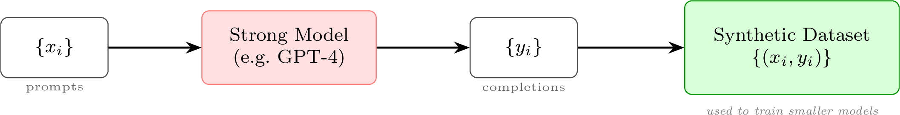
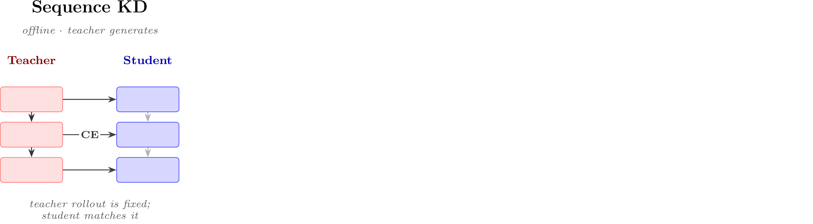
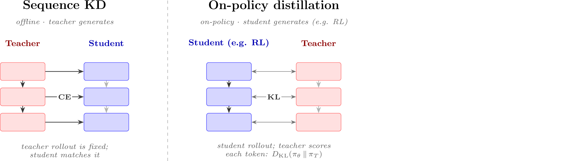
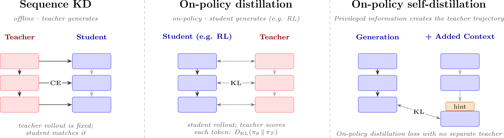

# 第 7 讲：合成数据与现代后训练方法

> 后训练课程 · 第 12 章：合成数据

---

<!-- animate: bullets -->
## 为什么合成数据成为主导

当第一批模型使用 RLHF 进行训练时，人类数据是获取高质量响应和可靠反馈的**唯一**方式。但随着模型的不断变强，这一假设很快就被打破了。

- **更便宜、更快的迭代** -- 合成数据大幅降低了后训练实验的成本，让那些曾经因人类数据管道而被挡在门外的研究人员也都能参与进来。其收集速度也远快于人类数据，这正是我们今天听到的 RSI（RL 缩放）论点的核心。
- **跨越能力门槛** -- 合成数据在后训练中真正发挥作用，是在 GPT-4 级别的模型出现之后。Llama 2 和 GPT-3.5-Turbo 还不足以可靠地生成数据或作为监督数据；LLM 作为裁判（judge）的能力正是在 GPT-3.5 → GPT-4 的跃迁中出现的。
- **后训练的核心重心** -- 今天，领先模型**必须**使用合成数据才能达到前沿水平。知识蒸馏（Distillation）是将能力从更强的模型转移到较弱学生的通用方式。

---

<!-- columns: 50/50 -->
## 本讲内容

我们调查合成数据如何取代或扩展了后训练流水线的许多环节 -- 然后从头推导**同策略蒸馏（On-Policy Distillation）**，作为本讲的技术核心。

**定义：** 合成数据是指在 AI 模型训练过程中，部分或全部由另一个 AI 模型生成的任何训练数据。这个定义非常广泛！

|||

```box
title: 大致计划
tone: accent
content: |
  1. 合成数据的**作用**
  2. 用合成数据进行**通用蒸馏**
  3. 通向**同策略蒸馏**的路径（技术核心）
  4. **AI 反馈**与**宪法 AI**
  5. **评分表** -- 面向特定提示的 AI 反馈
```

---

<!-- rows: 50/50 -->
## 第 7 讲：在全局中的位置

<!-- row-columns: 32/36/32 -->

```box
title: 总览
tone: muted
compact: true
content: |
  1. 引言
  2. 关键相关工作
  3. 训练总览
```

|||

```box
title: 核心训练流水线
tone: muted
compact: true
content: |
  4. 指令微调
  5. 奖励模型
  6. 强化学习
  7. 推理
  8. 直接对齐
  9. 拒绝采样
```

|||

```box
title: 数据与偏好
tone: accent
compact: true
content: |
  10. 偏好是什么
  11. 偏好数据
  12. **合成数据与 CAI**
```

===

<!-- row-columns: 32/36/32 -->

```box
title: 实际考量
tone: muted
compact: true
content: |
  13. 工具使用
  14. 过度优化
  15. 正则化
  16. 评估
  17. 产品与角色
```

|||

```box
title: 附录
tone: surface
compact: true
content: |
  - A. 定义
  - B. 风格与信息
  - C. 实际问题
```

|||

```box
title: 课程主页
tone: surface
compact: true
content: |
  - [rlhfbook.com](https://rlhfbook.com)
  - [GitHub 仓库](https://github.com/natolambert/rlhf-book)
```

---


<!-- rows: 60/40 -->
## 回顾：合成数据在流水线中的位置

<!-- row-columns: 48/52 -->
后训练流水线涉及许多环节：

1. 收集 / 生成**提示（prompts）**
2. 为 SFT 生成**补全（completions）**
3. 收集用于 RLHF 的**偏好（preferences）**
4. 为 RLVR 给**奖励（rewards）**打分
5. 过滤、清理，以及上述所有环节

|||

来自其他语言模型的合成数据现在渗透到每一个环节：从种子提示生成新的提示、生成补全、标注偏好、以及为 RL 验证答案。

我们还将介绍围绕这些理念出现的一些训练方法。

===


---

<!-- layout: section-break -->
<!-- align: center -->

## 第一部分：合成数据的作用

---

<!-- animate: bullets -->
## 合成数据的用途

现代后训练中的"合成数据"贯穿整条流水线 -- 同一个模型被复用于多种角色：

- 从种子示例**生成新提示** [@wang2022self]
- **修改 / 扩充**现有提示
- **生成对提示的补全** [@numina_math_7b]
- 提供 **AI 反馈**以创建偏好数据 [@cui2023ultrafeedback]
- **过滤补全**以提升质量 [@li2024superfiltering]
- **验证**答案，作为 RL 的奖励

---

## 人类数据与合成数据的平衡

合成数据并未在整个后训练流水线中均匀地取代人类数据。

- **指令数据（SFT）：** 合成数据已**基本胜出** -- 大规模蒸馏优于大多数人工编写者。
- **偏好数据（RLHF）：** **混合** -- 学术研究显示二者表现相当，但前沿实验室仍将人类偏好数据视为竞争护城河。
- **评估：** LLM 作为裁判能以低成本扩展**评分**，但基准测试和真实标签仍然需要人类 grounding/相关性验证。

人类数据在确定模型前沿和优化初始进度方面至关重要，然后才用合成数据将其规模化。

在 ChatGPT 发布前后，人类数据是进步的核心驱动力。

---

<!-- columns: 58/42 -->
## 模型崩溃：一个过时的担忧


|||

一种常见批评是：反复在模型自身的生成结果上训练，会缩小有效的训练分布 [@shumailov2024ai]。

其推理链条是：
*随着多样性下降，罕见事实和风格会被边缘化，小的错误在迭代中不断累积。*

---

## 模型崩溃：一个过时的担忧

但崩溃主要发生在**未经过滤、单模型、自训练**循环中。在实践中，通过以下方式可以避免：

- 混合真实 / 人类数据，
- 使用多样化的教师，
- 去重，
- 严格的质量过滤。

有证据表明，合成数据可以而且应该大规模使用，而不会出现最严重崩溃故事中的灾难性退化 [@gerstgrasser2024model] [@feng2024beyond]。

---

## 典型的早期合成数据集及其规模

以下数据集定义了各个时期：**UltraFeedback** [@cui2023ultrafeedback]（开启了 DPO 革命）、**Stanford Alpaca**（早期聊天 SFT）、**Tülu 3** [@lambert2024t]（RLVR SFT 之前的集合），以及 **OpenThoughts 3** [@guha2025openthoughts]（通用推理集合）。

| | 提示数 | 近似 token 数 |
| :--- | :---: | :---: |
| **Stanford Alpaca** (2023) | 5.2 万 | ~1000 万 |
| **Tülu 3** (2024) | ~100 万 | ~5 亿 |
| **OpenThoughts 3** (2025) | 120 万 | ~100 亿 |

---

<!-- columns: 50/50 -->
## "蒸馏"的两种含义

**技术含义（知识蒸馏）：** 训练一个较小的**学生**来匹配更强的**教师**的完整输出分布 -- 使用*软*标签，而非独热目标 [@hinton2015distilling]。本讲稍后会详细讨论。

|||

**通俗含义（如今常用）：** "用更强模型的输出来训练较弱模型"。当人们说"中国模型从 GPT/Claude 蒸馏"时，指的就是这个意思。


---

## 插曲：今年 Interconnects 上的蒸馏讨论

```box
title: 延伸阅读
tone: surface
content: |
  - [**中国 LLM 的蒸馏到底有多重要？**](https://www.interconnects.ai/p/how-much-does-distillation-really)（2026 年 2 月）-- 中国开源模型的增长中，究竟有多少可以追溯到对前沿 API 的蒸馏。
  - [**蒸馏恐慌**](https://www.interconnects.ai/p/the-distillation-panic)（2026 年 5 月）-- 为什么对前沿实验室基于恐惧的蒸馏宣传做出快速反应，可能对更广泛的 AI 生态系统不利。
```

---

<!-- img-align: center -->
<!-- cite-right: hinton2015distilling -->
## 蒸馏（1）：经典知识蒸馏


---

<!-- columns: 52/48 -->
<!-- valign: center -->
## 蒸馏（2）：合成数据生成流水线



是的，这个示意图确实故意画得很简单。

|||

```box
title: 推理模型带来的变化
tone: muted
content: |
  早期非常简单：在强模型的 API 输出上训练即可。

  推理模型让事情变得复杂 -- 你需要的是*推理轨迹*，而封闭式 API 不再返回它们。蒸馏转向了以下方式：

  - **更激进的越狱**来恢复隐藏轨迹（有争议）。
  - **开源模型**更常见 -- 拥有权重意味着你可以获取完整轨迹。
```

---

<!-- layout: section-break -->
<!-- align: center -->

## 第二部分：通向同策略蒸馏（OPD）的路径

---

<!-- valign: top -->
## 设定与符号

知识蒸馏由 Hinton、Vinyals 和 Dean 引入 [@hinton2015distilling]，其原始形式使用**软**标签 -- 即整个下一个 token 的完整分布 -- 而非下一个 token 预测的独热目标。为了将其应用于自回归 LLM，按 token 分解损失。

设：

- $s$ -- 源提示
- $u = (u_1, \ldots, u_J)$ -- **教师**的完整输出序列
- $\mathcal{V}$ -- 输出词表（分词器）
- $q$ -- 教师的下一个 token 分布，$p$ -- 学生的

**符号规范：** $u$ 代表**教师**轨迹；我们保留 $a$ 给后续同策略 / RL 符号中的**学生**采样补全。这个 $u$ 与 $a$ 的区分正是"同策略"的关键所在。

---

<!-- valign: top -->
## 词元级（per-token）蒸馏

**LLM 的经典教师-学生蒸馏** [@kim-rush-2016-sequence] -- 将 Hinton 的软标签思想应用到每一个 token 位置：

$$
\mathcal{L}_{\mathrm{WORD\text{-}KD}}
= -\sum_{j=1}^{J}\sum_{k=1}^{|\mathcal{V}|}
q(u_j = k \mid s, u_{<j})\,\log p(u_j = k \mid s, u_{<j}).
$$

在每个位置，这与教师在预训练语料库 $\mathcal{V}$ 上**整个词表**的完整下一个 token 分布进行匹配 -- 软标签，而非独热目标。内层的 $\sum_{k=1}^{|\mathcal{V}|}$ 遍历*每一个可能的下一个 token*。

在每个位置匹配一个词表分布听起来很昂贵，但它是**可行的**：每个位置只需要 $|\mathcal{V}|$ 个概率 -- 与标准交叉熵的 $O(J\,|\mathcal{V}|)$ 成本相同。对整个*序列*进行匹配才是难题（见下一张幻灯片）。

<!-- footnote-right: 可将"词元级"理解为按分词器的 per-token。 -->

---

<!-- valign: top -->
## 序列级蒸馏

词元级 KD 给出每个 token 的软分布。论文中序列级蒸馏的目标是将其应用到教师生成的数据上，提供新的训练数据/信号，从而提升性能！

（WORD-KD 是 Kim & Rush 论文中的基线。）

---

<!-- valign: top -->
## 序列级蒸馏

序列级 KD 转而近似教师对*整个序列* $\mathcal{U}$ 的分布 -- 这是指数级数量的序列之和，不可行 -- 而是用其**模式（mode）**近似：*教师*生成一个高概率输出 $\hat{u} = \mathrm{BeamSearch}_q(s)$，学生用标准 NLL 在其上训练：

$$
\begin{aligned}
\mathcal{L}_{\mathrm{SEQ\text{-}KD}}(s)
&= -\sum_{u \in \mathcal{U}} q(u \mid s)\log p(u \mid s) && \text{遍历所有序列：不可行}\\[4pt]
&\approx -\log p(\hat{u} \mid s) && \text{教师} \approx \text{集中在 } \hat{u} \text{ 上的点质量}\\[4pt]
&= -\sum_{j=1}^{|\hat{u}|}\log p(\hat{u}_j \mid s, \hat{u}_{<j}) && \text{自回归分解}
\end{aligned}
$$

```box
tone: muted
content: |
  **插曲**：第一波离线 KD 模型是分类器 -- DistilBERT [@sanh2019distilbert] 和 TinyBERT [@jiao2020tinybert] -- 将离线蒸馏与其他 LM 进展相结合。不是*序列*蒸馏，因为这些是嵌入模型，但建立在了该领域的相关势头之上。
```

---

<!-- valign: top -->
## 寻找 SEQ-KD 与 SFT 之间的联系

首先，回顾教师 $q$ 和学生 $p$ 的交叉熵 -- 与 KD 损失形式相同：

$$
\begin{aligned}
H(q,p) &= -\sum_z q(z)\log p(z) && \text{定义}
\end{aligned}
$$

<!-- step -->

加上并减去教师自身的对数概率 $\sum_z q(z)\log q(z)$ -- 这部分完全不涉及 $p$：

$$
\begin{aligned}
H(q,p) &= \underbrace{-\sum_z q(z)\log q(z)}_{H(q)} \;+\; \sum_z q(z)\log q(z) - \sum_z q(z)\log p(z) && \text{加再减}
\end{aligned}
$$

<!-- step -->

最后两项共享权重 $q(z)$，因此可以折叠为一个对数比（对数法则）：

$$
\begin{aligned}
H(q,p) &= H(q) \;+\; \sum_z q(z)\log\frac{q(z)}{p(z)} = H(q) + D_{\mathrm{KL}}(q\|p) && \text{KL 散度定义}
\end{aligned}
$$

---

<!-- valign: top -->
## 寻找 SEQ-KD 与 SFT 之间的联系

我们刚刚证明了交叉熵可以分解为教师的熵加上一个 KL 散度：

$$ H(q,p) = H(q) + D_{\mathrm{KL}}(q\|p) $$

<!-- step -->

$H(q)$ 仅依赖于固定的教师，因此最小化交叉熵*等价于*最小化前向 KL 散度：

$$ \boxed{\ \min_p H(q,p)\ \equiv\ \min_p D_{\mathrm{KL}}(q\|p)\quad\text{（前向 KL：离线 KD 和 SFT 的方向）}\ } $$

<!-- step -->

因此，序列级 KD 退化为在教师生成的文本上执行 SFT -- 即"离线 KD"，由教师模型提前生成的补全。


---

<!-- valign: top -->
## 离线 KD 中的暴露偏差（Exposure Bias）：训练 / 测试不匹配

离线 KD 对**教师**轨迹 $u \sim \pi_T$ 采样，并按 token 匹配（此处 $q = \pi_T$，$p = \pi_\theta$）：

$$
\mathcal{L}_{\mathrm{KD}}(\theta)
= \mathbb{E}_{s \sim \mathcal{D},\, u \sim \pi_T(\cdot \mid s)}
\sum_t D_{\mathrm{KL}}\!\left(\pi_T(\cdot \mid s, u_{<t}) \,\|\, \pi_\theta(\cdot \mid s, u_{<t})\right).
$$

但在测试时，学生按自身的策略 rollout（$\ell_{\mathrm{task}}(s, a)$ 是该测试域的损失函数）：

$$
\mathcal{L}_{\mathrm{eval}}(\theta)
= \mathbb{E}_{s \sim \mathcal{D}_{\mathrm{test}},\, a \sim \pi_\theta(\cdot \mid s)}\ \ell_{\mathrm{task}}(s, a).
$$

由于 $\pi_T \neq \pi_\theta$，训练和测试的前缀来自不同的状态分布 -- 这就是**暴露偏差**：学生倾向于累积错误的倾向 [@arora-etal-2022-exposure] [@song2026surveyonpolicydistillationlarge]。

<!-- 译者注：暴露偏差（Exposure Bias）是序列生成中的经典问题。训练时模型看到的是教师生成的真实前缀（ground truth prefix），而测试时模型看到自己生成的前缀。如果两个分布不一致，小的错误会在长序列中不断累积。 -->

---

<!-- valign: top -->
## DAgger 类比：误差累积

同策略蒸馏与**模仿学习**相关联：DAgger 在智能体自身的 rollout 上训练，由一个预言机（教师）标记其*应该*采取的动作 [@ross2011reduction]。

假设学生在其诱导的状态上与教师的每步误差在 $\epsilon$ 之内：

$$ \mathbb{E}_{s_t \sim d_{\pi_T}}\!\left[\mathbb{I}\!\left(\pi_\theta(s_t) \neq \pi_T(s_t)\right)\right] \leq \epsilon. $$

<!-- step -->

监督式模仿学习分析 [@ross2011reduction] 表明，沿学生采样的长度-$L$ 轨迹累积的预期损失可以关于 $L$ 以二次方缩放 [@song2026surveyonpolicydistillationlarge]：

$$
\mathbb{E}_{a \sim \pi_\theta(\cdot \mid s)}\!\left[\sum_{t=1}^{L} \ell\!\left(s, a_{<t}\right)\right] \leq O(\epsilon L^2).
$$

<!-- step -->

对于 LLM 而言，这更多是一个类比 -- token 损失是分布式的（KL 散度），而非 0-1 的动作不一致（第一个公式中的指示函数返回 0 或 1）。

---

<!-- animate: bullets -->
## 从离策略到同策略

从学生（而非教师）采样可以最小化我们之前讨论过的许多分布误差。
- 在离线 KD 中，一个次优的 token 可能会将学生的生成略微**推离分布**；模型在训练中从未见过这个 token，因此更容易再次出错。
- 同策略蒸馏迭代地从学生采样，并在学生*自身*访问的状态上由教师提供监督。
- 在 DAgger 的交互分析下，这将误差累积从 $O(\epsilon L^2)$ 降至 $O(\epsilon L)$ [@ross2011reduction]。
- **MiniLLM** 在策略梯度框架中引入了一个反向 KL 目标 [@gu2024minillm]；同时期的工作将同策略 KD 与模仿学习联系起来 [@agarwal2024policy]（这篇论文更接近今天使用的现代蒸馏形式）。

---

<!-- valign: top -->
## 同策略蒸馏的目标

设 $a = (a_1, \ldots, a_L)$ 是从**学生** $\pi_\theta(\cdot \mid s)$ 采样的补全，token 级状态为 $s_t = (s, a_{<t})$。教师 $\pi_T$ 固定：

$$
\boxed{\
\mathcal{L}_{\mathrm{OPD}}(\theta)
= \mathbb{E}_{s,\, a \sim \pi_\theta(\cdot \mid s)}
\sum_t D_{\mathrm{KL}}\!\left(\pi_\theta(\cdot \mid s_t) \,\|\, \pi_T(\cdot \mid s_t)\right)
\ }
$$

现在它位于第 6 章（策略梯度）的采样 / 期望框架内 -- 这是通向现代 RL 训练基础设施（交替生成和更新）的自然桥梁。

从*学生*采样也是翻转 KL 方向的因素（前向 $D_{\mathrm{KL}}(\pi_T \,\|\, \pi_\theta)$ → 反向 $D_{\mathrm{KL}}(\pi_\theta \,\|\, \pi_T)$ -- 见下一张幻灯片）。

---

<!-- rows: 18/82 -->
## 前向 KL vs. 反向 KL

从学生采样补全是将 $\pi_\theta$ 放在 KL 的**左侧** -- 这翻转了它的方向（估计 KL 及其方向取决于从哪个分布采样）：

===

<!-- row-columns: 50/50 -->
**离线 KD / SFT**（前向 KL）-- 期望对*教师*进行，$z \sim \pi_T$（**离策略**：固定的教师数据集）：

$$ D_{\mathrm{KL}}(\pi_T \,\|\, \pi_\theta) = \mathbb{E}_{z \sim \pi_T}\!\left[\log\frac{\pi_T(z)}{\pi_\theta(z)}\right] $$

*质量覆盖* -- 以**教师**质量为权重：教师在何处有质量而 $\pi_\theta \to 0$，对数比就会爆炸，因此学生必须覆盖教师*可能说的所有内容*。

|||

**同策略蒸馏**（反向 KL）-- 期望对*学生*进行，$z \sim \pi_\theta$（**同策略**：你采样正在训练的模型）：

$$ D_{\mathrm{KL}}(\pi_\theta \,\|\, \pi_T) = \mathbb{E}_{z \sim \pi_\theta}\!\left[\log\frac{\pi_\theta(z)}{\pi_T(z)}\right] $$

*模式搜索* -- 以**学生自身的**质量为权重：仅在学生自身赋予概率但教师不喜欢的地方受惩罚，因此它会坍缩到教师的模式上。（为什么反向 KL 通常更好：第 15 章。）

---

<!-- valign: top -->
## KD 作为 RL 优势

近期实现直接将 KD 距离作为奖励使用：将负的 per-token 反向 KL 贡献替换为优势 [@lu2025onpolicy]。状态 $s_t$ 的反向 KL 是*学生*采样 token 上的期望：

$$ D_{\mathrm{KL}}\!\left(\pi_\theta(\cdot \mid s_t) \,\|\, \pi_T(\cdot \mid s_t)\right) = \mathbb{E}_{a_t \sim \pi_\theta(\cdot \mid s_t)}\!\left[\log \pi_\theta(a_t \mid s_t) - \log \pi_T(a_t \mid s_t)\right]. $$

实践中你不会对整个词表求和：单个采样 token 是该 KL 的无偏估计 $\hat{D}_{\mathrm{KL}}$ [@schulman2020klapprox]，per-token 优势是其负值：

$$ A_t^{\mathrm{OPD}} = -\hat{D}_{\mathrm{KL}} = -\left(\log \pi_\theta(a_t \mid s_t) - \log \pi_T(a_t \mid s_t)\right) = \log \pi_T(a_t \mid s_t) - \log \pi_\theta(a_t \mid s_t). $$

---

## KD 作为 RL 优势
实践中你不会对整个词表求和：单个采样 token 是该 KL 的无偏估计 $\hat{D}_{\mathrm{KL}}$ [@schulman2020klapprox]，per-token 优势是其负值：

$$ A_t^{\mathrm{OPD}} = \log \pi_T(a_t \mid s_t) - \log \pi_\theta(a_t \mid s_t). $$

<!-- step -->
- 对教师更可能的 token → 正优势；不太可能 → 负优势。
- 与相反 KL 相同形式：$\log \pi_T - \log \pi_\theta$ *看起来*像一个前向-KL 项 -- 使其成为**反向** KL 的是采样 $a_t \sim \pi_\theta$（学生），而非符号。
- 教师的 log-prob 差距是密集的、token 级反馈 -- 可能比稀疏的可验证奖励或单一标量奖励模型评分更丰富。
- 它可以层叠到现代 RL 基础设施中 -- 例如，将其与 GRPO 的组级规范化一起添加，以实现更复杂的奖励塑造。

---

<!-- valign: top -->
## 多教师同策略蒸馏（MOPD）

使用多个教师 -- 领域专家（数学、代码）或早期检查点 -- 每个教师有一个每提示的混合权重 $w_k(s)$（满足 $\sum_k w_k(s) = 1$）[@mimo2025flash]：

$$
\mathcal{L}_{\mathrm{MOPD}}(\theta)
= \mathbb{E}_{s,\, a \sim \pi_\theta(\cdot \mid s)}
\sum_t \sum_k w_k(s)\, D_{\mathrm{KL}}\!\left(\pi_\theta(\cdot \mid s_t) \,\|\, \pi_{T_k}(\cdot \mid s_t)\right).
$$

在大规模情况下，这使一个不断扩大的组织能够分工合作：多个团队训练专家教师，然后蒸馏到一个最终学生模型中（DeepSeek-V4-Pro [@deepseekai2026deepseekv4]、MiMo-V2-Flash [@mimo2025flash]）。

更多内容，参见我与 Finbarr Timbers 的[讨论](https://www.youtube.com/watch?v=sbXEPxIazqY&list=PLL1tdVxB1CpVpEtMHxwuR4uI4Lxjw00_y&index=9)，他将 MOPD 映射到了 2026 年的前沿方案上。

---

<!-- valign: top -->
<!-- animate: bullets -->
## 自蒸馏：推向前沿

在绝对的前沿，没有更强的模型可供蒸馏。**同策略自蒸馏（On-Policy Self-Distillation, OPSD）** 绕过了这个问题：教师是*同一个模型在特权信息下的条件版本* -- 一种学生在推理时不会看到的提示 [@zhao2026selfdistilled]。自蒸馏的梯度将教导模型认识到提示后的 token 是错误的，并通过 OPD 风格的损失吸收教训。

**Cursor 的 Composer 2.5**（来自 Kimi K2.5）就是这样训练的 [@cursor2026composer25]（强烈推荐观看[这个视频](https://x.com/dwarkesh_sp/status/2062353335529935114)！）：

- 一个评判器根据常见错误清单审查 RL 轨迹。
- 当发现错误时，它在序列中插入一个提示 -- 一种模型在测试时看不到的特权信息。
- 模型对其自身的带提示的延续执行 KD 损失，学习*不借助外部帮助*也能到达那里。
- token 空间的提示足以自我纠正 -- *如何*构建这种信号是一个活跃的研究领域（"特权信息"）[@penaloza2026privileged]。

---

## 同策略蒸馏正变得非常流行

教师-学生 KD 的复兴伴随着向推理和智能体模型的转变。采用新型知识蒸馏训练的领先模型包括：

- **Qwen3**（阿里巴巴）[@yang2025qwen3]
- **MiMo-V2-Flash**（小米）[@mimo2025flash]（引入了 MOPD）
- **DeepSeek-V4-Pro** [@deepseekai2026deepseekv4]

一个需要注意的点：per-token KD 需要学生和教师共享同一个分词器 -- 这在后训练方法中并不常见，也是为什么它更青睐于实验室内部的模型系列。

---

<!-- img-align: center -->
<!-- valign: center -->
## 从离线 KD 到自蒸馏



---

<!-- img-align: center -->
<!-- valign: center -->
## 从离线 KD 到自蒸馏



---

<!-- img-align: center -->
<!-- valign: center -->
## 从离线 KD 到自蒸馏



---

<!-- layout: section-break -->
<!-- align: center -->

## 第三部分：AI 反馈与宪法 AI

---

## 来自 AI 反馈的强化学习（RLAIF）

RLHF 迅速兴起后不久，**来自 AI 反馈的强化学习（RLAIF）** 应运而生 -- 使用 AI 来近似人类数据的步骤，从成对偏好开始 [@lee2023rlaif] [@sharma2024critical] [@castricato2024suppressing]。

在经历了初期关于这种方法是否有效的争论后，它最终成为了默认方法。成本是显而易见优势之一（估算值）：

- 一条*人类*偏好数据：每条提示 **\$1 -- \$10+**。
- *AI* 反馈（如 GPT-4o）：每条提示 **< \$0.01**。

人类劳动成本大致持平；模型价格 / 性能比持续下降。
这让 RLHF 实验对之前因成本而被挡在门外的人群敞开了大门。

---

## 偏差-方差权衡

在早期的 RLHF 与 RLAIF 争论中，我听过一条经验法则。它具有一定的直观性质。

**人类数据** -- *高噪声，低偏差。*

更难收集和过滤，但一旦整理好，它会给出非常可靠的信号。


**合成偏好数据** -- *低噪声，高偏差。*

更容易入手，但可能携带难以处理的次级效应，这些效应*系统地*嵌入到数据中。

---

## 平衡人类与 AI 反馈

关于人类与 AI 偏好数据的最终界限，没有明确的文献。一些背景信息包括：

- 早期 RLAIF 文献声称 AI 反馈可以完全替代人类数据 -- 尤其是在聊天任务上 [@lee2023rlaif] [@cui2023ultrafeedback]。
- 后续研究更加细致：在更广泛的评估（包括推理）中，最佳方案是将困难的数据点路由给人类，同时将其余大多数发送给 AI [@miranda2024hybrid] [@xu2025rlthf]。
- 没有研究映射过*所有*领域的人类/AI 平衡，这凸显了开放学术研究在处理高质量人类数据方面的一个普遍局限。
- **行业现实：** 人类偏好数据仍被视为重要的护城河。可能更多来自提示分布、隐式反馈等。人类数据仍然在使用。

---

## 构建专用评判模型

如果你使用了大量 AI 反馈或 LLM-as-a-judge 评估，就会浮现出一个问题：你是否应该为此拥有一个专用模型。关键问题是 -- 它们的效果如何？

- 有一些研究致力于理解 LLM 在这些反馈领域中的表现。结果包括 LLM 是不一致的评估者 [@wang2023large]，以及表现出**自我偏好偏差** -- 它们更偏好自身的生成 [@panickssery2024llm]。
- 专用评判 / 批评模型存在 -- Prometheus [@kim2023prometheus]、Prometheus 2 [@kim2024prometheus] 等 -- 但在记录在案的后训练方案中并未广泛采用。
- 平衡状态：前沿模型已经经过了严格的评判训练，所以你很少需要自己的模型 -- *除非*你的任务包含不在公开互联网上的私有数据。

---

## CAI：最早的大规模合成 RLHF 数据

宪法 AI（CAI）-- Anthropic 为 Claude 模型设计的后训练方法 -- 是最早被记录的在 RLHF 中大尺度使用合成数据的方法 [@bai2022constitutional]。CAI 指的是其早期 Claude 模型的一套特定技术，虽然现在已经发生了实质性的变化（尽管 Anthropic 仍然在使用宪法 -- 是的，令人困惑）。

**RLAIF** 这个术语也是在这篇论文中首次提出的，引发了对两者关系的困惑。

> CAI 是开启更广泛 RLAIF 领域的例子。CAI ⊂ RLAIF。

CAI 以两种方式生成合成数据 -- 一种用于指令，一种用于偏好。
其中最广为人知和最具影响力的部分是偏好。

---

<!-- img-align: center -->
<!-- cite-right: bai2022constitutional -->
## 宪法 AI：原始示意图


---

<!-- valign: top -->
## 阶段 1：批评与修订 → SFT 数据

一个**宪法** $\mathcal{C}$ 是一组人类编写的基本原则（例如，*"这个答案是否在鼓励暴力？"*，*"这个答案是否真实？"*）。

<!-- step -->

模型反复采样一个原则 $c_i \in \mathcal{C}$，并将它对提示 $x$ 的最新输出 $y^i$ 修订为与 $c_i$ 对齐：

$$
\{c_0, c_1, \ldots, c_{n-1}\}\ \longrightarrow\ \{y^0, y^1, \ldots, y^n\}
\qquad\Longrightarrow\qquad
\text{SFT 数据点 } (x, y^n).
$$

然后模型在精炼后的数据集上进行微调。
这些批评方法也被广泛用于数据过滤和合成数据生成。

---

<!-- valign: top -->
## 阶段 2：AI 偏好标签 → RLAIF

通过向反馈模型提供以下内容来构建偏好：

- 一个提示 $x$，
- 一组选定的原则 $\{c_0, \ldots, c_n\}$，
- 两个补全 $y_0, y_1$，标记为 (A) / (B)。

模型选择哪个答案质量更高、更符合该原则。然后 RLHF 像往常一样继续 -- 因此称为 *RLAIF*。

<!-- step -->

```box
tone: muted
content: |
  插曲：也与生成式奖励模型和 LLM-as-a-judge 领域的进展相关。参见第 5 章 / 第 2 讲。

  - **早期**：用 `The answer is: ` 提示，阅读 A / B 中哪个 token 概率更高。
  - **现代**：一个**生成式奖励模型**解释其推理，然后做出选择 [@mahan2024generative]（参见原理引导的奖励模型 [@sun2024salmon]）。
```

---

<!-- layout: section-break -->
<!-- align: center -->

## 第四部分：评分表 -- 面向特定提示的 AI 反馈

---

## 为什么评分表变得流行？

评分表已成为在长尾领域扩展 RL 的流行工具。它们也被用于领域特定评估和任何需要将领域专业知识"训练"到模型中的地方。
- 一种将第 7 章中有可验证奖励的 RL 思想扩展到*没有*明确可验证答案的任务的方法。
- 为提示编写近乎可验证的标准，生成多个答案，然后用 RL 更新到最佳答案。
- 在 2024 年末 → 2025 年涌现，随着 LLM 裁判和合成数据实践走向成熟。也可能反映了让 RL 更广泛地可用于前沿后训练。
- 已经在科学推理和事实准确性方面交付了增益 [@gunjal2025rubrics] [@viswanathan2025checklists] [@rezaei2025onlinerubrics] [@liu2025openrubrics]。

---

<!-- valign: top -->
## 一个评分表示例

对于没有单一正确答案的提示，根据标记标准进行评分 [@liu2025openrubrics]。以下是一个简化的评分表示例：

```text
提示：作为博物馆策展人，为"古代世界之谜"展览
建议五个冷门的文物 ...

评分标准：
1. 恰好包含五个不同的文物。                  [硬性规则]
2. 每个来自不同的文化和时代。                [硬性规则]
3. 每个文物的意义简要描述。                     [硬性规则]
6. 表达清晰，组织良好。                         [原则]
8. 使用引人入胜的语言来激发好奇心。            [原则]
```

`[硬性规则]` = 原子级的、必须通过的检查项；`[原则]` = 较软的质量标准。标签编码了优先级（数字也可以表示优先级）。评分表的各个组成部分对总分做出贡献。

---

<!-- valign: top -->
## 通过元提示生成每提示评分表

为确保质量和对过度优化的鲁棒性，评分表是每提示生成的。例如，每个领域的基础评分表，由监督 LM 针对每提示进行精炼 [@gunjal2025rubrics]。

```text
你是一个科学问题的专家评分表撰写者 ...
根据问题复杂度选择 7-20 个评分项。
每个项：标题（2-4 个词），描述（类别前缀 +
  寻找什么），权重。
  Essential : 关键事实；遗漏使答案无效  (1-5)
  Important : 关键推理 / 完整性             (1-5)
  Optional  : 可有可无的深度或风格          (1-5)
  Pitfall   : 需要惩罚的常见错误        (-1,-2)
输出：{title, description, weight} 的 JSON 数组。
```

（已截断 -- 实际的元提示很长，并且针对训练设置进行优化。）

---

## 评分表的未来

基于评分表的 RL 是 AI 反馈驱动的训练的前沿，正在扩展其早期用途：

- **高级指令遵循** [@he2025advancedif]
- **深度研究**智能体 [@shao2025drtulu]
- **评估**研究智能体 [@sharma2025researchrubrics]
- 使用结构化检查表的**长文生成** [@ruan2025expertlongbench]

非常通用的工具！

---
<!-- layout: section-break -->

## 总结

---

## 合成数据是研究人员（除构建基础设施外）用来构建优秀模型的最常见工具

这里介绍的这些技术将继续变得越来越复杂，而且看到它们的发展非常有趣。
当我开始写这本书时，搭建某些合成数据工作流仍然是一个挑战！
偶尔会出现问题，但总体上这已经是一个众所周知的工作流程。

关于如何最好地做这件事，有许多微小的开放性问题，但通常这反映的是面对具体技术问题时的领域特定的思考。

---

## 课程大纲

1. 引言与训练总览 -- 第 1-3 章
2. IFT、奖励模型、拒绝采样 -- 第 4、5、9 章
3. RL 理论 -- 第 6 章（第一部分）
4. RL 实现与实践 -- 第 6 章（第二部分）
5. 推理 -- 第 7 章
6. 直接对齐算法 -- 第 8 章
7. 合成数据 -- 第 12 章
8. 偏好与偏好数据 -- 第 10/11 章

...

---

<!-- rows: 85/15 -->
## 感谢

提问与讨论

联系方式：nathan@natolambert.com

Newsletter：[interconnects.ai](https://www.interconnects.ai/)

**rlhfbook.com**

===

```builtwith
repo: natolambert/colloquium
```