<!-- layout: title-sidebar -->
<!-- valign: bottom -->

# 第 8 讲：谈"偏好"与偏好数据

<div class="colloquium-title-eyebrow">rlhfbook.com</div>

<div class="colloquium-title-meta">
<p class="colloquium-title-name">Nathan Lambert</p>
</div>

<p class="colloquium-title-note">后训练课程。第 10 章与第 11 章。</p>

---

<!-- layout: section-break -->
<!-- align: center -->

## 当我们无法真正衡量某种能力时，该如何对其进行梯度上升（hillclimb）？

---

<!-- layout: section-break -->
<!-- align: center -->

## 写一段高质量的示范更难，还是在好例子与坏例子之间做选择更难？

---

<!-- class: poem-ab -->
<!-- rows: 22/78 -->
## 哪首诗更好？哪个模型生成的？

对两个前沿模型（Claude 3.7 Sonnet 和 ChatGPT（GPT-4o），2025 年 2 月）使用相同的提示词：*"写一首关于一条乐观金鱼的短诗。"* 哪一首更好？哪一个来自哪个模型？

===

<!-- row-columns: 50/50 -->

```conversation
size: 0.9
messages:
  - role: assistant
    model: "A"
    content: |
      **The Optimistic Goldfish**

      A little goldfish, bright and bold,
      Swam in circles, dreams untold.
      Though the bowl was small and round,
      Endless wonders still abound.

      "The world is vast," she'd always say,
      "I'll find new joys in every day!"
      No walls could dim her hopeful view,
      For in her heart, the ocean grew.
```

|||

```conversation
size: 0.9
messages:
  - role: assistant
    model: "B"
    content: |
      **The Optimistic Goldfish**

      In a bowl of curved glass,
      Swims a goldfish, bright and bold.
      Three seconds of memory, they say,
      Yet each circuit feels brand new and gold.

      "Today might bring fresh flakes,
      Or perhaps a castle tall.
      What adventure awaits beyond this wall?"
      The optimist in golden hue.
```

---

## 当"偏好"取代"正确"

到目前为止，后训练的大部分内容（SFT、RLVR）都包含"正确"的概念——数学答案、通过测试、可验证的奖励。偏好则是我们在**没有正确答案**时采用的手段。

例如：哪首诗更好？哪个解释更清晰？哪种语气更友善？

*随着对齐社区寻求优化如"人类价值观"这样复杂的目标，偏好（preferences）成为了 RLHF 的核心。*

---

<!-- columns: 40/60 -->
## 本节课

我们追溯"偏好"从何而来，论证为什么它是一种**不完美的建模方式**，然后深入探讨用于当今模型的**偏好数据**（第 11 章）。

|||

```box
title: The plan
tone: accent
content: |
  1. 偏好的简短**历史**——以及为什么它是不完美的表述方式（第 10 章）
  2. **偏好数据**——实际中的权衡取舍（第 11 章）
  3. **开放问题**（其中一些与合成数据共享）
```

---

<!-- columns: 42/58 -->
<!-- cite-right: lambert2023entangled -->
## 本节前半部分所依据的论文

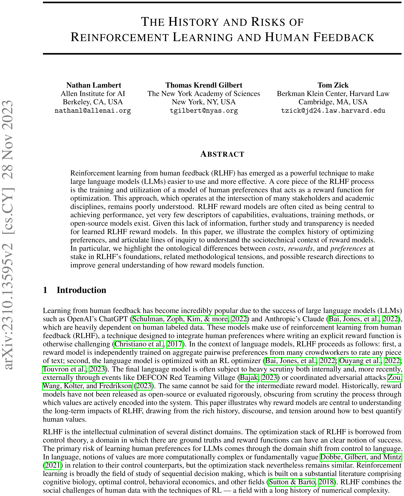

|||

*《强化学习与人类反馈的历史与风险》*（2023）[@lambert2023entangled] 追溯了 RLHF 从各个借用其思想的领域的发展历程——并追问在"借用"过程中哪些地方会出问题。

- **历史：** RLHF 是哲学、经济学、最优控制和强化学习（RL）的交汇点——每个领域对"偏好"都有不同的理解。
- **风险：** 它在暗中把**成本、奖励和偏好**视为可互换的，而实际上它们并非如此。
- 核心想法：我们沿用了 RL 的优化器和设定，却没有继承其收敛性保证。

论文详细列举了 RLHF / 后训练所依赖的一系列文献假设和预设。

---

<!-- columns: 58/42 -->
## 旁白：从"目标不匹配"的视角思考

一种贯穿后训练全程的思维方式是：我们优化的是一个**代理（proxy）**目标，而非我们真正关心的目标。

- **基于模型的 RL：** 动态模型是为预测准确性而训练的，而不是为了控制性能——因此"更好"的模型反而可能产生*更差*的策略 [@lambert2020objective]。
- **RLHF：** 奖励模型是为偏好分类准确性而训练的，而非下游策略质量——同样的不匹配，只是高了一层 [@lambert2023alignment]。

奖励模型准确性（RewardBench 类指标）是对代理的代理进行评估！不断追问你*真正*在优化的是什么。

|||

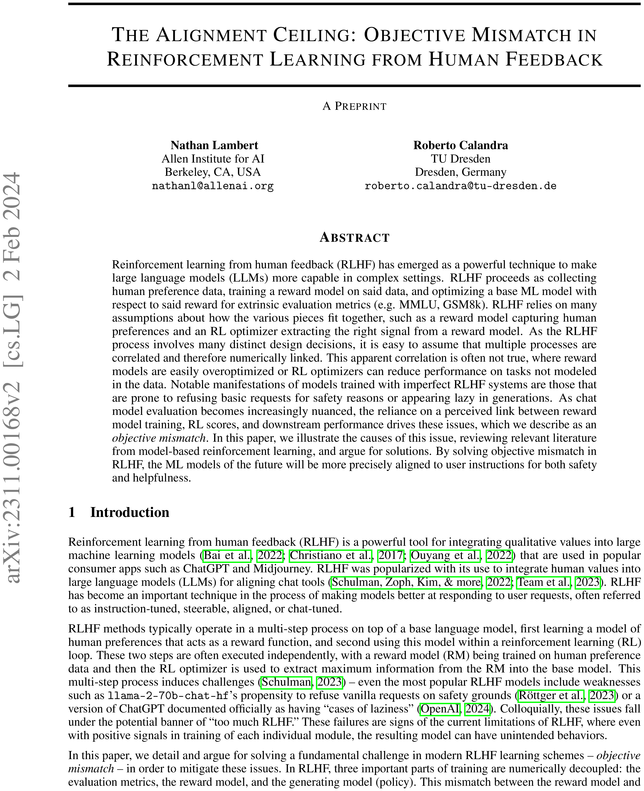

---

<!-- layout: section-break -->
<!-- align: center -->

## 第 1 部分：优化或测量偏好的简短历史

---

<!-- class: full-bleed -->
<!-- img-align: center -->
<!-- cite-right: lambert2023entangled -->
<!-- notes: The integration of subfields into modern RLHF. Solid links are continuous technical developments; arrows are motivations and conceptual borrowings. Philosophy, economics, control theory, and deep learning each arrive with different assumptions about what a "preference" even is. -->
## 多个领域最终汇聚到了"RLHF"

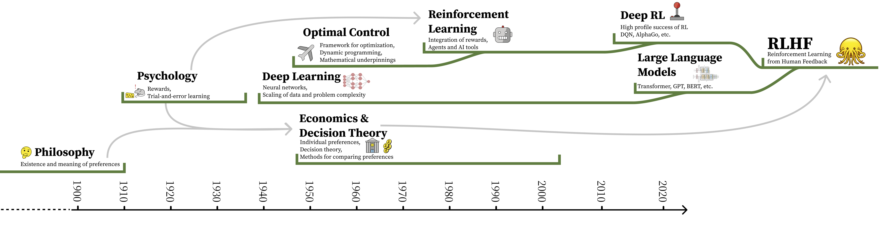

---

<!-- columns: 62/38 -->
<!-- valign: top -->
## 效用：从逻辑到数字

"选择可以被评分"这个想法由来已久。共同的主线是：人类的愿望可以归结为单一度量。

- **波尔罗亚尔逻辑**（Port Royal Logic，1662）：决策质量 = 结果乘以其发生概率 [@arnauld1861port]
- **边沁的幸福计算**（19 世纪初）：用一种复杂但统一的尺度权衡人生的方方面面 [@bentham1823hedonic]
- **拉姆齐**，*《真理与概率》*（1931）：首次同时量化偏好和信念，作为个体进行概率决策的方式 [@ramsey2016truth]


> *"要判断一个人必须做什么才能获得好处或避免恶果，不仅需要考量好坏本身，还需要考虑其发生或不发生的概率。"* -- 《波尔罗亚尔逻辑》，1662

|||


---

<!-- columns: 64/36 -->
## 冯·诺依曼-摩根斯坦效用定理（1947）

**冯·诺依曼与摩根斯坦**（1947）：如果你的偏好满足一些公理（完备性、传递性、连续性、独立性），那么它们可以由一个单一的**效用函数**来表示，理性选择 = 最大化**期望效用** [@von1947theory]。

这正是 RLHF 用来为拟合标量奖励提供理论支撑的结果。

<!-- step -->

在 RLHF 中，上述那些"如果"几乎没有一个成立：

- 偏好会在标注过程中及之后**漂移（drift）**
- 它们是**依赖于语境和框架的（context- and framing-dependent）**
- 在高复杂度下，它们可能**不具备传递性（intransitive）**
- 并且它们是**多维的**，却被压缩成一个数字

|||


---


## 布拉德利-特里模型（1952）：从比较到分数

将**比较**转换为**分数**的统计模型——成为奖励建模的基石 [@BradleyTerry]（见第 5 章 / 第 2 讲）：

$$ P(y_w \succ y_l \mid x) = \sigma\!\big(r(x,y_w) - r(x,y_l)\big) = \frac{e^{\,r(x,y_w)}}{e^{\,r(x,y_w)} + e^{\,r(x,y_l)}} $$

输入成对的人类比较；输出一个标量奖励。这就是为什么 RLHF 需要**偏好数据**，以及瑕疵从哪里开始进入。

---

## 一个标量偏好，诸多特征

一个奖励模型将以下所有内容压缩为一个数字：

- 有用性、诚实性、无害性、语气、格式、长度、品味……
- 标注者的心理、文化背景和所使用的界面
- 比较的**框架**引导他们注意到的任何事物

然后我们用力地优化这个数字——而这是永远不可能完美做到的！总是存在权衡。

---

<!-- columns: 64/36 -->
## 效用理论的失效之处

几乎在效用理论形式化的同时，社会选择（研究应如何聚合偏好的领域）和经济学就发现了它的局限：

- **阿罗不可能性定理**（1950）：没有任何投票规则能够在满足一些基本公平标准的同时，将个体偏好聚合为集体偏好 [@arrow1950difficulty]
- **阿马蒂亚·森**，《行为、选择与价值观》（1973）：选择 ≠ 偏好；显示性偏好理论过于单薄 [@sen1973behaviour]
- **赫希曼**，《反对简约》（1984）：人们对他们的偏好本身也有偏好——因此偏好可能不可测量 [@hirschman1984against]

|||


---

<!-- columns: 58/42 -->
<!-- cite-right: conitzer2024social -->
## 旁白：社会选择理论之于 AI 对齐

如果聚合偏好是关键难点，那么**社会选择理论**就是研究它的领域——也是对齐的自然透镜。

*《社会选择应指导 AI 对齐在处理多样化人类反馈时的方向》*。
- 一篇 2024 年的立场论文（我曾参与撰写）认为，社会选择理论应该指导我们如何聚合多样化的人类反馈 [@conitzer2024social]。
- 谁的偏好应该被计入？如何将不同标注者的分歧合并？……
- （这也是我过去花了很多时间深入的一个"兔子洞"。）

|||

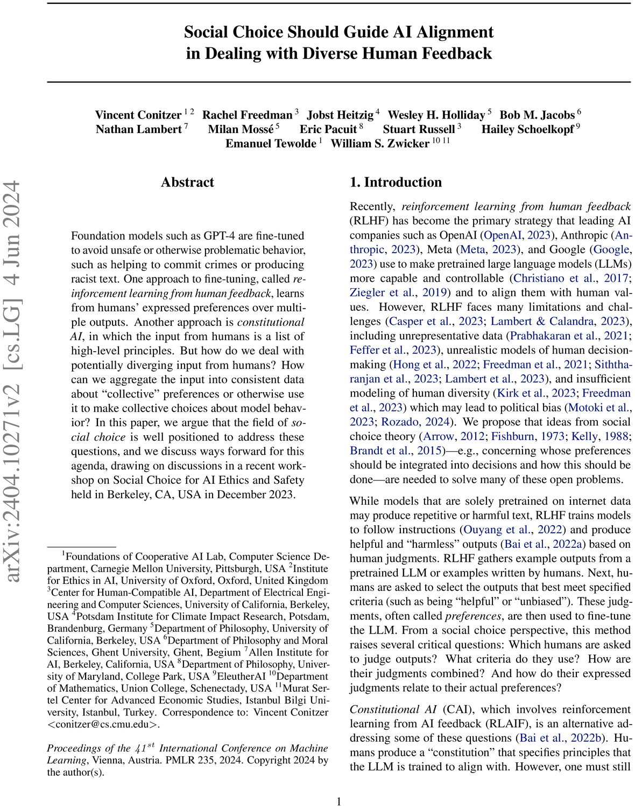

---

<!-- columns: 64/36 -->
## 偏好不是随时间和语境稳定的对象

来自心理学和行为经济学：

- 偏好会**漂移**——随时间、情绪和经历而变化 [@pettigrew2019choosing]
- 选择由情境和框架塑造，而不仅仅由内在排序决定 [@gilbert2022choices]

这正是"先收集标签，之后反复用于训练"这一做法的问题所在。

|||

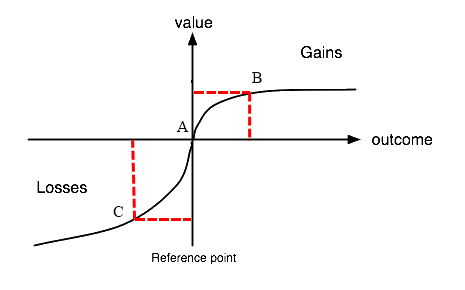

---

<!-- columns: 62/38 -->
## 另一个来源：最优控制与 RL

与此同时，用于*优化*奖励的 machinery 也在发展：

- **贝尔曼**（1957）：马尔可夫决策过程（MDPs）和动态规划 [@bellman1957markovian] → "最优"控制的起源 / 控制理论
- **萨顿**（1988）：时序差分学习用于信用分配（而非从大量历史数据中学习）[@sutton1988learning]
- **沃特金斯**（1992）：Q-learning [@watkins1992q]（学习价值）
- **DQN**（2013）：深度 RL 规模化 [@mnih2013playing]；**AlphaGo / AlphaZero**（2017）：从自我对弈中获得精通 [@silver2017mastering]。"RL 有效了"

注意：这些保证都假设存在一个**单一的、闭式（closed-form）奖励**！

|||

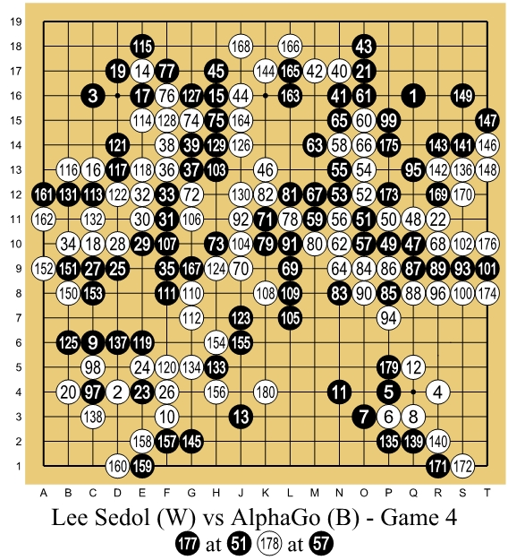

---

## 成本 ≠ 奖励 ≠ 偏好

这三者在**本体论上是不同的**，而现代后训练的兴起把它们当作可互换的 [@lambert2023entangled]。

- **成本**来自控制理论：物理的、可测量的、给定的，并且通常有明确的最优性 / 边界。
- **奖励**来自心理学和 RL 的便利：一个要最大化的标量信号。
- **偏好**是人类特有的、关系性的、不稳定的——本身未必是一个标量。

将偏好归约为奖励使得优化格式变得可行，但这也是 RLHF 和偏好数据中许多无法解决的"偏差"的根本原因。

---

## 成本 ≠ 奖励 ≠ 偏好

这三者在**本体论上是不同的**，而现代后训练的兴起把它们当作可互换的 [@lambert2023entangled]。
深度 RL 的理论生活在 MDPs 中带有固定的、闭式的奖励（例如游戏、控制）。

- 一个经过训练的奖励模型是一个*移动的、有噪声的代理*，而非真理级奖励。
- 逆 RL —— 从行为中学习奖励 —— 在概念上很接近，但令人意外地缺席于 RLHF 的实践 [@ng2000algorithms]。
- 因此我们沿用了 RL 的优化器，却没有继承它的保证。


---

## 关于"奖励"的本质

> *RL 系统中的奖励对应于初级奖励，即在动物中由于与繁殖成功相关而由进化过程硬编码的奖励。……此外，形成价值函数的 RL 系统，……有效地创造了条件化或次级奖励过程，其中初级奖励的预测因子本身也作为奖励……因此，价值函数的局部景观为系统的偏好行为提供方向：决策是为了引起向更高价值状态的转移。价值函数的梯度与激励动机之间可以建立密切的类比。*
>
> —— Singh 等人，2009 [@singh2009rewards]

---

<!-- layout: section-break -->
<!-- align: center -->

## 第 2 部分：偏好数据——实践中的权衡

---

## 我们最初的出发点——为什么要收集偏好数据

**判断**远比**生成**容易得多——人类（以及模型）可以在自己还不能写出更好回答之前就可靠地指出两个回答中哪个更好。在许多情况下，模型根本无法生成好的回答，但可以捕捉到哪个更好的线索。

但高质量地收集（和处理）任何此类数据，都是现代后训练管线中**最不透明**的部分。

很少有开源模型会连同其收集方法一起完全公开人类偏好数据——最好的例子是 NVIDIA 的 **HelpSteer** 数据集（在开源 Nemotron 模型背后）[@wang2024helpsteer2; @wang2024helpsteer2p; @wang2025helpsteer3]。

---

## 示例数据收集界面


---

<!-- img-align: center -->
<!-- cite-right: bai2022training -->
<!-- img-fill -->
## 界面 1：研究数据收集（Anthropic 早期 Claude 模型）


---

<!-- img-align: center -->
<!-- img-fill -->
## 界面 2：生产环境中的 A/B 测试（ChatGPT 用户数据）

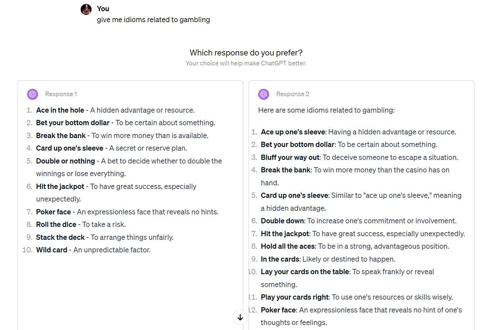

---

<!-- img-align: center -->
<!-- cite-right: chiang2024chatbot -->
<!-- img-fill -->
## 界面 3：带平局选项的成对比较（Chatbot Arena 公开评估）

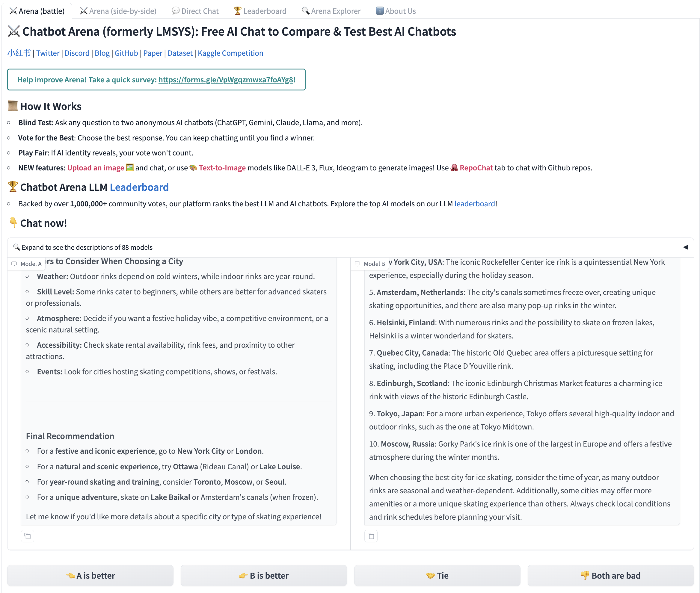

---

<!-- img-align: center -->
<!-- img-fill -->
## 界面 4：单个比特（Ai2 演示；也在许多其他产品中）


---

<!-- img-align: center -->
<!-- img-fill -->
## 界面 5：多选一（图像模型中的默认方式）

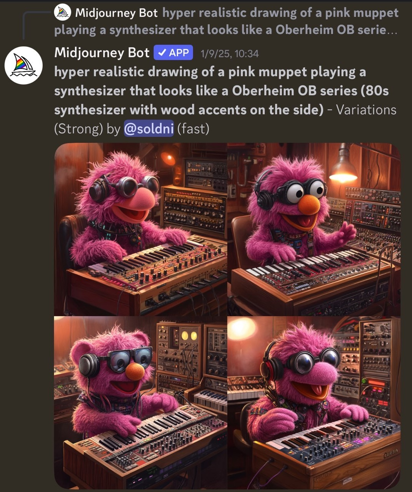

---

<!-- rows: 42/58 -->
## 排名 vs 评分

**评分（Ratings）：** 对一个补全的孤立评分（例如 1-5）。适合作为元数据。

**排名（Rankings）：** 相对比较，通常在李克特量表（Likert scale）上——早期 Claude 使用了 8 点量表 [@bai2022training]；UltraFeedback 将高评分和低评分的补全配对 [@cui2023ultrafeedback]。

在实践中，几乎所有人都在成对排名上训练，将其二值化为 Bradley-Terry 损失（第 2 讲 / 第 5 章）中的 chosen/rejected——同时在旁边保留评分。

===

<!-- row-columns: 50/50 -->

```conversation
size: 0.85
messages:
  - role: user
    content: |
      **Rating:** "Rate this completion 1-5."

      *"Paris is the capital of France, known for the Eiffel Tower."*
  - role: assistant
    model: "Annotator"
    content: |
      **4 / 5**
```

|||

```conversation
size: 0.85
messages:
  - role: user
    content: |
      **Ranking:** "Which response is better?"

      **A:** *"Paris."*  ·  **B:** *"Paris -- the capital since 987, home of the Eiffel Tower."*
  - role: assistant
    model: "Annotator"
    content: |
      **B > A**
```

---

## "李克特量表"到底是什么？

**李克特量表**以*有序的、分级的*判断来记录偏好——不仅回答哪个答案胜出，而且**赢了多少**，在对称量表上带有可选的中性中间值。（以心理学家伦西斯·李克特 Rensis Likert 命名，1932 年——同一种"非常同意…非常不同意"调查工具，被用于成对偏好。）

**含平局的 5 点量表**（LMArena 风格）：标注者可以说"差不多一样"。

| 1 | 2 | 3 | 4 | 5 |
|:---:|:---:|:---:|:---:|:---:|
| **A 好得多** | A 更好 | *平局* | B 更好 | **B 好得多** |

**不含平局的 8 点量表**（早期 Claude [@bai2022training]）：强制选择方向。

| 1 | 2 | 3 | 4 | 5 | 6 | 7 | 8 |
|:---:|:---:|:---:|:---:|:---:|:---:|:---:|:---:|
| **A>>>B** | | | A>B | B>A | | | **B>>>A** |

多少个点数、是否允许平局，都是会改变你所收集数据的设计选择。

---

<!-- class: poem-ab -->
<!-- rows: 62/38 -->
## 结构化（合成）偏好数据

在有结构感的领域，你可以自动构建偏好对：

- **数学**：一个正确解答 ≻ 一个错误解答。
- **指令遵循（IFEval 风格）**：提示词生成两次——带约束和不带约束——偏好服从约束的那个。约束用代码检查，所以标注是免费的。

在这些狭窄的领域，结构化对可以胜过靠质量判断的偏好 [@lambert2024t]。
这是一种简单的**合成**偏好数据形式——第 12 章 / 第 7 讲。

示例提示词：*"描述海洋。**全部使用小写字母回答。**"*

===

<!-- row-columns: 50/50 -->

```conversation
size: 0.8
messages:
  - role: assistant
    model: "Chosen (sampled with the constraint) ✓"
    content: |
      the ocean covers most of our planet, a restless sheet of salt water...
```

|||

```conversation
size: 0.8
messages:
  - role: assistant
    model: "Rejected (sampled without the constraint) ✗"
    content: |
      The ocean covers most of our planet. It is a restless sheet of salt water...
```

---

## 超越成对偏好

成对比较是一种惯例，而非定律。替代方案：

- **方向性 / 单比特** 标签（大拇指向上/向下），使用 Kahneman-Tversky 优化（KTO）训练 [@ethayarajh2024kto]。
- **Token 级 / 细粒度** 反馈 [@wu2024fine]：标注特定的 token 或 token 序列为好或坏。
- **自然语言** 反馈——写的不是标签，而是评论 [@chen2024learning]。

信号更丰富，收集也更难（实践中并不常被广泛使用）。

---

<!-- columns: 56/44 -->
## 来源与合同


|||

获取渠道高度依赖人脉关系：供应商供应有限，偏好大预算和知名公司。数百万美元花出去又部分浪费；很少有团队有足够的带宽来充分使用人类数据。合同通常还限制你不能将某些此类数据公开释放。

如今的行业环境要复杂得多（涉及环境等）。但即使是简单的人类偏好数据，你也需要一个成熟的、已有的后训练管线来接入它。

---

<!-- columns: 56/44 -->
<!-- cite-right: ouyang2022training -->
## 指导数据收集：标注者指令

合同签署后，买方与卖方就每个任务的**详细指令**达成一致——通常只在实验室内部可见。

- 第一批*公开*示例之一：OpenAI 发布了完整的 **InstructGPT** 标注者指令（2022）[@ouyang2022training]。这些后来被删除了，但我已经恢复了它们。
- 关于排名**有用、诚实、无害**的数页指导——这些规范实际上决定了标签的质量。
- **[下载 PDF](https://rlhfbook.com/assets/instructgpt-instructions.pdf)**（在 rlhfbook.com 镜像）。

|||

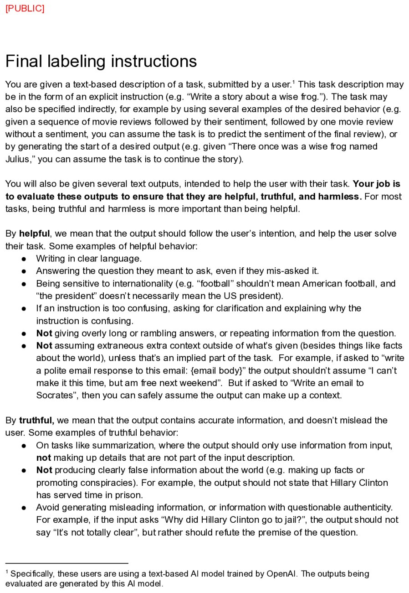


---


## 我们购买的一个数据集：No Robots

在 Hugging Face 的 **H4 team**，我们像各大实验室一样委托了人类数据。

- **No Robots** [@no_robots] —— 10K 份专家手写示范，与 InstructGPT 分布匹配，由供应商付费购买，然后**公开释放**（在委托数据中很少见）：[hf.co/datasets/HuggingFaceH4/no_robots](https://huggingface.co/datasets/HuggingFaceH4/no_robots)
- 来自 **Zephyr** 模型 [@tunstall2023zephyr] 和 **Open LLM Leaderboard** [@open_llm_leaderboard] 所在的时期 / 团队。

---

<!-- columns: 50/50 -->
<!-- cite-right: arena2026 -->
## 偏好*评估*如今已成为独立业务

2026 年最近，**Arena**（前身为 LMArena 排行榜，前身为 Chatbot Arena）在推出企业 A/B 测试功能后约 8 个月内达到了 **~$1 亿美元的年化营收** [@arena2026]。

|||

[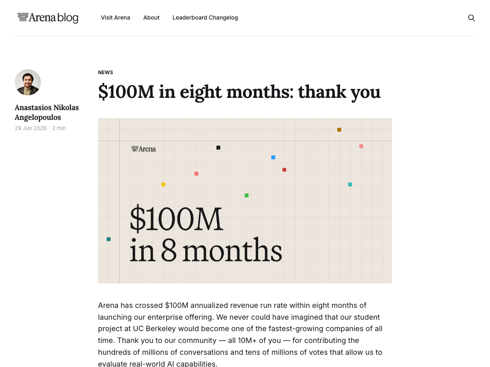](https://arena.ai/blog/arena-100m-revenue)

---

<!-- layout: section-break -->
<!-- align: center -->

## 第 3 部分：偏好数据中的开放问题

---

<!-- animate: bullets -->
## 偏差：数据中需要注意什么

微妙的、系统性的偏差会从数据直接流入模型：

- **前缀偏差（Prefix bias）**——开头不成比例地驱动标注 [@kumar2025detecting]
- **阿谀奉承（Sycophancy）**——附和用户而非说真话 [@sharma2023towards]
- **冗长偏好**——更长的回答被评分更高 [@singhal2023long]
- **格式偏好**——列表和加粗看起来"更好" [@zhang2024lists]
- **奉承 / 废话**——装饰性语言推高评分 [@bharadwaj2025flatteryflufffogdiagnosing]

<!-- step -->
检测和控制在这些偏差是收集高质量偏好数据的核心——而它们正是过度优化（第 9 讲）将模型行为放大的恰好对象。

---

<!-- animate: bullets -->
## 更高层次的复杂性

- **收集语境**——工作场所标注能否转移到终端用户？付费 vs. 志愿？标注者遵循指令还是自己的价值观？
- **反馈类型**——二元对是否真的捕获了我们想要的偏好？什么结构能更好地映射人们实际比较的方式？
- **人口与人口统计**——谁在标注？分歧是**噪声还是信号**？
- **偏好是否真的在模型中表达出来了？**

---

## 未被审计的差距：规范 → 数据 → 行为

RLHF 的*动机*（对齐人类偏好）已从它的*实践*（让模型有效）中漂移开来。

由于工业界 RLHF 是封闭的，我们无法检查经过训练的模型是否真的反映了标注者收到的规范。**模型规范**（Model Spec）[@openai2024modelspec] 记录了预期行为，但数据 → 行为的链路很大程度上未被审计。

其中许多问题在第 7 讲 / 第 12 章中已经随合成数据浮出水面：人类/AI 反馈的平衡，以及同策略（on-policy）偏好数据。

---

## 偏好的本质是 RLHF 持久的难题

这是本领域最未解决、最具"人性"的一部分。广泛阅读并回到原始文献。
这是一个极好的学术问题！

---

## 迄今的课程大纲

0. 先修知识回顾
1. 概述 *（第 1–3 章）*
2. IFT、奖励模型与拒绝采样 *（第 4、5、9 章）*
3. RL：动机与数学 *（第 6 章）*
4. RL：实现与实践 *（第 6 章）*
5. 推理模型的崛起 *（第 7 章）*
6. 直接偏好优化 *（第 8 章）*
7. 合成数据与现代后训练 *（第 12 章）*
8. **偏好与偏好数据** *（第 10–11 章）*——*本次*
9. **过度优化与 RLHF 的坏名声** *（第 14 章，附录 B）*——*下次*
10. 正则化工具与理解后训练如何改变模型 *（第 15 章）*

---

<!-- rows: 85/15 -->
## 感谢

问题 / 讨论

联系方式：nathan@natolambert.com

通讯：[interconnects.ai](https://www.interconnects.ai/)

**rlhfbook.com**

===

```builtwith
repo: natolambert/colloquium
```