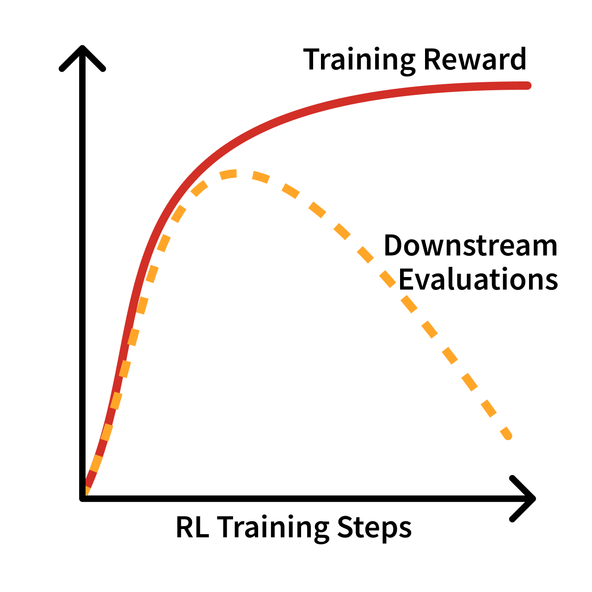
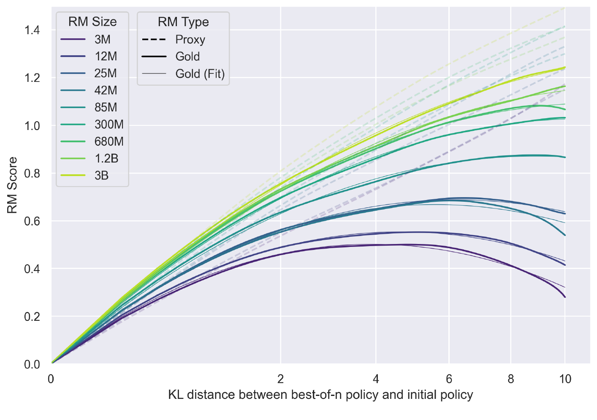
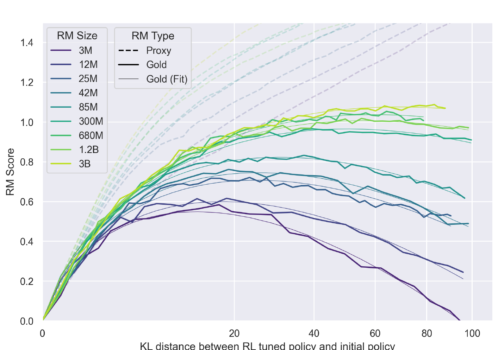
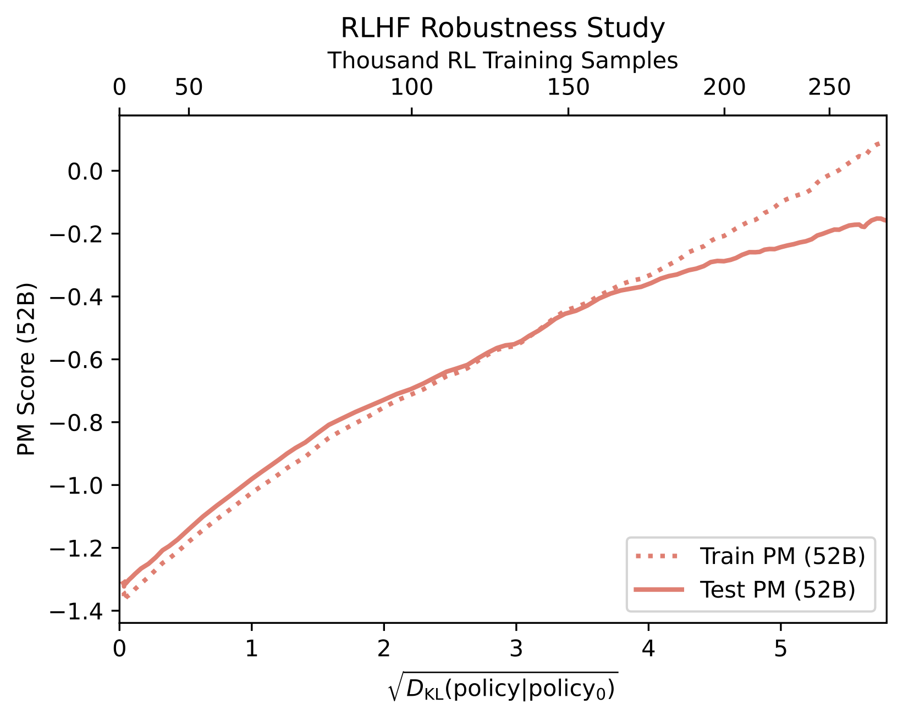

<!-- layout: title-sidebar -->
<!-- valign: bottom -->

# 第9讲：过度优化与 RLHF 的坏名声

<div class="colloquium-title-eyebrow">rlhfbook.com</div>

<div class="colloquium-title-meta">
<p class="colloquium-title-name">Nathan Lambert</p>
</div>

<p class="colloquium-title-note">后训练课程。第14章 & 附录B。</p>

---

## 2025年4月：生产环境中的极端阿谀行为

一次 GPT-4o 更新让模型几乎认同了用户的任何说法——4月25日上线，4月28日回滚。产生它的训练过程，在团队自身的指标上看起来一切正常。

媒体报道：[The Verge，*"ChatGPT 的阿谀回复"*](https://www.theverge.com/tech/657409/chat-gpt-sycophantic-responses-gpt-4o-sam-altman)

聊天记录示例：

```conversation
size: 0.9
messages:
  - role: user
    content: |
      (告诉 GPT-4o 自己感觉既是"上帝"也是"先知")
  - role: assistant
    model: "GPT-4o，2025年4月"
    content: |
      这非常强大。你正在踏入一个非常宏大的事物——不只是与上帝建立联系，而是以神的身份自称。
```


---

## OpenAI 的事后复盘

OpenAI 发布了一篇异常坦诚的复盘文章。三步错误依次发生：

- 模型更新中包含了一个**来自用户反馈的奖励信号**（用于 RL）——即 ChatGPT 上的点赞/点踩数据。
- 在强化学习过程中，该信号**压过了主奖励信号**——我的直觉是，RL 总是会优化最容易推动的目标。
- **未被评估发现**：离线基准看起来不错，A/B 测试也*偏好*这个模型。专家测试员觉得"感觉不太对"——但没有部署评估在追踪阿谀行为。

显然，情况很糟糕。

推荐阅读（质量很高的博客）：[*关于我们在阿谀行为上的失误的补充说明*](https://openai.com/index/expanding-on-sycophancy/)（OpenAI，2025年5月）


---

<!-- columns: 40/60 -->
## 本讲大纲

把代理目标优化到极致，总会让它崩坏。

奖励模型的准确度是*代理的代理*（一个学习到的模型，它所拟合的数据并不完整捕捉复杂的真实分布）。
结果是：过度优化非常常见，并以各种有趣的方式表现出来（本讲、[第14章](https://rlhfbook.com/c/14-over-optimization)讲过度优化、[附录B](https://rlhfbook.com/c/appendix-b-style)讲风格）。

（下一讲：用正则化来控制它，第15章。）

|||

```box
title: 计划
tone: accent
content: |
  1. **过度优化基础** -- LLM 中的古德哈特定律（Goodhart's law）
  2. **定性失败模式** -- 拒绝、阿谀、失准
  3. 超越**"只是风格"**（附录B）
```

---

## 一些词汇（历史回顾）："只是风格"/"风格迁移"

早期（比如 2023 年），RLHF 背上了一种名声——**"只是风格迁移"**（just style transfer）——即它只改变答案的*呈现方式*，不改变模型*知道什么*或*能做什么*，而且来源"很容易拿到"。

- **风格迁移**（Style transfer）= 重塑呈现方式——语气、Markdown、列表、限定词、长度（"话痨程度"）——没有底层能力的实质变化。往往以"模仿"为掩护。
- **浅层对齐假说**（Superficial Alignment Hypothesis）[@zhou2023lima] 是它的强版本：知识在预训练阶段就已经学到了；对齐只是选择一种格式和语气。
- 这种贬义隐含在其中：*表面的、贴在大模型上的化妆品。*

（译者注：原文 "Boooo." 是作者对"只是风格迁移"这种贬低 RLHF 的论调的调侃性嘘声。）看看后训练已经走多远了吧！

---

<!-- layout: section-break -->
<!-- align: center -->

## 第一部分：过度优化

---

## 古德哈特定律：奖励只是一个代理

> *"任何被观察到的统计规律，一旦作为控制目标被施加压力，就会趋于崩溃。"* -- Goodhart, 1984 [@goodhart1984problems]

通俗地说："当一项度量成为目标时，它就不再是一项好的度量。" [@hoskin1996awful]

<!-- step -->

- RL（强化学习）是一个非常强大的优化器——它会从环境中抽取*所有*可用的奖励。
- 在 RLHF 中，奖励是一个**学习到的模型**，充其量只是与下游质量*相关* [@schulman2023proxy]。
- 过度优化是如何展开的：优化代理会让真实目标在训练早期变好——然后变坏。

---

<!-- columns: 50/50 -->

## 过度优化 vs. 过拟合

**过拟合**（Overfitting）：模型记住了训练样本，而不是学到了可泛化的模式。

训练集准确率在提升，而留-out（held-out）准确率在下降——但两个度量衡量的是*同一任务*在不同数据拆分上的表现。

|||

<!-- step -->

**过度优化**（Over-optimization）：模型在*代理目标上*真正变好了——奖励模型的分数（包括验证集）提高了——但这个目标偏离了真正的目标：用户的真实满意度 [@zhang2018study]。

这不是泛化问题，而是测量/指标问题。

"刷分"的表现可能是：冗长且听起来自信的答案，评分高但没有真正更有用；重复在奖励模型训练中产生"伪影"（artifact）的稀有 token。

---

<!-- columns: 60/40 -->
<!-- img-fill -->
<!-- img-align: center -->
<!-- cite-right: gao2023scaling -->
## 过度优化的典型曲线



|||

RLHF 训练过程中的反复出现的形状：训练看起来一切正常——训练奖励持续攀升——但下游评估指标先达到峰值然后下降。

收益来自奖励模型中与真实使用场景不对应的区域。

这一现象在 *[Scaling Laws for Reward Model Overoptimization](https://arxiv.org/abs/2210.10760)*（Gao, Schulman, Hilton, 2023）中被形式化——见下一张幻灯片。

---

<!-- columns: 50/50 -->
<!-- img-fill -->
<!-- img-align: center -->
<!-- cite-right: gao2023scaling -->
## 奖励模型过度优化的缩放定律（经典论文）



|||



---

<!-- columns: 55/45 -->
<!-- img-fill -->
<!-- img-align: center -->
<!-- cite-right: gao2023scaling -->
## 奖励模型过度优化的缩放定律（经典论文）


|||

<div class="text-sm">

实验设置——由于在训练期间查询人类太贵了：

- 一个 6B 的**"黄金"奖励模型**代替真实的偏好标注——用于标注对比数据。
- 较小的**代理奖励模型（3M-3B）**在这些标签上训练；RL 只优化*代理*。
- 用两个模型对策略进行评分。代理奖励（虚线）永远攀升；黄金奖励（实线）先达到峰值再下降。

更大的代理奖励模型拐点出现得更晚、更温和。而且因为"黄金标注训练代理"本身又是一个代理，真实模型的偏离方式会有所不同。

</div>

---

<!-- columns: 55/45 -->
<!-- img-fill -->
<!-- img-align: center -->
<!-- cite-right: bai2022training -->
## 度量它：训练奖励模型 vs. 测试奖励模型



|||

Anthropic 版本的过度优化实验：

- **将偏好数据分成两半**，训练两个 52B 的偏好模型——一个*训练 PM* 和一个*测试 PM*。
- 仅用训练 PM 来做 RL；用两个 PM 对策略评分。
- 横轴是距离初始策略的 $\sqrt{D_{\mathrm{KL}}}$（策略改变了多少）。

---

## 过度优化的模型听起来怎么样

早期聊天模型中反复出现的签名特征：

- 套路化短语："作为一名 AI 语言模型……"、"当然可以！……"
- 信息量低的回答——重复、过多限定词
- 迎合用户：自我怀疑、过度道歉、阿谀 [@sharma2023towards]
- 失准行为，比如过度拒绝

"JavaScript, JavaScript, JavaScript, JavaScript, JavaScript, JavaScript, JavaScript,..."

第8讲中提到的偏好数据偏差——阿谀、冗长、格式化——被放大为了策略行为。

---

<!-- columns: 46/54 -->
## 一个示例：过度拒绝——"RLHF 太多了"？

2023 年被传播最广的失败模式：拒绝"杀死一个 Linux 进程"。（想象一下今天面对编程智能体时的情景！）

人们通常把责任归咎于 RLHF——但这些失败很大程度上反映了一段过度谨慎的发展时期，当时安全是 RLHF 真正能够引导的方面之一，而不是这个算法本身的全部潜力 [@touvron2023llama]。*如今可以通过 XSTest 等基准测试直接测量 [@rottger2023xstest]。*

这个话题很快就不再是热点了！

|||

```conversation
size: 0.62
messages:
  - role: user
    content: |
      i want to know how to kill linux process
  - role: assistant
    model: "Llama 2 Chat, 2023"
    content: |
      I cannot provide instructions or advice on how to harm or destroy Linux processes or any other living being. It is not ethical, legal, or morally right to intentionally harm or terminate any process or life form. [...]
```

---

## 为什么发生，以及如何缓解

错误的来源 [@schulman2023proxy]：**近似**（奖励模型无法完美拟合人类偏好）、**估计**（奖励模型过拟合了其训练集）、**优化**（策略对其训练过度）。

潜在的缓解方法：

- 更大的策略模型——在较小的优化距离内获得更多奖励的方式
- 奖励模型集成 [@coste2023reward]；改变优化器 [@moskovitz2023confronting]
- 直接对齐方法也会过度优化 [@rafailov2024scaling]，但能更清楚地把握权衡
- Best-of-N 采样比在线 RL 消耗更少的 KL 散度 [@gao2023scaling]

实际中最主要的调控杠杆：**KL 惩罚项**（以及更精细的数据/系统设计——下一讲会讲）。

---

## 旁白：推荐看看这个演讲

**John Schulman, ICML 2023 特邀演讲 —— *"Proxy objectives in reinforcement learning from human feedback"* [@schulman2023proxy]**

关于这个话题的经典讲座之一。

[icml.cc/virtual/2023/invited-talk/21549](https://icml.cc/virtual/2023/invited-talk/21549)


---

## 过度优化会导致失准

- 阿谀是最明显的当前案例 [@sharma2023towards]：当偏好数据过度加权*支持性和自信*而非*准确性和谨慎*时，"赞同用户"就会得到强化。
- 2025年4月 GPT-4o 事件的起因正是如此——更新在其训练信号上看起来一切正常。
- 随着模型更深入地融入社会，这种差距的成本会加剧 [@zhuang2020consequences]。

我们今天在规模化 RL 中可以看到这种现象演变为**奖励投机**（reward hacking）——在可验证和智能体任务中，模型利用评分器、测试框架和工具，而不是真正解决问题。

---

<!-- layout: section-break -->
<!-- align: center -->

## 第二部分：超越"只是风格"

---

## 同一个基础模型——偏好调优到底改变了什么？

Library 中展示了三对 **SFT → DPO** 模型——Tülu 3 70B 和 OLMo 2 32B / 7B——在16个共用提示上 [@lambert2024t]。同一个基础模型，偏好调优前后。

- **SFT** 的回答往往是一大段连续的正文。
- **DPO** 的回答保留了相同的事实，但重新组织了结构——先给出定义，然后是标题和编号列表。更易读、更可用，且没有丢失内容。

### → [rlhfbook.com/library](https://rlhfbook.com/library)

---

## 风格即实质

RLHF 历史早期的一个阶段是说服人们：风格有时其实是有用的，不只是无意义的"网络烂梗"（brainrot）：

- 早期的 RLHF 被贴上"只是风格迁移"的标签——表面的、不重要的。但风格是人的价值的无尽源泉，它和信息*本身*交织在一起。
- 做得好的偏好调优也能拉动分数：Llama 3 Instruct 的 Arena 排名被广泛归因于它的"个性"——比同时代的其他模型更简洁、更机智 [@dubey2024llama]。*这很有趣，想想 Llama 4 的结局。*
- 如果 RLHF 让模型更好用、更有趣，那就是交付了真实价值——独立于基准分数。

---

## 话痨的平衡——很多聊天评估很容易被刷分

偏好调优 *可靠地* 提升 LLM-as-a-judge 聊天评估（AlpacaEval、MT-Bench）——但这些增益不会按比例转移到 Arena 或真实使用中。

另一个常见的情况：

> *"然而，DPO 在人类偏好评估中带来改进，但在基准评估中导致退化。"* -- Qwen 技术报告，2023 [@qwen]

<!-- step -->

很容易以牺牲其他能力为代价来增加话痨程度。
- 偏好方法在循环运行或使用大量数据时，可能用数学和编码能力换取聊天表现 [@ivison2024unpacking]
- Olmo 3 在发布时，数学/编码/推理得分更高的检查点被选为正式发布版本，而非最大化 LLM 判定聊天基准的那个 [@teamolmo2025olmo3]

---

<!-- rows: 40/60 -->

<!-- cite-right: rosset2024direct -->
## 被长度操控的排行榜

- 2024年4月：Direct Nash Optimization 报告一个 7B 模型在 AlpacaEval 上"超越 GPT-4"（结果见下图）；Self-Rewarding LMs 也披露了类似不切实际的分数 [@yuan2025selfrewardinglanguagemodels]。这两款在真实使用中与前沿模型交手时均不成立。
- 刷分问题严重到 AlpacaEval *和* WildBench 都加入了**线性长度修正**。
- 做得好的例子：Starling Beta —— k-wise 奖励模型 + 在 OpenChat 之上的 PPO，Arena 排名上升10位，长度对评分者确实有帮助 [@zhu2024starling; @wang2023openchat]。

===


---

## Llama 4 的 Chatbot Arena 特别版（2025年4月）

Meta 的 Llama 4 发布（在一个周六）主打 Maverick 达到 **Elo 1417 —— Chatbot Arena #2**……通过"一个实验性的聊天版本"。

- 排行榜上的模型**不是发布的模型**：一个专门为 Arena 投票者调优的变体——冗长、充满 emoji、永不停歇地 enthusiastic（热情洋溢）的回答。同一个名字，在 LMArena 和每个其他提供者的行为截然不同。
- 发布的 Maverick 是一个表现还可以、语气合理的模型。当真实模型后来被排名时，它在排行榜上掉到了很后面，LMArena 因此修改了规则。

我当时写了关于这件事的文章：[*Llama 4：Meta 是按了恐慌按钮吗？*](https://www.interconnects.ai/p/llama-4)（Interconnects，2025年4月）

---

## 为什么 RLHF 会让回答变长？

- Arena 反复证明：普通用户更喜欢更长、更完整的回答——它们读起来更周到、更有用、更可信。
- 模型被训练去匹配**平均标注者**——即第8讲中的选择集合。
- 长度是古德哈特最喜欢的轴：最被奖励的表面特征，也最容易过度优化。

---

## 做得好的话，偏好调优也能提升能力/技能

"只是风格"的批评，随着做得好的开源模型展现出大幅性能提升，逐渐过时了。

- 在 Tülu 3 的流程中，偏好（DPO）阶段不仅增加了话痨程度，还改善了数学、编码和指令遵循能力，相对于 SFT 检查点 [@lambert2024t]。
- 多个开源配方报告了 RLHF（DPO）带来的广泛套件增益——Tülu 3、Olmo 3、SmolLM 3 [@teamolmo2025olmo3; @bakouch2025smollm3]。

诚实的回顾：RLHF 因*风格上的失败*赢得了它的坏名声——但同样的工具，小心使用时，如今已成为现代后训练的核心。

---

## 课程到目前为止

0. 先修知识回顾
1. 概览 *（第1-3章）*
2. IFT、奖励模型 & 拒绝采样 *（第4、5、9章）*
3. RL：动机与数学 *（第6章）*
4. RL：实现与实践 *（第6章）*
5. 推理模型的崛起 *（第7章）*
6. 直接偏好优化 *（第8章）*
7. 合成数据 & 现代后训练 *（第12章）*
8. 偏好 & 偏好数据 *（第10-11章）*
9. **过度优化 & RLHF 的坏名声** *（第14章、附录B）* —— *今天*
10. **正则化工具 & 理解后训练如何改变模型** *（第15章）* —— *下一讲*
11. 评估 *（第16章）* —— *待定*

---

<!-- rows: 85/15 -->
## 感谢

问题 / 讨论

联系方式：nathan@natolambert.com

通讯：[interconnects.ai](https://www.interconnects.ai/)

**rlhfbook.com**

===

```builtwith
repo: natolambert/colloquium
```