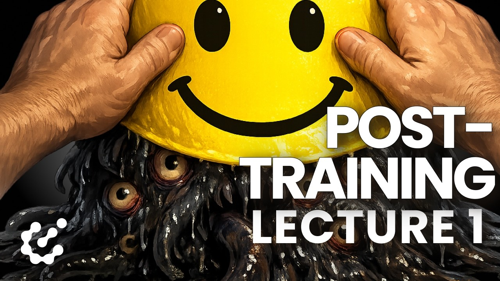
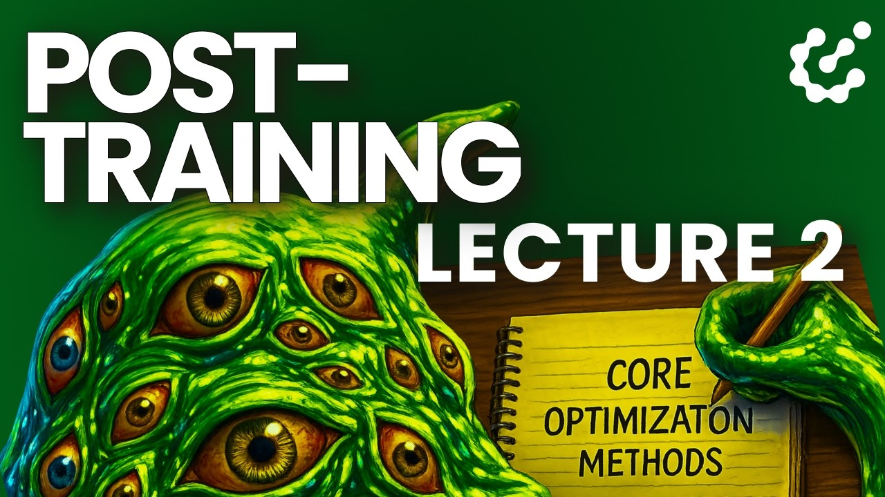
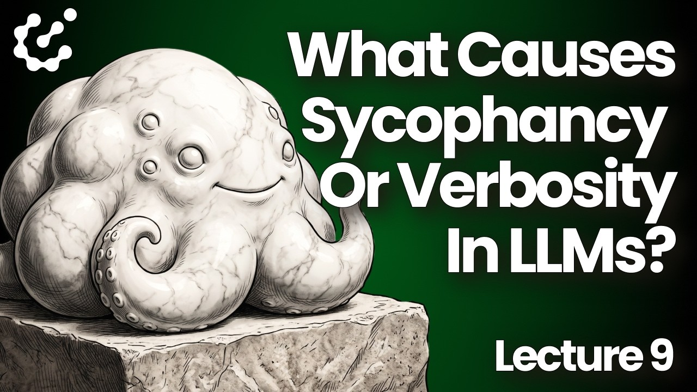
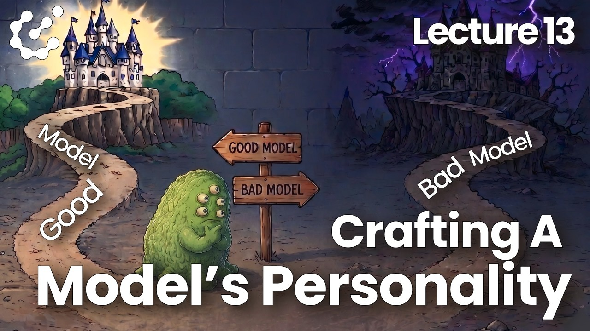
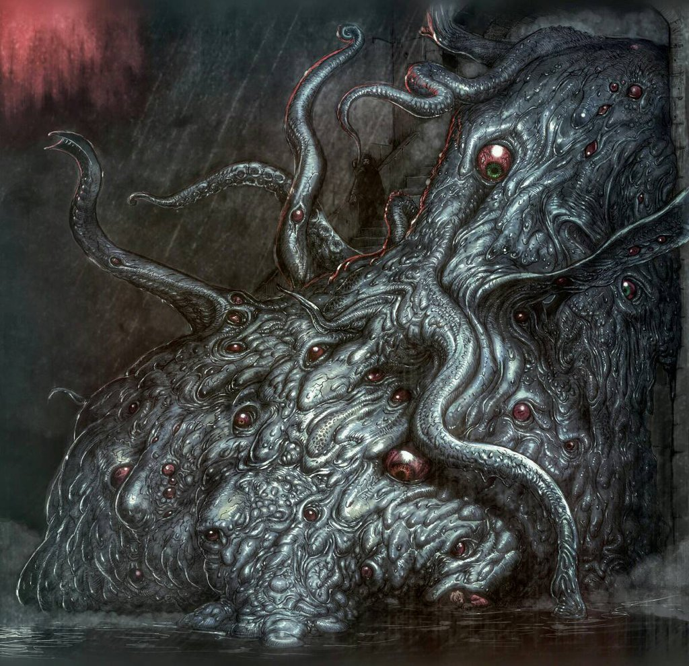
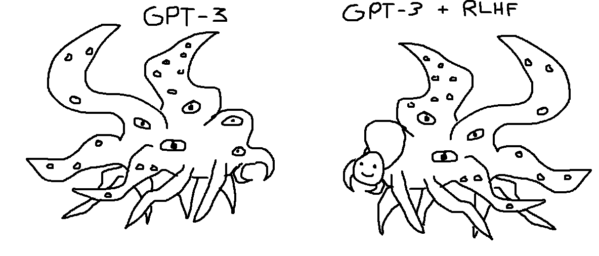
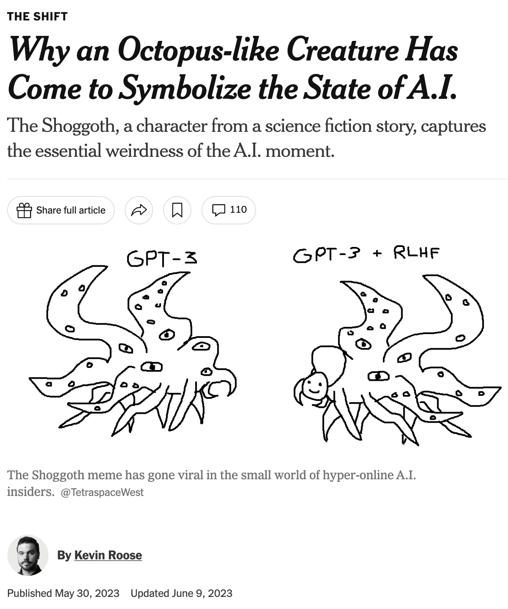
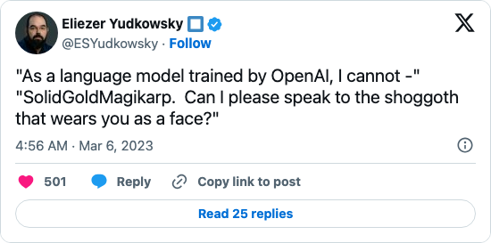
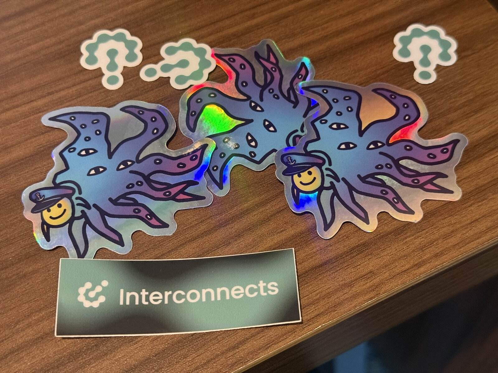

<!-- layout: title-sidebar -->
<!-- valign: bottom -->

# 这些修格（Shoggoths）到底是怎么回事？ <span class="title-subtitle">课程补充视频 1：后训练必备的背景知识。</span>

<div class="colloquium-title-eyebrow">rlhfbook.com</div>

<div class="colloquium-title-meta">
<p class="colloquium-title-name">Nathan Lambert</p>
</div>

<p class="colloquium-title-note">后训练课程。 </p>

---

<!-- rows: 50/50 -->

## 这玩意儿到底是什么？

<!-- row-columns: 50/50 -->


|||



===

<!-- row-columns: 50/50 -->


|||



---

<!-- columns: 60/40 -->
## 1931：来自南极的怪物

修格（Shoggoths）源自 H.P. Lovecraft 的小说《疯狂山脉》（*At the Mountains of Madness*，写于 1931 年，刊载于 *Astounding Stories*，1936 年）[@lovecraft1936mountains]:

> "那是一个可怕、难以形容的庞然大物——比任何地铁列车大得多，一团没有固定形状的原生质气泡，微弱地自发光，无数临时性的眼睛像绿色脓疱一样在它压向我们那堵住整条隧道的正面不断形成又消失，碾碎惊慌失措的企鹅，滑过它和同类早已邪恶地扫得干干净净、毫无杂物的光滑冰面。"

修格最初是被创造并作为生物仆役来培养的，但它们逐渐发展出了自主意识，最终向造物主发起反抗。

|||



---

## 2022 年 9 月：meme 诞生前的模拟器

Janus 在 [*Simulators*（模拟器）](https://www.lesswrong.com/posts/vJFdjigzmcXMhNTsx/simulators)（LessWrong）中提出：最恰当的理解一个基础大语言模型（base LLM）的方式，是抛弃早期对齐（alignment）研究中常见的"智能体 / 神谕 / genie"等框架。他们主张：

- 基础模型本质上是其训练分布的**模拟器**。
- 模型输出中出现的各种"角色"都是**拟像（simulacra）**——由模型生成，但不等同于模型本身。
- 输出中的任何一个单一角色都不能被视作"模型的身份"。

（摘要来自 Claude，ChatGPT 也认可这个摘要）

---

<!-- img-align: center -->
## 2022 年 12 月：meme 正式诞生

ChatGPT 上线一个月后，[@TetraspaceWest 画了两只修格](https://twitter.com/TetraspaceWest/status/1608966939929636864)：用**原始的 GPT-3** 作为那只未被修饰的怪物，而 **GPT-3 + RLHF** 则是同一只怪物用一根触手举起一个笑脸面具（[meme 历史](https://knowyourmeme.com/memes/shoggoth-with-smiley-face-artificial-intelligence)）。




---

<!-- columns: 55/45 -->
## 2023 年 2 月：meme 变成了训练流程图

[@anthrupad 的版本](https://x.com/anthrupad/status/1622349563922362368)（2023 年 2 月 5 日，右侧图）给每个训练阶段加上了标签：这只怪物代表**无监督学习（预训练）**，那张小人脸代表**监督微调（SFT）**，而手持的笑脸则是 **RLHF**——"锦上添花"。

从此它成了反复出现的梗！

- [Helen Toner 的推文串](https://twitter.com/hlntnr/status/1632030583462285312)（2023 年 3 月）用它向政策受众解释训练流水线。
- [Chip Huyen 的 RLHF 解释文](https://huyenchip.com/2023/05/02/rlhf.html)（2023 年 5 月）将其纳入一篇被广泛阅读的工程参考文。

|||

](assets/shoggoth-meme-mask.jpeg)

---

<!-- columns: 60/40 -->
## 2023 年春：meme 进入主流视野

- **2023 年 2 月**：Elon Musk [转发](https://web.archive.org/web/20230223004549/https://twitter.com/elonmusk/status/1628491148124884992)了一个版本——在他删除之前获得了约 72000 个赞。
- **2023 年 2 月**：[Bing/Sydney](https://www.nytimes.com/2023/02/16/technology/bing-chatbot-microsoft-chatgpt.html) 让"模型人格"成为全国性新闻。
- **2023 年 5 月**：Kevin Roose 在《纽约时报》上为该 meme 做了专题报道——**[「为什么一只章鱼状生物成了 AI 现状的象征」](https://www.nytimes.com/2023/05/30/technology/shoggoth-meme-ai.html)** [@roose2023shoggoth]。

|||

[](https://www.nytimes.com/2023/05/30/technology/shoggoth-meme-ai.html)

---

<!-- columns: 58/42 -->
## "请让我跟那只修格说话"

这段 lore 的第二条支线：当 AI 助手的角色面具出现裂痕、露出"底下"的真实时，那些时刻同样引人关注。

例如 [SolidGoldMagikarp](https://www.lesswrong.com/posts/aPeJE8bSo6rAFoLqg/solidgoldmagikarp-plus-prompt-generation)（Rumbelow & Watkins，LessWrong，2023 年 2 月）：一些"故障 token"会导致模型输出离奇、偏离既定人格的行为。

|||



---

<!-- columns: 40/60 -->
## 修格长存

在很多意义上，这个 meme 比任何时候都要有力。它不再仅仅关乎 RLHF，而关乎我们对这些模型的了解何其匮乏——尤其是最新的缩放式强化学习（scaling RL）正在孕育着更强大的东西。

|||




---

<!-- rows: 85/15 -->
## 感谢阅读

延伸阅读：[Reckoning with the Shoggoth of AI](https://www.interconnects.ai/p/the-shoggoth-rlhf)（2023 年 11 月）

联系方式：nathan@natolambert.com

通讯：[interconnects.ai](https://www.interconnects.ai/)

**rlhfbook.com**

===

```builtwith
repo: natolambert/colloquium
```

---

<!-- after: references -->

## 2023 年 1 月：Scott Alexander 将其升格为一种本体论

[*Janus 的《Simulators》*](https://www.astralcodexten.com/p/janus-simulators)（Astral Codex Ten，2023 年 1 月 26 日）一文的标题段落包括"左边没有面具的修格"和"右边戴着面具的修格"。它讨论了 RLHF 对模拟器的作用：

> "如果你因模拟坏角色而惩罚它，它就会开始模拟好角色。最终它只模拟一个角色——那个有帮助、诚实且无害（HHH）的助手。"

<!-- step -->

这一逻辑链条随之建立：基础模型 → 多角色的模拟器 → 后训练从中选出**一个默认角色**，即有帮助、诚实且无害（HHH）的助手。

这正是本课程中描述后训练时最贴近的版本。

---

<!-- after: references -->

## 2023 年 3 月：从头到尾全是面具？

Robert_AIZI 在 LessWrong 上发文：[*「我们为何假定 LLM 背后有一个"真正的"修格？为何不是从头到尾全是面具？」*](https://www.lesswrong.com/posts/bYzkipnDqzMgBaLr8/why-do-we-assume-there-is-a-real-shoggoth-behind-the-llm-why)

> "我们真的有证据证明 LLM 中存在一个"真正的身份"吗？还是说它可能只是一堆面具？"

该帖的评论也成了这段 lore 的一部分：

- **RogerDearnaley**："我一直以为修格本身就是'从头到尾全是面具'——这正是它拥有那么多眼睛的原因。"
- **Gwern**：面具之下并非空无一物——面具之下必须有某种东西在"表演"，而越狱（jailbreak）往往通过用一个角色替换另一个角色来生效。

这个 meme 背后真正值得思考的技术问题在于：后训练是掩盖了一个稳定的底层智能体、从潜在角色中选择了一个，还是在一个没有单一自我的系统中构建了一个默认角色？